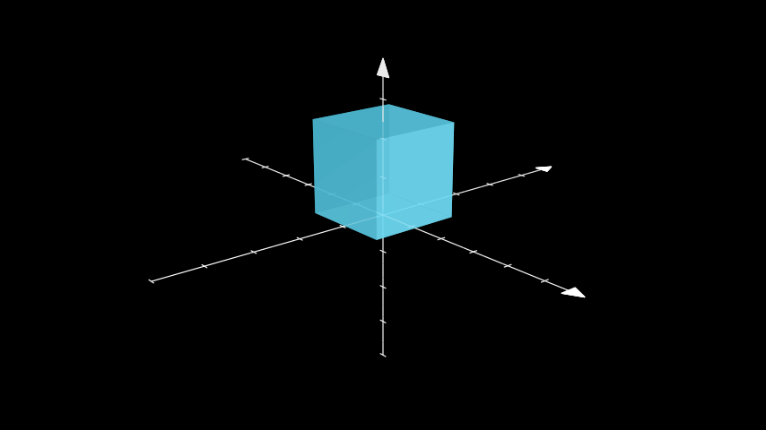
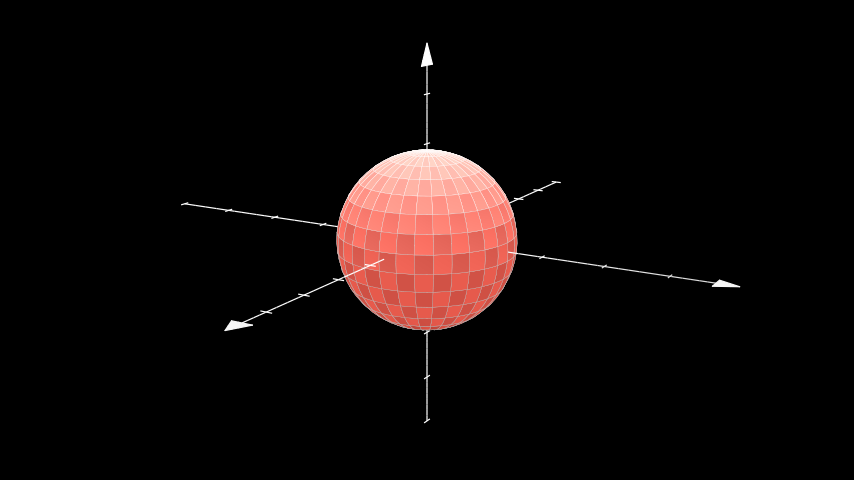
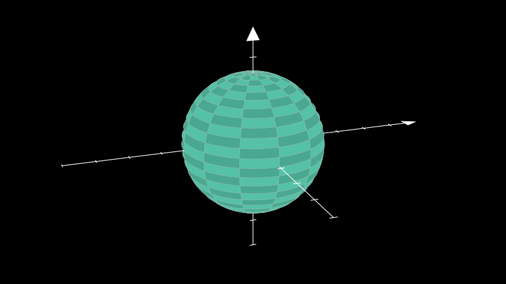
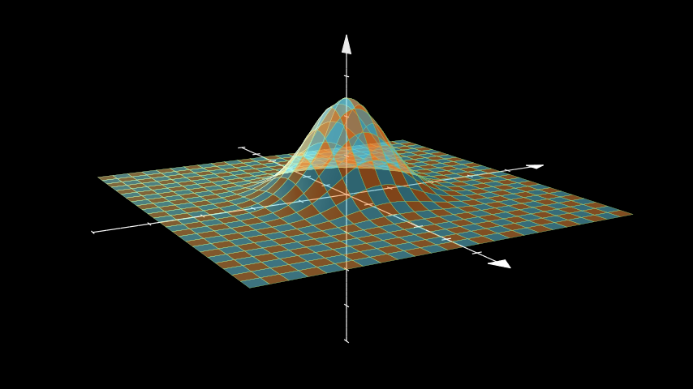
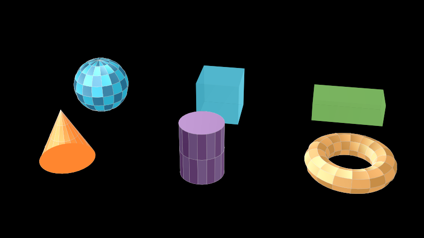
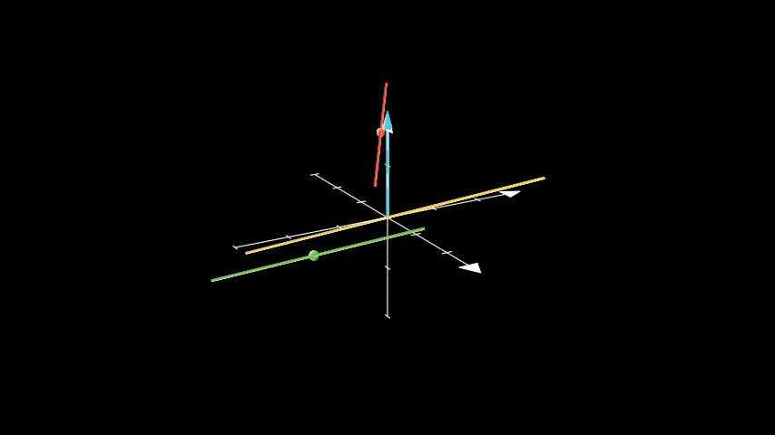
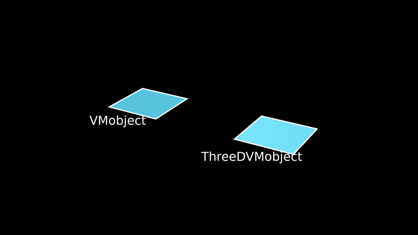
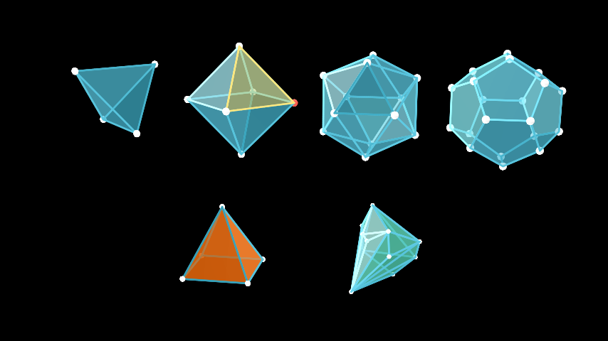
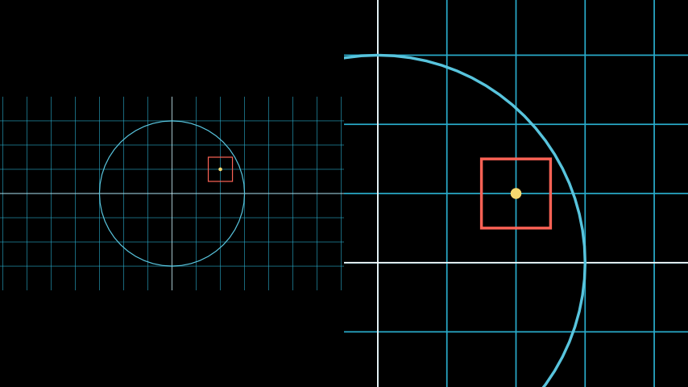
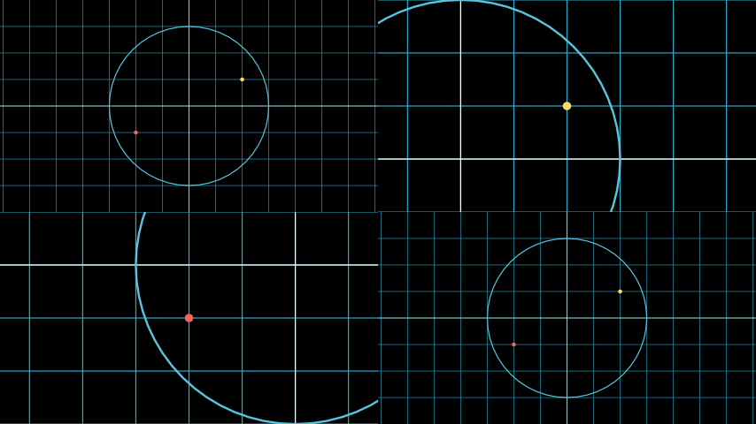

# Cameras and 3D scenes

Every scene looks at its mobjects through a camera. The camera decides
which part of the plane is visible, how big the picture is, and, in 3D,
from which direction you look. You rarely create a camera yourself: you
pick a scene class, and the scene creates the matching camera.

| Scene class | Camera class | What it adds |
|----|----|----|
| `Scene` | `CameraClass` | A fixed view of the frame. |
| `MovingCameraScene` | `MovingCameraClass` | A frame you can move, scale and animate: panning and zooming. |
| `ZoomedScene` | `MultiCameraClass` | A second camera whose view is shown in a “zoomed display” inset. |
| `ThreeDScene`, `SpecialThreeDScene` | `ThreeDCameraClass` | Spherical camera angles, perspective, depth sorting and shading. |
| `VectorScene`, `LinearTransformationScene` | `CameraClass` | Helpers for vectors and matrix transformations. |
| any scene with `camera_class = ...` | `MappingCameraClass`, `SplitScreenCameraClass`, `OldMultiCameraClass` | Warped views and several views side by side. |

Inside `construct()` the camera is `self$camera`. (Python manim code
often writes `self.renderer.camera`; `self$camera` is the same object,
and `self$renderer$camera` works too.)

Because 3D views need the camera of a `ThreeDScene`, every example in
this vignette is a scene. The
[`plot()`](https://rdrr.io/r/graphics/plot.default.html) method draws
with a plain 2D camera, which ignores depth: it is handy for 2D pictures
but shows a 3D mobject from straight above. To look at a 3D scene from
the console, plot one of its frames: `plot(scene_frame(MyScene, t = 2))`
draws the frame at two seconds with the scene’s own camera (see
[RStudio, knitr, Quarto and
Shiny](https://adamrsophie.github.io/manimR/articles/rstudio-knitr-shiny.md)).
Scenes without motion use the chunk option `save_last_frame = TRUE`, so
they appear as pictures even where the other scenes play as videos.

## Camera settings for any scene

The size of the picture and of the visible region are configuration
settings. Set them for the session with
[`manim_config()`](https://adamrsophie.github.io/manimR/reference/manim_config.md),
for one render with
[`render()`](https://adamrsophie.github.io/manimR/reference/render.md),
or for the chunks of a document with `knitr::opts_chunk$set()`:

``` r

manim_config(background_color = "#1C1C2E")     # every scene from now on
render(MyScene, quality = "m", background_color = WHITE, frame_rate = 24)
render(MyScene, pixel_width = 1080, pixel_height = 1080)  # a square video
```

| Setting | Meaning |
|----|----|
| `background_color`, `background_opacity` | The color behind the mobjects (`transparent = TRUE` renders without one). |
| `pixel_width`, `pixel_height`, `frame_rate` | The video size and frame rate; `quality` sets all three at once. |
| `frame_width` | The visible width in scene units, 14.22 at every quality; the camera derives the height from the pixel aspect ratio (8 at 16:9, 14.22 for a square video). |

The same values can be given to the camera of a single scene class by
overriding `initialize()`: arguments that the scene does not use itself
are passed to its camera. This is also the way to set a
`background_image`, a PNG file or an array of values from 0 to 1 that
replaces the background color (drawn pixel for pixel from the top left
corner, as in manim):

``` r

BackgroundImage <- R6::R6Class("BackgroundImage", inherit = Scene,
  public = list(
    initialize = function(...) {
      h <- config$pixel_height
      w <- config$pixel_width
      shade <- matrix(seq(0.35, 0, length.out = h), h, w)
      sky <- array(c(shade * 0.4, shade * 0.6, shade + 0.15), c(h, w, 3))
      super$initialize(background_image = sky, ...)
    },
    construct = function() {
      moon <- Circle(radius = 1, color = YELLOW_A)$set_fill(YELLOW_A, opacity = 1)$shift(3 * RIGHT + 1.5 * UP)
      set.seed(4)
      stars <- VGroup(lapply(1:40, function(i) Dot(c(runif(1, -7, 7), runif(1, -4, 4), 0), radius = 0.025)))
      self$add(stars)
      self$play(FadeIn(moon, shift = DOWN), run_time = 1.5)
    }
  )
)
```

Inside `construct()`, `self$camera$set_background(pixel_array)` and
`self$camera$set_background_from_func(f)` replace the background with an
image computed in R. `f` receives the coordinates `c(x, y)` of a pixel
and returns its color as `c(red, green, blue, alpha)` between 0 and 1;
it is called once per pixel, so it takes a moment at high quality.

``` r

RadialBackground <- R6::R6Class("RadialBackground", inherit = Scene,
  public = list(construct = function() {
    self$camera$set_background_from_func(function(xy) {
      r <- min(sqrt(sum(xy^2)) / 8, 1)
      c(0.15 * (1 - r), 0.1 + 0.25 * (1 - r), 0.05 + 0.35 * (1 - r), 1)
    })
    square <- Square(side_length = 3, color = WHITE)$set_fill(ORANGE, opacity = 0.8)
    self$play(DrawBorderThenFill(square), run_time = 1.5)
  })
)
```

## Moving the camera in 2D

A `MovingCameraScene` has a `MovingCameraClass` camera whose visible
region is a rectangle mobject, `self$camera$frame`. Moving, scaling or
animating the frame pans and zooms; everything else in the scene stays
where it is. The frame is an ordinary mobject, so `save_state()` and
[`Restore()`](https://adamrsophie.github.io/manimR/reference/transform.md)
work on it.

``` r

ZoomInOut <- R6::R6Class("ZoomInOut", inherit = MovingCameraScene,
  public = list(construct = function() {
    square <- Square(side_length = 3, color = BLUE)$set_fill(BLUE, opacity = 0.3)
    dot <- Dot(square$get_corner(UR), color = YELLOW)
    self$add(square, dot)
    self$camera$frame$save_state()
    self$play(self$camera$frame$animate$scale(0.4)$move_to(dot), run_time = 1.5)
    self$play(dot$animate$shift(0.5 * LEFT), run_time = 0.8)
    self$play(Restore(self$camera$frame), run_time = 1.5)
  })
)
```

`self$camera$frame$animate$set(width = 4)` sets the visible width
directly, and the camera methods `get_frame_width()`,
`get_frame_height()`, `get_frame_center()`, `set_frame_width()`,
`set_frame_height()` and `set_frame_center()` read or change the frame
without animation. `is_in_frame(mob)` tells whether a mobject is at
least partly visible.

### Following a mobject

An updater on the frame makes the camera follow a moving mobject. This
is upstream’s classic example: the camera zooms in on a dot, rides along
the graph with it, and zooms out again.

``` r

FollowingGraphCamera <- R6::R6Class("FollowingGraphCamera", inherit = MovingCameraScene,
  public = list(construct = function() {
    self$camera$frame$save_state()
    ax <- Axes(x_range = c(-1, 10), y_range = c(-1, 10))
    graph <- ax$plot(function(x) sin(x), color = BLUE, x_range = c(0, 3 * PI))
    moving_dot <- Dot(ax$i2gp(graph$t_min, graph), color = ORANGE)
    dot_1 <- Dot(ax$i2gp(graph$t_min, graph))
    dot_2 <- Dot(ax$i2gp(graph$t_max, graph))
    self$add(ax, graph, dot_1, dot_2, moving_dot)
    self$play(self$camera$frame$animate$scale(0.5)$move_to(moving_dot), run_time = 1)
    follow <- function(mob) mob$move_to(moving_dot$get_center())
    self$camera$frame$add_updater(follow)
    self$play(MoveAlongPath(moving_dot, graph, rate_func = linear), run_time = 2)
    self$camera$frame$remove_updater(follow)
    self$play(Restore(self$camera$frame), run_time = 1)
  })
)
```

### Fitting the view to mobjects

`self$camera$auto_zoom(mobjects, margin)` returns an animation that
moves and scales the frame so the mobjects just fit, plus `margin`. With
`animate = FALSE` it moves the frame at once instead, and
`only_mobjects_in_frame = TRUE` ignores mobjects that are off screen.

``` r

AutoZoom <- R6::R6Class("AutoZoom", inherit = MovingCameraScene,
  public = list(construct = function() {
    small <- VGroup(Square(side_length = 0.6, color = RED), Circle(radius = 0.3, color = YELLOW))
    small$arrange(RIGHT, buff = 0.3)$shift(4 * LEFT + 2 * DOWN)
    big <- Star(color = BLUE)$scale(1.5)$shift(3 * RIGHT + UP)
    self$add(small, big)
    self$play(self$camera$auto_zoom(small, margin = 0.5), run_time = 1.5)
    self$play(self$camera$auto_zoom(list(small, big), margin = 1), run_time = 1.5)
  })
)
```

## Zoomed scenes

A `ZoomedScene` adds a second camera, `self$zoomed_camera`, whose view
is shown in an inset, `self$zoomed_display`. The zoomed camera’s frame
(a rectangle in the scene) marks what is magnified. `activate_zooming()`
turns both on (with `animate = TRUE` it also plays the zoom in and pop
out animations); `get_zoomed_display_pop_out_animation()` animates the
display growing out of the frame.

The settings are arguments of the scene’s `initialize()`, so a scene
that wants other values overrides it: `zoom_factor` (size of the zoomed
frame relative to the display, 0.15 by default),
`zoomed_display_height`, `zoomed_display_width`, `zoomed_display_center`
or `zoomed_display_corner`, `zoomed_display_corner_buff`,
`image_frame_stroke_width`, `zoomed_camera_frame_starting_position`,
`zoomed_camera_config` (arguments of the zoomed `MovingCameraClass`) and
`zoomed_camera_image_mobject_config`.

This is a shortened version of upstream’s `MovingZoomedSceneAround`:

``` r

MovingZoomedSceneAround <- R6::R6Class("MovingZoomedSceneAround", inherit = ZoomedScene,
  public = list(
    initialize = function(...) {
      super$initialize(zoom_factor = 0.3, zoomed_display_height = 1, zoomed_display_width = 6,
                       image_frame_stroke_width = 20,
                       zoomed_camera_config = list(default_frame_stroke_width = 3), ...)
    },
    construct = function() {
      dot <- Dot()$shift(UL * 2)
      image <- ImageMobject(matrix(c(0, 100, 30, 200, 255, 0, 5, 33), 2, byrow = TRUE))
      image$height <- 7
      frame_text <- Text("Frame", color = PURPLE, font_size = 67)
      zoomed_camera_text <- Text("Zoomed camera", color = RED, font_size = 67)
      self$add(image, dot)
      frame <- self$zoomed_camera$frame
      zoomed_display <- self$zoomed_display
      zoomed_display_frame <- zoomed_display$display_frame
      frame$move_to(dot)
      frame$set_color(PURPLE)
      zoomed_display_frame$set_color(RED)
      zoomed_display$shift(DOWN)
      zd_rect <- BackgroundRectangle(zoomed_display, fill_opacity = 0, buff = MED_SMALL_BUFF)
      self$add_foreground_mobject(zd_rect)
      unfold_camera <- UpdateFromFunc(zd_rect, function(rect) rect$replace(zoomed_display))
      frame_text$next_to(frame, DOWN)
      self$play(Create(frame), FadeIn(frame_text, shift = UP), run_time = 1)
      self$activate_zooming()
      self$play(self$get_zoomed_display_pop_out_animation(), unfold_camera, run_time = 1)
      zoomed_camera_text$next_to(zoomed_display_frame, DOWN)
      self$play(FadeIn(zoomed_camera_text, shift = UP), FadeOut(frame_text), run_time = 0.8)
      self$play(frame$animate$shift(2.5 * DOWN), FadeOut(zoomed_camera_text), run_time = 1.5)
    }
  )
)
```

`get_zoom_factor()` returns the current magnification ratio and
`get_zoom_in_animation()` the animation that
`activate_zooming(animate = TRUE)` plays first.

The zoomed display is an
[`ImageMobjectFromCamera()`](https://adamrsophie.github.io/manimR/reference/image_mobject.md),
drawn by the scene’s `MultiCameraClass` camera. You can build the same
picture in picture by hand in any `MovingCameraScene` that uses a
`MultiCameraClass` camera:

``` r

PictureInPicture <- R6::R6Class("PictureInPicture", inherit = MovingCameraScene,
  public = list(
    default_camera_class = function() MultiCameraClass,
    construct = function() {
      grid <- NumberPlane()
      target <- Star(color = YELLOW)$scale(0.4)$shift(2 * LEFT + DOWN)
      self$add(grid, target)
      inset_camera <- MovingCameraClass$new(default_frame_stroke_width = 3)
      inset_camera$frame$set(height = 2)$move_to(target)
      inset <- ImageMobjectFromCamera(inset_camera)
      inset$add_display_frame()
      inset$set(height = 3)$to_corner(UR)
      self$camera$add_image_mobject_from_camera(inset)
      self$add(inset_camera$frame, inset)
      self$play(Rotate(target, angle = PI), run_time = 1.5)
    }
  )
)
```

`MultiCameraClass$new(image_mobjects_from_cameras, allow_cameras_to_capture_their_own_display)`
is the camera; `add_image_mobject_from_camera()` registers more displays
later. A display that stays a rectangle (also rotated or flipped) shows
the view as sharp vector graphics; a sheared display shows the sub
camera’s pixels mapped onto its shape, as in Python manim.

## 3D scenes

A `ThreeDScene` looks at the scene from a point on a sphere around the
frame center:

- `phi` is the polar angle, measured from the z axis: `phi = 0` looks
  straight down (the default, so a 3D scene starts out looking like a 2D
  one), `phi = 90 * DEGREES` looks horizontally;
- `theta` is the azimuth, the angle around the z axis (`-90 * DEGREES`
  by default, which puts the x axis horizontal);
- `gamma` rolls the camera about its line of sight;
- `zoom` magnifies the picture;
- `focal_distance` sets the strength of the perspective (smaller is
  stronger);
- `frame_center` is the 3D point at the center of the screen.

`set_camera_orientation()` sets any of them at once. Angles are in
radians; multiply degrees by `DEGREES`.

``` r

CameraOrientation <- R6::R6Class("CameraOrientation", inherit = ThreeDScene,
  public = list(construct = function() {
    axes <- ThreeDAxes()
    cube <- Cube(side_length = 2, fill_color = BLUE)$shift(OUT)
    self$set_camera_orientation(phi = 70 * DEGREES, theta = -40 * DEGREES, zoom = 0.9)
    self$add(axes, cube)
  })
)
```



### Text that ignores the camera

Titles and labels usually should not be rotated with the scene.
`add_fixed_in_frame_mobjects()` pins mobjects to the screen, as if they
were drawn on the camera lens. `add_fixed_orientation_mobjects()` keeps
mobjects facing the viewer while their position follows the 3D scene,
which suits axis labels. `remove_fixed_in_frame_mobjects()` and
`remove_fixed_orientation_mobjects()` undo them.

``` r

FixedInFrameMObjectTest <- R6::R6Class("FixedInFrameMObjectTest", inherit = ThreeDScene,
  public = list(construct = function() {
    axes <- ThreeDAxes()
    self$set_camera_orientation(phi = 75 * DEGREES, theta = -45 * DEGREES)
    text3d <- Text("This is a 3D text")
    self$add_fixed_in_frame_mobjects(text3d)
    text3d$to_corner(UL)
    x_label <- Text("x", color = YELLOW)$move_to(axes$c2p(6.6, 0, 0))
    z_label <- Text("z", color = YELLOW)$move_to(axes$c2p(0.6, 0, 3.6))
    self$add_fixed_orientation_mobjects(x_label, z_label)
    self$add(axes)
    self$begin_ambient_camera_rotation(rate = 0.4)
    self$wait(1.5)
  })
)
```

### Moving the camera

`move_camera()` animates the camera to new angles (any of `phi`,
`theta`, `gamma`, `zoom`, `focal_distance` and `frame_center`), together
with any animations in `added_anims`.
`begin_ambient_camera_rotation(rate, about)` keeps turning the camera
(about `"theta"`, `"phi"` or `"gamma"`) until
`stop_ambient_camera_rotation()`. This is upstream’s
`ThreeDCameraRotation`:

``` r

ThreeDCameraRotation <- R6::R6Class("ThreeDCameraRotation", inherit = ThreeDScene,
  public = list(construct = function() {
    axes <- ThreeDAxes()
    circle <- Circle()
    self$set_camera_orientation(phi = 75 * DEGREES, theta = 30 * DEGREES)
    self$add(circle, axes)
    self$begin_ambient_camera_rotation(rate = 0.5)
    self$wait(1.5)
    self$stop_ambient_camera_rotation()
    self$move_camera(phi = 60 * DEGREES, theta = -60 * DEGREES, gamma = 10 * DEGREES, zoom = 1.3,
                     run_time = 1.5)
  })
)
```

`begin_3dillusion_camera_rotation(rate)` wobbles the camera on a small
ellipse instead, which gives a sense of depth without turning the scene
away; `stop_3dillusion_camera_rotation()` ends it.

``` r

ThreeDCameraIllusionRotation <- R6::R6Class("ThreeDCameraIllusionRotation", inherit = ThreeDScene,
  public = list(construct = function() {
    axes <- ThreeDAxes()
    circle <- Circle()
    self$set_camera_orientation(phi = 75 * DEGREES, theta = 30 * DEGREES)
    self$add(circle, axes)
    self$begin_3dillusion_camera_rotation(rate = 2)
    self$wait(PI / 2)
    self$stop_3dillusion_camera_rotation()
  })
)
```

The angles live in value trackers on the camera (`phi_tracker`,
`theta_tracker`, `gamma_tracker`, `zoom_tracker`,
`focal_distance_tracker`), read with `get_phi()`, `get_theta()`,
`get_gamma()`, `get_zoom()` and `get_focal_distance()` and set without
animation with `set_phi()`, `set_theta()`, `set_gamma()`, `set_zoom()`
and `set_focal_distance()`; the scene’s `camera_tracker("theta")`
returns one of the trackers. `project_point(p)` gives the screen
position of a 3D point under the current view. Animating a tracker
yourself, for example
`self$play(self$camera$theta_tracker$animate$set_value(PI))`, is the
same as `move_camera()`.

### Light and shading

Mobjects with `shade_in_3d = TRUE` (all surfaces and the faces of
solids) are sorted by depth and shaded by how much they face the light
source, `self$camera$light_source`, a point you can move. This is
upstream’s `ThreeDLightSourcePosition`, lit from below:

``` r

ThreeDLightSourcePosition <- R6::R6Class("ThreeDLightSourcePosition", inherit = ThreeDScene,
  public = list(construct = function() {
    axes <- ThreeDAxes()
    sphere <- Surface(
      function(u, v) c(1.5 * cos(u) * cos(v), 1.5 * cos(u) * sin(v), 1.5 * sin(u)),
      v_range = c(0, TAU), u_range = c(-PI / 2, PI / 2),
      checkerboard_colors = c(RED_D, RED_E), resolution = c(15, 32)
    )
    self$camera$light_source$move_to(3 * IN)
    self$set_camera_orientation(phi = 75 * DEGREES, theta = 30 * DEGREES)
    self$add(axes, sphere)
  })
)
```



The shading itself is
[`get_shaded_rgb()`](https://adamrsophie.github.io/manimR/reference/get_shaded_rgb.md):
a color brightens when its surface faces the light and darkens when it
faces away.

``` r

blue <- c(0.2, 0.4, 0.8)
get_shaded_rgb(blue, point = ORIGIN, unit_normal_vect = OUT, light_source = 10 * OUT)
#> [1] 0.7 0.9 1.3
get_shaded_rgb(blue, point = ORIGIN, unit_normal_vect = IN, light_source = 10 * OUT)
#> [1] -0.05  0.15  0.55
```

Arguments of `initialize()` are passed to the `ThreeDCameraClass`
camera: `should_apply_shading = FALSE` turns shading off,
`light_source_start_point` moves the light,
`exponential_projection = TRUE` uses a softer perspective, and `phi`,
`theta`, `gamma`, `zoom`, `focal_distance` and `frame_center` set the
starting view.

``` r

FlatLook <- R6::R6Class("FlatLook", inherit = ThreeDScene,
  public = list(
    initialize = function(...) super$initialize(should_apply_shading = FALSE, ...),
    construct = function() self$add(Sphere())
  )
)
```

### Default angles and `SpecialThreeDScene`

`set_to_default_angled_camera_orientation()` sets the angles stored in
the scene’s `default_angled_camera_orientation_kwargs` (`phi` 70 and
`theta` -135 degrees). `SpecialThreeDScene` adds ready made pieces:
`get_axes()`, `get_sphere()` (a radius 2 sphere, coarser at low
quality), `get_default_camera_position()` and
`set_camera_to_default_position()`. Its `initialize()` takes
`camera_config`, `three_d_axes_config`, `sphere_config`,
`default_angled_camera_position` and `low_quality_config`.

``` r

SpecialScene <- R6::R6Class("SpecialScene", inherit = SpecialThreeDScene,
  public = list(construct = function() {
    self$set_camera_to_default_position()
    self$add(self$get_axes(), self$get_sphere(checkerboard_colors = c(TEAL_D, TEAL_E)))
  })
)
```



## Surfaces and 3D plots

`Surface(func, u_range, v_range, resolution)` draws a parametric
surface: `func(u, v)` returns a point `c(x, y, z)`. The surface is made
of `resolution` (one number or `c(u, v)`) small faces colored
alternately with `checkerboard_colors`; `fill_color`, `fill_opacity`,
`stroke_color` and `stroke_width` style them.
`set_fill_by_checkerboard()` recolors the faces afterwards. This is
upstream’s Gaussian surface:

``` r

ThreeDSurfacePlot <- R6::R6Class("ThreeDSurfacePlot", inherit = ThreeDScene,
  public = list(construct = function() {
    self$set_camera_orientation(phi = 75 * DEGREES, theta = -30 * DEGREES)
    param_gauss <- function(u, v) {
      sigma <- 0.4
      c(u, v, exp(-(u^2 + v^2) / (2 * sigma^2)))
    }
    gauss_plane <- Surface(param_gauss, resolution = c(24, 24), v_range = c(-2, 2), u_range = c(-2, 2))
    gauss_plane$scale(2, about_point = ORIGIN)
    gauss_plane$set_style(fill_opacity = 1, stroke_color = GREEN)
    gauss_plane$set_fill_by_checkerboard(ORANGE, BLUE, opacity = 0.5)
    axes <- ThreeDAxes()
    self$add(axes, gauss_plane)
  })
)
```



[`ThreeDAxes()`](https://adamrsophie.github.io/manimR/reference/coordinate_systems.md)
has the methods of `Axes` (see [Graphs, plots and coordinate
systems](https://adamrsophie.github.io/manimR/articles/graphing.md))
plus a z axis (`z_range`, `z_length`, `z_axis_config`).
`axes$plot_surface(f, u_range, v_range)` draws `z = f(x, y)` in the
axes’ coordinates, and its `colorscale` argument colors the faces by
height (for example `colorscale = c(BLUE, TEAL, YELLOW, RED)`).
`set_fill_by_value(axes, colorscale, axis)` does the same for any
surface; `axis` is 1, 2 or 3 for x, y or z, and `colorscale` is a vector
of colors spread over the axis range, or a list of `list(color, value)`
pairs. `get_axis_labels()` of `ThreeDAxes` also labels the z axis.

``` r

SurfacePlot <- R6::R6Class("SurfacePlot", inherit = ThreeDScene,
  public = list(construct = function() {
    axes <- ThreeDAxes(x_range = c(-3, 3, 1), y_range = c(-3, 3, 1), z_range = c(-1, 1, 0.5),
                       x_length = 6, y_length = 6, z_length = 3)
    wave <- axes$plot_surface(function(x, y) sin(x) * cos(y), u_range = c(-3, 3), v_range = c(-3, 3),
                              resolution = c(18, 18), fill_opacity = 0.9)
    wave$set_fill_by_value(axes = axes, axis = 3,
                           colorscale = list(list(BLUE, -1), list(TEAL, -0.3), list(YELLOW, 0.3), list(RED, 1)))
    self$set_camera_orientation(phi = 65 * DEGREES, theta = -50 * DEGREES, zoom = 0.9)
    self$add(axes, wave)
    self$begin_ambient_camera_rotation(rate = 0.3)
    self$wait(1.5)
  })
)
```

## 3D mobjects

All of these are mobjects like any other: they move, rotate, scale and
animate. Each has an R6 class generator with the suffix `Class`
(`SurfaceClass`, `SphereClass`, `Dot3DClass`, `CubeClass`, `PrismClass`,
`ConeClass`, `CylinderClass`, `Line3DClass`, `Arrow3DClass`,
`TorusClass`, `ThreeDVMobjectClass`, `PolyhedronClass`) for subclassing,
and the help pages are
[`?three_dimensions`](https://adamrsophie.github.io/manimR/reference/three_dimensions.md)
and
[`?polyhedra`](https://adamrsophie.github.io/manimR/reference/polyhedra.md).
The curved ones are `Surface`s, so they accept `resolution`,
`checkerboard_colors` and the surface style arguments; lower resolutions
draw faster.

| Constructor | Main arguments |
|----|----|
| [`Sphere()`](https://adamrsophie.github.io/manimR/reference/three_dimensions.md) | `center`, `radius`, `resolution`, `u_range`, `v_range` (partial spheres) |
| [`Dot3D()`](https://adamrsophie.github.io/manimR/reference/three_dimensions.md) | `point`, `radius`, `color` |
| [`Cube()`](https://adamrsophie.github.io/manimR/reference/three_dimensions.md) | `side_length`, `fill_color`, `fill_opacity`, `stroke_width` |
| [`Prism()`](https://adamrsophie.github.io/manimR/reference/three_dimensions.md) | `dimensions = c(x, y, z)` |
| [`Cone()`](https://adamrsophie.github.io/manimR/reference/three_dimensions.md) | `base_radius`, `height`, `direction`, `show_base` |
| [`Cylinder()`](https://adamrsophie.github.io/manimR/reference/three_dimensions.md) | `radius`, `height`, `direction`, `show_ends` |
| [`Torus()`](https://adamrsophie.github.io/manimR/reference/three_dimensions.md) | `major_radius`, `minor_radius` |
| [`Line3D()`](https://adamrsophie.github.io/manimR/reference/three_dimensions.md) | `start`, `end`, `thickness`, `color` |
| [`Arrow3D()`](https://adamrsophie.github.io/manimR/reference/three_dimensions.md) | `start`, `end`, `thickness`, `height` and `base_radius` of the tip |
| [`ThreeDVMobject()`](https://adamrsophie.github.io/manimR/reference/three_dimensions.md) | any `VMobject` arguments; shaded in 3D |

``` r

Solids <- R6::R6Class("Solids", inherit = ThreeDScene,
  public = list(construct = function() {
    self$set_camera_orientation(phi = 60 * DEGREES, theta = -80 * DEGREES)
    sphere <- Sphere(radius = 1, resolution = c(16, 8))$move_to(c(-4.5, 1.8, 0))
    cube <- Cube(side_length = 1.5, fill_color = BLUE)$move_to(c(0, 1.8, 0))
    prism <- Prism(dimensions = c(2.4, 1.2, 0.8), fill_color = GREEN)$move_to(c(4.5, 1.8, 0))
    cone <- Cone(base_radius = 0.9, height = 1.8, show_base = TRUE, resolution = c(4, 16),
                 fill_color = ORANGE)$move_to(c(-4.5, -1.8, 0))
    cylinder <- Cylinder(radius = 0.7, height = 1.8, resolution = c(2, 16), fill_color = PURPLE,
                         checkerboard_colors = c(PURPLE_D, PURPLE_E))$
      move_to(c(0, -1.8, 0))
    torus <- Torus(major_radius = 1, minor_radius = 0.35, resolution = c(16, 8),
                   checkerboard_colors = c(GOLD_D, GOLD_E))$move_to(c(4.5, -1.8, 0))
    self$add(sphere, cube, prism, cone, cylinder, torus)
  })
)
```



Lines and arrows are thin cylinders.
`Line3D_parallel_to(line, point, length)` and
`Line3D_perpendicular_to(line, point, length)` (upstream’s class methods
`Line3D.parallel_to()` and `Line3D.perpendicular_to()`) make a new line
through `point`.
[`Dot3D()`](https://adamrsophie.github.io/manimR/reference/three_dimensions.md)
is a small sphere that marks a point.

``` r

Lines3D <- R6::R6Class("Lines3D", inherit = ThreeDScene,
  public = list(construct = function() {
    self$set_camera_orientation(phi = 70 * DEGREES, theta = -30 * DEGREES)
    axes <- ThreeDAxes(x_range = c(-3, 3, 1), y_range = c(-3, 3, 1), z_range = c(-2, 2, 1),
                       x_length = 6, y_length = 6, z_length = 4)
    line <- Line3D(start = c(-2, -2, -1), end = c(2, 2, 1), color = YELLOW, resolution = 8)
    parallel <- Line3D_parallel_to(line, point = c(1, -2, 0), length = 4, color = GREEN, resolution = 8)
    perpendicular <- Line3D_perpendicular_to(line, point = c(-2, 1, 1), length = 3, color = RED,
                                             resolution = 8)
    arrow <- Arrow3D(start = ORIGIN, end = c(0, 0, 2), color = BLUE, resolution = 8)
    dots <- VGroup(Dot3D(c(1, -2, 0), color = GREEN), Dot3D(c(-2, 1, 1), color = RED))
    self$add(axes, line, parallel, perpendicular, arrow, dots)
  })
)
```



[`ThreeDVMobject()`](https://adamrsophie.github.io/manimR/reference/three_dimensions.md)
is a `VMobject` with `shade_in_3d = TRUE`: give it points and it is
depth sorted and shaded like the faces of a solid. Any `VMobject` can be
made 3D with `set_shade_in_3d(TRUE)`.

``` r

ShadedFace <- R6::R6Class("ShadedFace", inherit = ThreeDScene,
  public = list(construct = function() {
    self$set_camera_orientation(phi = 65 * DEGREES, theta = -60 * DEGREES)
    corners <- rbind(c(-1, -1, 0), c(1, -1, 0), c(1, 1, 0), c(-1, 1, 0), c(-1, -1, 0))
    flat <- VMobject(fill_color = BLUE, fill_opacity = 1)$set_points_as_corners(corners)$shift(2.5 * LEFT)
    shaded <- ThreeDVMobject(fill_color = BLUE, fill_opacity = 1)$set_points_as_corners(corners)$
      shift(2.5 * RIGHT)
    self$add(flat, shaded)
    self$add_fixed_orientation_mobjects(
      Text("VMobject", font_size = 30)$move_to(flat$get_center() + 1.8 * DOWN),
      Text("ThreeDVMobject", font_size = 30)$move_to(shaded$get_center() + 1.8 * DOWN)
    )
  })
)
```



### Polyhedra

[`Tetrahedron()`](https://adamrsophie.github.io/manimR/reference/polyhedra.md),
[`Octahedron()`](https://adamrsophie.github.io/manimR/reference/polyhedra.md),
[`Icosahedron()`](https://adamrsophie.github.io/manimR/reference/polyhedra.md)
and
[`Dodecahedron()`](https://adamrsophie.github.io/manimR/reference/polyhedra.md)
are the platonic solids, sized by `edge_length`.
`Polyhedron(vertex_coords, faces_list)` builds any polyhedron from a
matrix of vertices and a list of faces (1 based vertex indices, as in
the OFF file format), and `ConvexHull3D(points)` wraps a cloud of
points. The faces are in `$faces` and the vertices and edges in
`$graph`, a
[`Graph()`](https://adamrsophie.github.io/manimR/reference/GenericGraphClass.md);
style them with `faces_config` and `graph_config`, or afterwards through
those fields.

Each vertex is a small
[`Dot3D()`](https://adamrsophie.github.io/manimR/reference/three_dimensions.md)
sphere. A scene with many vertices draws faster with coarser ones, set
through `graph_config`:

``` r

PolyhedraGallery <- R6::R6Class("PolyhedraGallery", inherit = ThreeDScene,
  public = list(construct = function() {
    self$set_camera_orientation(phi = 75 * DEGREES, theta = -80 * DEGREES)
    coarse <- list(vertex_config = list(resolution = c(4, 4)))
    solids <- list(
      Tetrahedron(edge_length = 2, graph_config = coarse),
      Octahedron(edge_length = 1.8, graph_config = coarse),
      Icosahedron(edge_length = 1.3, graph_config = coarse),
      Dodecahedron(edge_length = 0.9, graph_config = coarse)
    )
    xs <- c(-4.5, -1.5, 1.5, 4.5)
    for (k in seq_along(solids)) solids[[k]]$move_to(c(xs[k], 0, 1.6))
    solids[[2]]$faces[3]$set_color(YELLOW)
    solids[[2]]$graph[1]$set_color(RED)
    pyramid <- Polyhedron(
      rbind(c(1, 1, 0), c(1, -1, 0), c(-1, -1, 0), c(-1, 1, 0), c(0, 0, 2)),
      list(c(1, 2, 5), c(2, 3, 5), c(3, 4, 5), c(4, 1, 5), c(1, 2, 3, 4)),
      faces_config = list(fill_color = ORANGE, fill_opacity = 0.7), graph_config = coarse
    )$scale(0.8)$move_to(c(-2, 0, -1.8))
    set.seed(3)
    cloud <- matrix(rnorm(45), ncol = 3)
    hull <- ConvexHull3D(cloud, faces_config = list(fill_color = TEAL, fill_opacity = 0.6),
                         graph_config = coarse)$scale(0.6)$move_to(c(2, 0, -1.8))
    self$add(VGroup(solids), pyramid, hull)
  })
)
```



## Linear algebra: `VectorScene` and `LinearTransformationScene`

`LinearTransformationScene` sets up a gray background plane, a blue
plane on top of it that gets transformed, and the basis vectors i hat
(green) and j hat (red). Mobjects added with
`add_transformable_mobject()`, `add_vector()` or `add_unit_square()`
move with every transformation; `add_background_mobject()` and
`add_foreground_mobject()` add mobjects that stay put. Then:

- `apply_matrix(m)` animates the linear map `m` (a 2 x 2 R matrix, so
  `matrix(c(1, 0, 1, 1), 2)` is the shear with columns (1, 0) and (1,
  1));
- `apply_transposed_matrix(t_m)` takes the matrix by rows, as
  3Blue1Brown’s old code did; `apply_inverse()` and
  `apply_inverse_transpose()` undo a map;
- `apply_nonlinear_transformation(f)` and `apply_function(f)` animate
  any function of points.

Each of these takes `run_time` (3 seconds by default) and `added_anims`.
Options of the scene go to `initialize()`: `show_basis_vectors`,
`show_coordinates`, `leave_ghost_vectors` (keep faded copies of the
vectors after each step), `include_background_plane`,
`include_foreground_plane`, `background_plane_kwargs`,
`foreground_plane_kwargs`, `i_hat_color`, `j_hat_color` and
`basis_vector_stroke_width`.

``` r

Shear <- R6::R6Class("Shear", inherit = LinearTransformationScene,
  public = list(
    initialize = function(...) super$initialize(leave_ghost_vectors = TRUE, ...),
    construct = function() {
      self$add_unit_square()
      self$add_vector(c(-1, 2), color = YELLOW)
      self$add_transformable_mobject(Circle(radius = 0.5, color = PINK)$move_to(c(2, 1, 0)))
      self$apply_matrix(matrix(c(1, 0, 1, 1), 2), run_time = 1.5)
      # The rotation matrix(c(0, 1, -1, 0), 2), given by rows:
      self$apply_transposed_matrix(matrix(c(0, -1, 1, 0), 2), run_time = 1.5)
    }
  )
)
```

The basis vectors use the colors `X_COLOR` (green) and `Y_COLOR` (red);
`Z_COLOR` (blue) completes the set for 3D.
`get_unit_square(color, opacity, stroke_width)` returns the unit square
without adding it, `get_matrix_transformation(m)` returns the map as a
function of points, and `get_ghost_vectors()` the faded copies.

``` r

Warp <- R6::R6Class("Warp", inherit = LinearTransformationScene,
  public = list(
    initialize = function(...) super$initialize(show_basis_vectors = FALSE, ...),
    construct = function() {
      self$apply_nonlinear_transformation(function(p) {
        p + c(0.3 * sin(p[2]), 0.3 * sin(p[1]), 0)
      }, run_time = 2)
    }
  )
)
```

`VectorScene` is the simpler base class, with helpers that draw:
`add_plane()` and `add_axes()`, `get_vector(coords)` (an arrow on
`self$plane`), `add_vector()` (with `animate = TRUE` it grows the
arrow), `get_basis_vectors()`, `label_vector()` and
`get_vector_label()`, `get_basis_vector_labels()`,
`write_vector_coordinates()`, the animated explanations
`coords_to_vector()` and `vector_to_coords()`, and
`show_ghost_movement()`. The labels and coordinates are typeset with
LaTeX:

``` r

VectorCoordinates <- R6::R6Class("VectorCoordinates", inherit = VectorScene,
  public = list(construct = function() {
    self$plane <- self$add_plane()$fade(0.5)
    v <- self$add_vector(c(2, 1), color = YELLOW, animate = FALSE)
    self$label_vector(v, "v", animate = FALSE)
    self$add(self$get_basis_vectors(), self$get_basis_vector_labels())
    self$vector_to_coords(v, clean_up = FALSE)
  })
)
```

`LinearTransformationScene` adds LaTeX labels that follow the
transformations too: `add_title()` writes a title in the foreground,
`add_transformable_label(vector, label)` labels a vector and rewrites
the label as `L(v)` when a transformation is applied, and
`add_moving_mobject()` moves a mobject’s center through the map.
`lock_in_faded_grid()` draws a faded grid once into the camera’s
background image, which keeps it out of the per frame work.

## More cameras

Every camera class also has a constructor function:
[`Camera()`](https://adamrsophie.github.io/manimR/reference/CameraClass.md),
[`MovingCamera()`](https://adamrsophie.github.io/manimR/reference/MovingCameraClass.md),
[`ThreeDCamera()`](https://adamrsophie.github.io/manimR/reference/ThreeDCameraClass.md),
[`MultiCamera()`](https://adamrsophie.github.io/manimR/reference/MultiCameraClass.md),
[`MappingCamera()`](https://adamrsophie.github.io/manimR/reference/MappingCameraClass.md),
[`OldMultiCamera()`](https://adamrsophie.github.io/manimR/reference/MappingCameraClass.md)
and
[`SplitScreenCamera()`](https://adamrsophie.github.io/manimR/reference/MappingCameraClass.md).
A scene takes the class generator (for example `MappingCameraClass`) as
its `camera_class` and builds its own camera from it; the constructors
make cameras that you hand to another camera, such as the halves of a
split screen below.

### MappingCamera

`MappingCameraClass` draws every point through a function. The scene
itself is unchanged; only the view is bent. Curves are subdivided first
(`min_num_curves`) so straight lines bend smoothly.

``` r

WavyView <- R6::R6Class("WavyView", inherit = Scene,
  public = list(
    initialize = function(...) {
      super$initialize(camera_class = MappingCameraClass,
                       mapping_func = function(p) p + c(0.3 * sin(2 * p[2]), 0.3 * sin(2 * p[1]), 0), ...)
    },
    construct = function() {
      self$add(NumberPlane())
      self$play(Create(Square(side_length = 3, color = YELLOW)), run_time = 1.5)
    }
  )
)
```

### SplitScreenCamera and OldMultiCamera

`SplitScreenCameraClass` shows two cameras side by side, each in half of
the picture; giving it two `MovingCameraClass` cameras lets each half
frame its own region. `OldMultiCameraClass` is the general version: it
composites any number of cameras, each at a pixel offset given as
`list(camera, c(start_y, start_x))`.

``` r

SplitScreen <- R6::R6Class("SplitScreen", inherit = Scene,
  public = list(
    initialize = function(...) {
      left <- MovingCamera()
      right <- MovingCamera()
      right$frame$scale(0.35)$move_to(c(2, 1, 0))
      super$initialize(camera_class = SplitScreenCameraClass, left_camera = left, right_camera = right, ...)
    },
    construct = function() {
      self$add(NumberPlane(), Circle(radius = 3, color = BLUE), Dot(c(2, 1, 0), color = YELLOW),
               Square(side_length = 1, color = RED)$move_to(c(2, 1, 0)))
    }
  )
)
```



`OldMultiCameraClass` takes the cameras and their pixel offsets
directly. Here four cameras, each a quarter of the picture, look at the
same scene; two of them zoom in.

``` r

FourViews <- R6::R6Class("FourViews", inherit = Scene,
  public = list(
    initialize = function(...) {
      w <- config$pixel_width %/% 2
      h <- config$pixel_height %/% 2
      cams <- lapply(1:4, function(i) MovingCamera(pixel_width = w, pixel_height = h))
      cams[[2]]$frame$scale(0.5)$move_to(c(2, 1, 0))
      cams[[3]]$frame$scale(0.5)$move_to(c(-2, -1, 0))
      super$initialize(camera_class = OldMultiCameraClass, cameras_with_start_positions = list(
        list(cams[[1]], c(0, 0)), list(cams[[2]], c(0, w)),
        list(cams[[3]], c(h, 0)), list(cams[[4]], c(h, w))
      ), ...)
    },
    construct = function() {
      self$add(NumberPlane(), Circle(radius = 3, color = BLUE), Dot(c(2, 1, 0), color = YELLOW),
               Dot(c(-2, -1, 0), color = RED))
    }
  )
)
```



### Background colored mobjects

`BackgroundColoredVMobjectDisplayer` is upstream’s helper for mobjects
that take their colors from an image (`color_using_background_image()`).
The manimR camera draws such mobjects itself, so you only need this
class to get the same result as a pixel array.
