# Colors, images, SVG and point clouds

This vignette covers everything about color in manimR, and the mobjects
that are not made of Bezier paths drawn by hand: raster images, imported
SVG files and clouds of points. For the shapes themselves, see [Mobjects
and
geometry](https://adamrsophie.github.io/manimR/articles/mobjects.md).

## How colors are stored

A color in manimR is a hex string such as `"#58C4DD"`. Every argument
that takes a color (`color`, `fill_color`, `stroke_color`, …) accepts
such a string, a manim color name, or any color R knows:

``` r

BLUE
#> [1] "#58C4DD"
Circle(color = BLUE)$get_color()
#> [1] "#58C4DD"
Circle(color = "blue_d")$get_color()   # manim names, any case
#> [1] "#29ABCA"
Circle(color = "tomato")$get_color()   # R color names
#> [1] "#FF6347"
Circle(color = "#FF8800")$get_color()
#> [1] "#FF8800"
```

Upstream manim wraps every color in a `ManimColor` object. manimR has
that class too (see [ManimColor objects](#manimcolor-objects)), but
plain strings are what mobjects store, so colors print, compare and
combine like any other R strings.

## Named colors

The standard manim palette comes in families with five shades, from `_A`
(lightest) to `_E` (darkest). The name without a suffix is the `_C`
shade: `BLUE` is `BLUE_C`. Gray is spelled both ways (`GRAY_A` and
`GREY_A`).

To draw the swatches below, this small helper uses base graphics. It
labels each swatch in black or white, whichever contrasts better, using
the `contrasting()` method of a `ManimColor`.

``` r

show_swatches <- function(cols, ncol = 5, cex = 0.7, show_hex = TRUE) {
  n <- length(cols)
  nrow <- ceiling(n / ncol)
  op <- par(mar = c(0, 0, 0, 0))
  on.exit(par(op))
  plot.new()
  plot.window(c(0, ncol), c(0, nrow), xaxs = "i", yaxs = "i")
  i <- seq_len(n) - 1
  x <- i %% ncol
  y <- nrow - 1 - i %/% ncol
  rect(x + 0.03, y + 0.06, x + 0.97, y + 0.94, col = unlist(cols), border = "grey85")
  ink <- vapply(cols, function(cl) as.character(ManimColor(cl)$contrasting()), "")
  text(x + 0.5, y + if (show_hex) 0.62 else 0.5, names(cols), cex = cex, col = ink)
  if (show_hex) text(x + 0.5, y + 0.36, unlist(cols), cex = cex * 0.9, col = ink)
}
```

``` r

families <- c("BLUE", "TEAL", "GREEN", "YELLOW", "GOLD", "RED", "MAROON", "PURPLE", "GRAY")
shades <- unlist(lapply(families, function(f) paste0(f, "_", c("A", "B", "C", "D", "E"))))
show_swatches(mget(shades, envir = asNamespace("manimR")), ncol = 5)
```

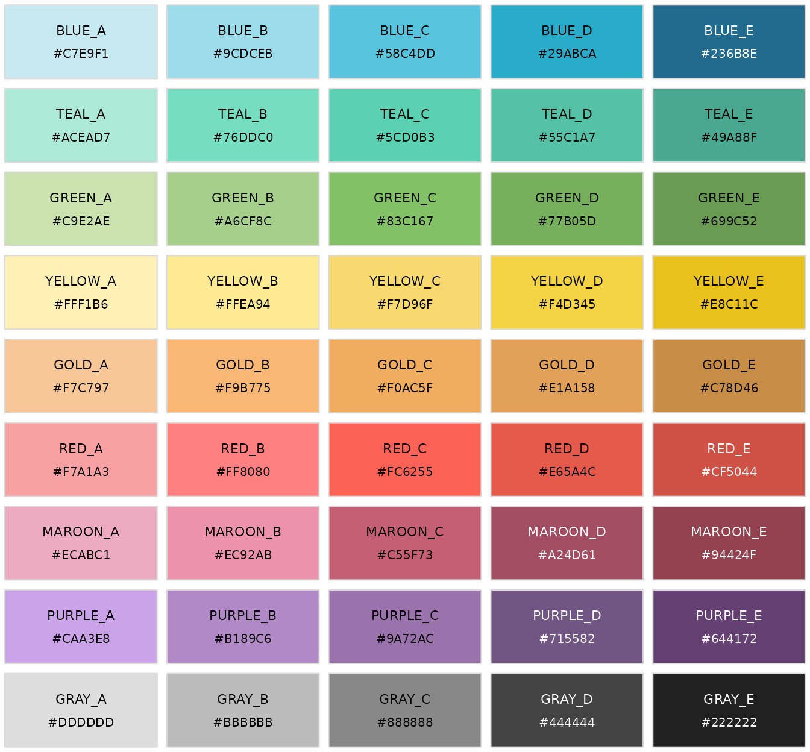

The remaining named colors are the grays, the pure primaries, a few
singles and the colors of the manim logo:

``` r

others <- c("WHITE", "LIGHTER_GRAY", "LIGHT_GRAY", "GRAY", "DARK_GRAY", "DARKER_GRAY", "BLACK",
            "PURE_RED", "PURE_GREEN", "PURE_BLUE", "PURE_CYAN", "PURE_MAGENTA", "PURE_YELLOW",
            "DARK_BLUE", "PINK", "LIGHT_PINK", "ORANGE", "LIGHT_BROWN", "DARK_BROWN", "GRAY_BROWN",
            "LOGO_WHITE", "LOGO_GREEN", "LOGO_BLUE", "LOGO_RED", "LOGO_BLACK")
show_swatches(mget(others, envir = asNamespace("manimR")), ncol = 7, cex = 0.62)
```

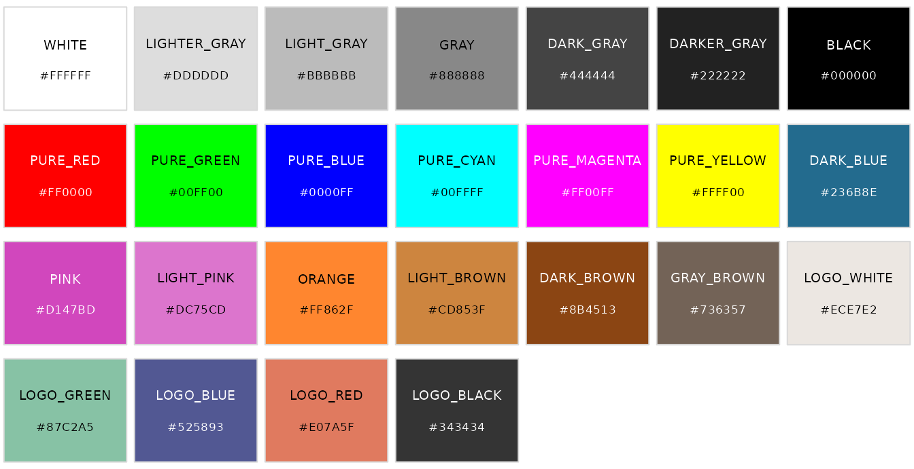

`LIGHTER_GREY`, `LIGHT_GREY`, `GREY`, `DARK_GREY`, `DARKER_GREY` and
`GREY_BROWN` are the same colors under their British spelling.

## Color palettes

Six larger palettes from upstream’s color modules are named lists of hex
strings. Pick a color with `$`, as in `XKCD$AVOCADO`. `X11_COLORS` is
upstream’s `X11` (renamed so it does not mask
[`grDevices::X11()`](https://rdrr.io/r/grDevices/x11.html)).

``` r

palettes <- list(X11_COLORS = X11_COLORS, XKCD = XKCD, SVGNAMES = SVGNAMES,
                 DVIPSNAMES = DVIPSNAMES, AS2700 = AS2700, BS381 = BS381)
vapply(palettes, length, integer(1))
#> X11_COLORS       XKCD   SVGNAMES DVIPSNAMES     AS2700      BS381 
#>        504        922        151         68        206        287
XKCD$AVOCADO
#> [1] "#90B134"
SVGNAMES$CORNFLOWERBLUE
#> [1] "#6395ED"
head(names(AS2700))
#> [1] "B11_RICH_BLUE"   "B12_ROYAL_BLUE"  "B13_NAVY_BLUE"   "B14_SAPHHIRE"   
#> [5] "B15_MID_BLUE"    "B21_ULTRAMARINE"
head(names(BS381))
#> [1] "BS381_101"      "SKY_BLUE"       "BS381_102"      "TURQUOISE_BLUE"
#> [5] "BS381_103"      "PEACOCK_BLUE"
```

- `X11_COLORS` and `SVGNAMES`: the X11 and SVG named colors.
- `XKCD`: the color names of the xkcd color survey.
- `DVIPSNAMES`: the colors of LaTeX’s `dvipsnames` option.
- `AS2700`: the Australian standard colors (codes such as
  `B11_RICH_BLUE`).
- `BS381`: the British standard colors, by number (`BS381_101`) and by
  name.

Six evenly spaced samples from each palette:

``` r

samples <- unlist(lapply(names(palettes), function(p) {
  pal <- palettes[[p]]
  pick <- pal[round(seq(1, length(pal), length.out = 6))]
  setNames(pick, paste0(p, "$\n", names(pick)))
}), recursive = FALSE)
show_swatches(samples, ncol = 6, cex = 0.58, show_hex = FALSE)
```

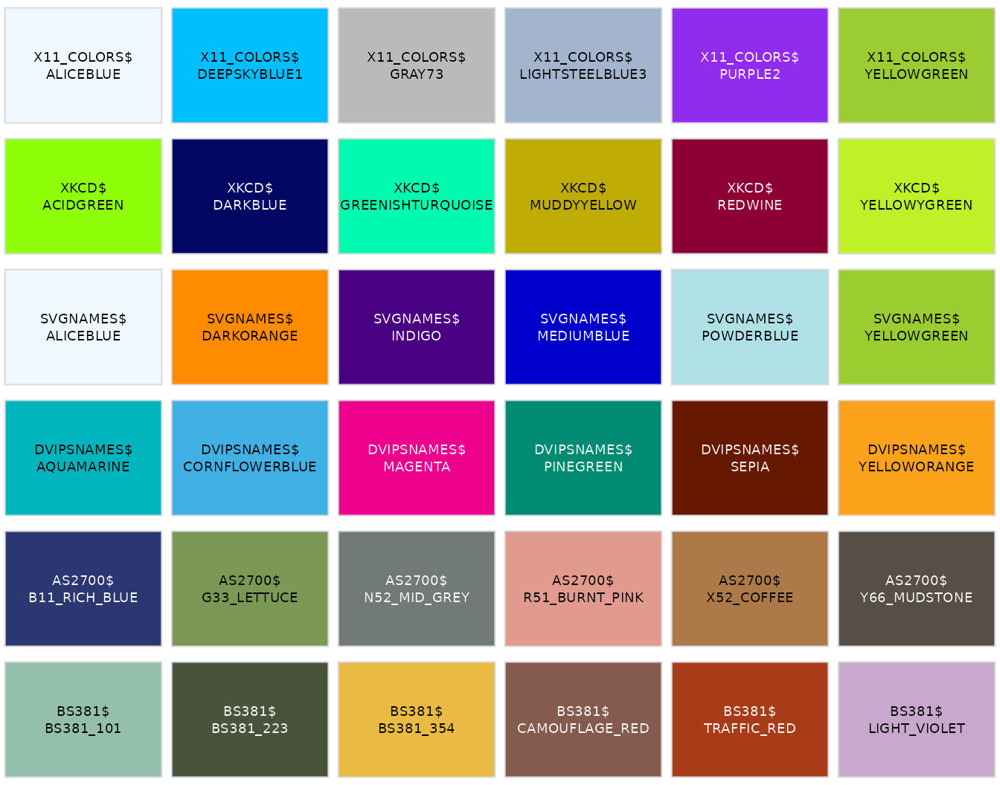

The list `color` mirrors upstream’s `color` module, so ported code such
as `color.X11.BEIGE` becomes `color$X11$BEIGE`:

``` r

color$X11$BEIGE
#> [1] "#F5F5DC"
color$BLUE_C
#> [1] "#58C4DD"
```

## Parsing and converting colors

[`manim_color()`](https://adamrsophie.github.io/manimR/reference/manim_color.md)
turns anything color like into an uppercase hex string: manim names (in
any case), hex strings starting with `#`, and R color names. The
`color_to_*` and `*_to_color` functions convert between hex and numeric
channels in `[0, 1]`.

``` r

manim_color("red")
#> [1] "#FC6255"
manim_color("blue_d")
#> [1] "#29ABCA"
manim_color("tomato")
#> [1] "#FF6347"
color_to_rgb(BLUE)
#> [1] 0.3450980 0.7686275 0.8666667
color_to_rgba(BLUE, alpha = 0.5)
#> [1] 0.3450980 0.7686275 0.8666667 0.5000000
rgb_to_color(c(1, 0.5, 0))
#> ManimColor('#FF7F00')
rgba_to_color(c(1, 0.5, 0, 0.5))
#> ManimColor('#FF7F00')
```

More conversions handle integer channels (0 to 255), hex and HSV (hue,
saturation and value, each in `[0, 1]`):

``` r

color_to_int_rgb(BLUE)
#> [1]  88 196 221
color_to_int_rgba(BLUE, alpha = 0.5)
#> [1]  88 196 221 127
rgb_to_hex(c(1, 0, 0))
#> ManimColor('#FF0000')
hex_to_rgb("#58C4DD")
#> [1] 0.3450980 0.7686275 0.8666667
color_to_hsv(BLUE)
#>         h         s         v 
#> 0.5313283 0.6018100 0.8666667
color_from_hsv(0.5, 1, 1)
#> ManimColor('#00FFFF')
```

## Color arithmetic

[`interpolate_color()`](https://adamrsophie.github.io/manimR/reference/interpolate_color.md)
blends two colors and
[`color_gradient()`](https://adamrsophie.github.io/manimR/reference/interpolate_color.md)
spreads any number of colors over a sequence.
[`average_color()`](https://adamrsophie.github.io/manimR/reference/interpolate_color.md)
averages several colors,
[`invert_color()`](https://adamrsophie.github.io/manimR/reference/interpolate_color.md)
takes the complement, and
[`lighter_color()`](https://adamrsophie.github.io/manimR/reference/interpolate_color.md)
and
[`darker_color()`](https://adamrsophie.github.io/manimR/reference/interpolate_color.md)
blend toward white or black.

``` r

interpolate_color(RED, BLUE, 0.5)
#> ManimColor('#AA9399')
color_gradient(c(RED, YELLOW, GREEN), 5)
#> [1] "#FC6255" "#F99D62" "#F7D96F" "#BDCD6B" "#83C167"
average_color(RED, BLUE, GREEN)
#> ManimColor('#9DA288')
invert_color(RED)
#> ManimColor('#029DAA')
lighter_color(RED, blend = 0.3)
#> ManimColor('#FC9188')
darker_color(RED, blend = 0.3)
#> ManimColor('#B0443B')
```

The picture shows a gradient of 24 steps and a ladder of lighter and
darker versions of `BLUE`.

``` r

bar <- VGroup(lapply(color_gradient(c(BLUE, GREEN, YELLOW, RED), 24), function(cl) {
  Rectangle(width = 0.45, height = 1, stroke_width = 0, fill_color = cl, fill_opacity = 1)
}))$arrange(RIGHT, buff = 0)
blends <- c(seq(0.8, 0.2, by = -0.2), 0, seq(0.2, 0.8, by = 0.2))
ladder <- VGroup(lapply(seq_along(blends), function(i) {
  cl <- if (i < 5) darker_color(BLUE, blends[i]) else if (i == 5) BLUE else lighter_color(BLUE, blends[i])
  Square(side_length = 0.9, stroke_width = 0, fill_color = cl, fill_opacity = 1)
}))$arrange(RIGHT, buff = 0.1)
plot(VGroup(bar, ladder)$arrange(DOWN, buff = 0.6))
```

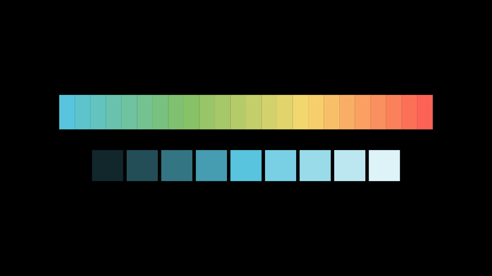

### Random colors

[`random_color()`](https://adamrsophie.github.io/manimR/reference/interpolate_color.md)
picks one of the manim colors and
[`random_bright_color()`](https://adamrsophie.github.io/manimR/reference/interpolate_color.md)
blends a random one halfway to white. They use R’s random number
generator, so [`set.seed()`](https://rdrr.io/r/base/Random.html) makes
them repeatable.
[`RandomColorGenerator()`](https://adamrsophie.github.io/manimR/reference/RandomColorGenerator.md)
has its own stream: with a seed it repeats the same sequence without
touching R’s global seed. Its `next_color()` method (also callable as
`` gen$`next`() ``, since [`next`](https://rdrr.io/r/base/Control.html)
is reserved in R) returns the next color, chosen from `sample_colors`
when given. Its generator is `RandomColorGeneratorClass`.

``` r

set.seed(1)
random_color()
#> [1] "#9A72AC"
random_bright_color()
#> ManimColor('#909090')
gen <- RandomColorGenerator(seed = 42)
c(gen$next_color(), gen$`next`(), gen$next_color())
#> [1] "#E07A5F" "#9A72AC" "#444444"
again <- RandomColorGenerator(seed = 42)
again$next_color() # the same first color
#> ManimColor('#E07A5F')
traffic <- RandomColorGenerator(seed = 1, sample_colors = c(RED, YELLOW, GREEN))
replicate(5, traffic$next_color())
#> [1] "#FC6255" "#83C167" "#FC6255" "#F7D96F" "#FC6255"
```

## ManimColor objects

[`ManimColor()`](https://adamrsophie.github.io/manimR/reference/ManimColor.md)
(also called
[`RGBA()`](https://adamrsophie.github.io/manimR/reference/ManimColor.md))
builds upstream’s color object. It is a hex string with an exact RGBA
value attached, so it works anywhere a color does, and it brings
upstream’s methods through `$`. It accepts names, hex strings (with `#`
or `0x`), integers such as `0xFF0000`, and three or four channels,
either in `[0, 1]` or as integers from 0 to 255.

``` r

ManimColor("#FF0000")
#> ManimColor('#FF0000')
ManimColor("blue_d")
#> ManimColor('#29ABCA')
ManimColor(0x00FF00)
#> ManimColor('#00FF00')
ManimColor(c(1, 0.5, 0))
#> ManimColor('#FF7F00')
ManimColor(c(255L, 128L, 0L))
#> ManimColor('#FF8000')
RGBA(c(1, 0, 0, 0.5))
#> ManimColor('#FF0000')
Square(color = ManimColor(0x00FF00))$get_color()
#> [1] "#00FF00"
```

### Conversions

``` r

red <- ManimColor("#FF0000")
red$to_rgb()
#> [1] 1 0 0
red$to_int_rgb()
#> [1] 255   0   0
red$to_rgba()
#> [1] 1 0 0 1
red$to_int_rgba()
#> [1] 255   0   0 255
red$to_rgba_with_alpha(0.5)
#> [1] 1.0 0.0 0.0 0.5
red$to_int_rgba_with_alpha(0.5)
#> [1] 255   0   0 127
red$to_hex()
#> [1] "#FF0000"
red$to_hex(with_alpha = TRUE)
#> [1] "#FF0000FF"
red$to_hsv()
#> [1] 0 1 1
red$to_hsl()
#> [1] 0.0 1.0 0.5
red$to_integer()
#> [1] 16711680
as.integer(red)
#> [1] 16711680
as.character(red)
#> [1] "#FF0000"
format(red)
#> [1] "#FF0000"
```

### Methods that return new colors

`invert()`,
[`interpolate()`](https://adamrsophie.github.io/manimR/reference/interpolate.md),
`darker()`, `lighter()`, `contrasting()`, `opacity()` and `into()` all
return a new color and leave the original alone. `contrasting()` returns
white for dark colors and black for light ones (or the `light` and
`dark` colors you pass), and `into()` converts to another color class
such as `HSVClass`.

``` r

red$invert()
#> ManimColor('#00FFFF')
red$interpolate(ManimColor(BLUE), 0.5)
#> ManimColor('#AB626E')
red$darker(0.4)
#> ManimColor('#990000')
red$lighter(0.4)
#> ManimColor('#FF6666')
ManimColor(YELLOW)$contrasting()
#> ManimColor('#000000')
ManimColor(DARK_BLUE)$contrasting()
#> ManimColor('#FFFFFF')
red$opacity(0.3)$to_rgba()
#> [1] 1.0 0.0 0.0 0.3
red$into(HSVClass)
#> HSV('#FF0000')
```

A mobject stores plain hex strings, so wrap one to use the methods:

``` r

sq <- Square(color = TEAL)
ManimColor(sq$get_color())$darker()
#> ManimColor('#49A68F')
```

### Arithmetic and comparison

Arithmetic works channel by channel, with numbers or other colors.
Channels are not clipped, as in upstream, so keep results inside the
valid range (for example by averaging rather than adding two colors).

``` r

(ManimColor(BLUE) + ManimColor(RED)) / 2
#> ManimColor('#AA9399')
ManimColor(BLUE) * 0.5
#> ManimColor('#2C626E')
ManimColor(BLUE) - 0.1
#> ManimColor('#3EAAC3')
ManimColor(BLUE) == ManimColor("#58C4DD")
#> [1] TRUE
!ManimColor(BLUE)          # inversion
#> ManimColor('#A73A21')
ManimColor(0xFF0000) | ManimColor(0x0000FF) # combines the integer values
#> ManimColor('#FF00FF')
```

### Class methods

Upstream’s class methods live on the generator `ManimColorClass`:

``` r

ManimColorClass$from_rgb(c(1, 0, 0))
#> ManimColor('#FF0000')
ManimColorClass$from_rgba(c(1, 0, 0, 0.5))
#> ManimColor('#FF0000')
ManimColorClass$from_hex("#00FF00", alpha = 0.5)
#> ManimColor('#00FF00')
ManimColorClass$from_hsv(c(0.5, 1, 1))
#> ManimColor('#00FFFF')
ManimColorClass$from_hsl(c(0.5, 1, 0.5))
#> ManimColor('#00FEFF')
ManimColorClass$parse(c(RED, BLUE))
#> [[1]]
#> ManimColor('#FC6255')
#> 
#> [[2]]
#> ManimColor('#58C4DD')
ManimColorClass$gradient(c(RED, BLUE), 3)
#> [[1]]
#> ManimColor('#FC6255')
#> 
#> [[2]]
#> ManimColor('#AA9399')
#> 
#> [[3]]
#> ManimColor('#58C4DD')
ManimColorDType
#> [1] "double"
```

### HSV colors

[`HSV()`](https://adamrsophie.github.io/manimR/reference/ManimColor.md)
holds a color as hue, saturation and value. Read or set the channels
with `$hue`, `$saturation` and `$value` (or `$h`, `$s`, `$v`), and the
color updates. `HSVClass` has the same class methods as
`ManimColorClass`.

``` r

h <- HSV(c(0.25, 1, 1))
h
#> HSV('#7FFF00')
h$hue <- 0.5
h
#> HSV('#00FFFF')
h$saturation
#> [1] 1
as.character(h)
#> [1] "#00FFFF"
HSVClass$from_rgb(c(1, 0, 0))
#> HSV('#FF0000')
```

Varying the hue gives a quick rainbow:

``` r

hues <- seq(0, 1, length.out = 13)[-13]
rainbow_dots <- VGroup(lapply(hues, function(hh) Dot(radius = 0.35, color = as.character(HSV(c(hh, 0.7, 1))))))
plot(rainbow_dots$arrange_in_grid(rows = 2, buff = 0.3))
```

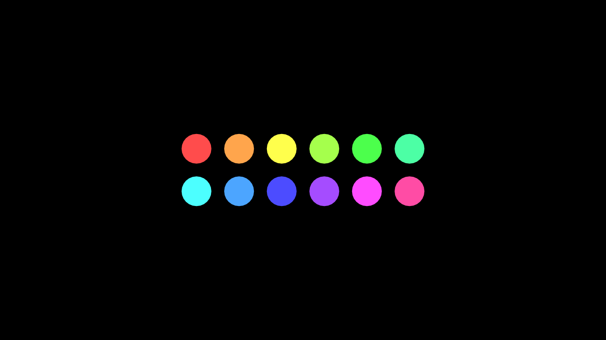

## Coloring mobjects

The basic methods are `set_color()` (fill and stroke), `set_fill()` and
`set_stroke()`; they are covered in [Mobjects and
geometry](https://adamrsophie.github.io/manimR/articles/mobjects.md).
This section is about the ways to put more than one color on a mobject.

### Gradients

Give `set_color()`, `set_fill()` or `set_stroke()` several colors and
the fill or stroke becomes a linear gradient. The gradient runs along
the mobject’s `sheen_direction` (`UL` by default; change it with
`set_sheen_direction()`).

``` r

a <- Square()$set_fill(c(RED, BLUE), opacity = 1)
b <- Square(stroke_width = 0)$set_fill(c(RED, BLUE), opacity = 1)$set_sheen_direction(RIGHT)
cc <- Circle()$set_fill(YELLOW, opacity = 1)$set_stroke(c(GREEN, PURPLE), width = 14)
d <- Star(fill_opacity = 1)$set_color(c(PINK, YELLOW))
plot(VGroup(a, b, cc, d)$arrange(RIGHT, buff = 0.6))
```

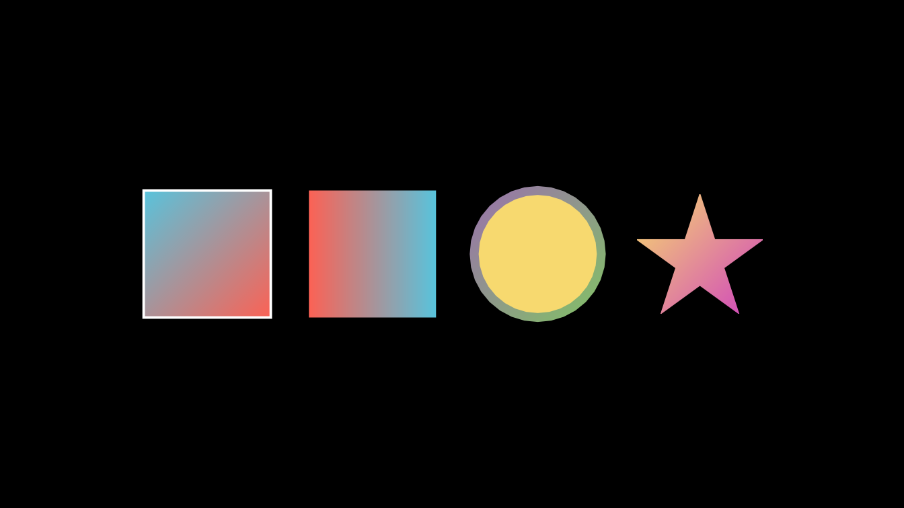

``` r

a$get_fill_colors()
#> [1] "#FC6255" "#58C4DD"
a$get_sheen_direction()
#> [1] -1  1  0
```

For groups, `set_color_by_gradient()` colors the submobjects one after
the other along a gradient, and `set_colors_by_radial_gradient()` colors
them by their distance from a center.

``` r

dots <- VGroup(lapply(1:16, function(i) Dot(radius = 0.18)))$arrange(RIGHT, buff = 0.15)
dots$set_color_by_gradient(BLUE, GREEN, YELLOW)
tiles <- VGroup(lapply(1:81, function(i) Square(side_length = 0.3, fill_opacity = 1, stroke_width = 1)))
tiles$arrange_in_grid(rows = 9, buff = 0.04)
tiles$set_colors_by_radial_gradient(radius = 1.5, inner_color = YELLOW, outer_color = RED)
plot(VGroup(dots, tiles)$arrange(DOWN, buff = 0.5))
```

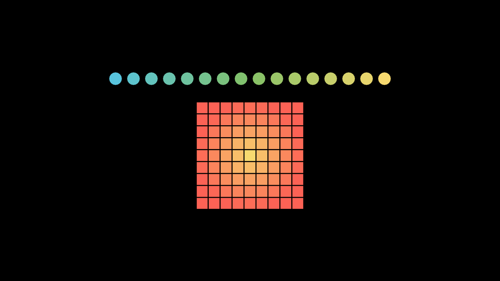

### Sheen

`set_sheen(factor, direction)` lightens the fill toward one side, which
gives flat shapes a little depth. A negative factor darkens instead.

``` r

shapes <- VGroup(
  Square(fill_opacity = 1, color = BLUE)$set_sheen(0.6, UR),
  Circle(fill_opacity = 1, color = RED)$set_sheen(0.8, UL),
  RegularPolygon(6, fill_opacity = 1, color = GREEN)$set_sheen(-0.6, DOWN)
)$arrange(RIGHT, buff = 1)
plot(shapes)
```

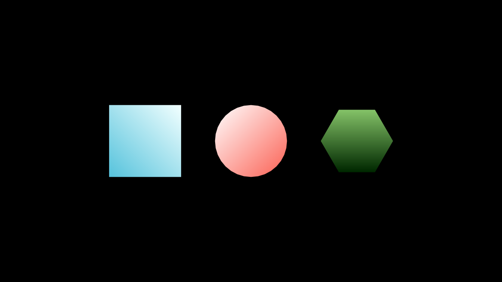

``` r

c(shapes[1]$get_sheen_factor(), shapes[3]$get_sheen_factor())
#> [1]  0.6 -0.6
```

### Coloring with an image

`color_using_background_image()` fills a VMobject with the matching part
of an image, given as a file or as an array of values in `[0, 1]`. Here
two shapes share one gradient image:

``` r

BackgroundColored <- R6::R6Class("BackgroundColored", inherit = Scene,
  public = list(construct = function() {
    x <- seq(0, 1, length.out = 200)
    img <- array(0, c(200, 200, 3))
    img[, , 1] <- outer(x, x, function(a, b) a)
    img[, , 2] <- outer(x, x, function(a, b) b)
    img[, , 3] <- 0.6
    sq <- Square(side_length = 3, fill_opacity = 1)$shift(3 * LEFT)
    ci <- Circle(radius = 1.5, fill_opacity = 1)$shift(3 * RIGHT)
    VGroup(sq, ci)$color_using_background_image(img)
    self$play(DrawBorderThenFill(sq), DrawBorderThenFill(ci), run_time = 1.5)
    self$play(Rotate(sq, PI / 4), ci$animate$shift(LEFT), run_time = 1)
  })
)
```

## Images

### Making an ImageMobject

[`ImageMobject()`](https://adamrsophie.github.io/manimR/reference/image_mobject.md)
shows a raster image. It accepts a PNG file name, a numeric array with
values from 0 to 255 (a matrix for gray, or an `h x w x 3` or
`h x w x 4` array), a raster from
[`as.raster()`](https://rdrr.io/r/grDevices/as.raster.html), a
`nativeRaster`, or a character matrix of colors. Images are stored as
RGBA arrays of values 0 to 255.

``` r

gray <- ImageMobject(matrix(c(0, 100, 30, 200, 255, 0, 5, 33), nrow = 2, byrow = TRUE))
dim(gray$pixel_array)
#> [1] 2 4 4
z <- outer(seq(-2, 2, length.out = 60), seq(-2, 2, length.out = 90), function(y, x) sin(x^2 + y^2))
heat <- ImageMobject(matrix(hcl.colors(100, "Plasma")[cut(z, 100)], nrow = 60))
dim(heat$get_pixel_array())
#> [1] 60 90  4
png_file <- tempfile(fileext = ".png")
rgb_array <- array(0, c(64, 64, 3))
rgb_array[, , 1] <- outer(1:64, 1:64, function(i, j) i / 64)
rgb_array[, , 2] <- outer(1:64, 1:64, function(i, j) j / 64)
rgb_array[, , 3] <- 0.5
png::writePNG(rgb_array, png_file)
from_file <- ImageMobject(png_file)
from_native <- ImageMobject(png::readPNG(png_file, native = TRUE))
from_raster <- ImageMobject(as.raster(rgb_array))
c(from_file$width, from_file$height)
#> [1] 0.4740741 0.4740741
```

The size follows `scale_to_resolution`: an image is shown pixel for
pixel at that vertical resolution (1080 by default), so the 64 pixel
tall image above is `64 / 1080 * 8` units tall. Set `height` or `width`
(or use [`scale()`](https://rdrr.io/r/base/scale.html)) to resize;
images move, scale and rotate like any mobject.

``` r

for (img in list(gray, heat, from_file)) img$height <- 2.5
from_native$height <- 1.2
from_raster$height <- 1.2
from_native$rotate(PI / 8)
plot(Group(gray, heat, from_file, Group(from_native, from_raster)$arrange(DOWN))$arrange(RIGHT, buff = 0.4))
```

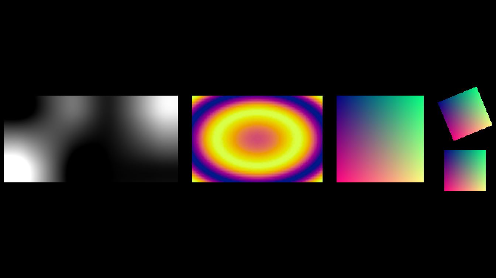

### Resampling, opacity, inversion and modes

When an image is drawn larger than its pixels,
`set_resampling_algorithm()` decides how the gaps are filled. The
accepted names are listed in `RESAMPLING_ALGORITHMS`. As with Pillow’s
transform in Python manim, `"nearest"` shows sharp pixel blocks,
`"bilinear"` blends neighboring pixels linearly and `"bicubic"` (the
default) uses Pillow’s bicubic filter, which is a little sharper;
`"lanczos"`, `"box"` and `"hamming"` are drawn as `"bilinear"`.

``` r

RESAMPLING_ALGORITHMS
#>    nearest       none    lanczos  antialias   bilinear     linear    bicubic 
#>  "nearest"  "nearest"  "lanczos"  "lanczos" "bilinear" "bilinear"  "bicubic" 
#>      cubic        box    hamming 
#>  "bicubic"      "box"  "hamming"
```

`set_opacity()` makes an image transparent, `invert = TRUE` inverts its
colors, and `image_mode` converts an image read from a file: `"RGBA"`
(the default), `"RGB"` (drops the alpha channel) or `"L"` (luminance,
gray).

``` r

tiny <- matrix(c(0, 255, 60, 200, 120, 30, 255, 90, 160), 3)
blocky <- ImageMobject(tiny)$set_resampling_algorithm("nearest")
smooth <- ImageMobject(tiny)$set_resampling_algorithm("bilinear")
behind <- Square(side_length = 2.2, color = YELLOW, fill_opacity = 1)
faded <- ImageMobject(png_file)$set_opacity(0.4)
inverted <- ImageMobject(png_file, invert = TRUE)
luminance <- ImageMobject(png_file, image_mode = "L")
for (img in list(blocky, smooth, faded, inverted, luminance)) img$height <- 2
faded$move_to(behind)
plot(Group(blocky, smooth, Group(behind, faded), inverted, luminance)$arrange(RIGHT, buff = 0.3))
```

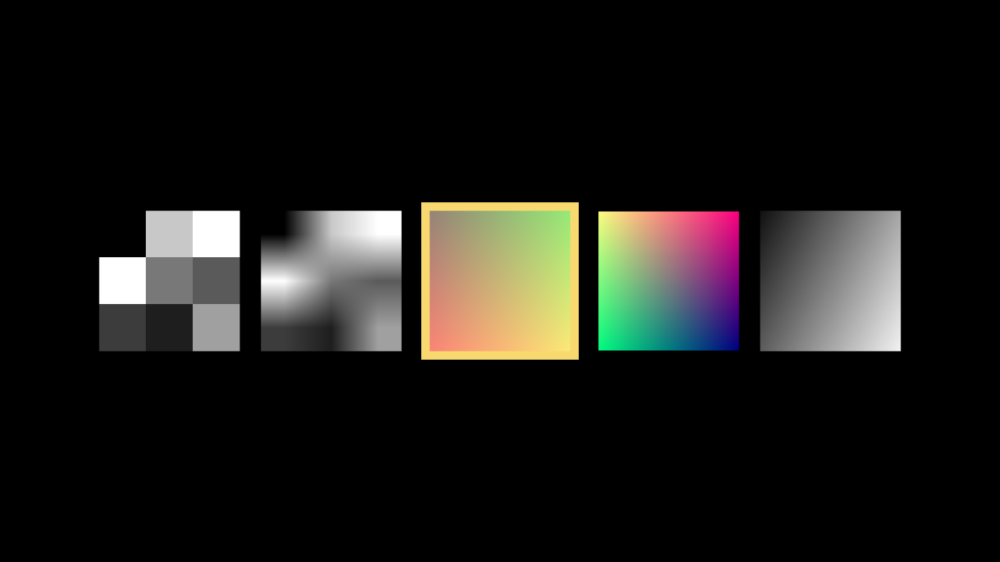

`get_raster()` returns the image as an array in `[0, 1]`, ready for
[`grid::grid.raster()`](https://rdrr.io/r/grid/grid.raster.html), and
`get_pixel_array()` returns the stored 0 to 255 array.

``` r

dim(heat$get_raster())
#> [1] 60 90  4
range(heat$get_raster())
#> [1] 0 1
```

### Animating images

[`ImageMobject()`](https://adamrsophie.github.io/manimR/reference/image_mobject.md)
creates an object of class `ImageMobjectClass`, which inherits from
`AbstractImageMobjectClass` (the base class it shares with
`ImageMobjectFromCameraClass`); subclass these generators for image
mobjects of your own.

Images take part in animations like other mobjects. A `Transform`
between two images of the same pixel size blends their pixels:

``` r

ImageAnimation <- R6::R6Class("ImageAnimation", inherit = Scene,
  public = list(construct = function() {
    x <- seq(-3, 3, length.out = 80)
    pattern <- function(f, palette) {
      z <- outer(x, x, f)
      matrix(hcl.colors(64, palette)[cut(z, 64)], nrow = length(x))
    }
    rings <- ImageMobject(pattern(function(a, b) sin(a^2 + b^2), "Viridis"))
    waves <- ImageMobject(pattern(function(a, b) sin(2 * a) + cos(3 * b), "Plasma"))
    for (img in list(rings, waves)) img$height <- 5
    self$play(FadeIn(rings), run_time = 1)
    self$play(rings$animate$rotate(PI / 4)$scale(0.8), run_time = 1)
    self$play(Transform(rings, waves$rotate(PI / 4)$scale(0.8)), run_time = 1.5)
  })
)
```

### Image helpers

Three helpers from `manim.utils.images` work on 0 to 255 image arrays.
[`change_to_rgba_array()`](https://adamrsophie.github.io/manimR/reference/image_helpers.md)
adds the missing channels,
[`invert_image()`](https://adamrsophie.github.io/manimR/reference/image_helpers.md)
returns `255 - image` (alpha included, as upstream) and
[`drag_pixels()`](https://adamrsophie.github.io/manimR/reference/image_helpers.md)
fills the black pixels of each frame from the frames that came before,
leaving a trail.

``` r

dim(change_to_rgba_array(matrix(c(1, 2, 3, 4), 2)))
#> [1] 2 2 4
change_to_rgba_array(array(100, c(1, 1, 3)))[1, 1, ]
#> [1] 100 100 100 255
invert_image(array(c(0, 255, 100, 255), c(1, 1, 4)))[1, 1, ]
#> [1] 255   0 155   0
frames <- lapply(1:5, function(k) {
  a <- array(0, c(10, 20, 3))
  a[4:7, (4 * k - 3):(4 * k - 1), ] <- 255 * k / 5
  a
})
trail <- drag_pixels(frames)
```

``` r

show_row <- function(arrays) Group(lapply(arrays, function(a) {
  img <- ImageMobject(a)$set_resampling_algorithm("nearest")
  img$height <- 1.2
  Group(img, SurroundingRectangle(img, buff = 0, color = GREY_C, stroke_width = 2))
}))$arrange(RIGHT, buff = 0.2)
plot(Group(show_row(frames), show_row(trail))$arrange(DOWN, buff = 0.4))
```

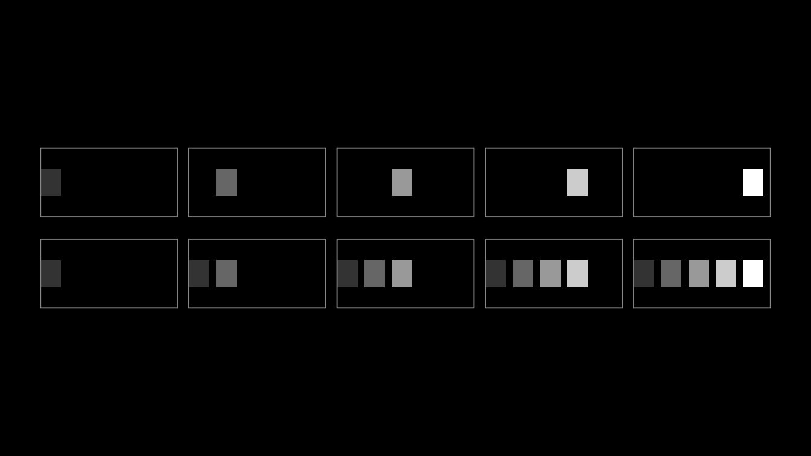

The top row shows five frames of a moving block, the bottom row what
[`drag_pixels()`](https://adamrsophie.github.io/manimR/reference/image_helpers.md)
makes of them.

### A background image for the scene

A camera can draw an image instead of the plain background color: pass
`background_image` (a file name or an array of values in `[0, 1]`) when
the scene is created. Override `initialize()` in your scene class to do
that. The image is drawn at its own pixel size from the top left corner,
not stretched, so make it as large as the frame; `config$pixel_width`
and `config$pixel_height` give the size of the current render.

``` r

SkyScene <- R6::R6Class("SkyScene", inherit = Scene,
  public = list(
    initialize = function(...) {
      h <- config$pixel_height
      w <- config$pixel_width
      shade <- seq(0, 1, length.out = h)
      sky <- array(0, c(h, w, 3))
      sky[, , 1] <- 0.1 * shade
      sky[, , 2] <- 0.2 + 0.3 * shade
      sky[, , 3] <- 0.5 + 0.4 * (1 - shade)
      super$initialize(background_image = sky, ...)
    },
    construct = function() {
      star <- Star(color = YELLOW, fill_opacity = 1)$shift(2 * LEFT + DOWN)
      self$play(GrowFromCenter(star), run_time = 1)
      self$play(star$animate$move_to(2 * RIGHT + UP)$scale(1.5), run_time = 1.5)
    }
  )
)
```

### Images of another camera

[`ImageMobjectFromCamera()`](https://adamrsophie.github.io/manimR/reference/image_mobject.md)
shows what a second camera sees. It is the building block of
`ZoomedScene` (see [Cameras and
3D](https://adamrsophie.github.io/manimR/articles/cameras-and-3d.md)),
and can be used directly: give the scene a `MultiCameraClass` camera,
make a `MovingCameraClass` camera, wrap it in
[`ImageMobjectFromCamera()`](https://adamrsophie.github.io/manimR/reference/image_mobject.md),
and register it with `add_image_mobject_from_camera()`. Moving the
second camera’s frame changes what the display shows.

``` r

PictureInPicture <- R6::R6Class("PictureInPicture", inherit = MovingCameraScene,
  public = list(
    default_camera_class = function() MultiCameraClass,
    construct = function() {
      shapes <- VGroup(Circle(fill_opacity = 1, color = RED), Square(fill_opacity = 1, color = BLUE),
                       Triangle(fill_opacity = 1, color = GREEN))$arrange(RIGHT)$shift(2 * LEFT + DOWN)
      cam <- MovingCameraClass$new(default_frame_stroke_width = 3)
      display <- ImageMobjectFromCamera(cam)
      display$add_display_frame()
      for (mob in list(cam$frame, display)) {
        mob$stretch_to_fit_height(2.5)
        mob$stretch_to_fit_width(3.5)
      }
      cam$frame$scale(0.6)$move_to(shapes[1])
      display$to_corner(UR)
      self$camera$add_image_mobject_from_camera(display)
      self$add(shapes, cam$frame, display)
      self$play(cam$frame$animate$move_to(shapes[3]), run_time = 2)
    }
  )
)
```

## SVG files

### Importing an SVG

[`SVGMobject()`](https://adamrsophie.github.io/manimR/reference/SVGMobjectClass.md)
reads an SVG file into a group of VMobjects, one per shape. Paths,
rectangles, circles, ellipses, lines, polylines, polygons, groups,
`<use>` references, transforms, CSS styles and fill and stroke
attributes are supported; `<text>` elements are skipped with a warning,
as upstream does (convert text to paths first). The file below is
written to a temporary file so the example is self contained.

``` r

svg_file <- tempfile(fileext = ".svg")
writeLines(c(
  '<svg xmlns="http://www.w3.org/2000/svg" viewBox="0 0 200 160">',
  '  <style>.wall { fill: #F7D96F; stroke: #FFFFFF; stroke-width: 2; }</style>',
  '  <rect class="wall" x="40" y="70" width="120" height="80"/>',
  '  <polygon points="30,72 100,15 170,72" fill="#FC6255"/>',
  '  <rect x="88" y="105" width="24" height="45" fill="#8B4513"/>',
  '  <circle cx="65" cy="98" r="12" fill="#58C4DD" stroke="#FFFFFF" stroke-width="2"/>',
  '  <ellipse cx="135" cy="98" rx="14" ry="10" fill="#58C4DD"/>',
  '  <line x1="0" y1="150" x2="200" y2="150" stroke="#83C167" stroke-width="4"/>',
  '  <polyline points="15,35 25,27 35,35 45,27 55,35" fill="none" stroke="#FFFFFF" stroke-width="2"/>',
  '  <g transform="translate(130 10) scale(0.5)">',
  '    <path d="M 10 40 C 10 10, 50 10, 50 40 S 90 70, 90 40" fill="none" stroke="#BBBBBB" stroke-width="6"/>',
  '  </g>',
  '</svg>'), svg_file)
house <- SVGMobject(svg_file, height = 4)
print_family(house)
#>  SVGMobject 3bed2af5da1c152610-523
#>   Rectangle 3bed2af5da1c152610-528
#>   Polygon 3bed2af5da1c152610-531
#>   Rectangle 3bed2af5da1c152610-533
#>   Circle 3bed2af5da1c152610-536
#>   Circle 3bed2af5da1c152610-538
#>   Line 3bed2af5da1c152610-540
#>   VMobject 3bed2af5da1c152610-542
#>   VMobjectFromSVGPath 3bed2af5da1c152610-545
```

By default the result is centered and scaled to `height = 2`; pass
`height` or `width` to choose the size and `should_center = FALSE` to
keep the file’s position. Style arguments override the file’s styles,
and `svg_default` sets the style of elements that do not set their own.

``` r

plain <- SVGMobject(svg_file, height = 4, stroke_width = 0)
recolored <- SVGMobject(svg_file, height = 4, fill_color = GREY_B, stroke_color = WHITE, stroke_width = 1)
row <- VGroup(house$copy(), plain, recolored)$arrange(RIGHT, buff = 0.3)
row$width <- 13
plot(row)
```

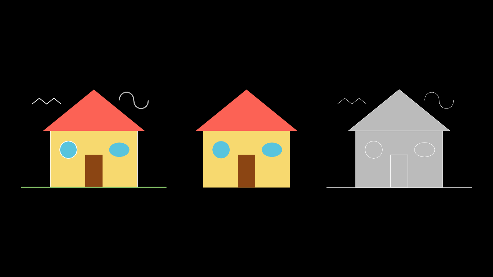

The middle copy has no strokes, so the stroke only parts (the ground
line, the bird and the smoke) disappear. Each shape is a submobject, so
index it to change one part:

``` r

length(house)
#> [1] 8
class(house[2])[1]
#> [1] "Polygon"
house[2]$set_fill(PURPLE)
house[4]$set_fill(ORANGE)
plot(house)
```

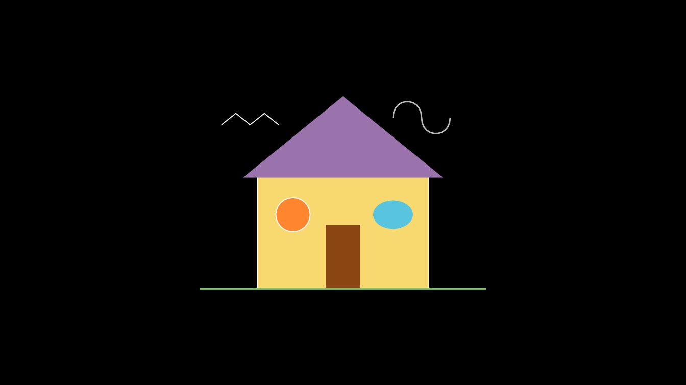

`use_svg_cache = TRUE` (the default) reuses an earlier import of the
same file, and `path_string_config` passes options on to the path
parser. The class generators are `SVGMobjectClass` and
`VMobjectFromSVGPathClass`; each import step is a method, so a subclass
can change one of them.

### Drawing an SVG

An imported SVG animates like any VMobject.
[`DrawBorderThenFill()`](https://adamrsophie.github.io/manimR/reference/creation.md)
traces the outlines and then fills them:

``` r

DrawHouse <- R6::R6Class("DrawHouse", inherit = Scene,
  public = list(construct = function() {
    house <- SVGMobject(svg_file, height = 5)
    self$play(DrawBorderThenFill(house), run_time = 2)
    self$play(house[2]$animate$set_fill(PURPLE), run_time = 0.8)
  })
)
```

### Single paths

[`VMobjectFromSVGPath()`](https://adamrsophie.github.io/manimR/reference/SVGMobjectClass.md)
turns the `d` attribute of an SVG `<path>` into a VMobject directly. It
keeps SVG coordinates, in which y grows downward, so flip the result
([`SVGMobject()`](https://adamrsophie.github.io/manimR/reference/SVGMobjectClass.md)
does this for you):

``` r

heart_path <- "M 10,30 A 20,20 0,0,1 50,30 A 20,20 0,0,1 90,30 Q 90,60 50,90 Q 10,60 10,30 z"
raw <- VMobjectFromSVGPath(heart_path, color = RED, fill_opacity = 1)
c(raw$width, raw$height)
#> [1] 80.30938 80.52252
upright <- raw$copy()$flip(RIGHT)
hearts <- VGroup(raw, upright)
hearts$height <- 3
plot(hearts$arrange(RIGHT, buff = 1.5))
```

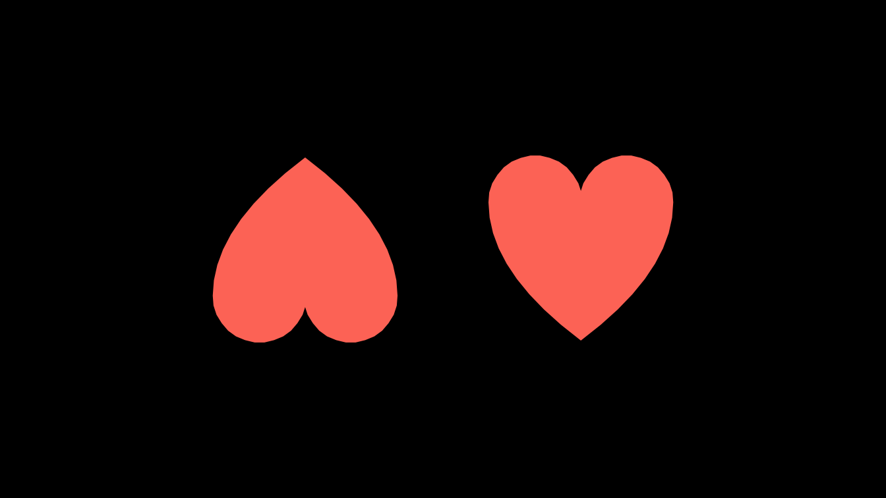

`long_lines`, `should_subdivide_sharp_curves` and
`should_remove_null_curves` are accepted for compatibility with
upstream’s OpenGL renderer.

## Point clouds

Point cloud mobjects are made of points rather than curves: each point
is drawn as a small square `stroke_width` pixels wide, with its own
color. The colors are stored in the `rgbas` matrix, one RGBA row per
point.

- [`PMobject()`](https://adamrsophie.github.io/manimR/reference/point_cloud.md)
  is an empty cloud. `add_points(points, rgbas, color, alpha)` appends
  points with one color or a color per point.
- `Mobject1D(density)` adds `add_line(start, end, color)`, which samples
  a segment `density` points per unit.
- `Mobject2D(density)` is the two dimensional version, a cloud with a
  density per unit area.
- `PointCloudDot(center, radius, density)` fills a disc with rings of
  points, and `Point(location)` is a single point.
- [`PGroup()`](https://adamrsophie.github.io/manimR/reference/point_cloud.md)
  groups point clouds.

Their class generators, for subclassing, are `PMobjectClass`,
`Mobject1DClass`, `Mobject2DClass`, `PointCloudDotClass`, `PointClass`
and `PGroupClass`.

``` r

set.seed(7)
cloud <- PMobject(stroke_width = 3)
cloud$add_points(cbind(rnorm(500, sd = 0.7), rnorm(500, sd = 0.7), 0))
dim(cloud$points)
#> [1] 500   3
dim(cloud$rgbas)
#> [1] 500   4
cloud$set_colors_by_radial_gradient(radius = 2.5, inner_color = YELLOW, outer_color = RED)
tri <- Mobject1D(density = 20, stroke_width = 4)
corners <- list(c(-1, -1, 0), c(1, -1, 0), c(0, 0.8, 0))
for (k in 1:3) tri$add_line(corners[[k]], corners[[k %% 3 + 1]], color = c(BLUE, GREEN, PURPLE)[k])
grid_pts <- as.matrix(expand.grid(x = seq(-1, 1, by = 1 / 5), y = seq(-1, 1, by = 1 / 5), z = 0))
patch <- Mobject2D(density = 5, stroke_width = 4)
patch$add_points(grid_pts, color = TEAL)
disc <- PointCloudDot(radius = 1, density = 12, stroke_width = 3)
disc$set_color_by_gradient(BLUE, GREEN)
nrow(disc$points)
#> [1] 478
```

The methods `thin_out(factor)` (keep every `factor`th point),
`filter_out(condition)` (drop the points for which `condition(point)` is
true), `sort_points(fn)` and `fade_to(color, alpha)` reshape a cloud:

``` r

thin <- disc$copy()$thin_out(3)
nrow(thin$points)
#> [1] 160
half <- disc$copy()$filter_out(function(p) p[1] > 0)
nrow(half$points)
#> [1] 233
cloud$copy()$sort_points(function(p) p[2])$points[1, ] # the lowest point
#> [1] -0.9455574 -1.8350181  0.0000000
```

Points are measured in pixels, so point clouds are best seen in a
rendered scene. This one shows the clouds above and then reshapes them:

``` r

PointClouds <- R6::R6Class("PointClouds", inherit = Scene,
  public = list(construct = function() {
    group <- PGroup(cloud, tri, patch, disc, Point(c(0, 3, 0), color = WHITE))
    cloud$move_to(4.5 * LEFT)
    tri$move_to(1.5 * LEFT)
    patch$move_to(1.5 * RIGHT)
    disc$move_to(4.5 * RIGHT)
    self$play(FadeIn(group), run_time = 1)
    self$play(Rotate(tri, PI), cloud$animate$fade_to(BLUE, 0.6),
              disc$animate$filter_out(function(p) p[2] < disc$get_center()[2]), run_time = 1.5)
  })
)
```

### OpenGL point clouds

Upstream’s OpenGL renderer has its own point clouds, drawn as round dots
of radius `stroke_width / 100` units. They are ported so that scenes
written for it run; manimR draws them with the same renderer as
everything else.

- [`OpenGLPMobject()`](https://adamrsophie.github.io/manimR/reference/opengl_point_cloud.md)
  is an empty cloud; add points with `add_points()`.
- `OpenGLPMPoint(location)` is a single dot.
- `DotCloud(radius, density)` fills a disc with rings of dots.
  `make_3d()` stores upstream’s gloss and shadow, which only affect
  upstream’s shader.
- [`TrueDot()`](https://adamrsophie.github.io/manimR/reference/opengl_point_cloud.md)
  is a `DotCloud`; as upstream, its initializer ends up making the
  default cloud of radius 2 at the origin.
- [`OpenGLPGroup()`](https://adamrsophie.github.io/manimR/reference/opengl_point_cloud.md)
  groups OpenGL point clouds.

The generators are `OpenGLPMobjectClass`, `OpenGLPMPointClass`,
`DotCloudClass`, `TrueDotClass` and `OpenGLPGroupClass`.

``` r

ring <- OpenGLPMobject(color = GREEN, stroke_width = 8)
theta <- seq(0, 2 * pi, length.out = 25)[-25]
ring$add_points(cbind(cos(theta), sin(theta), 0))
dots <- DotCloud(radius = 1, density = 6, color = BLUE)
dots$make_3d()
true_dot <- TrueDot(color = RED)$scale(0.5)
pair <- OpenGLPGroup(OpenGLPMPoint(LEFT / 2, stroke_width = 20, color = YELLOW),
                     OpenGLPMPoint(RIGHT / 2, stroke_width = 20, color = PINK))
c(nrow(dots$points), nrow(true_dot$points), dots$gloss)
#> [1]  166.0 1303.0    0.5
plot(Group(ring, dots, true_dot, pair)$arrange(RIGHT, buff = 0.6))
```

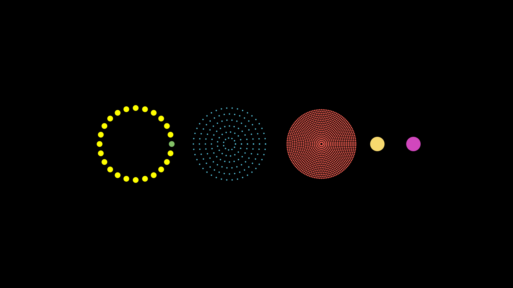
