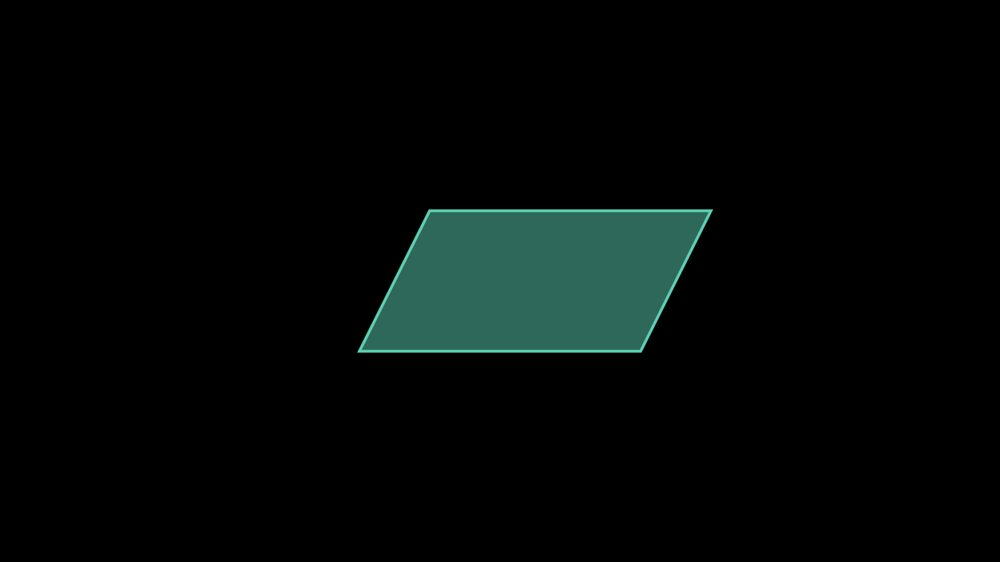
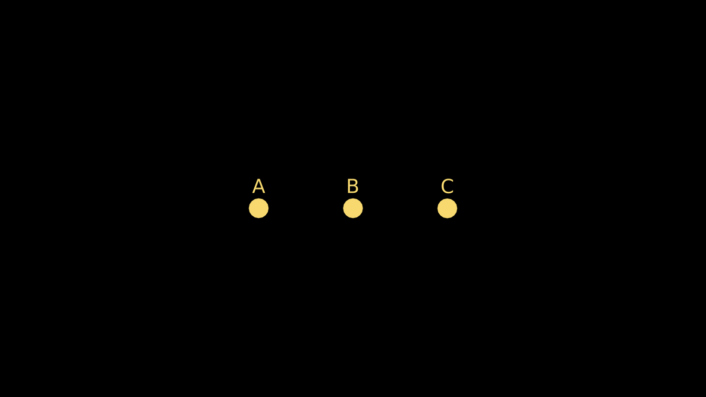
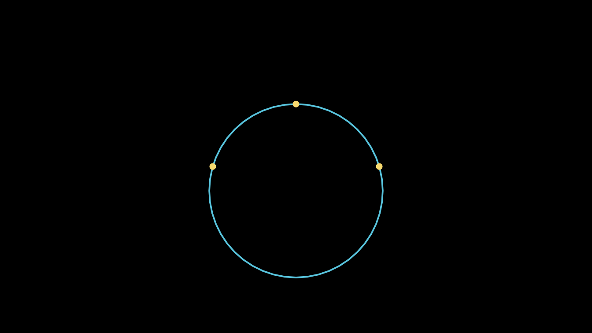
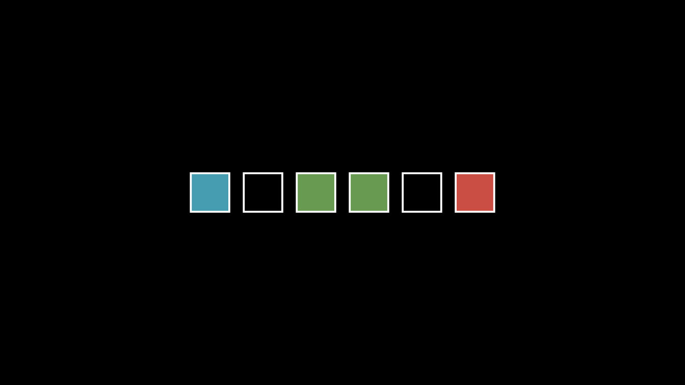
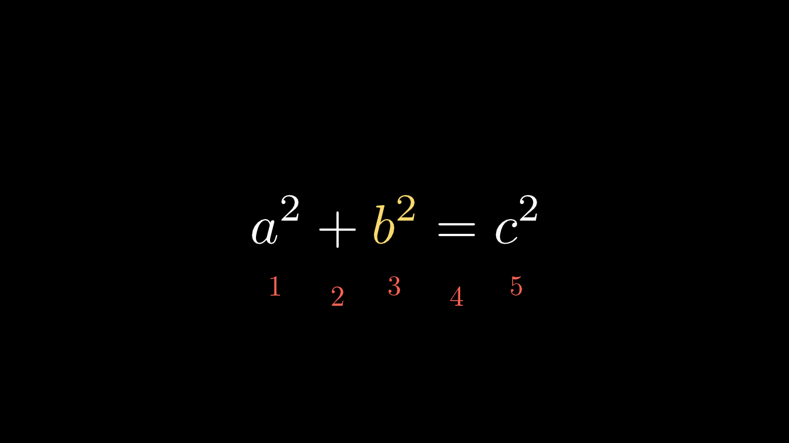
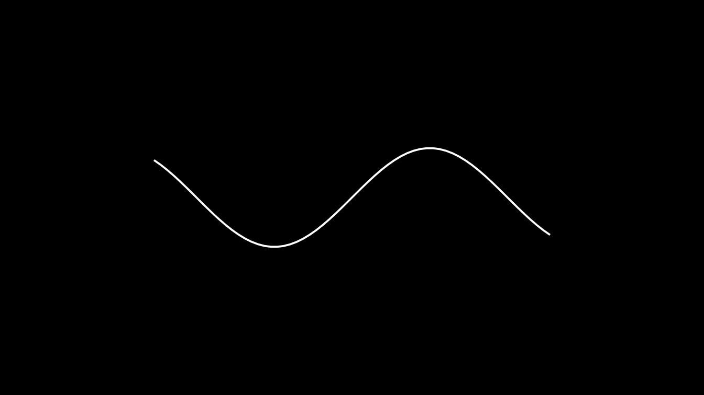

# Coming from Python manim

manimR follows the API of Manim Community (version 0.22.1) closely: the
classes, methods and arguments have the same names and the same
defaults, and every public name of `from manim import *` has an R
counterpart. What changes is the language around them. This guide
translates Python manim code to R, one construct at a time, and lists
every place where manimR deliberately differs: a handful of renamed
names, and indices that start at 1 instead of 0.

Python snippets are shown in `python` blocks and are not run. The R code
is run when this vignette is built, so every R example below works as
shown.

## The same scene in both languages

Here is a short Python scene:

``` python
from manim import *

class SquareAndCircle(Scene):
    def construct(self):
        circle = Circle(radius=1, color=BLUE).set_fill(BLUE, opacity=0.5)
        square = Square(side_length=2, color=GREEN)
        square.next_to(circle, RIGHT, buff=0.5)
        group = VGroup(circle, square).move_to(ORIGIN)
        self.play(Create(circle), FadeIn(square), run_time=1.5)
        self.play(square.animate.rotate(PI / 4).set_fill(GREEN, opacity=0.8))
        self.play(group[0].animate.shift(UP))
        self.wait(0.5)
```

and the same scene in R:

``` r

SquareAndCircle <- R6::R6Class("SquareAndCircle", inherit = Scene,
  public = list(construct = function() {
    circle <- Circle(radius = 1, color = BLUE)$set_fill(BLUE, opacity = 0.5)
    square <- Square(side_length = 2, color = GREEN)
    square$next_to(circle, RIGHT, buff = 0.5)
    group <- VGroup(circle, square)$move_to(ORIGIN)
    self$play(Create(circle), FadeIn(square), run_time = 1.5)
    self$play(square$animate$rotate(PI / 4)$set_fill(GREEN, opacity = 0.8))
    self$play(group[1]$animate$shift(UP))
    self$wait(0.5)
  })
)
```

The differences are all mechanical:

- the class is an R6 class that inherits from `Scene`;
- `construct` is a function in the class’s `public` list, and `self` is
  available inside it without being an argument;
- methods are called with `$` instead of `.`;
- keyword arguments use `=` with spaces by convention, and assignment
  uses `<-`;
- `group[0]` becomes `group[1]`, because R counts from 1.

Constructors, method names, argument names, constants (`BLUE`, `RIGHT`,
`PI`) and animation names are unchanged.

## Imports

| Python | R |
|----|----|
| `from manim import *` | [`library(manimR)`](https://adamrsophie.github.io/manimR/) |
| `import manim; manim.Circle()` | [`manimR::Circle()`](https://adamrsophie.github.io/manimR/reference/geometry.md) |
| `import numpy as np` | nothing: vectors and matrices are built into R |
| `from manim.utils import rate_functions` | `rate_functions` (a list, see [Modules](#modules-rate_functions-color-and-unit)) |
| `from manim.utils.color import X11` | `X11_COLORS`, or `color$X11` |

[`library(manimR)`](https://adamrsophie.github.io/manimR/) attaches
every exported name at once, as `from manim import *` does. If another
attached package uses the same name, write `manimR::` in front.

## Scene classes and `construct()`

A Python scene class becomes an R6 class:

``` python
class Intro(Scene):
    def setup(self):
        self.title = Text("Intro")

    def construct(self):
        self.add(self.title)
        self.show_dot(LEFT)

    def show_dot(self, point):
        self.play(FadeIn(Dot(point)))
```

``` r

Intro <- R6::R6Class("Intro", inherit = Scene,
  public = list(
    title = NULL,
    setup = function() {
      self$title <- Text("Intro")
    },
    construct = function() {
      self$add(self$title)
      self$show_dot(LEFT)
    },
    show_dot = function(point) {
      self$play(FadeIn(Dot(point)))
    }
  )
)
```

Points to keep in mind:

- Methods and fields all go in the `public` list. Helper methods are
  called as `self$show_dot()`, like `self.show_dot()`.
- R6 objects are locked by default: assigning `self$title` works only
  because `title = NULL` declares the field. A Python habit such as
  `self.anything = value` inside `construct()` fails with “cannot add
  bindings to a locked environment” unless you declare the field, or
  create the class with `R6::R6Class(..., lock_objects = FALSE)`.
- `super().construct()` is `super$construct()`, and
  `super().__init__(...)` is `super$initialize(...)`.
- The scene base classes keep their names: `Scene`, `MovingCameraScene`,
  `ZoomedScene`, `ThreeDScene`, `VectorScene` and
  `LinearTransformationScene` are all R6 classes you inherit from.
- [`manim_scene()`](https://adamrsophie.github.io/manimR/reference/manim_scene.md)
  builds a scene class from a single function, for when a class is more
  ceremony than you need:

``` r

Intro2 <- manim_scene(function(self) {
  self$add(Text("Intro"))
  self$play(FadeIn(Dot(LEFT)))
}, name = "Intro2")
```

## Calling scene methods

| Python | R |
|----|----|
| `self.play(Create(sq))` | `self$play(Create(sq))` |
| `self.play(a, b, run_time=2, rate_func=linear)` | `self$play(a, b, run_time = 2, rate_func = linear)` |
| `self.play(*[FadeIn(d) for d in dots])` | `self$play(lapply(dots$submobjects, FadeIn))` |
| `self.wait()`, `self.wait(2)` | `self$wait()`, `self$wait(2)` |
| `self.pause()`, `self.wait_until(cond)` | `self$pause()`, `self$wait_until(cond)` |
| `self.add(a, b)`, `self.remove(a)` | `self$add(a, b)`, `self$remove(a)` |
| `self.bring_to_front(a)` | `self$bring_to_front(a)` |
| `self.add_foreground_mobject(a)` | `self$add_foreground_mobject(a)` |
| `self.camera.frame` (in a `MovingCameraScene`) | `self$camera$frame` |
| `self.time` | `self$time` |
| `self.next_section("intro")` | `self$next_section("intro")` |
| `self.add_sound("click.wav")` | `self$add_sound("click.wav")` |

`self$play()` accepts lists of animations and flattens them, so the
unpacking star of `self.play(*animations)` is not needed. Named
arguments after the animations (`run_time`, `rate_func`, `lag_ratio`)
apply to every animation in the call, exactly as keyword arguments do in
Python.

## Python values in R

| Python | R |
|----|----|
| `Circle(radius=2)` | `Circle(radius = 2)` |
| `True`, `False`, `None` | `TRUE`, `FALSE`, `NULL` |
| `[1, 2, 3]` (numbers) | `c(1, 2, 3)` |
| `[a, b, c]` (mobjects) | `list(a, b, c)` |
| `x_range=(-3, 3, 1)` | `x_range = c(-3, 3, 1)` |
| `axis_config={"color": BLUE}` | `axis_config = list(color = BLUE)` |
| `t2c={"[1:4]": RED}` | `t2c = list("[1:4]" = RED)` (quote names that are not R names) |
| `f(*args)` | `do.call(f, args)` |
| `f(x, **kwargs)` | `do.call(f, c(list(x), kwargs))` |
| `r"\frac{a}{b}"` | `r"(\frac{a}{b})"` or `"\\frac{a}{b}"` |
| `f"x = {x:.2f}"` | `sprintf("x = %.2f", x)` |
| `x ** 2`, `a // b`, `a % b` | `x^2`, `a %/% b`, `a %% b` |
| `x += 1` | `x <- x + 1` |
| `range(5)` | `0:4`, or `seq_len(5)` for 1 to 5 |
| `[f(x) for x in xs]` | `lapply(xs, f)` (a list) or `sapply(xs, f)` (a vector) |
| `for i, m in enumerate(group):` | `for (i in seq_along(group)) { m <- group[i]; ... }` |
| `np.pi`, `PI`, `TAU`, `DEGREES` | `pi`, `PI`, `TAU`, `DEGREES` |

LaTeX strings deserve a special note: Python code usually writes them as
raw strings, `r"\frac{a}{b}"`. In an ordinary R string every backslash
must be doubled, `"\\frac{a}{b}"`. R also has raw strings, written
`r"(...)"`, so `MathTex(r"(\frac{a}{b})")` keeps the LaTeX exactly as in
Python.

[`do.call()`](https://rdrr.io/r/base/do.call.html) replaces both kinds
of unpacking. Here it builds a polygon from a list of points, as
`Polygon(*points)` would:

``` r

points <- list(c(-2, -1, 0), c(2, -1, 0), c(3, 1, 0), c(-1, 1, 0))
shape <- do.call(Polygon, c(points, list(color = TEAL, fill_opacity = 0.5)))
plot(shape)
```



## Methods, fields and `$`

Everything reached with a dot in Python is reached with `$` in R:

| Python                       | R                             |
|------------------------------|-------------------------------|
| `mob.shift(UP).scale(2)`     | `mob$shift(UP)$scale(2)`      |
| `mob.get_center()`           | `mob$get_center()`            |
| `mob.points`                 | `mob$points`                  |
| `mob.submobjects`            | `mob$submobjects`             |
| `mob.width`, `mob.width = 3` | `mob$width`, `mob$width <- 3` |
| `mob.copy()`                 | `mob$copy()`                  |
| `mob.set(width=3)`           | `mob$set(width = 3)`          |

`width`, `height` and `depth` are R6 active bindings, so reading and
assigning them works as with Python properties:

``` r

sq <- Square()
sq$width
#> [1] 2
sq$width <- 3
sq$height
#> [1] 3
sq$shift(UP)$get_center()
#> [1] 0 1 0
```

Methods that change a mobject return it invisibly, which is why the
chained calls above print nothing until the last one asks for a value.

Mobjects have reference semantics in both languages: `b <- a` makes `b`
another name for the same mobject, and changing one changes the other.
This is how Python behaves, but it is unusual in R, where most objects
are copied on modification. Use `$copy()` when you need an independent
copy.

## Constructors, classes and subclasses

Each Python class `Circle` corresponds to two R objects:

- [`Circle()`](https://adamrsophie.github.io/manimR/reference/geometry.md),
  a constructor function with the arguments of the class (RStudio
  completes them), which you call to create mobjects;
- `CircleClass`, the R6 class generator, which you use to subclass, to
  reach class methods, and with
  [`set_default()`](https://adamrsophie.github.io/manimR/reference/set_default.md).

Every upstream class has such a generator, including the ones you rarely
create yourself, such as `MathTableClass` or
`ReplacementTransformClass`.

| Python | R |
|----|----|
| `Circle(radius=2)` | `Circle(radius = 2)` |
| `isinstance(m, Circle)` | `inherits(m, "Circle")` |
| `type(m).__name__` | `class(m)[1]` |
| `class LabeledDot(VGroup):` | `R6::R6Class("LabeledDot", inherit = VGroupClass, ...)` |
| `LabeledDot("A")` | `LabeledDot$new("A")` |

A custom mobject in Python:

``` python
class LabeledDot(VGroup):
    def __init__(self, label, **kwargs):
        super().__init__(**kwargs)
        self.add(Dot(radius=0.2), Text(label, font_size=28).shift(0.45 * UP))
```

and in R:

``` r

LabeledDot <- R6::R6Class("LabeledDot", inherit = VGroupClass,
  public = list(
    initialize = function(label, ...) {
      super$initialize(...)
      self$add(Dot(radius = 0.2), Text(label, font_size = 28)$shift(0.45 * UP))
    }
  )
)
dots <- VGroup(LabeledDot$new("A"), LabeledDot$new("B"), LabeledDot$new("C"))
dots$arrange(RIGHT, buff = 1.5)$set_color(YELLOW)
plot(dots)
```



``` r

inherits(dots[1], "VGroup")
#> [1] TRUE
```

Scenes are the exception to the two names rule: `Scene`, `ThreeDScene`
and the other scene classes are R6 generators already, so you inherit
from them directly and there is no `SceneClass`.

### Class methods

R6 has no class methods, so upstream’s class and static methods live on
the generators (see
[`?class_methods`](https://adamrsophie.github.io/manimR/reference/class_methods.md)):

| Python | R |
|----|----|
| `Circle.from_three_points(p1, p2, p3)` | `CircleClass$from_three_points(p1, p2, p3)` |
| `Angle.from_three_points(A, B, C)` | `AngleClass$from_three_points(A, B, C)` |
| `Line3D.parallel_to(line, point)` | `Line3DClass$parallel_to(line, point)` |
| `Line3D.perpendicular_to(line, point)` | `Line3DClass$perpendicular_to(line, point)` |
| `ChangeSpeed.add_updater(mob, func)` | `ChangeSpeedClass$add_updater(mob, func)` or `change_speed_add_updater(mob, func)` |
| `Mobject.set_default(...)`, `Animation.set_default(...)` | `MobjectClass$set_default(...)`, `AnimationClass$set_default(...)` |
| `Mobject.add_animation_override(...)` | `MobjectClass$add_animation_override(...)` |
| `Text.font_list()`, `MarkupText.font_list()` | `TextClass$font_list()`, `MarkupTextClass$font_list()` |
| `TexTemplate.from_file(path)` | `TexTemplateClass$from_file(path)` |
| `Code.get_styles_list()` | `CodeClass$get_styles_list()` |

``` r

p <- list(c(-2, 0, 0), c(0, 1.5, 0), c(2, 0, 0))
circle <- CircleClass$from_three_points(p[[1]], p[[2]], p[[3]], color = BLUE)
circle$radius
#> [1] 2.083333
plot(VGroup(circle, VGroup(lapply(p, Dot, color = YELLOW))))
```



### `set_default()`

`Text.set_default(font_size=60)` changes the default of an argument for
every later call. In R the class comes first, as an argument; calling
[`set_default()`](https://adamrsophie.github.io/manimR/reference/set_default.md)
with only the class restores the original defaults:

``` r

set_default(Circle, color = BLUE, fill_opacity = 0.5)
blue <- Circle()
set_default(Circle)
plain <- Circle()
c(blue$get_color(), plain$get_color())
#> [1] "#58C4DD" "#FC6255"
```

## The `$animate` builder

| Python | R |
|----|----|
| `mob.animate.shift(UP)` | `mob$animate$shift(UP)` |
| `mob.animate.shift(UP).scale(2)` | `mob$animate$shift(UP)$scale(2)` |
| `mob.animate(run_time=2, rate_func=linear).shift(UP)` | `mob$animate(run_time = 2, rate_func = linear)$shift(UP)` |
| `mob.always.next_to(other, UP)` | `mob$always$next_to(other, UP)` |

As in Python, the animation arguments go in the call to `animate` and
must come before the first method. `$always` turns a method call into an
updater that repeats it every frame.

## Lists, groups and indexing

A Python list of mobjects becomes an R
[`list()`](https://rdrr.io/r/base/list.html). Groups accept lists, so
the star is not needed:

| Python | R |
|----|----|
| `VGroup(*mobs)` | `VGroup(mobs)` or `do.call(VGroup, mobs)` |
| `VGroup(*[Dot() for _ in range(5)])` | `VGroup(lapply(1:5, function(i) Dot()))` |
| `len(group)` | `length(group)` |
| `group[0]` | `group[1]` |
| `group[-1]` | `group[length(group)]` |
| `group[1:3]` | `group[2:3]` |
| `group[::2]` | `group[seq(1, length(group), by = 2)]` |
| `for m in group:` | `for (m in as.list(group))` (the mobject first when it has points) |
| `group.submobjects[0]` | `group$submobjects[[1]]` or `group[[1]]` |
| `group.add(m)` | `group$add(m)` |
| `group[1] = m` | `group[2] <- m` |
| `group + m`, `group - m` (a `VGroup`) | `group + m`, `group - m` |
| `a + b` (two other mobjects) | an error, as upstream; use `Group(a, b)` |
| `bool(tracker)` | `as.logical(tracker)` |

Indices start at 1, and a negative index means something different: in
Python `group[-1]` is the last element, while in R `group[-1]` is every
element except the first. A single number returns that element; a vector
of numbers returns a group of the selected elements.

Indexing follows upstream’s
[`split()`](https://rdrr.io/r/base/split.html), which matters for
mobjects that have points of their own and also submobjects, such as an
`Arrow` (its line, then its tip): for them, `mob[1]` is the mobject
itself and the submobjects follow, and `length(mob)` counts both. For
groups, which have no points of their own, and for
[`Text()`](https://adamrsophie.github.io/manimR/reference/TextClass.md)
and
[`MathTex()`](https://adamrsophie.github.io/manimR/reference/tex.md),
the elements are just the submobjects. `mob$submobjects[[1]]` is always
the first submobject.

``` r

squares <- VGroup(lapply(1:6, function(i) Square(side_length = 0.8)))
squares$arrange(RIGHT, buff = 0.3)
squares[1]$set_fill(BLUE, opacity = 0.8)
squares[length(squares)]$set_fill(RED, opacity = 0.8)
squares[3:4]$set_fill(GREEN, opacity = 0.8)
plot(squares)
```



``` r

length(squares)
#> [1] 6
length(squares[-1])
#> [1] 5
class(squares[3:4])[1]
#> [1] "VGroup"
```

The same indices apply to the parts of a
[`MathTex()`](https://adamrsophie.github.io/manimR/reference/tex.md):
each string you pass is one part, so the third part has index 3.
[`index_labels()`](https://adamrsophie.github.io/manimR/reference/print_family.md)
labels every part with its index, counting from 1 as R does (the labels
are placed on the parts; here they are shifted below the formula):

``` r

eq <- MathTex("a^2", "+", "b^2", "=", "c^2")$scale(2)
eq[3]$tex_string
#> [1] "b^2"
eq$index_of_part_by_tex("c^2")
#> [1] 5
eq[3]$set_color(YELLOW)
labels <- index_labels(eq, label_height = 0.35)$set_color(RED)$shift(1.2 * DOWN)
plot(VGroup(eq, labels))
```



Dictionaries of mobjects use character keys. A `VDict` is indexed by
name, and a `Graph` by vertex name; the names are strings, so write
`g["1"]` for the vertex named 1 (`g[1]` is the first submobject):

``` r

shapes <- VDict(list(square = Square(), circle = Circle()))
shapes["triangle"] <- Triangle()
names(shapes$submob_dict)
#> [1] "square"   "circle"   "triangle"
class(shapes["circle"])[1]
#> [1] "Circle"
g <- Graph(1:3, list(c(1, 2), c(2, 3)))
class(g["2"])[1]
#> [1] "Dot"
```

`[[` with a character key returns a field or method of the object when
there is one with that name, and the dictionary entry otherwise, so
prefer `[` for keys.

## Points: numpy arrays and R vectors

A point is a numeric vector of length 3, and the direction constants are
such vectors:

| Python                            | R                                       |
|-----------------------------------|-----------------------------------------|
| `np.array([1, 2, 0])`             | `c(1, 2, 0)`                            |
| `UP`, `ORIGIN`, `UL`              | `UP`, `ORIGIN`, `UL` (length 3 vectors) |
| `2 * UP + RIGHT`                  | `2 * UP + RIGHT`                        |
| `point[0]` (x coordinate)         | `point[1]`                              |
| `mob.points` (n x 3 array)        | `mob$points` (n x 3 matrix)             |
| `mob.points[0]` (first point)     | `mob$points[1, ]`                       |
| `mob.points[:, 0]` (all x values) | `mob$points[, 1]`                       |
| `len(mob.points)`                 | `nrow(mob$points)`                      |
| `np.array([p1, p2])`              | `rbind(p1, p2)`                         |
| `np.linalg.norm(v)`               | `get_norm(v)`                           |
| `np.cross(a, b)`, `np.dot(a, b)`  | `cross(a, b)`, `sum(a * b)`             |
| `a @ b`                           | `a %*% b`                               |
| `np.linspace(0, 1, 5)`            | `seq(0, 1, length.out = 5)`             |
| `np.arange(0, 1, 0.25)`           | `seq(0, 0.75, by = 0.25)`               |

Functions that take a point accept two coordinates too and add `z = 0`.

``` r

2 * UP + RIGHT
#> [1] 1 2 0
sq <- Square()
dim(sq$points)
#> [1] 16  3
sq$points[1:4, ]
#>            [,1] [,2] [,3]
#> [1,]  1.0000000    1    0
#> [2,]  0.3333333    1    0
#> [3,] -0.3333333    1    0
#> [4,] -1.0000000    1    0
get_norm(c(3, 4, 0))
#> [1] 5
Dot(c(1, 2))$get_center()
#> [1] 1 2 0
```

Functions applied to points receive one point, a vector of length 3, so
coordinates are `p[1]`, `p[2]` and `p[3]`:

``` r

wave <- Line(4 * LEFT, 4 * RIGHT)
wave$insert_n_curves(60)
wave$apply_function(function(p) p + sin(p[1]) * UP)
plot(wave)
```



Matrices deserve care: R’s
[`matrix()`](https://rdrr.io/r/base/matrix.html) fills by column, so the
Python matrix `[[1, 1], [0, 1]]` is `rbind(c(1, 1), c(0, 1))`, or
`matrix(c(1, 1, 0, 1), 2, byrow = TRUE)`.

## Lambdas and functions

| Python | R |
|----|----|
| `lambda m: m.next_to(dot, UP)` | `function(m) m$next_to(dot, UP)`, or `\(m) m$next_to(dot, UP)` |
| `lambda m, dt: m.rotate(dt)` | `function(m, dt) m$rotate(dt)` |
| `lambda: Text("hi")` | `function() Text("hi")` |
| `lambda x: np.sin(x)` | `sin`, or `function(x) sin(x)` |
| `def f(x): return x ** 2` | `f <- function(x) x^2` |

The short form `\(x)` needs R 4.1 or later (manimR needs R 4.4 anyway).
Functions passed to `Axes()$plot()` and the other graphing methods
receive one number at a time, as in Python, so `if` works inside them.

## Updaters and `ValueTracker`

Updaters translate directly. Upstream decides whether an updater wants
the frame time by looking for an argument named `dt`, and so does
manimR: write `function(m, dt)`, not `function(m, delta)`.

``` python
class UpdaterDemo(Scene):
    def construct(self):
        angle = ValueTracker(0)
        hand = Line(ORIGIN, 2 * RIGHT, color=YELLOW)
        hand.add_updater(lambda m: m.become(
            Line(ORIGIN, 2 * np.array([np.cos(angle.get_value()), np.sin(angle.get_value()), 0]), color=YELLOW)))
        spinner = Square(side_length=0.6, color=BLUE).shift(4 * LEFT)
        spinner.add_updater(lambda m, dt: m.rotate(dt * PI))
        label = always_redraw(lambda: Text(f"{angle.get_value() / DEGREES:.0f} degrees", font_size=32).to_edge(DOWN))
        self.add(Circle(radius=2, color=GREY), hand, spinner, label)
        self.play(angle.animate.set_value(PI), run_time=2)
        angle += -PI / 2
        self.wait(0.5)
```

``` r

UpdaterDemo <- R6::R6Class("UpdaterDemo", inherit = Scene,
  public = list(construct = function() {
    angle <- ValueTracker(0)
    hand <- Line(ORIGIN, 2 * RIGHT, color = YELLOW)
    hand$add_updater(function(m) m$become(
      Line(ORIGIN, 2 * c(cos(angle$get_value()), sin(angle$get_value()), 0), color = YELLOW)))
    spinner <- Square(side_length = 0.6, color = BLUE)$shift(4 * LEFT)
    spinner$add_updater(function(m, dt) m$rotate(dt * PI))
    label <- always_redraw(function() {
      Text(sprintf("%.0f degrees", angle$get_value() / DEGREES), font_size = 32)$to_edge(DOWN)
    })
    self$add(Circle(radius = 2, color = GREY), hand, spinner, label)
    self$play(angle$animate$set_value(PI), run_time = 2)
    angle$increment_value(-PI / 2)
    self$wait(0.5)
  })
)
```

| Python | R |
|----|----|
| `mob.add_updater(func)` | `mob$add_updater(func)` |
| `mob.add_updater(func, index=0)` | `mob$add_updater(func, index = 1)` |
| `mob.remove_updater(func)`, `mob.clear_updaters()` | `mob$remove_updater(func)`, `mob$clear_updaters()` |
| `mob.suspend_updating()`, `mob.resume_updating()` | `mob$suspend_updating()`, `mob$resume_updating()` |
| `self.add_updater(lambda dt: ...)` | `self$add_updater(function(dt) ...)` |
| `always_redraw(lambda: ...)` | `always_redraw(function() ...)` |
| `t = ValueTracker(0)` | `t <- ValueTracker(0)` |
| `t.get_value()`, `t.set_value(1)` | `t$get_value()`, `t$set_value(1)` |
| `t += 1` | `t$increment_value(1)` |
| `t.animate.set_value(5)` | `t$animate$set_value(5)` |

R has no `+=`. Arithmetic on a tracker works (`t + 1` is a new
`ValueTracker`), but `t <- t + 1` creates a new tracker instead of
changing the one your updaters and animations hold, so use
`t$increment_value()` or `t$set_value()` for the in place update that
Python’s `+=` performs. [Updaters and value
trackers](https://adamrsophie.github.io/manimR/articles/updaters.md) has
much more.

## Configuration

| Python | R |
|----|----|
| `config.background_color = WHITE` | `config$background_color <- WHITE`, or `manim_config(background_color = WHITE)` |
| `config.frame_width`, `config["pixel_height"]` | `config$frame_width`, `config[["pixel_height"]]` |
| `config.quality = "low_quality"` | `config$quality <- "low_quality"`, or `manim_config(quality = "l")` |
| `with tempconfig({"frame_height": 10}):` | `tempconfig(list(frame_height = 10), { ... })` |
| `frame.top`, `frame.frame_width` | `manim_frame$top`, `manim_frame$frame_width` |
| `self.camera.background_color = WHITE` | `self$camera$background_color <- WHITE` |
| a `manim.cfg` file | read when manimR loads, from the working directory (and the user wide file), or with `digest_config_file("manim.cfg")` |

`config` and
[`manim_config()`](https://adamrsophie.github.io/manimR/reference/manim_config.md)
read and write the same settings.
[`manim_config()`](https://adamrsophie.github.io/manimR/reference/manim_config.md)
with no arguments returns them all as a list, and with named arguments
sets them and invisibly returns the old values.
`with_manim_config(settings, code)` and `tempconfig(settings, code)`
both run code with temporary settings;
[`tempconfig()`](https://adamrsophie.github.io/manimR/reference/config.md)
ignores names that are not settings, as upstream does.

``` r

config$frame_height
#> [1] 8
config$frame_width
#> [1] 14.22222
tempconfig(list(frame_height = 16), config$frame_height)
#> [1] 16
config$frame_height
#> [1] 8
manim_frame$top
#> [1] 0 4 0
```

With `renderer = "opengl"`, scenes render with
[`OpenGLRenderer()`](https://adamrsophie.github.io/manimR/reference/opengl_renderer.md),
a port of upstream’s OpenGL renderer that draws its shaders’ triangles
in software instead of on the GPU. Scenes with their own camera, such as
`ThreeDScene`, keep the Cairo style renderer. See [Rendering,
configuration and
output](https://adamrsophie.github.io/manimR/articles/rendering.md) for
every setting.

## The command line

The `manim` command becomes
[`manim_cli()`](https://adamrsophie.github.io/manimR/reference/manim_cli.md),
run with `Rscript`:

``` sh
# Python
manim -pql scenes.py SquareToCircle
# R
Rscript -e 'manimR::manim_cli()' scenes.R SquareToCircle -pql
```

From an R session,
[`render_file()`](https://adamrsophie.github.io/manimR/reference/render_file.md)
does the same:

``` r

render_file("scenes.R", "SquareToCircle", quality = "l", preview = TRUE)
```

[`manim_cli()`](https://adamrsophie.github.io/manimR/reference/manim_cli.md)
follows the `manim` command: an optional leading `render`, the quality
flags `-ql`, `-qm`, `-qh`, `-qp`, `-qk`, and `-p`, `-s`, `-t`, `-a`,
`-o FILE`, `-n N,M`, `-r W,H`, `--fps`, `--format`, `--save_sections`,
`--disable_caching`, `--flush_cache`, `-c FILE` for a configuration
file, `--name=value` for any other setting, clustered flags such as
`-pql`, and the subcommands `checkhealth`, `cfg`, `init`, `plugins` and
`cache clear`. Like `manim`, it reads `manim.cfg` from the working
directory; manimR also reads that file, and the user wide
`~/.config/manim/manim.cfg`, when it loads, as `import manim` does.

Output follows upstream 0.22.1 too: `format` is `"auto"` by default
(MP4, or MOV for a transparent render), `"png"` (or `-s`) saves only the
last frame, `"png-sequence"` saves every frame, and a relative
`output_file` goes into the video directory. Default names of last frame
images and GIFs carry the version, as `Scene_manimR_v0.1.0.png` in place
of upstream’s `Scene_ManimCE_v0.22.1.png`. [Rendering, configuration and
output](https://adamrsophie.github.io/manimR/articles/rendering.md)
covers all of it.

## Modules: `rate_functions`, `color` and `unit`

Python code often reaches rate functions and colors through their
modules. manimR provides the same access through two lists (see
[`?upstream_modules`](https://adamrsophie.github.io/manimR/reference/upstream_modules.md)),
and also exports every member directly:

| Python | R |
|----|----|
| `rate_func=smooth` | `rate_func = smooth_rate`, or `rate_functions$smooth` |
| `rate_functions.ease_in_sine` | `rate_functions$ease_in_sine`, or `ease_in_sine` |
| `color.BLUE_C` | `color$BLUE_C`, or `BLUE_C` |
| `X11.BEIGE` | `X11_COLORS$BEIGE`, or `color$X11$BEIGE` |
| `XKCD.AVOCADO` | `XKCD$AVOCADO` |
| `ManimColor("#FF0000").darker()` | `ManimColor("#FF0000")$darker()` |
| `unit.Pixels`, `unit.Percent(X_AXIS)` | `Pixels`, `Percent(X_AXIS)` |

``` r

names(rate_functions)
#>  [1] "unit_interval"             "zero"                     
#>  [3] "linear"                    "smooth"                   
#>  [5] "smoothstep"                "smootherstep"             
#>  [7] "smoothererstep"            "rush_into"                
#>  [9] "rush_from"                 "slow_into"                
#> [11] "double_smooth"             "there_and_back"           
#> [13] "there_and_back_with_pause" "running_start"            
#> [15] "not_quite_there"           "wiggle"                   
#> [17] "squish_rate_func"          "lingering"                
#> [19] "exponential_decay"         "ease_in_sine"             
#> [21] "ease_out_sine"             "ease_in_out_sine"         
#> [23] "ease_in_quad"              "ease_out_quad"            
#> [25] "ease_in_out_quad"          "ease_in_cubic"            
#> [27] "ease_out_cubic"            "ease_in_out_cubic"        
#> [29] "ease_in_quart"             "ease_out_quart"           
#> [31] "ease_in_out_quart"         "ease_in_quint"            
#> [33] "ease_out_quint"            "ease_in_out_quint"        
#> [35] "ease_in_expo"              "ease_out_expo"            
#> [37] "ease_in_out_expo"          "ease_in_circ"             
#> [39] "ease_out_circ"             "ease_in_out_circ"         
#> [41] "ease_in_back"              "ease_out_back"            
#> [43] "ease_in_out_back"          "ease_in_elastic"          
#> [45] "ease_out_elastic"          "ease_in_out_elastic"      
#> [47] "ease_in_bounce"            "ease_out_bounce"          
#> [49] "ease_in_out_bounce"
rate_functions$smooth(0.25) == smooth_rate(0.25)
#> [1] TRUE
c(color$BLUE_C, color$X11$BEIGE)
#> [1] "#58C4DD" "#F5F5DC"
100 * Pixels
#> [1] 0.7407407
```

Colors are plain hex strings in R.
[`ManimColor()`](https://adamrsophie.github.io/manimR/reference/ManimColor.md)
wraps one when you need upstream’s color methods. [Colors, images, SVG
and point
clouds](https://adamrsophie.github.io/manimR/articles/colors-images.md)
lists the palettes.

## Renamed names

Every public name of `from manim import *` exists in manimR under the
same name, except these, which would otherwise mask a function of base R
or of a package R always attaches:

| Upstream name | In manimR | Why |
|----|----|----|
| `smooth` (rate function) | [`smooth_rate()`](https://adamrsophie.github.io/manimR/reference/rate_funcs.md), or `rate_functions$smooth` | `smooth` would mask [`stats::smooth()`](https://rdrr.io/r/stats/smooth.html) |
| `X11` (color palette) | `X11_COLORS`, or `color$X11` | `X11` would mask [`grDevices::X11()`](https://rdrr.io/r/grDevices/x11.html) |
| [`clip()`](https://rdrr.io/r/graphics/clip.html) | [`clip_value()`](https://adamrsophie.github.io/manimR/reference/clip_value.md) | `clip` would mask [`graphics::clip()`](https://rdrr.io/r/graphics/clip.html) |
| `frame` (frame settings object) | `manim_frame` | `frame` would mask [`graphics::frame()`](https://rdrr.io/r/graphics/frame.html) |
| [`choose()`](https://rdrr.io/r/base/Special.html) | [`base::choose()`](https://rdrr.io/r/base/Special.html) | Base R already computes the same binomial coefficient |
| `unit` (module) | `Pixels`, [`Percent()`](https://adamrsophie.github.io/manimR/reference/units.md), `Degrees`, `Munits` | A `unit` object would mask [`grid::unit()`](https://rdrr.io/r/grid/unit.html); its members are exported one by one |
| `ParsableManimColor` | no counterpart | A Python type annotation; any color value works where it is expected |

``` r

smooth_rate(0.5)
#> [1] 0.5
clip_value(5, 0, 3)
#> [1] 3
choose(5, 2)
#> [1] 10
X11_COLORS$BEIGE
#> [1] "#F5F5DC"
```

## Where indices start

Indices that select an element count from 1 in manimR, as everything in
R does. A few numbers keep upstream’s counting from 0, because they are
labels or follow a fixed external format rather than R indices.

Counted from 1 in manimR (from 0 upstream):

| What | Python | R |
|----|----|----|
| Submobjects | `group[0]`, `group.submobjects[0]` | `group[1]`, `group$submobjects[[1]]` |
| Parts of [`MathTex()`](https://adamrsophie.github.io/manimR/reference/tex.md) and [`Tex()`](https://adamrsophie.github.io/manimR/reference/tex.md) | `MathTex("a", "+", "b")[2]` | `MathTex("a", "+", "b")[3]` |
| `index_of_part()`, `index_of_part_by_tex()` | return 0 for the first part | return 1 |
| [`index_labels()`](https://adamrsophie.github.io/manimR/reference/print_family.md) | labels start at 0 | labels start at 1 |
| Coordinates of a point | `p[0]` is x | `p[1]` is x |
| Rows of `mob.points` | `mob.points[0]` | `mob$points[1, ]` |
| Axes of a coordinate system | `axes.get_axis(0)` is the x axis | `axes$get_axis(1)` |
| Position of an updater | `add_updater(f, index=0)` | `add_updater(f, index = 1)` |
| Curves of a `VMobject` | `get_nth_curve_points(0)` | `get_nth_curve_points(1)` |
| Vertices in `Polyhedron(faces_list = ...)` | `[0, 1, 2]` | `c(1, 2, 3)` |

The same in both (already 1 based upstream):

| What | Both |
|----|----|
| `Table` positions | `table$get_cell(c(1, 1))` is the top left entry, also in `get_entries()`, `add_highlighted_cell()` and friends |

Still counted from 0 in manimR, as upstream:

| What | Example |
|----|----|
| Animation numbers for partial renders | `-n 2,4`, `from_animation_number = 2` (the third play) |
| Slice keys in [`Text()`](https://adamrsophie.github.io/manimR/reference/TextClass.md) styling | `t2c = list("[1:3]" = RED)` colors the second and third characters |
| [`integer_interpolate()`](https://adamrsophie.github.io/manimR/reference/interpolate.md) | `$index` is a 0 based position; add 1 to index an R vector |
| 3D corner indices | [`get_3d_vmob_start_corner_index()`](https://adamrsophie.github.io/manimR/reference/get_3d_vmob_start_corner_index.md) and related functions |
| File numbering | section videos `Scene_0000_name.mp4`, image sequence frames `Scene/0000.png` |

The `t2c` slice keys are Python slices written as strings, so they keep
Python’s meaning:

``` r

plot(Text("Hello", font_size = 96, t2c = list("[1:3]" = YELLOW)))
```


## Other things that trip people up

- **Changing a mobject prints nothing.** Methods that change a mobject
  return it invisibly. At the console, call `print(mob)` or `plot(mob)`
  to see it.
- **Misspelled arguments are errors.** `Circle(raduis = 2)` fails, as it
  does in Python with a `TypeError`, and so does
  [`manim_config()`](https://adamrsophie.github.io/manimR/reference/manim_config.md)
  with a setting name it does not know.
- **Scene fields must be declared.** See [Scene
  classes](#scene-classes-and-construct) above: `self$anything <- value`
  needs a declared field or `lock_objects = FALSE`.
- **No `+=`.** Write `x <- x + 1`, and `tracker$increment_value(1)` for
  a `ValueTracker`.
- **Integers.** `5` is a double in R. That rarely matters to manimR, but
  write `5L` where an integer is required by another package.
- **Vectors versus lists.** Numbers go in
  [`c()`](https://rdrr.io/r/base/c.html), mobjects in
  [`list()`](https://rdrr.io/r/base/list.html). `c(a, b)` on two
  mobjects does not make a group; use `VGroup(a, b)`.
- **Text uses system fonts.**
  [`Text()`](https://adamrsophie.github.io/manimR/reference/TextClass.md)
  draws with `systemfonts` and `textshaping` instead of Pango, so font
  names are those your system knows (`TextClass$font_list()` lists
  them).
- **Output paths.** Videos go to `media/videos/<script name>/<quality>/`
  as with Python manim, but the media folder is in the R session’s
  temporary directory unless you set
  `manim_config(media_dir = "media")`;
  [`manim_cli()`](https://adamrsophie.github.io/manimR/reference/manim_cli.md)
  uses a folder in `tools::R_user_dir("manimR", "cache")` unless you
  pass `--media_dir media`, which gives the Python command line’s
  `./media`. Scenes rendered from the console, without a script, use
  `manimR` as the folder name.
- **Plotting a mobject.** `plot(mob)` draws one frame in the Plots pane;
  Python manim has no counterpart, and it is the quickest way to check a
  layout.

## Where next

[Getting
started](https://adamrsophie.github.io/manimR/articles/manimR.md)
introduces manimR from the beginning. The other articles cover each area
in depth: [Mobjects and
geometry](https://adamrsophie.github.io/manimR/articles/mobjects.md),
[Animations](https://adamrsophie.github.io/manimR/articles/animations.md),
[Updaters and value
trackers](https://adamrsophie.github.io/manimR/articles/updaters.md),
[Text, math and
tables](https://adamrsophie.github.io/manimR/articles/text-and-math.md),
[Graphs, plots and coordinate
systems](https://adamrsophie.github.io/manimR/articles/graphing.md),
[Cameras and 3D
scenes](https://adamrsophie.github.io/manimR/articles/cameras-and-3d.md),
[Colors, images, SVG and point
clouds](https://adamrsophie.github.io/manimR/articles/colors-images.md),
[Rendering, configuration and
output](https://adamrsophie.github.io/manimR/articles/rendering.md),
[RStudio, knitr, Quarto and
Shiny](https://adamrsophie.github.io/manimR/articles/rstudio-knitr-shiny.md)
and [Math and utility
functions](https://adamrsophie.github.io/manimR/articles/utilities.md).
