# Graphs, plots and coordinate systems

This vignette covers everything in manimR that draws data and
mathematics on coordinates:

- number lines and their scales (linear and logarithmic);
- `Axes` and the plotting and calculus tools that live on them;
- the planes: `NumberPlane`, `PolarPlane` and `ComplexPlane`;
- function graphs that need no axes;
- bar charts and probability sample spaces;
- network graphs (vertices and edges) with their layouts and animations;
- vector fields and stream lines.

Static pictures are drawn with
[`plot()`](https://rdrr.io/r/graphics/plot.default.html), which shows
one frame. Animations are `manim` chunks (see [RStudio, knitr, Quarto
and
Shiny](https://adamrsophie.github.io/manimR/articles/rstudio-knitr-shiny.md)):
on the website they play as videos, and in the installed vignette you
see their last frame. Number labels, axis labels and graph labels are
typeset with LaTeX through
[`MathTex()`](https://adamrsophie.github.io/manimR/reference/tex.md), so
those chunks only run when LaTeX is installed (see [Text and
math](https://adamrsophie.github.io/manimR/articles/text-and-math.md)).

Every constructor in this vignette also has an R6 class generator with
the suffix `Class` (`AxesClass`, `ThreeDAxesClass`, `NumberPlaneClass`,
`PolarPlaneClass`, `ComplexPlaneClass`, `NumberLineClass`,
`UnitIntervalClass`, `LinearBaseClass`, `LogBaseClass`,
`ParametricFunctionClass`, `FunctionGraphClass`,
`ImplicitFunctionClass`, `BarChartClass`, `SampleSpaceClass`,
`GraphClass`, `DiGraphClass`, `VectorFieldClass`,
`ArrowVectorFieldClass`, `StreamLinesClass` and so on), to inherit from
when you write your own mobjects; `CoordinateSystemClass` and
`GenericGraphClass` are the shared base classes. The help pages are
[`?coordinate_systems`](https://adamrsophie.github.io/manimR/reference/coordinate_systems.md),
[`?NumberLine`](https://adamrsophie.github.io/manimR/reference/NumberLine.md),
[`?graph_scale`](https://adamrsophie.github.io/manimR/reference/graph_scale.md),
[`?function_graphs`](https://adamrsophie.github.io/manimR/reference/function_graphs.md),
[`?probability`](https://adamrsophie.github.io/manimR/reference/probability.md),
[`?GenericGraphClass`](https://adamrsophie.github.io/manimR/reference/GenericGraphClass.md)
and
[`?VectorFieldClass`](https://adamrsophie.github.io/manimR/reference/VectorFieldClass.md).

A note on names for readers who know Python manim: the plotting method
is `ax$plot()` (an R6 method, unrelated to R’s
[`plot()`](https://rdrr.io/r/graphics/plot.default.html) generic, which
draws a mobject), the point function of a graph is `graph$func` because
`function` is a reserved word in R, and every index (axes, colorscale
axes) starts at 1.

## Number lines

[`NumberLine()`](https://adamrsophie.github.io/manimR/reference/NumberLine.md)
draws a line with ticks. Its range is `x_range = c(min, max, step)`; the
step sets the tick spacing. Give the drawn length with `length` or the
distance between consecutive integers with `unit_size`.

``` r

plain <- NumberLine(x_range = c(-5, 5, 1), length = 10)
fine <- NumberLine(
  x_range = c(-5, 5, 0.5), length = 10, color = BLUE,
  numbers_with_elongated_ticks = -5:5, longer_tick_multiple = 2.5,
  include_tip = TRUE, tip_width = 0.2, tip_height = 0.2
)
tilted <- NumberLine(x_range = c(0, 4, 1), unit_size = 1.2, rotation = 20 * DEGREES,
                     stroke_width = 4, tick_size = 0.2, color = YELLOW)
plot(VGroup(plain, fine, tilted)$arrange(DOWN, buff = 0.8))
```

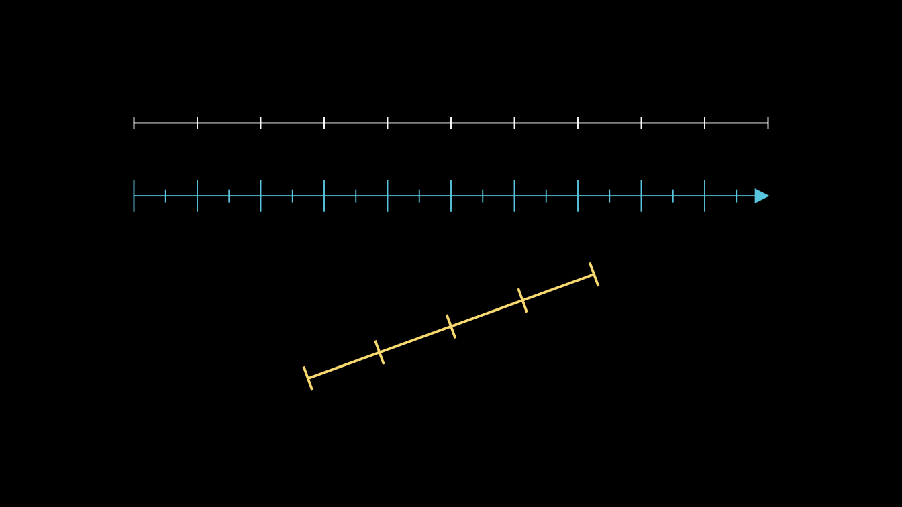

The arguments shown: `numbers_with_elongated_ticks` (values whose ticks
are `longer_tick_multiple` times longer), `include_tip`, `tick_size`
(half the tick length), `rotation` (radians), `stroke_width` and `color`
(passed on to the underlying
[`Line()`](https://adamrsophie.github.io/manimR/reference/geometry.md)).
`exclude_origin_tick = TRUE` leaves out the tick at zero and
`include_ticks = FALSE` all of them.

### Numbers on the line

`include_numbers = TRUE` labels every tick. The labels are
[`DecimalNumber()`](https://adamrsophie.github.io/manimR/reference/DecimalNumberClass.md)s
whose number of decimal places follows the step, so a step of 0.25 gives
two decimals. `numbers_to_exclude`, `numbers_to_include`, `font_size`,
`label_direction`, `line_to_number_buff` and `decimal_number_config`
control them:

``` r

integers <- NumberLine(x_range = c(-3, 3, 1), length = 9, include_numbers = TRUE,
                       numbers_to_exclude = 0)
quarters <- NumberLine(x_range = c(0, 1, 0.25), length = 9, include_numbers = TRUE,
                       label_direction = UP, font_size = 30, color = TEAL)
percent <- NumberLine(x_range = c(0, 100, 25), length = 9, include_numbers = TRUE,
                      decimal_number_config = list(num_decimal_places = 0, unit = "\\%"))
plot(VGroup(integers, quarters, percent)$arrange(DOWN, buff = 1))
```

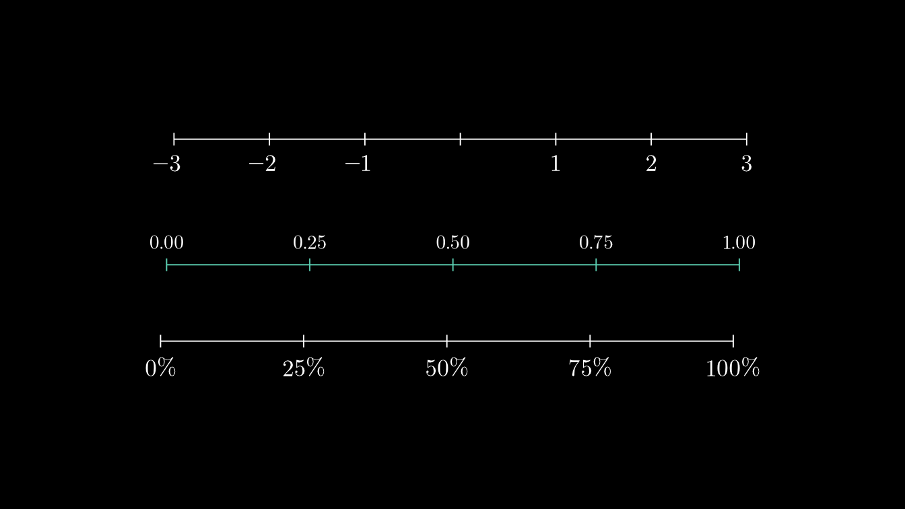

Labels can also be added after the fact. `add_numbers()` labels chosen
values, `get_number_mobject()` returns a single label (without adding
it), and `add_labels()` puts arbitrary text at named positions;
character labels are typeset with
[`Tex()`](https://adamrsophie.github.io/manimR/reference/tex.md), and
any mobject is used as it is:

``` r

line <- NumberLine(x_range = c(0, 10, 1), length = 10)
line$add_numbers(x_values = c(0, 5, 10), font_size = 32)
line$add_labels(list("2" = "start", "8" = Text("end", font_size = 28, color = RED)),
                direction = UP)
seven <- line$get_number_mobject(7, direction = DOWN, font_size = 48)$set_color(YELLOW)
plot(VGroup(line, seven))
```

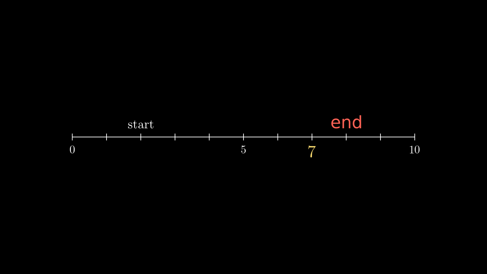

### From numbers to points and back

`number_to_point()` (alias `n2p()`) gives the scene point of a value and
`point_to_number()` (alias `p2n()`) goes the other way. A vector of
values gives a matrix with one point per row.

``` r

line <- NumberLine(x_range = c(-5, 5, 1), length = 10)
line$n2p(2)
#> [1] 2 0 0
line$n2p(c(-1, 0, 1))
#>      [,1] [,2] [,3]
#> [1,]   -1    0    0
#> [2,]    0    0    0
#> [3,]    1    0    0
line$p2n(c(-2.5, 0, 0))
#> [1] -2.5
line$get_tick_range()
#>  [1] -5 -4 -3 -2 -1  0  1  2  3  4  5
line$get_unit_size()
#> [1] 1
```

`rotate_about_number(number, angle)` turns the line about one of its
values and `rotate_about_zero(angle)` about 0. `get_tick_marks()`
returns the ticks, `get_tick(x)` builds one more, `get_unit_vector()` is
the vector from one integer to the next, and `get_number_mobjects(...)`
(or `get_labels()` for every tick) builds labels without adding them.

The animation below moves a pointer along a line with a
[`ValueTracker()`](https://adamrsophie.github.io/manimR/reference/ValueTrackerClass.md):

``` r

NumberLinePointer <- R6::R6Class("NumberLinePointer", inherit = Scene,
  public = list(construct = function() {
    line <- NumberLine(x_range = c(-4, 4, 1), length = 11, include_numbers = TRUE)
    x <- ValueTracker(-3)
    pointer <- Vector(0.8 * DOWN, color = YELLOW)
    pointer$add_updater(function(m) m$next_to(line$n2p(x$get_value()), UP, buff = 0.1))
    self$add(line, pointer)
    self$play(x$animate$set_value(2.5), run_time = 2)
    self$play(x$animate$set_value(PI), run_time = 1)
  })
)
```

### Scales: `LinearBase()` and `LogBase()`

How values map to positions is decided by a scale object, given as
`scaling`. `LinearBase(scale_factor)` is the default (a straight
multiple); `LogBase(base)` makes a logarithmic line. With a logarithmic
scale `x_range` is given in exponents: `c(0, 4, 1)` runs from 10^0 to
10^4 with a tick at each power.

``` r

LinearBase(scale_factor = 2)$func(3)
#> [1] 6
LinearBase(scale_factor = 2)$inverse_function(6)
#> [1] 3
LogBase()$func(3)
#> [1] 1000
LogBase()$inverse_function(1000)
#> [1] 3
LogBase(base = 2)$func(5)
#> [1] 32
```

The scale method is called `func()` because upstream’s name, `function`,
is a reserved word in R. With `custom_labels = TRUE` (the default for
[`LogBase()`](https://adamrsophie.github.io/manimR/reference/graph_scale.md))
the labels are powers such as 10^2, built by `get_custom_labels()`.

[`UnitInterval()`](https://adamrsophie.github.io/manimR/reference/NumberLine.md)
is a ready made line from 0 to 1 with ticks every 0.1, ten units long,
with elongated ticks at both ends.

``` r

unit <- UnitInterval(include_numbers = TRUE, font_size = 24)
logline <- NumberLine(x_range = c(0, 4, 1), length = 10, scaling = LogBase(),
                      include_numbers = TRUE, font_size = 30)
marker <- Dot(logline$n2p(300), color = RED)
plot(VGroup(unit, VGroup(logline, marker))$arrange(DOWN, buff = 1.2))
```

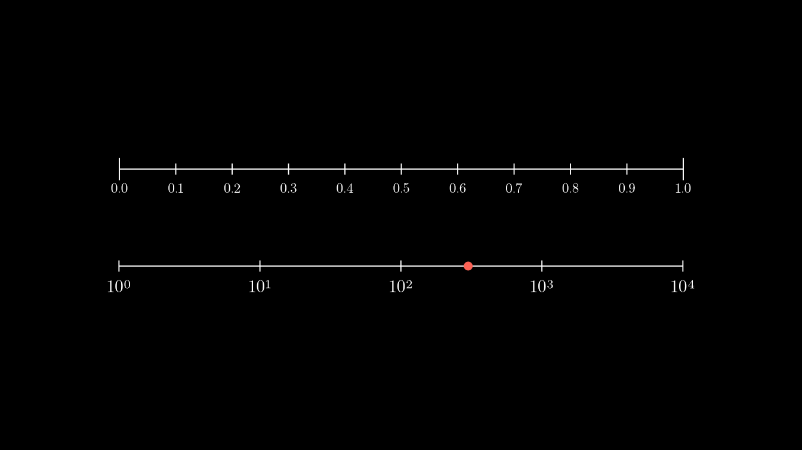

The red dot marks 300 on the logarithmic line, between 10^2 and 10^3.

## Axes

[`Axes()`](https://adamrsophie.github.io/manimR/reference/coordinate_systems.md)
puts an x and a y
[`NumberLine()`](https://adamrsophie.github.io/manimR/reference/NumberLine.md)
together, crossing where both coordinates are 0 (or at the end of a
range that excludes 0). The main arguments:

- `x_range`, `y_range`: `c(min, max, step)` of each axis;
- `x_length`, `y_length`: the drawn lengths (by default nearly the whole
  frame);
- `axis_config`: a list of
  [`NumberLine()`](https://adamrsophie.github.io/manimR/reference/NumberLine.md)
  arguments for both axes, and `x_axis_config`, `y_axis_config` for one
  of them;
- `tips`: whether the axes end in arrow tips.

``` r

ax <- Axes(x_range = c(-3, 3, 1), y_range = c(-2, 2, 1), x_length = 9, y_length = 5.5,
           axis_config = list(color = GREY_B), y_axis_config = list(include_tip = FALSE))
p <- ax$c2p(2, 1)
plot(VGroup(ax, ax$get_lines_to_point(p), Dot(p, color = YELLOW)))
```

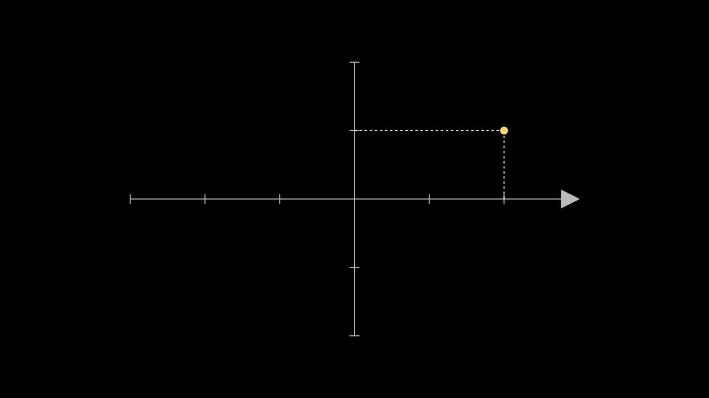

`coords_to_point()` (alias `c2p()`) turns coordinates into a scene point
and `point_to_coords()` (alias `p2c()`) does the reverse. Like upstream,
`c2p()` of two vectors returns coordinate rows (a 3 x n matrix), and
`c2p()` of a matrix with one coordinate pair per row returns one point
per row.

``` r

ax$c2p(2, 1)
#> [1] 3.000 1.375 0.000
ax$p2c(ax$c2p(2, 1))
#> [1] 2 1
ax$c2p(c(0, 1, 2), c(0, 1, 1.5))
#>      [,1]  [,2]   [,3]
#> [1,]    0 1.500 3.0000
#> [2,]    0 1.375 2.0625
#> [3,]    0 0.000 0.0000
ax$c2p(rbind(c(0, 0), c(1, 1)))
#>      [,1]  [,2] [,3]
#> [1,]  0.0 0.000    0
#> [2,]  1.5 1.375    0
ax$get_origin()
#> [1] 0 0 0
c(ax$get_x_unit_size(), ax$get_y_unit_size())
#> [1] 1.500 1.375
```

`get_x_axis()`, `get_y_axis()` and `get_axis(i)` return the
`NumberLine`s (`get_axes()` returns all of them as a group), so
everything from the previous section works on them, for example
`ax$get_x_axis()$n2p(1)`. `polar_to_point(r, theta)` (alias `pr2pt()`)
and `point_to_polar()` (`pt2pr()`) work with polar coordinates on any
coordinate system.

### Plotting functions: sine and cosine

`ax$plot(f)` draws `y = f(x)` over the x range of the axes, or over the
`x_range` you give. This is upstream’s classic example, with numbers on
the x axis, axis labels, graph labels and a vertical line at x = 2π:

``` r

axes <- Axes(
  x_range = c(-10, 10.3, 1), y_range = c(-1.5, 1.5, 1), x_length = 10,
  axis_config = list(color = GREEN),
  x_axis_config = list(numbers_to_include = seq(-10, 10, 2),
                       numbers_with_elongated_ticks = seq(-10, 10, 2)),
  tips = FALSE
)
axes_labels <- axes$get_axis_labels()
sin_graph <- axes$plot(sin, color = BLUE)
cos_graph <- axes$plot(cos, color = RED)
sin_label <- axes$get_graph_label(sin_graph, "\\sin(x)", x_val = -10, direction = UP / 2)
cos_label <- axes$get_graph_label(cos_graph, label = "\\cos(x)")
vert_line <- axes$get_vertical_line(axes$i2gp(TAU, cos_graph), color = YELLOW, line_func = Line)
line_label <- axes$get_graph_label(cos_graph, "x=2\\pi", x_val = TAU, direction = UR, color = WHITE)
plot(VGroup(axes, sin_graph, cos_graph, vert_line, axes_labels, sin_label, cos_label, line_label))
```

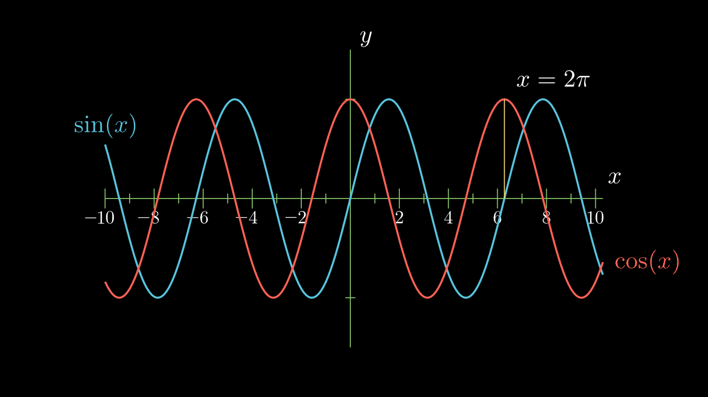

- `get_axis_labels(x_label = "x", y_label = "y")` labels both axes at
  their ends; `get_x_axis_label()` and `get_y_axis_label()` place one
  label, with `edge`, `direction` and `buff` to move it. A string is
  typeset with
  [`MathTex()`](https://adamrsophie.github.io/manimR/reference/tex.md);
  any mobject, for example a
  [`Text()`](https://adamrsophie.github.io/manimR/reference/TextClass.md),
  is used as it is. `get_axis_label(label, axis, edge, direction)` is
  the general form for any axis.
- `get_graph_label(graph, label, x_val, direction, buff, color, dot)`
  puts a label next to the graph at `x_val` (by default near the right
  end), and with `dot = TRUE` adds a dot on the graph.
- `input_to_graph_point(x, graph)` (alias `i2gp()`) is the scene point
  of the graph above `x`.

`add_coordinates()` labels the ticks of every axis. Give it vectors to
label only some values, or a named vector to use your own labels:

``` r

ax <- Axes(x_range = c(0, 6, 1), y_range = c(0, 4, 1), x_length = 9, y_length = 5, tips = FALSE)
ax$add_coordinates(1:5, c(2, 4))
labels <- ax$get_axis_labels(x_label = Text("time", font_size = 30), y_label = "v(t)")
plot(VGroup(ax, labels, ax$plot(function(t) 4 * t / (1 + t), color = YELLOW)))
```

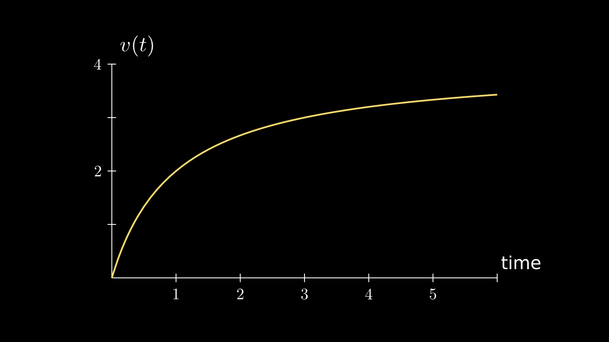

### Plot options

`ax$plot()` takes

- `x_range = c(min, max, step)`: the domain and the sampling step (by
  default a tenth of the tick step);
- `discontinuities` and `dt`: values where the curve is broken, and how
  far on each side to stop;
- `use_smoothing`: smooth the sampled points into Bezier curves
  (`TRUE`);
- `use_vectorized = TRUE`: call `f` once with all x values (faster for
  vectorized R functions);
- `colorscale` and `colorscale_axis`: color the graph by its y (axis 2)
  or x (axis 1) values;
- style arguments such as `color` and `stroke_width`.

``` r

ax <- Axes(x_range = c(-4, 4, 1), y_range = c(-4, 4, 1), x_length = 7, y_length = 7)$scale(0.95)
hyperbola <- ax$plot(function(x) 1 / x, x_range = c(-4, 4, 0.01),
                     discontinuities = 0, dt = 0.25, color = RED)
cubic <- ax$plot(function(x) x^3 / 4 - x, x_range = c(-2.9, 2.9),
                 colorscale = c(BLUE, GREEN, YELLOW, ORANGE), use_vectorized = TRUE,
                 stroke_width = 6)
plot(VGroup(ax, hyperbola, cubic))
```

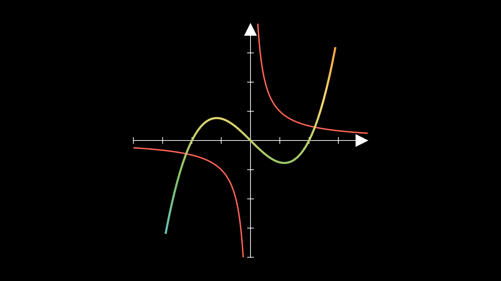

### Parametric, implicit and polar curves

`plot_parametric_curve(f, t_range)` draws `t -> c(x(t), y(t))` in the
axes’ coordinates, `plot_implicit_curve(f)` draws the curve
`f(x, y) = 0`, and `plot_polar_graph(r, theta_range)` draws `r(theta)`
(best on a `PolarPlane`, shown further down).

``` r

left <- Axes(x_range = c(-4, 4, 1), y_range = c(-4, 4, 1), x_length = 6, y_length = 6)
right <- left$copy()
VGroup(left, right)$arrange(RIGHT, buff = 1)
lemniscate <- left$plot_implicit_curve(function(x, y) (x^2 + y^2)^2 - 8 * (x^2 - y^2), color = BLUE)
lissajous <- right$plot_parametric_curve(function(t) c(3 * sin(2 * t), 3 * cos(3 * t)),
                                         t_range = c(0, TAU, 0.01), color = ORANGE)
spiral <- right$plot_polar_graph(function(th) th / 3, theta_range = c(0, 3 * PI), color = PINK)
plot(VGroup(left, lemniscate, right, lissajous, spiral))
```

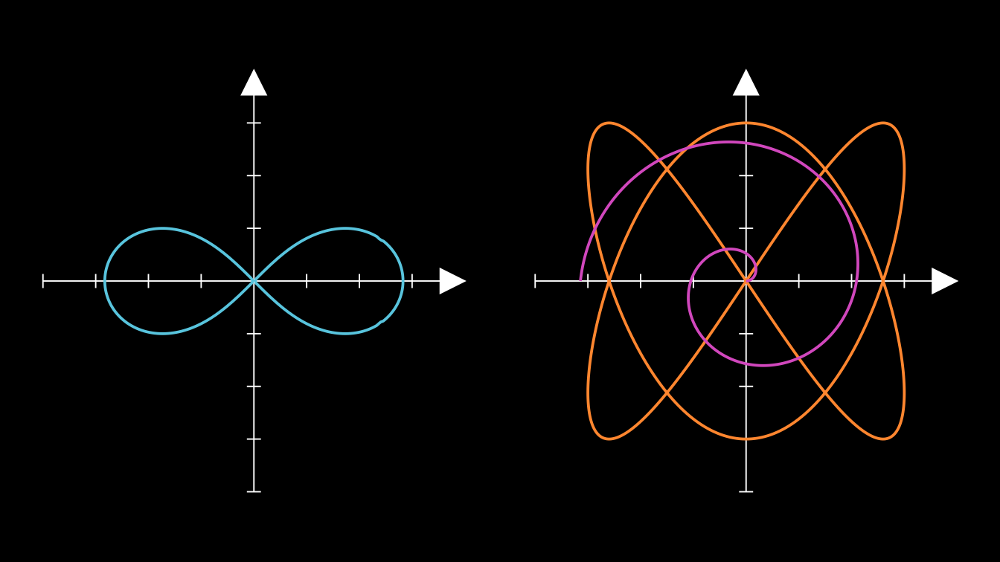

Note that the curves are created after the axes are moved: a graph is
computed from the axes’ position at the time you call
[`plot()`](https://rdrr.io/r/graphics/plot.default.html).

### Line graphs

`plot_line_graph(x_values, y_values)` joins data points with straight
segments and returns a `VDict` with the entries `"line_graph"` and
`"vertex_dots"`. This is upstream’s heat diagram:

``` r

ax <- Axes(x_range = c(0, 40, 5), y_range = c(-8, 32, 5), x_length = 9, y_length = 6,
           x_axis_config = list(numbers_to_include = seq(0, 35, 5)),
           y_axis_config = list(numbers_to_include = seq(-5, 30, 5)), tips = FALSE)
labels <- ax$get_axis_labels(x_label = Tex("$\\Delta Q$"), y_label = Tex("T[$^\\circ C$]"))
graph <- ax$plot_line_graph(x_values = c(0, 8, 38, 39), y_values = c(20, 0, 0, -5),
                            line_color = GOLD, vertex_dot_style = list(color = RED))
plot(VGroup(ax, labels, graph))
```

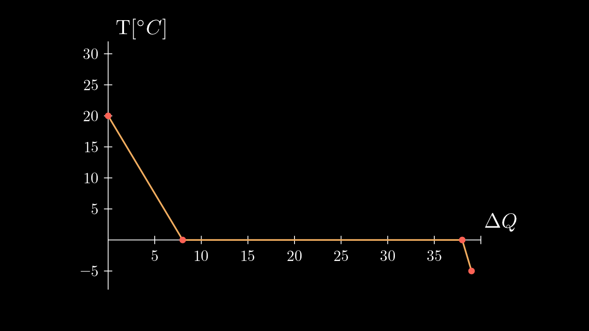

### Areas and Riemann sums

`get_area(graph, x_range)` fills the region between a graph and the x
axis, or between two graphs with `bounded_graph`.
`get_riemann_rectangles(graph, x_range, dx)` approximates the area with
rectangles; `input_sample_type` (`"left"`, `"right"` or `"center"`)
picks where each rectangle meets the graph, `color` is a gradient across
the rectangles, `show_signed_area` inverts the color of rectangles below
the axis, and `bounded_graph` measures from a second graph.
`get_vertical_line(point)` drops a dashed line from a point to the x
axis.

``` r

ax <- Axes(x_range = c(0, 5), y_range = c(0, 6),
           x_axis_config = list(numbers_to_include = c(2, 3)), tips = FALSE)
labels <- ax$get_axis_labels()
curve_1 <- ax$plot(function(x) 4 * x - x^2, x_range = c(0, 4), color = BLUE_C)
curve_2 <- ax$plot(function(x) 0.8 * x^2 - 3 * x + 4, x_range = c(0, 4), color = GREEN_B)
line_1 <- ax$get_vertical_line(ax$input_to_graph_point(2, curve_1), color = YELLOW)
line_2 <- ax$get_vertical_line(ax$i2gp(3, curve_1), color = YELLOW)
riemann_area <- ax$get_riemann_rectangles(curve_1, x_range = c(0.3, 0.6), dx = 0.03,
                                          color = BLUE, fill_opacity = 0.5)
area <- ax$get_area(curve_2, c(2, 3), bounded_graph = curve_1, color = GREY, opacity = 0.5)
plot(VGroup(ax, labels, curve_1, curve_2, line_1, line_2, riemann_area, area))
```

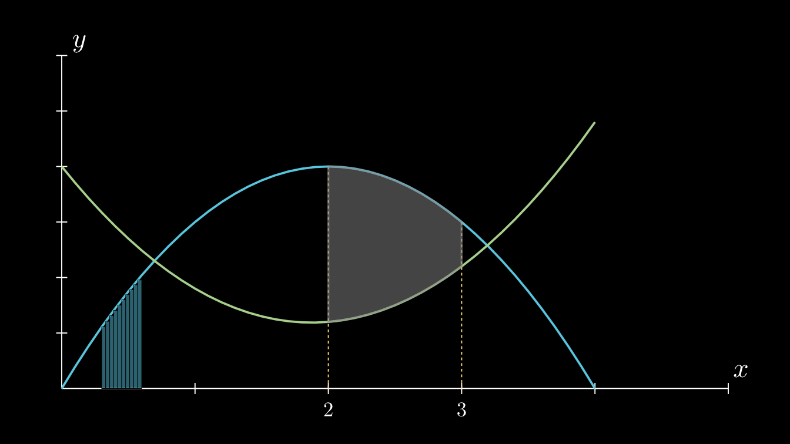

The classic Riemann sum animation refines the rectangles until they
become the area under the curve:

``` r

RiemannSum <- R6::R6Class("RiemannSum", inherit = Scene,
  public = list(construct = function() {
    ax <- Axes(x_range = c(0, 5, 1), y_range = c(0, 5, 1), x_length = 9, y_length = 6, tips = FALSE)
    f <- ax$plot(function(x) 0.2 * (x - 1) * (x - 3) * (x - 4.5) + 2.5, x_range = c(0.2, 5), color = YELLOW)
    rects <- lapply(c(0.5, 0.25, 0.1), function(dx) {
      ax$get_riemann_rectangles(f, x_range = c(0.5, 4.5), dx = dx, input_sample_type = "center",
                                color = c(BLUE, TEAL, GREEN), fill_opacity = 0.7, stroke_width = 0.5)
    })
    area <- ax$get_area(f, x_range = c(0.5, 4.5), color = c(BLUE, GREEN), opacity = 0.7)
    self$add(ax)
    self$play(Create(f), run_time = 1)
    self$play(Create(rects[[1]]), run_time = 1)
    for (k in 2:3) self$play(Transform(rects[[1]], rects[[k]]), run_time = 0.8)
    self$play(FadeOut(rects[[1]]), FadeIn(area), run_time = 0.8)
  })
)
```

### Values on graphs

A few methods compute numbers rather than mobjects:

``` r

ax <- Axes(x_range = c(-3, 3, 1), y_range = c(-1, 9, 1))
parabola <- ax$plot(function(x) x^2)
ax$input_to_graph_coords(2, parabola)   # alias i2gc()
#> [1] 2 4
ax$p2c(ax$i2gp(2, parabola))
#> [1] 2 4
ax$slope_of_tangent(2, parabola)
#> [1] 4
ax$angle_of_tangent(2, parabola) / DEGREES
#> [1] 75.96376
parabola$underlying_function(3)
#> [1] 9
```

`slope_of_tangent()` and `angle_of_tangent()` are measured in the axes’
coordinates. `graph$underlying_function` is the function you plotted,
while `graph$func` maps a value to a scene point.

### Lines to graphs, T labels and secants

``` r

ax <- Axes(x_range = c(0, 6, 1), y_range = c(0, 4, 1), x_length = 10, y_length = 6, tips = FALSE)
g <- ax$plot(function(x) 2 + sin(x), color = BLUE)
fan <- ax$get_vertical_lines_to_graph(g, x_range = c(0.5, 2.5), num_lines = 9, color = TEAL)
t_label <- ax$get_T_label(x_val = 4, graph = g, triangle_color = YELLOW, line_color = YELLOW)
h_line <- ax$get_horizontal_line(ax$i2gp(5, g), color = RED)
v_line <- ax$get_vertical_line(ax$i2gp(5, g), line_func = Line, color = RED)
plot(VGroup(ax, g, fan, t_label, h_line, v_line))
```

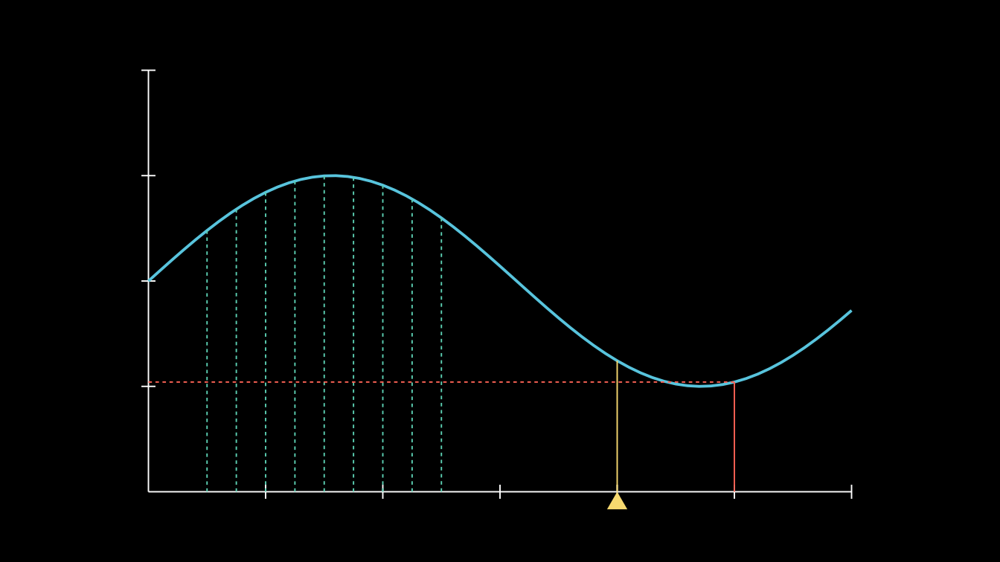

`get_vertical_line()`, `get_horizontal_line()` and
`get_lines_to_point()` (all built on
`get_line_from_axis_to_point(index, point)`) draw dashed lines by
default; `line_func = Line` gives solid ones, and `color`,
`stroke_width` and `line_config` style them.
`get_vertical_lines_to_graph()` draws `num_lines` evenly spaced lines
and `get_T_label()` a triangle marker with an optional `label` under it.

`get_secant_slope_group(x, graph, dx)` builds the classic picture of a
secant: the `dx` and `dy` legs, optional labels, and the secant line.

``` r

ax <- Axes(x_range = c(0, 4, 1), y_range = c(0, 7, 1), x_length = 8, y_length = 6, tips = FALSE)
f <- ax$plot(function(x) 0.4 * x^2 + 0.5, color = BLUE)
secant <- ax$get_secant_slope_group(x = 1.5, graph = f, dx = 1.5, dx_label = "dx", dy_label = "dy",
                                    secant_line_length = 6, secant_line_color = YELLOW)
plot(VGroup(ax, f, secant))
```

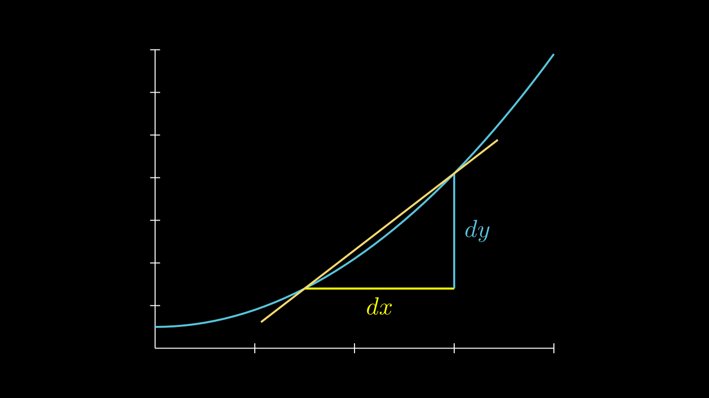

Shrinking `dx` turns the secant into the tangent. An updater made with
[`always_redraw()`](https://adamrsophie.github.io/manimR/reference/updater_helpers.md)
rebuilds the group every frame:

``` r

SecantToTangent <- R6::R6Class("SecantToTangent", inherit = Scene,
  public = list(construct = function() {
    ax <- Axes(x_range = c(0, 4, 1), y_range = c(0, 7, 1), x_length = 8, y_length = 6, tips = FALSE)
    f <- ax$plot(function(x) 0.4 * x^2 + 0.5, color = BLUE)
    dx <- ValueTracker(2)
    secant <- always_redraw(function() {
      ax$get_secant_slope_group(x = 1.5, graph = f, dx = dx$get_value(),
                                secant_line_length = 6, secant_line_color = YELLOW)
    })
    self$add(ax, f, secant)
    self$play(dx$animate$set_value(0.01), run_time = 2)
  })
)
```

### A moving tangent line and the derivative

`plot_derivative_graph(graph)` plots the slope of a graph and
`plot_antiderivative_graph(graph, y_intercept)` its integral (computed
numerically). In this animation a tangent line slides along a curve
while a dot traces the derivative: the dot’s height is always the
tangent’s slope. The axes use one unit per coordinate in both
directions, so slopes on the screen equal slopes in coordinates.

``` r

MovingTangent <- R6::R6Class("MovingTangent", inherit = Scene,
  public = list(construct = function() {
    ax <- Axes(x_range = c(-5, 5, 1), y_range = c(-3, 3, 1), x_length = 10, y_length = 6)
    f <- ax$plot(function(x) sin(x) + 0.3 * x, color = BLUE)
    df <- ax$plot_derivative_graph(f, color = GREEN)
    x <- ValueTracker(-4)
    tangent <- always_redraw(function() {
      Line(LEFT, RIGHT, color = YELLOW)$set_length(3)$
        rotate(ax$angle_of_tangent(x$get_value(), f))$
        move_to(ax$i2gp(x$get_value(), f))
    })
    on_f <- always_redraw(function() Dot(ax$i2gp(x$get_value(), f), color = YELLOW))
    on_df <- always_redraw(function() Dot(ax$i2gp(x$get_value(), df), color = GREEN))
    self$add(ax, f, df, tangent, on_f, on_df)
    self$play(x$animate$set_value(4), run_time = 3, rate_func = linear)
  })
)
```

Both helpers return ordinary graphs, so labels and areas work on them
too:

``` r

ax <- Axes(x_range = c(0, 6.5, 1), y_range = c(-1.5, 3, 1), x_length = 10, y_length = 6, tips = FALSE)
f <- ax$plot(sin, x_range = c(0, 6.5), color = BLUE)
df <- ax$plot_derivative_graph(f, color = GREEN)
big_f <- ax$plot_antiderivative_graph(f, y_intercept = 0, color = ORANGE)
labels <- VGroup(
  ax$get_graph_label(f, "f(x) = \\sin x", x_val = 4.5, direction = DOWN),
  ax$get_graph_label(df, "f'(x)", x_val = 5.2, direction = UP),
  ax$get_graph_label(big_f, "F(x)", x_val = 2.6, direction = UL, dot = TRUE)
)
plot(VGroup(ax, f, df, big_f, labels))
```

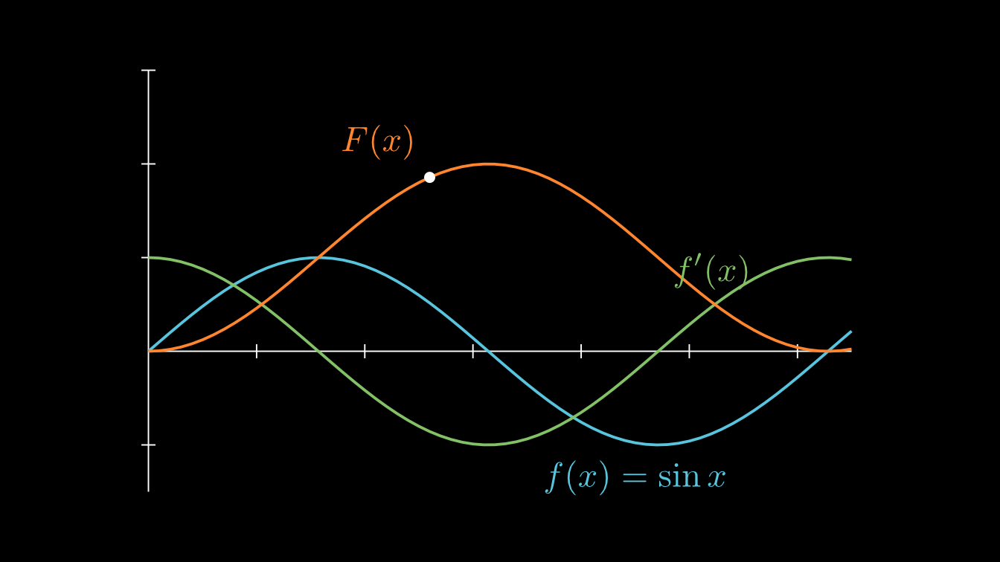

## Planes

### NumberPlane

[`NumberPlane()`](https://adamrsophie.github.io/manimR/reference/coordinate_systems.md)
is an `Axes` with a grid. By default it covers the whole frame with one
unit per square. `background_line_style` styles the grid lines and
`faded_line_ratio` adds fainter lines between them (2 means one faint
line per cell). `get_vector(coords)` draws an arrow from the origin.

``` r

plane <- NumberPlane(
  x_range = c(-7, 7, 1), y_range = c(-4, 4, 1),
  background_line_style = list(stroke_color = TEAL, stroke_width = 2, stroke_opacity = 0.6),
  faded_line_ratio = 2
)
v <- plane$get_vector(c(3, 2), color = YELLOW)
w <- plane$get_vector(c(-2, 1), color = RED)
plot(VGroup(plane, v, w))
```

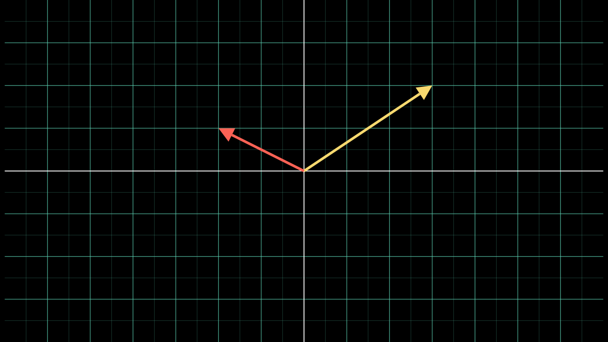

The grid lines are in `plane$background_lines` and `plane$faded_lines`.

A plane can be bent by any function of points. Straight lines only have
two anchors, so call `prepare_for_nonlinear_transform()` first to give
them enough points to curve smoothly:

``` r

PlaneWarp <- R6::R6Class("PlaneWarp", inherit = Scene,
  public = list(construct = function() {
    grid <- NumberPlane()
    self$add(grid)
    grid$prepare_for_nonlinear_transform()
    self$play(grid$animate$apply_function(function(p) {
      p + c(sin(p[2]), sin(p[1]), 0)
    }), run_time = 2)
  })
)
```

### PolarPlane

[`PolarPlane()`](https://adamrsophie.github.io/manimR/reference/coordinate_systems.md)
draws circles and rays. `radius_max` and `radius_step` set the circles,
`size` the diameter on screen, `azimuth_step` the number of rays, and
`azimuth_units` the angle labels: `"PI radians"`, `"TAU radians"`,
`"degrees"`, `"gradians"` or `NULL` (plain fractions of a turn).
`azimuth_compact_fraction`, `azimuth_offset`, `azimuth_direction`
(`"CCW"` or `"CW"`), `azimuth_label_buff` and `azimuth_label_font_size`
fine tune the labels. `add_coordinates()` writes them;
`get_coordinate_labels()` returns them without adding, and
`get_radian_label(number)` builds one angle label.

``` r

radians <- PolarPlane(radius_max = 2, size = 5, azimuth_units = "PI radians", azimuth_step = 8)
radians$add_coordinates()
degrees <- PolarPlane(radius_max = 2, size = 5, azimuth_units = "degrees", azimuth_step = 12,
                      azimuth_direction = "CW", radius_config = list(font_size = 20))
degrees$add_coordinates()
rose <- radians$plot_polar_graph(function(th) 2 * sin(3 * th), theta_range = c(0, PI), color = PINK)
plot(VGroup(VGroup(radians, rose), degrees)$arrange(RIGHT, buff = 1.5))
```

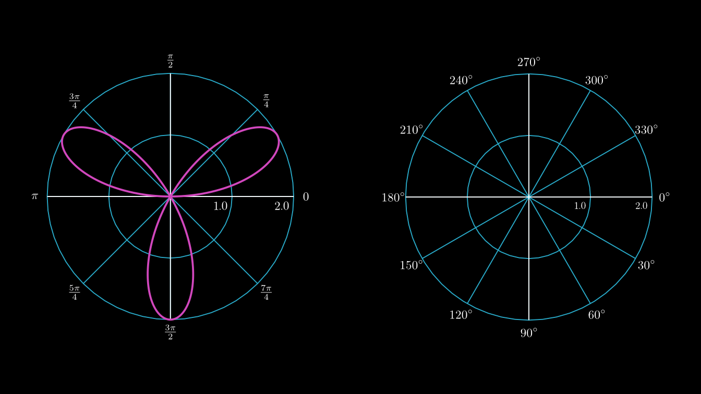

`plane$pr2pt(r, theta)` turns polar coordinates into a scene point:

``` r

plane <- PolarPlane(radius_max = 3)
plane$pr2pt(2, PI / 2)
#> [1] 1.224647e-16 2.000000e+00 0.000000e+00
plane$pt2pr(c(0, 2, 0))
#> [1] 2.000000 1.570796
```

### ComplexPlane

[`ComplexPlane()`](https://adamrsophie.github.io/manimR/reference/coordinate_systems.md)
is a `NumberPlane` addressed by complex numbers: `n2p()` takes a complex
number and `p2n()` returns one. Its `add_coordinates()` takes complex
numbers and labels the imaginary axis with an `i`; without arguments it
labels `get_default_coordinate_values()`, and `get_coordinate_labels()`
returns the labels without adding them.

``` r

plane <- ComplexPlane(x_range = c(-4, 4, 1), y_range = c(-3, 3, 1), x_length = 8, y_length = 6)
plane$add_coordinates(-3:3, complex(imaginary = c(-2, -1, 1, 2)))
z <- complex(real = 1.5, imaginary = 0.5)
dots <- VGroup(Dot(plane$n2p(z), color = YELLOW), Dot(plane$n2p(z^2), color = RED))
labels <- VGroup(MathTex("z")$next_to(dots[1], UR, buff = 0.1),
                 MathTex("z^2")$next_to(dots[2], UR, buff = 0.1))
plot(VGroup(plane, dots, labels))
```

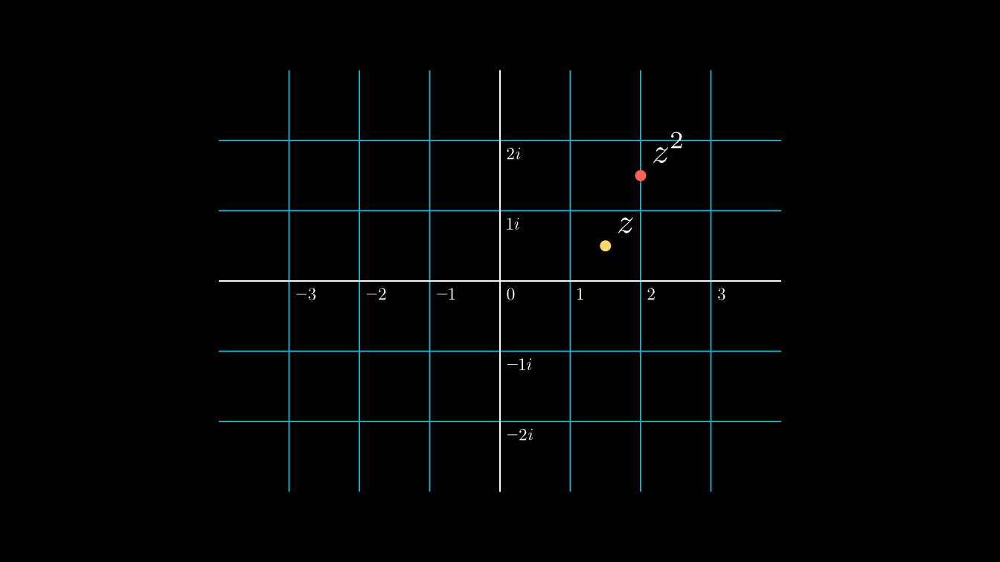

``` r

plane <- ComplexPlane()
plane$n2p(complex(real = 2, imaginary = 1))
#> [1] 2 1 0
plane$p2n(c(-1, 3, 0))
#> [1] -1+3i
```

`ApplyComplexFunction(f, mobject)` animates any mobject through a
complex function: every point `x + iy` moves to `f(x + iy)`. Here a grid
is squared:

``` r

ComplexSquare <- R6::R6Class("ComplexSquare", inherit = Scene,
  public = list(construct = function() {
    plane <- ComplexPlane(x_range = c(-2, 2, 0.5), y_range = c(-2, 2, 0.5), x_length = 4, y_length = 4,
                          background_line_style = list(stroke_color = BLUE, stroke_width = 2))
    plane$prepare_for_nonlinear_transform()
    self$add(plane)
    self$play(ApplyComplexFunction(function(z) z^2 / 2, plane), run_time = 2)
  })
)
```

The mobject method `apply_complex_function()` does the same without
animation. It works in scene coordinates, which are the complex
coordinates when the plane is centered with one unit per step:

``` r

plane <- ComplexPlane(x_range = c(-7, 7, 1), y_range = c(-4, 4, 1))
circle <- Circle(radius = 1, color = YELLOW)
image <- circle$copy()$apply_complex_function(exp)$set_color(RED)
plot(VGroup(plane, circle, image))
```

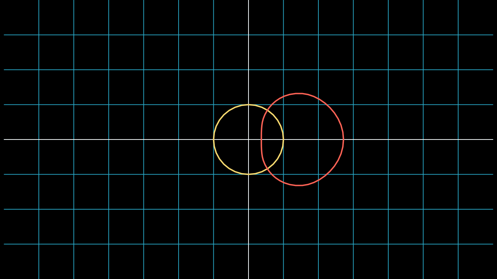

### ThreeDAxes

[`ThreeDAxes()`](https://adamrsophie.github.io/manimR/reference/coordinate_systems.md)
adds a z axis, with `z_range`, `z_length` and `z_axis_config`;
`get_z_axis()` returns it and `get_z_axis_label()` labels it. Every
plotting method above works in 3D (with a third coordinate where it
makes sense), and `plot_surface()` draws `z = f(x, y)`. They need a
`ThreeDScene` to be viewed from an angle, so they are covered in
[Cameras and 3D
scenes](https://adamrsophie.github.io/manimR/articles/cameras-and-3d.md).
A quick taste, a helix drawn with `plot_parametric_curve()`:

``` r

Helix <- R6::R6Class("Helix", inherit = ThreeDScene,
  public = list(construct = function() {
    axes <- ThreeDAxes(x_range = c(-3, 3, 1), y_range = c(-3, 3, 1), z_range = c(0, 4, 1),
                       x_length = 6, y_length = 6, z_length = 4)
    helix <- axes$plot_parametric_curve(function(t) c(2 * cos(t), 2 * sin(t), t / 4),
                                        t_range = c(0, 4 * PI, 0.05), color = YELLOW)
    self$set_camera_orientation(phi = 70 * DEGREES, theta = -50 * DEGREES, zoom = 0.8,
                                frame_center = c(0, 0, 1.5))
    self$add(axes)
    self$play(Create(helix), run_time = 2)
  })
)
```

## Function graphs without axes

Three mobjects draw curves directly in scene coordinates:

- `ParametricFunction(func, t_range)`: `func(t)` returns `c(x, y)` or
  `c(x, y, z)`; `t_range = c(min, max, step)`. With
  `use_vectorized = TRUE` the function receives all `t` values at once
  and returns coordinate rows, such as `rbind(x, y, z)`.
  `discontinuities`, `dt`, `use_smoothing` and `scaling` work as for
  `ax$plot()`.
- `FunctionGraph(f, x_range)`: `y = f(x)`, by default across the whole
  frame.
- `ImplicitFunction(f, x_range, y_range)`: the curve `f(x, y) = 0`.
  `min_depth` and `max_quads` set the sampling resolution.

``` r

lissajous <- ParametricFunction(function(t) c(2 * sin(2 * t), 1.6 * sin(3 * t), 0),
                                t_range = c(0, TAU, 0.01), color = ORANGE)
spiral <- ParametricFunction(function(t) rbind(t / 10 * cos(t), t / 10 * sin(t), 0),
                             t_range = c(0, 6 * PI, 0.05), use_vectorized = TRUE, color = TEAL)
heart <- ImplicitFunction(function(x, y) (x^2 + y^2 - 1)^3 - x^2 * y^3,
                          x_range = c(-1.5, 1.5), y_range = c(-1.5, 1.5), color = RED)$scale(1.6)
VGroup(lissajous, spiral, heart)$arrange(RIGHT, buff = 0.8)$shift(0.8 * UP)
wave <- FunctionGraph(function(x) 0.4 * cos(2 * x), x_range = c(-7, 7), color = BLUE)$shift(2.9 * DOWN)
plot(VGroup(lissajous, spiral, heart, wave))
```

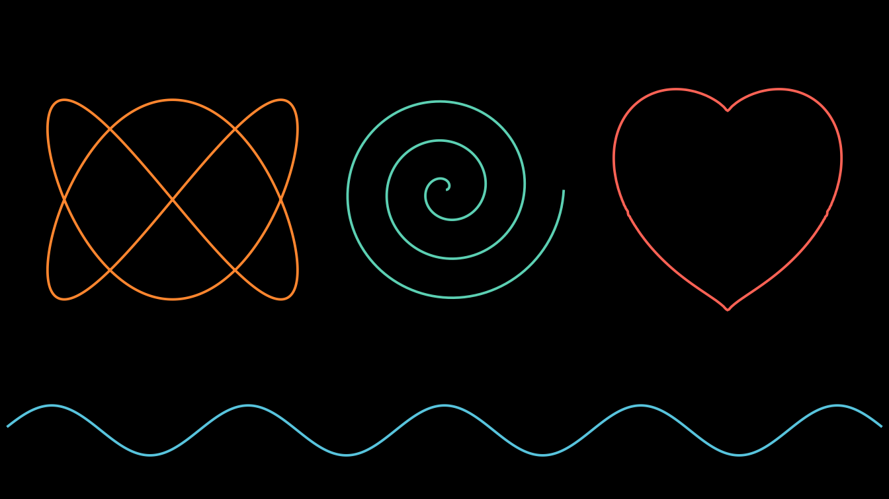

The function of a graph stays available: `get_function()` returns the
function you gave, and `graph$func` (or `get_point_from_function(t)`)
the point function.

``` r

wave$get_function()(0)
#> [1] 0.4
lissajous$func(PI / 4)
#> [1] 2.000000 1.131371 0.000000
c(lissajous$t_min, lissajous$t_max)
#> [1] 0.000000 6.283185
```

## Bar charts

`BarChart(values, bar_names)` is an `Axes` with one bar per value. The y
range is computed from the values unless you give `y_range`.
`bar_colors` is a gradient spread across the bars, and `bar_width`,
`bar_fill_opacity` and `bar_stroke_width` style them. `get_bar_labels()`
returns the values as labels above (or below) the bars. This is
upstream’s example:

``` r

chart <- BarChart(
  values = c(-5, 40, -10, 20, -3),
  bar_names = c("one", "two", "three", "four", "five"),
  y_range = c(-20, 50, 10), y_length = 6, x_length = 10,
  x_axis_config = list(font_size = 36)
)
bar_labels <- chart$get_bar_labels(font_size = 48)
plot(VGroup(chart, bar_labels))
```

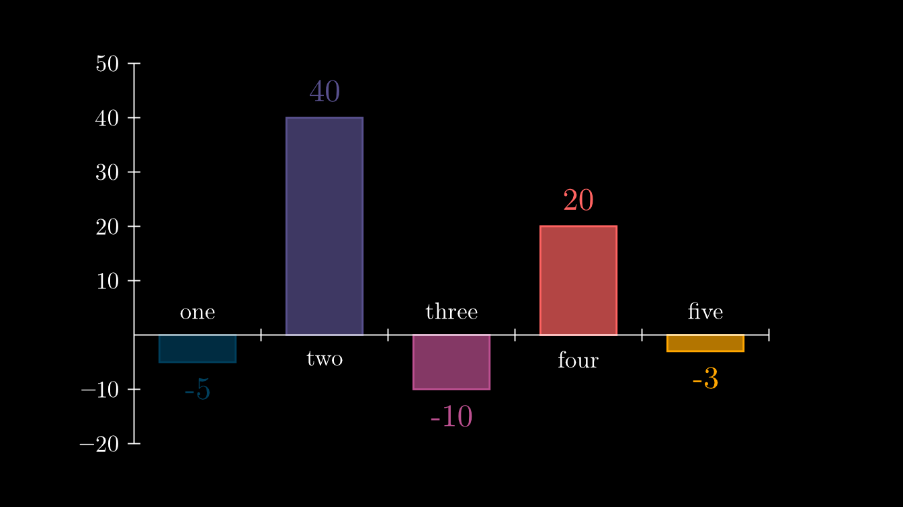

The bars are in `chart$bars`. `change_bar_values()` resizes them (and
`update_colors()` reapplies the gradient), and through `$animate` the
change is animated:

``` r

BarChartChange <- R6::R6Class("BarChartChange", inherit = Scene,
  public = list(construct = function() {
    chart <- BarChart(c(3, 5, 2, 6), bar_names = c("A", "B", "C", "D"),
                      y_range = c(0, 8, 2), y_length = 5, x_length = 8)
    self$add(chart)
    self$play(chart$animate$change_bar_values(c(6, 2, 7, 3)), run_time = 1.5)
    self$play(chart$bars[1]$animate$set_color(YELLOW), run_time = 0.5)
  })
)
```

## Sample spaces

[`SampleSpace()`](https://adamrsophie.github.io/manimR/reference/probability.md)
is a rectangle for drawing probabilities as areas.
`divide_horizontally(p_list)` and `divide_vertically(p_list)` split it
into parts proportional to the probabilities (a missing last part is
added so they sum to 1, see `complete_p_list()`), and `space[i]` returns
part `i`, which is itself a `SampleSpace` and can be divided again.
`get_horizontal_division()` and `get_vertical_division()` return the
parts without adding them, and `add_title()` writes a title above the
space.

`get_side_braces_and_labels()`, `get_top_braces_and_labels()` and
`get_bottom_braces_and_labels()` make braces with labels for the parts
of a division, and `add_braces_and_labels()` adds them all to the space:

``` r

space <- SampleSpace(width = 6, height = 4)
space$divide_horizontally(0.3, colors = c(GREEN_E, BLUE_E))
lower <- space[2]
lower$divide_vertically(0.6, colors = c(MAROON_B, YELLOW))
space$add_title("Sample space")
side <- space$get_side_braces_and_labels(c("P(A)", "P(\\bar{A})"))
bottom <- lower$get_bottom_braces_and_labels(c("P(B|\\bar{A})", "P(\\bar{B}|\\bar{A})"))
plot(VGroup(space, side, bottom)$move_to(ORIGIN))
```

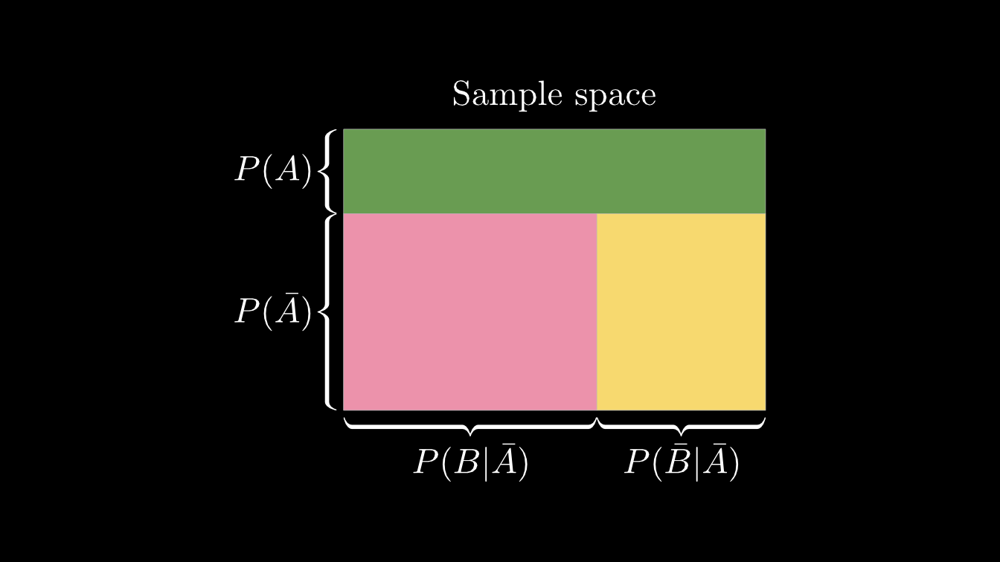

## Network graphs

`Graph(vertices, edges)` draws a graph in the sense of graph theory:
vertices (by default
[`Dot()`](https://adamrsophie.github.io/manimR/reference/geometry.md)s)
joined by edges (by default
[`Line()`](https://adamrsophie.github.io/manimR/reference/geometry.md)s).
[`DiGraph()`](https://adamrsophie.github.io/manimR/reference/GenericGraphClass.md)
draws a directed graph with arrows. Vertices are named by strings
(numbers are converted), edges are pairs of names given as a list or a
two column matrix. manimR computes the layouts itself (they are ports of
the networkx layouts), so no graph package is needed.

### Layouts

`layout` is one of the names below, a named list of positions, or a
function `function(graph, scale, ...)` returning such a list.
`layout_scale` is the half width of the layout and `layout_config`
passes extra settings to it.

| Layout | Notes |
|----|----|
| `"spring"` | Force directed (Fruchterman and Reingold). Random start: give `layout_config = list(seed = 1)` for a reproducible picture. `pos` gives starting positions and `fixed` the vertices that keep them, `center` shifts the result, and `dim = 3` lays the graph out in 3D. |
| `"circular"` | Vertices on a circle. |
| `"kamada_kawai"` | Places vertices so that their distances match path lengths. Optional `dist`. |
| `"planar"` | A drawing without crossings; fails for graphs that are not planar. |
| `"random"` | Uniform random positions; takes `seed`. |
| `"shell"` | Concentric circles given by `nlist`, a list of vertex groups. |
| `"spectral"` | Eigenvectors of the graph Laplacian. |
| `"spiral"` | A spiral; `resolution` and `equidistant`. |
| `"tree"` | Needs a tree and `root_vertex`; optional `vertex_spacing` and `orientation`. |
| `"partite"` | Columns given by `partitions`; `align = "horizontal"` for rows. |

The same binary tree in every layout:

``` r

vertices <- 1:7
edges <- list(c(1, 2), c(1, 3), c(2, 4), c(2, 5), c(3, 6), c(3, 7))
configs <- list(
  spring = list(seed = 1), circular = list(), kamada_kawai = list(), planar = list(),
  random = list(seed = 2), shell = list(nlist = list(1, 2:3, 4:7)), spectral = list(),
  spiral = list(), tree = list(root_vertex = 1), partite = list(partitions = list(1, 2:3, 4:7))
)
panels <- lapply(names(configs), function(layout) {
  g <- Graph(vertices, edges, layout = layout, layout_scale = 1, layout_config = configs[[layout]],
             vertex_config = list(radius = 0.07), edge_config = list(stroke_width = 2))
  VGroup(g, Text(layout, font_size = 22)$next_to(g, DOWN, buff = 0.25))
})
plot(VGroup(panels)$arrange_in_grid(rows = 2, buff = c(0.6, 0.5)))
```

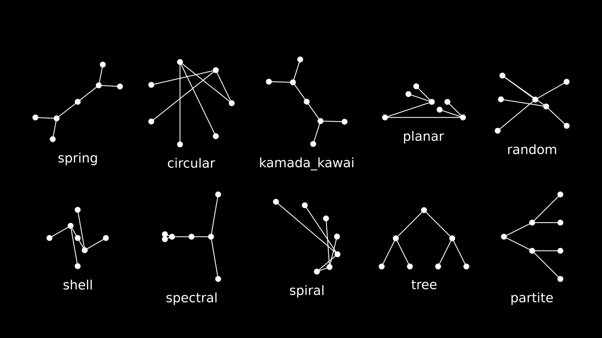

`root_vertex` and `partitions` can also be given directly to
[`Graph()`](https://adamrsophie.github.io/manimR/reference/GenericGraphClass.md).

### Graphs from igraph

If your network lives in an igraph object,
`GraphClass$from_igraph(g, ...)` and `DiGraphClass$from_igraph(g, ...)`
build a `Graph` or `DiGraph` with its vertices (by name, when they have
names) and edges; the other arguments go to the constructor. This is the
R counterpart of upstream’s `Graph.from_networkx()`. Here is Zachary’s
karate club network, which comes with igraph:

``` r

karate <- igraph::make_graph("Zachary")
club <- GraphClass$from_igraph(karate, layout = "kamada_kawai", layout_scale = 3.5,
                               vertex_config = list(radius = 0.1, fill_color = TEAL),
                               edge_config = list(stroke_width = 1.5, stroke_opacity = 0.6))
club$get(1)$set_color(YELLOW)
club$get(34)$set_color(RED)
plot(club)
```

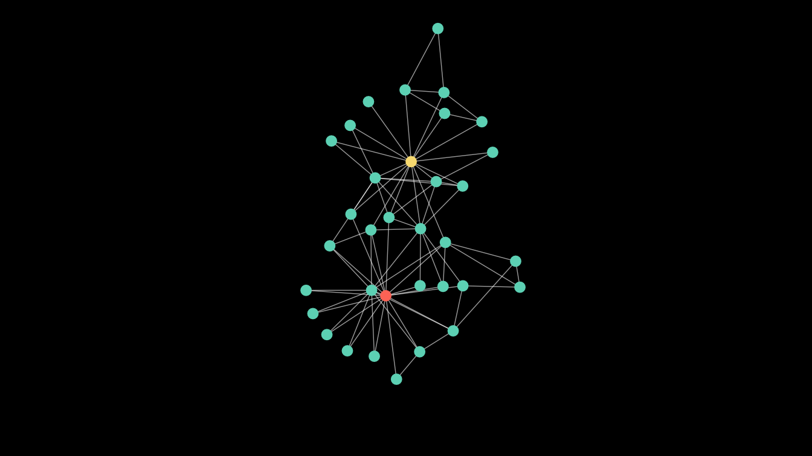

``` r

club
#> Undirected graph on 34 vertices and 78 edges
```

### Vertex and edge styles, labels and custom positions

`vertex_config` is a list of arguments for the vertex constructor; an
entry named after a vertex replaces the defaults for that vertex only.
`edge_config` works the same way for edges, with entries named `"u-v"`.
`labels = TRUE` writes the vertex names on the vertices with
[`MathTex()`](https://adamrsophie.github.io/manimR/reference/tex.md)
(the vertices become
[`LabeledDot()`](https://adamrsophie.github.io/manimR/reference/geometry.md)s);
a named list of mobjects gives your own labels. `vertex_type` and
`edge_type` choose other mobjects, for example `vertex_type = Square`.

``` r

ids <- c("a", "b", "c", "d")
text_labels <- setNames(lapply(ids, function(v) Text(v, font_size = 30, color = BLACK)), ids)
g <- Graph(
  ids, list(c("a", "b"), c("b", "c"), c("c", "d"), c("d", "a"), c("a", "c")),
  layout = list(a = c(-2, 1.5, 0), b = c(2, 1.5, 0), c = c(2, -1.5, 0), d = c(-2, -1.5, 0)),
  labels = text_labels,
  vertex_config = list(fill_color = BLUE_B, d = list(fill_color = RED_B)),
  edge_config = list(stroke_width = 4, "a-c" = list(color = YELLOW, stroke_width = 8))
)$shift(3.5 * LEFT)
dg <- DiGraph(
  1:4, list(c(1, 2), c(2, 3), c(3, 4), c(4, 1), c(1, 3)),
  layout = "circular", layout_scale = 2,
  vertex_type = Square, vertex_config = list(side_length = 0.5, fill_opacity = 1, fill_color = TEAL),
  edge_config = list(tip_config = list(tip_length = 0.25, tip_width = 0.25),
                     "1-3" = list(color = ORANGE))
)$shift(3.5 * RIGHT)
plot(VGroup(g, dg))
```

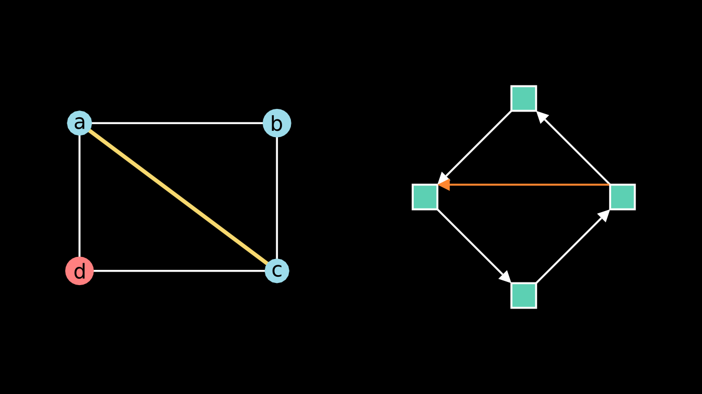

``` r

g
#> Undirected graph on 4 vertices and 5 edges
```

Look up a vertex with `g$get("a")` (or `g$vertices[["a"]]`) and an edge
with `g$get(c("a", "c"))`. `vertex_ids()`, `neighbors(v)` and
`is_tree()` answer questions about the structure. Moving a vertex drags
its edges along, because the graph keeps them attached with an updater.

### Changing a graph

`add_vertices()`, `remove_vertices()`, `add_edges()` and
`remove_edges()` change the graph (`remove_vertex()`, `add_edge()` and
`remove_edge()` handle one at a time), and `change_layout()` moves the
vertices to a new layout. Through `$animate` each of them is animated:
new vertices and edges are drawn with
[`Create()`](https://adamrsophie.github.io/manimR/reference/creation.md),
removed ones with
[`Uncreate()`](https://adamrsophie.github.io/manimR/reference/creation.md),
and the layout change moves the vertices smoothly. Pass animation
settings with `g$animate(run_time = 2)$...`, or another animation with
`g$animate(animation = FadeIn)$...`.

``` r

GraphChanges <- R6::R6Class("GraphChanges", inherit = Scene,
  public = list(construct = function() {
    g <- Graph(1:4, list(c(1, 2), c(2, 3), c(3, 4)), layout = "circular", layout_scale = 2,
               vertex_config = list(radius = 0.15))
    self$play(Create(g), run_time = 1)
    self$play(g$animate$add_vertices(5, 6, positions = list("5" = c(-4, 0, 0), "6" = c(4, 0, 0))),
              run_time = 0.8)
    self$play(g$animate$add_edges(c(4, 5), c(5, 6), c(6, 1)), run_time = 0.8)
    self$play(g$animate$change_layout("circular", layout_scale = 2.5), run_time = 1)
    self$play(g$get(1)$animate$shift(1.5 * RIGHT), run_time = 0.8)
    self$play(g$animate$remove_edges(c(6, 1)), run_time = 0.8)
    self$play(g$animate(animation = FadeOut)$remove_vertices(3), run_time = 0.8)
  })
)
```

## Vector fields

A vector field is a function from a position `c(x, y, z)` to a vector.
[`ArrowVectorField()`](https://adamrsophie.github.io/manimR/reference/VectorFieldClass.md)
draws it as a grid of arrows and
[`StreamLines()`](https://adamrsophie.github.io/manimR/reference/VectorFieldClass.md)
as the paths of particles flowing through it. Unless `color` is given,
the vectors are colored by their length mapped onto the gradient
`colors` (by default `DEFAULT_SCALAR_FIELD_COLORS`) between
`min_color_scheme_value` and `max_color_scheme_value`; `color_scheme`
replaces the length by any function of the vector.

``` r

DEFAULT_SCALAR_FIELD_COLORS
#> [1] "#236B8E" "#83C167" "#F7D96F" "#FC6255"
```

The methods `eval_func(pos)`, `pos_to_color(pos)` and `pos_to_rgb(pos)`
of any field return the vector at a position and its color.

### Arrow fields

`x_range` and `y_range` (`c(min, max, step)`) set the grid of arrows,
`length_func` maps each vector’s length to the drawn length (by default
lengths are squashed below 0.45 so arrows do not overlap), `opacity`
fades them, and `vector_config` is passed to each
[`Vector()`](https://adamrsophie.github.io/manimR/reference/geometry.md).
On the left the default coloring, on the right a single color and arrows
of a fixed length:

``` r

func <- function(p) sin(p[2] / 2) * RIGHT + cos(p[1] / 2) * UP
colored <- ArrowVectorField(func, x_range = c(-6.75, -0.75, 0.75), y_range = c(-3, 3, 0.75),
                            min_color_scheme_value = 0.5, max_color_scheme_value = 1.4,
                            colors = c(BLUE, GREEN, YELLOW, RED))
fixed <- ArrowVectorField(func, x_range = c(0.75, 6.75, 0.75), y_range = c(-3, 3, 0.75),
                          color = YELLOW, length_func = function(norm) 0.4)
plot(VGroup(colored, fixed))
```

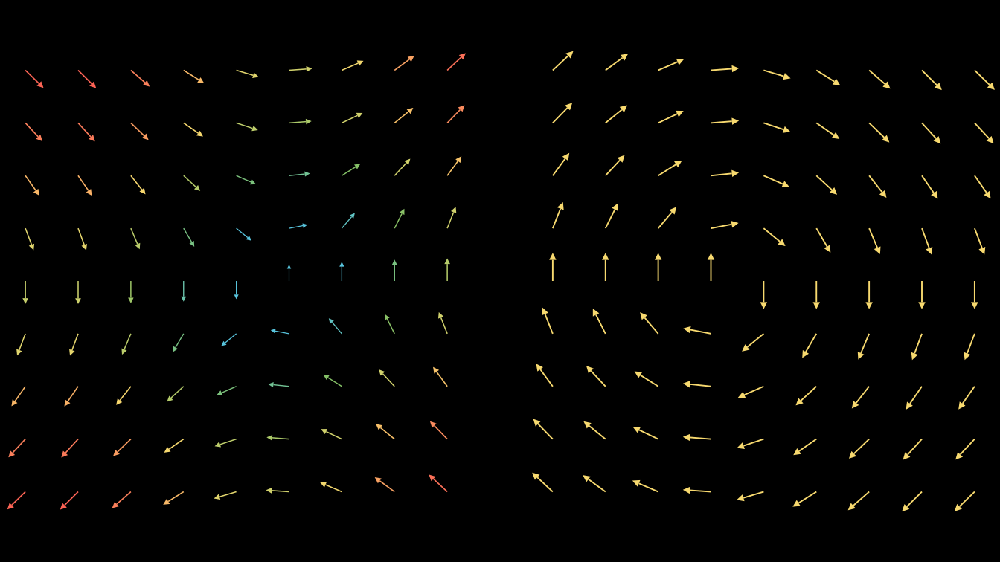

### Moving mobjects along a field

`nudge(mob, dt, substeps, pointwise)` moves a mobject along the field
for a time `dt` (by its center, or every point separately with
`pointwise = TRUE`, which deforms it).
`get_nudge_updater(speed, pointwise)` returns an updater that does this
every frame. This is upstream’s nudging example: the circle and the dot
are first nudged two seconds backwards, then flow forwards through their
starting position (the gray circle) and beyond.

``` r

Nudging <- R6::R6Class("Nudging", inherit = Scene,
  public = list(construct = function() {
    func <- function(p) sin(p[2] / 2) * RIGHT + cos(p[1] / 2) * UP
    field <- ArrowVectorField(func, x_range = c(-7, 7, 1), y_range = c(-4, 4, 1),
                              length_func = function(x) x / 2)
    self$add(field)
    circle <- Circle(radius = 2)$shift(LEFT)
    self$add(circle$copy()$set_color(GREY))
    dot <- Dot()$move_to(circle)
    field$nudge(circle, -2, 60, TRUE)
    field$nudge(dot, -2, 60)
    circle$add_updater(field$get_nudge_updater(pointwise = TRUE))
    dot$add_updater(field$get_nudge_updater())
    self$add(circle, dot)
    self$wait(3)
  })
)
```

[`VectorField()`](https://adamrsophie.github.io/manimR/reference/VectorFieldClass.md)
is the base class: a field with no arrows of its own. Give it
submobjects and `start_submobject_movement()` keeps them flowing until
`stop_submobject_movement()`; `nudge_submobjects(dt)` moves them once.

``` r

FloatingDots <- R6::R6Class("FloatingDots", inherit = Scene,
  public = list(construct = function() {
    func <- function(p) c(-p[2], p[1], 0) / 2
    self$add(ArrowVectorField(func, x_range = c(-7, 7, 1), y_range = c(-4, 4, 1), opacity = 0.4))
    flow <- VectorField(func)
    for (r in 1:3) flow$add(Dot(r * RIGHT, color = YELLOW, radius = 0.12))
    self$add(flow)
    flow$start_submobject_movement(speed = 1)
    self$wait(2)
    flow$stop_submobject_movement()
  })
)
```

### Stream lines

`StreamLines(func)` starts a particle near every grid point (randomly
jittered by `noise_factor`, with `n_repeats` particles per point) and
follows it for `virtual_time` in steps of `dt`. `max_anchors_per_line`,
`padding` (how far particles may leave the grid) and `stroke_width`
shape the lines. A stream line field is animated in one of two ways:

- `self$play(stream_lines$create())` draws the lines once, in random
  order;
- `stream_lines$start_animation(warm_up, flow_speed, time_width, rate_func, line_animation_class)`
  makes light flow along them continuously while the scene waits, and
  `self$play(stream_lines$end_animation())` ends the flow smoothly with
  every line fully drawn.

The single lines are `StreamLineClass` objects in
`stream_lines$stream_lines`.

``` r

ContinuousMotion <- R6::R6Class("ContinuousMotion", inherit = Scene,
  public = list(construct = function() {
    func <- function(p) sin(p[1] / 2) * UR + cos(p[2] / 2) * LEFT
    stream_lines <- StreamLines(func, x_range = c(-7, 7, 1.4), y_range = c(-4, 4, 1.4),
                                stroke_width = 3, max_anchors_per_line = 30)
    self$add(stream_lines)
    stream_lines$start_animation(warm_up = FALSE, flow_speed = 1.5)
    self$wait(1)
    self$play(stream_lines$end_animation())
  })
)
```

### Field helpers

`vector_field_shift_func(func, shift_vector)` and
`vector_field_scale_func(func, scalar)` return a moved or rescaled copy
of a field function (the methods `field$shift_func()` and
`field$scale_func()` do the same). `fit_to_coordinate_system(axes)`
moves a field built in coordinates onto a coordinate system:

``` r

swirl <- function(p) c(-p[2], p[1], 0)
moved <- vector_field_shift_func(swirl, shift_vector = 2 * RIGHT)
moved(c(2, 1, 0))        # the swirl now turns around (2, 0)
#> [1] -1  0  0
finer <- vector_field_scale_func(swirl, scalar = 0.5)
finer(c(2, 2, 0))
#> [1] -1  1  0
```

``` r

plane <- NumberPlane(x_range = c(-3, 3, 1), y_range = c(-2, 2, 1), x_length = 9, y_length = 6)
field <- ArrowVectorField(swirl, x_range = c(-2.5, 2.5, 0.5), y_range = c(-1.5, 1.5, 0.5),
                          length_func = function(n) 0.25)
field$fit_to_coordinate_system(plane)
plot(VGroup(plane, field))
```

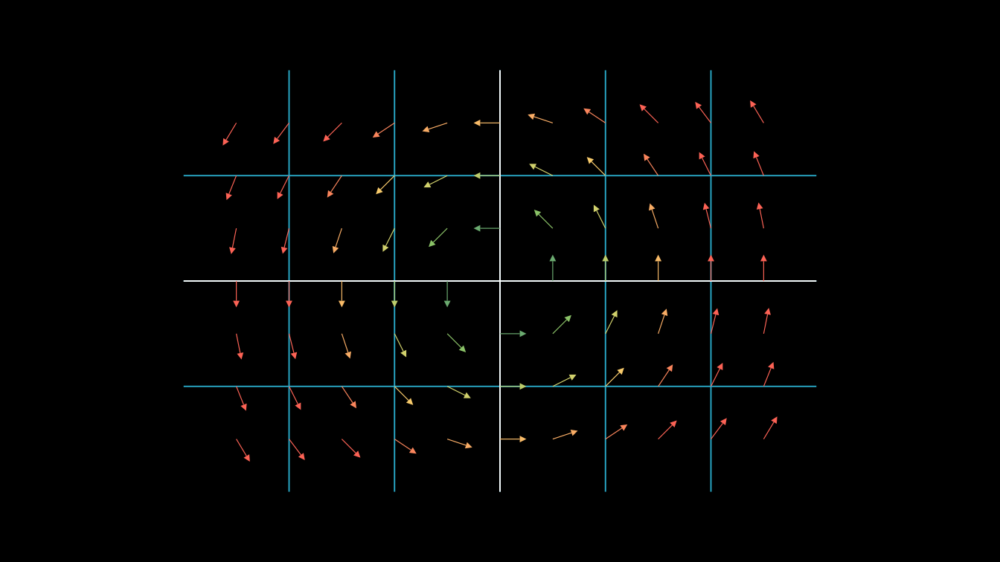

`get_colored_background_image(sampling_rate)` samples the field’s colors
over the whole frame and returns an RGB array (rows from top to bottom),
for example to draw with
[`as.raster()`](https://rdrr.io/r/grDevices/as.raster.html); a larger
`sampling_rate` samples fewer pixels.
`get_vectorized_rgba_gradient_function(start, end, colors)` returns a
function that maps values to RGBA rows along a gradient.

``` r

field <- VectorField(function(p) c(p[2], -p[1], 0) / 3)
img <- field$get_colored_background_image(sampling_rate = 40)
dim(img)
#> [1] 27 48  3
op <- par(mar = c(0, 0, 0, 0))
plot(as.raster(img))
```

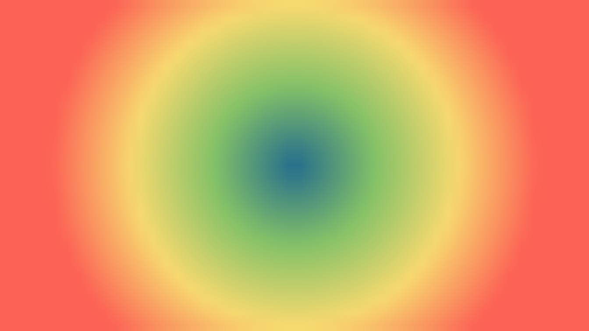

``` r

par(op)
gradient <- field$get_vectorized_rgba_gradient_function(0, 2, c(BLUE, RED))
gradient(c(0, 1, 2))
#>                                       opacity
#> #58C4DD 0.3450980 0.7686275 0.8666667       1
#> #58C4DD 0.6666667 0.5764706 0.6000000       1
#> #FC6255 0.9882353 0.3843137 0.3333333       1
```
