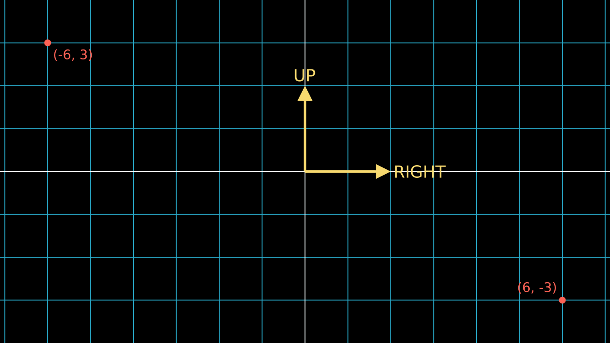
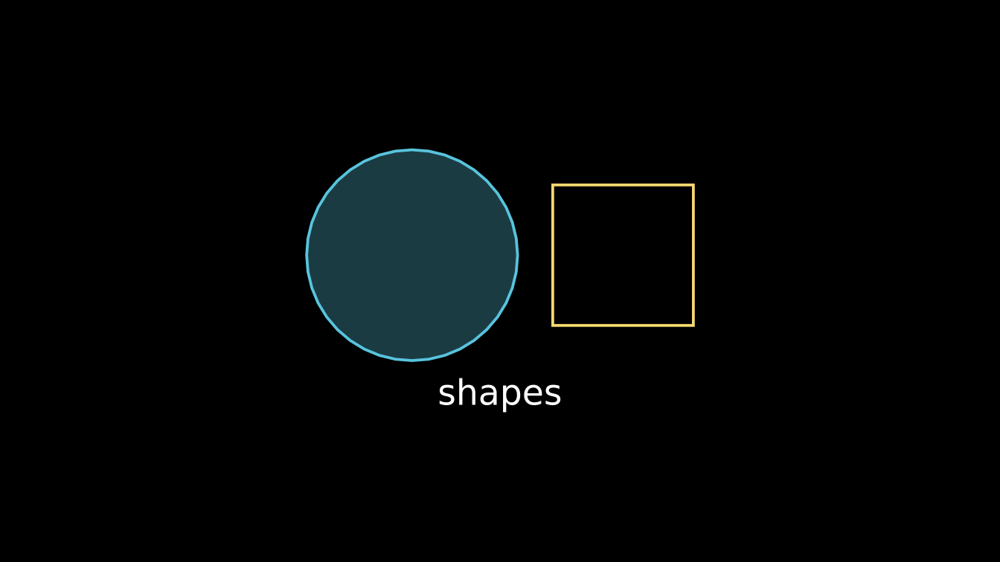
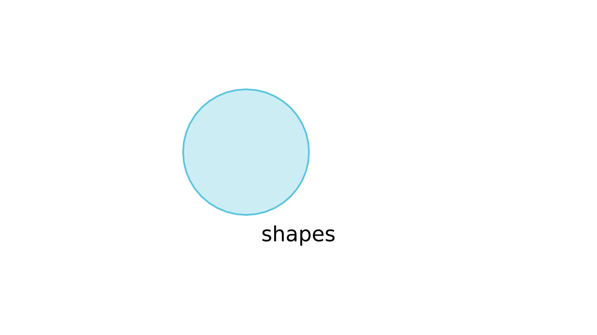
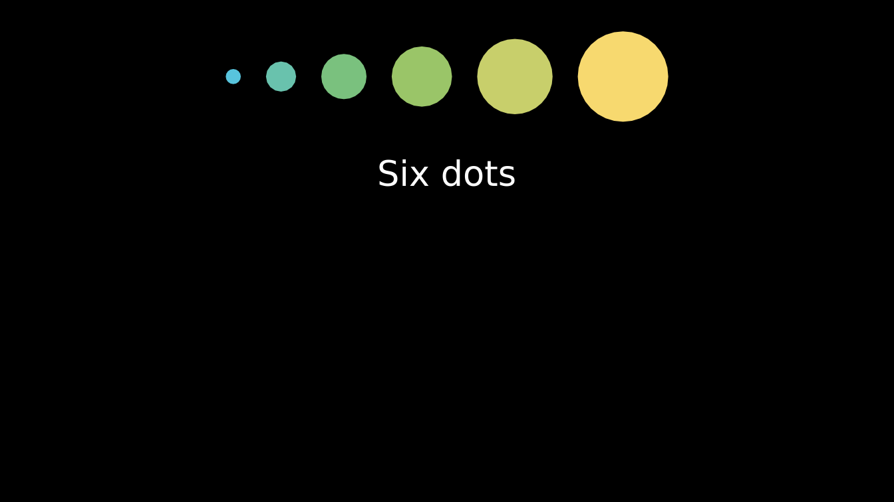
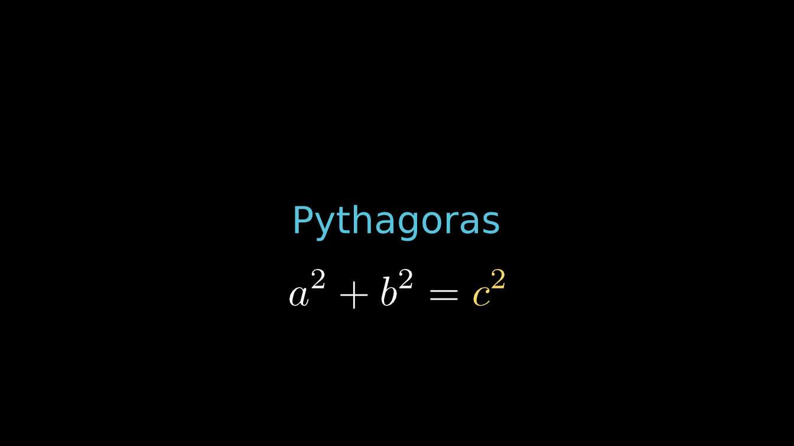

# Getting started with manimR

manimR is a native R port of [Manim
Community](https://www.manim.community/), the animation engine behind
many explanatory math videos. You describe a scene in R code: shapes,
text, formulas and graphs, and how they move. manimR draws every frame
and hands the frames to `ffmpeg`, which writes a video, a GIF or a set
of images. There is no Python involved; the drawing is done with grid on
an offscreen ragg device.

The API follows Python manim closely, so the large body of manim
examples and tutorials translates almost line by line. If you already
know Python manim, read [Coming from Python
manim](https://adamrsophie.github.io/manimR/articles/coming-from-python.md)
next. If you do not, this vignette is the place to start.

## Installation

Install the package from GitHub:

``` r

# install.packages("remotes")
remotes::install_github("adamrsophie/manimR")
```

manimR itself is pure R, but some features call external programs:

| Program | Needed for | How to get it |
|----|----|----|
| `ffmpeg` | Video output (MP4, MOV, WebM, GIF) | `brew install ffmpeg`, `sudo apt install ffmpeg`, or <https://ffmpeg.org> |
| LaTeX with `dvisvgm` | [`Tex()`](https://adamrsophie.github.io/manimR/reference/tex.md), [`MathTex()`](https://adamrsophie.github.io/manimR/reference/tex.md) and everything built on them | [`tinytex::install_tinytex()`](https://rdrr.io/pkg/tinytex/man/install_tinytex.html) then `tinytex::tlmgr_install("dvisvgm")`, or a full TeX Live or MiKTeX |
| `typst` | [`Typst()`](https://adamrsophie.github.io/manimR/reference/typst.md) and [`MathTypst()`](https://adamrsophie.github.io/manimR/reference/typst.md) | <https://typst.app>; set `manim_config(typst = "/path/to/typst")` if it is not on the `PATH` |
| Python with Pygments (optional) | Syntax highlighting of any language in [`Code()`](https://adamrsophie.github.io/manimR/reference/CodeClass.md); without it, a built in highlighter handles R and Python | `pip install pygments` |

Without `ffmpeg` you can still draw mobjects with
[`plot()`](https://rdrr.io/r/graphics/plot.default.html) and save single
frames as PNG files. Without LaTeX,
[`Text()`](https://adamrsophie.github.io/manimR/reference/TextClass.md)
still works, since it uses your system fonts.

[`manim_check()`](https://adamrsophie.github.io/manimR/reference/manim_check.md)
reports which of these programs it can find (it is the counterpart of
`manim checkhealth`):

``` r

manim_check()
#> ffmpeg    /usr/bin/ffmpeg
#> ffprobe   /usr/bin/ffprobe
#> latex     /home/runner/.TinyTeX/bin/x86_64-linux/latex
#> dvisvgm   /home/runner/.TinyTeX/bin/x86_64-linux/dvisvgm
#> typst     /home/runner/work/_temp/typst-x86_64-unknown-linux-musl/typst
#> pygments  /usr/bin/python3
```

## The core ideas

Five ideas cover most of manimR.

- **Mobjects** (mathematical objects) are the things you see: a
  [`Circle()`](https://adamrsophie.github.io/manimR/reference/geometry.md),
  a
  [`Square()`](https://adamrsophie.github.io/manimR/reference/geometry.md),
  a
  [`Text()`](https://adamrsophie.github.io/manimR/reference/TextClass.md),
  an
  [`Axes()`](https://adamrsophie.github.io/manimR/reference/coordinate_systems.md),
  a [`MathTex()`](https://adamrsophie.github.io/manimR/reference/tex.md)
  formula. Most are vectorized mobjects (`VMobject`), whose outlines are
  made of cubic Bezier curves. Mobjects can contain other mobjects, and
  groups such as
  [`VGroup()`](https://adamrsophie.github.io/manimR/reference/VGroupClass.md)
  hold several at once.
- **Scenes** hold the mobjects and run the show. You write a scene as a
  class with a `construct()` method; rendering the scene calls
  `construct()`.
- **Animations** change mobjects over time:
  [`Create()`](https://adamrsophie.github.io/manimR/reference/creation.md)
  draws a shape,
  [`Transform()`](https://adamrsophie.github.io/manimR/reference/transform.md)
  morphs one shape into another,
  [`FadeIn()`](https://adamrsophie.github.io/manimR/reference/fading.md)
  fades in. A scene runs them with `self$play()` and pauses with
  `self$wait()`.
- **The camera** turns the scene into pixels. Its frame is 8 units tall
  and, at the usual 16:9 aspect ratio, about 14.2 units wide, with the
  origin in the middle, x to the right and y up. Positions are in these
  units, so a scene looks the same at every resolution.
- **Rendering** plays the scene from start to finish, captures every
  frame and writes the output file.
  [`render()`](https://adamrsophie.github.io/manimR/reference/render.md)
  does this, with options for the resolution, frame rate and file
  format.

Directions are plain numeric vectors of length 3: `UP` is `c(0, 1, 0)`
and `RIGHT` is `c(1, 0, 0)`, so `2 * UP + RIGHT` is the point (1, 2).
The picture below shows the frame with a
[`NumberPlane()`](https://adamrsophie.github.io/manimR/reference/coordinate_systems.md)
grid (one square per unit), the direction constants, and two points
labeled with their coordinates.

``` r

plane <- NumberPlane()
arrows <- VGroup(
  Arrow(ORIGIN, 2 * UP, buff = 0, color = YELLOW),
  Arrow(ORIGIN, 2 * RIGHT, buff = 0, color = YELLOW)
)
labels <- VGroup(
  Text("UP", font_size = 28, color = YELLOW)$next_to(arrows[1], UP, buff = 0.1),
  Text("RIGHT", font_size = 28, color = YELLOW)$next_to(arrows[2], RIGHT, buff = 0.1)
)
corner <- function(point, label, direction) {
  VGroup(
    Dot(point, color = RED),
    Text(label, font_size = 22, color = RED)$next_to(point, direction, buff = 0.15)
  )
}
corners <- VGroup(
  corner(c(-6, 3, 0), "(-6, 3)", DR),
  corner(c(6, -3, 0), "(6, -3)", UL)
)
plot(VGroup(plane, arrows, labels, corners))
```



## Your first mobjects

Constructors such as
[`Circle()`](https://adamrsophie.github.io/manimR/reference/geometry.md)
and
[`Square()`](https://adamrsophie.github.io/manimR/reference/geometry.md)
create mobjects. Their arguments match Python manim’s, and RStudio
completes them. Methods are called with `$`, and every method that
changes a mobject returns the mobject, so calls chain:

``` r

circle <- Circle(radius = 1.5, color = BLUE)$set_fill(BLUE, opacity = 0.3)
square <- Square(side_length = 2, color = YELLOW)$next_to(circle, RIGHT, buff = 0.5)
label <- Text("shapes", font_size = 36)$next_to(VGroup(circle, square), DOWN)
shapes <- VGroup(circle, square, label)$move_to(ORIGIN)
plot(shapes)
```



[`plot()`](https://rdrr.io/r/graphics/plot.default.html) draws a mobject
as a single frame on the scene’s black background. It is the fastest way
to check a layout: no video is written, and the picture appears in the
RStudio Plots pane. Pass `background_color` to change the background:

``` r

plot(VGroup(circle, label$copy()$set_color(BLACK)), background_color = WHITE)
```



Mobjects are R6 objects, which means they are modified in place:
`square$shift(UP)` moves `square` itself, and `b <- a` does not copy
`a`. Use `$copy()` when you want an independent copy, as above, where
the black label is a copy and the original stays white.

Every mobject stores its outline in `$points`, an n x 3 matrix of Bezier
control points (four rows per cubic curve):

``` r

dim(square$points)
#> [1] 16  3
square$get_center()
#> [1] 1.7500 0.3675 0.0000
square$width
#> [1] 2
```

## Your first scene

A scene is an R6 class that inherits from `Scene` and defines a
`construct()` method. Inside `construct()`, `self` is the scene:
`self$play()` runs one or more animations and `self$wait()` holds the
current frame.

``` r

SquareToCircle <- R6::R6Class("SquareToCircle", inherit = Scene,
  public = list(construct = function() {
    circle <- Circle()$set_fill(PINK, opacity = 0.5)
    square <- Square()$rotate(PI / 4)
    self$play(Create(square))
    self$play(Transform(square, circle))
    self$wait(0.5)
  })
)
```

Reading it line by line:

1.  `R6::R6Class("SquareToCircle", inherit = Scene, ...)` defines a new
    scene class. The first argument is the class name, which also names
    the output file.
2.  `circle` is a pink, half transparent circle, and `square` a square
    turned by 45 degrees. Creating them does not show them yet.
3.  `self$play(Create(square))` draws the square’s outline and adds it
    to the scene.
4.  `self$play(Transform(square, circle))` morphs the square into the
    circle. The mobject on screen is still `square`; it now looks like
    `circle`.
5.  `self$wait(0.5)` holds the last frame for half a second.

Each `play()` lasts one second unless you pass `run_time`, and `wait()`
defaults to one second too.

This vignette shows scenes with a knitr engine (see [RStudio, knitr,
Quarto and
Shiny](https://adamrsophie.github.io/manimR/articles/rstudio-knitr-shiny.md));
in a script you render them yourself, as shown in
[Rendering](#rendering) below.

## A shorter way: `manim_scene()`

For quick experiments,
[`manim_scene()`](https://adamrsophie.github.io/manimR/reference/manim_scene.md)
builds the scene class from a plain function whose argument is the
scene:

``` r

Shapes <- manim_scene(function(self) {
  shapes <- VGroup(
    Circle(color = BLUE)$set_fill(BLUE, 0.5),
    Square(color = GREEN)$set_fill(GREEN, 0.5),
    Triangle(color = RED)$set_fill(RED, 0.5)
  )$arrange(RIGHT, buff = 1)
  self$play(LaggedStart(lapply(shapes$submobjects, GrowFromCenter), lag_ratio = 0.3))
  self$play(shapes$animate$arrange(DOWN, buff = 0.3)$scale(0.6), run_time = 1.5)
  self$wait(0.5)
}, name = "Shapes")
```

[`manim_scene()`](https://adamrsophie.github.io/manimR/reference/manim_scene.md)
also takes a `setup` function, run before `construct`, and a `base`
class such as `MovingCameraScene`.
[`render()`](https://adamrsophie.github.io/manimR/reference/render.md)
accepts a bare function too, which it wraps with
[`manim_scene()`](https://adamrsophie.github.io/manimR/reference/manim_scene.md)
for you.

## Method chaining and the `$animate` builder

Because methods return the mobject, you can describe a whole layout in
one expression:

``` r

dots <- VGroup(lapply(1:6, function(i) Dot(radius = 0.12 * i)))
dots$arrange(RIGHT, buff = 0.4)$set_color_by_gradient(BLUE, GREEN, YELLOW)$to_edge(UP)
title <- Text("Six dots", font_size = 40)$next_to(dots, DOWN, buff = 0.6)
plot(VGroup(dots, title))
```



To animate a method call instead of applying it at once, put `$animate`
between the mobject and the method. `square$animate$shift(RIGHT)` is an
animation that moves the square to the right; chain several methods and
they happen together. Arguments for the animation itself, such as
`run_time` or `rate_func`, go in `$animate(...)`:

``` r

AnimateBuilder <- R6::R6Class("AnimateBuilder", inherit = Scene,
  public = list(construct = function() {
    square <- Square(color = BLUE)$set_fill(BLUE, 0.4)$shift(4 * LEFT)
    circle <- Circle(color = YELLOW)$shift(3.5 * RIGHT)
    self$add(square, circle)
    self$play(square$animate$shift(3 * RIGHT)$rotate(PI / 4)$set_fill(GREEN, 0.8))
    self$play(
      circle$animate(rate_func = there_and_back)$scale(0.5),
      square$animate$scale(1.5),
      run_time = 1.5
    )
    self$wait(0.5)
  })
)
```

Several animations passed to one `self$play()` run at the same time.
`self$add()` puts mobjects on screen without an animation. Named
arguments of `self$play()`, here `run_time = 1.5`, apply to every
animation in the call.

## A first updater

An updater is a function that runs on every frame. A `ValueTracker`
holds a number you can animate; updaters read it and redraw whatever
depends on it. Here a dot follows a tracker along a number line, and its
label is rebuilt every frame with
[`always_redraw()`](https://adamrsophie.github.io/manimR/reference/updater_helpers.md):

``` r

Tracker <- R6::R6Class("Tracker", inherit = Scene,
  public = list(construct = function() {
    line <- NumberLine(x_range = c(-5, 5, 1), length = 10)
    x <- ValueTracker(-4)
    dot <- Dot(color = YELLOW)
    dot$add_updater(function(m) m$move_to(line$number_to_point(x$get_value())))
    label <- always_redraw(function() {
      Text(sprintf("x = %.1f", x$get_value()), font_size = 32)$next_to(dot, UP)
    })
    self$add(line, dot, label)
    self$play(x$animate$set_value(4), run_time = 2)
    self$play(x$animate$set_value(1), run_time = 1)
    self$wait(0.5)
  })
)
```

[Updaters and value
trackers](https://adamrsophie.github.io/manimR/articles/updaters.md)
covers updaters in depth.

## Text and math

[`Text()`](https://adamrsophie.github.io/manimR/reference/TextClass.md)
renders text with your system fonts.
[`MathTex()`](https://adamrsophie.github.io/manimR/reference/tex.md)
typesets LaTeX math, and each string you pass becomes one part you can
color or animate separately:

``` r

words <- Text("Pythagoras", font_size = 48, color = BLUE)
eq <- MathTex("a^2", "+", "b^2", "=", "c^2", font_size = 72)$next_to(words, DOWN, buff = 0.5)
eq[5]$set_color(YELLOW)
plot(VGroup(words, eq))
```



Note that LaTeX backslashes must be doubled in ordinary R strings
(`"\\frac{a}{b}"`), or written in a raw string (`r"(\frac{a}{b})"`).
[Text, math and
tables](https://adamrsophie.github.io/manimR/articles/text-and-math.md)
has the details.

## Rendering

[`render()`](https://adamrsophie.github.io/manimR/reference/render.md)
plays a scene and writes the output. Give it the scene class (or a
function, or a scene object):

``` r

out <- render(SquareToCircle, quality = "l")
basename(out)
#> [1] "SquareToCircle.mp4"
str(get_video_metadata(out)[c("width", "height", "avg_frame_rate", "duration")])
#> List of 4
#>  $ width         : int 854
#>  $ height        : int 480
#>  $ avg_frame_rate: chr "15/1"
#>  $ duration      : chr "2.466667"
```

The main arguments are:

| Argument | What it does |
|----|----|
| `quality` | `"l"` (854 x 480, 15 fps), `"m"` (1280 x 720, 30 fps), `"h"` (1920 x 1080, 60 fps, the default), `"p"` (2560 x 1440, 60 fps) or `"k"` (3840 x 2160, 60 fps) |
| `format` | `"auto"` (the default: MP4, or MOV when transparent), `"mp4"`, `"mov"`, `"webm"`, `"gif"`, `"png"` (the last frame only) or `"png-sequence"` (every frame as a PNG) |
| `output_file` | The file name; a relative name goes into the video folder (or the image folder for a PNG) |
| `save_last_frame` | `TRUE` is a shorthand for `format = "png"`: save only the final frame |
| `transparent` | Transparent background (MOV, WebM or PNG) |
| `preview` | Open the result when done, in the RStudio Viewer when available |
| `...` | Any other setting of [`manim_config()`](https://adamrsophie.github.io/manimR/reference/manim_config.md), such as `background_color` or `frame_rate` |

Without `output_file`, the video goes to
`media/videos/<module>/<quality>/<Scene>.mp4` in the working directory,
where `<quality>` is a folder such as `480p15`. Use low quality while
you work and high quality for the final version.

A bare function works as well, which is handy at the console. Such a
scene is called `Scene` unless you name it with `scene_name`:

``` r

out <- render(function(self) {
  self$play(DrawBorderThenFill(Star(color = GOLD, fill_opacity = 0.8)))
}, quality = "l", format = "gif", scene_name = "Star")
basename(out)
#> [1] "Star_manimR_v0.1.0.gif"
```

For the quickest look at a finished scene, skip the video and save only
the last frame with `format = "png"` (or `save_last_frame = TRUE`, which
means the same). As in Python manim, the default names of GIFs and last
frame images carry the version of the package:

``` r

png_file <- render(SquareToCircle, quality = "l", format = "png")
basename(png_file)
#> [1] "SquareToCircle_manimR_v0.1.0.png"
```

[`preview_output()`](https://adamrsophie.github.io/manimR/reference/preview_output.md)
shows a rendered file in the RStudio Viewer pane, or opens it with your
system’s viewer elsewhere. `render(..., preview = TRUE)` calls it for
you:

``` r

out <- render(SquareToCircle, quality = "l")
preview_output(out)
```

For scripts that define several scenes, `render_file("scenes.R")`
renders them all, and
[`manim_cli()`](https://adamrsophie.github.io/manimR/reference/manim_cli.md)
does the same from a terminal, like the `manim` command. [Rendering,
configuration and
output](https://adamrsophie.github.io/manimR/articles/rendering.md)
covers every option, the media folder layout, sections, sound and
caching.

## A tour of the other vignettes

- [Coming from Python
  manim](https://adamrsophie.github.io/manimR/articles/coming-from-python.md):
  a translation guide from Python manim code to manimR, with every
  renamed name and index difference.
- [Mobjects and
  geometry](https://adamrsophie.github.io/manimR/articles/mobjects.md):
  shapes, lines, arrows, polygons, groups, positioning and styling.
- [Animations](https://adamrsophie.github.io/manimR/articles/animations.md):
  creating, transforming, fading, moving and indicating mobjects,
  composing animations and rate functions.
- [Updaters and value
  trackers](https://adamrsophie.github.io/manimR/articles/updaters.md):
  functions that run every frame, `ValueTracker` and
  [`always_redraw()`](https://adamrsophie.github.io/manimR/reference/updater_helpers.md).
- [Text, math and
  tables](https://adamrsophie.github.io/manimR/articles/text-and-math.md):
  [`Text()`](https://adamrsophie.github.io/manimR/reference/TextClass.md),
  [`MarkupText()`](https://adamrsophie.github.io/manimR/reference/MarkupText.md),
  LaTeX with
  [`Tex()`](https://adamrsophie.github.io/manimR/reference/tex.md) and
  [`MathTex()`](https://adamrsophie.github.io/manimR/reference/tex.md),
  Typst, code listings, numbers, matrices and tables.
- [Graphs, plots and coordinate
  systems](https://adamrsophie.github.io/manimR/articles/graphing.md):
  number lines, axes, function plots, areas, network graphs, vector
  fields and charts.
- [Cameras and 3D
  scenes](https://adamrsophie.github.io/manimR/articles/cameras-and-3d.md):
  moving and zooming cameras, 3D axes, surfaces, solids and camera
  orientation.
- [Colors, images, SVG and point
  clouds](https://adamrsophie.github.io/manimR/articles/colors-images.md):
  the color constants and palettes, `ManimColor`, images, SVG files and
  point clouds.
- [Rendering, configuration and
  output](https://adamrsophie.github.io/manimR/articles/rendering.md):
  [`render()`](https://adamrsophie.github.io/manimR/reference/render.md),
  qualities, formats, configuration, sections, sound, subcaptions,
  caching and the command line.
- [RStudio, knitr, Quarto and
  Shiny](https://adamrsophie.github.io/manimR/articles/rstudio-knitr-shiny.md):
  RStudio addins, the `manim` knitr engine and interactive scenes.
- [Math and utility
  functions](https://adamrsophie.github.io/manimR/articles/utilities.md):
  Bezier curves, space operations, interpolation and the other helper
  functions.

## Getting help

Every constructor has a help page with its arguments, for example
[`?Circle`](https://adamrsophie.github.io/manimR/reference/geometry.md)
or
[`?Axes`](https://adamrsophie.github.io/manimR/reference/coordinate_systems.md),
and the reference index on the website groups them by topic. Because
manimR mirrors Python manim, the [Manim Community
documentation](https://docs.manim.community/) and its example gallery
are useful too: most examples run in R after the small changes described
in [Coming from Python
manim](https://adamrsophie.github.io/manimR/articles/coming-from-python.md).
