# Mobjects and geometry

Everything you see in a manimR scene is a *mobject* (a mathematical
object). This vignette explains how mobjects are built, how to place,
transform, style, copy and group them, and then tours every shape in the
geometry library. Animating mobjects is the subject of
[Animations](https://adamrsophie.github.io/manimR/articles/animations.md);
colors are covered in depth in [Colors, images, SVG and point
clouds](https://adamrsophie.github.io/manimR/articles/colors-images.md).

Most examples are static pictures drawn with
[`plot()`](https://rdrr.io/r/graphics/plot.default.html), which draws
one frame on the current graphics device.
[`plot()`](https://rdrr.io/r/graphics/plot.default.html) works anywhere,
including the RStudio Plots pane, so it is the quickest way to check a
layout while you build a scene.

## Mobjects, points and families

### Points

A mobject stores its geometry in `points`, an `n x 3` matrix with one
point per row. Vectorized mobjects (VMobjects, the kind almost every
shape is) are chains of cubic Bezier curves, stored four rows per curve:
an anchor, two handles and the next anchor.

``` r

sq <- Square(side_length = 2)
sq
#> <Square> 16 points, 0 submobjects
dim(sq$points)
#> [1] 16  3
sq$points[1:4, ]           # the first curve: the top edge
#>            [,1] [,2] [,3]
#> [1,]  1.0000000    1    0
#> [2,]  0.3333333    1    0
#> [3,] -0.3333333    1    0
#> [4,] -1.0000000    1    0
sq$get_num_curves()
#> [1] 4
sq$get_start_anchors()     # the corners
#>      [,1] [,2] [,3]
#> [1,]    1    1    0
#> [2,]   -1    1    0
#> [3,]   -1   -1    0
#> [4,]    1   -1    0
```

A straight edge is a Bezier curve whose handles lie on the segment,
which is why the top edge has handles at one third and two thirds of the
way. A circle uses eight curves with real handles:

``` r

Circle()$get_num_curves()
#> [1] 8
round(Circle()$points[1:4, ], 3)
#>       [,1]  [,2] [,3]
#> [1,] 1.000 0.000    0
#> [2,] 1.000 0.265    0
#> [3,] 0.895 0.520    0
#> [4,] 0.707 0.707    0
```

`Mobject` is the base class of everything; `VMobject` adds Bezier paths,
fill and stroke. You rarely create either directly, but
[`VMobject()`](https://adamrsophie.github.io/manimR/reference/VMobjectClass.md)
is the starting point for [custom
shapes](#building-a-vmobject-from-points).

### Submobjects and families

A mobject can contain other mobjects, its *submobjects*. A mobject
together with all its submobjects, their submobjects and so on is its
*family*. Moving, scaling or coloring a mobject applies to its whole
family.
[`print_family()`](https://adamrsophie.github.io/manimR/reference/print_family.md)
shows the tree with each member’s name and id.

``` r

eyes <- VGroup(Dot(c(-0.5, 0.4, 0)), Dot(c(0.5, 0.4, 0)))
mouth <- Arc(radius = 0.8, start_angle = PI + 0.6, angle = PI - 1.2, color = YELLOW)
face <- VGroup(Circle(radius = 1.5, color = YELLOW), eyes, mouth)$scale(1.5)
print_family(face)
#>  VGroup 47112af6301a1afe28-10
#>   Circle 47112af6301a1afe28-9
#>   VGroup 47112af6301a1afe28-7
#>       Dot 47112af6301a1afe28-5
#>       Dot 47112af6301a1afe28-6
#>   Arc 47112af6301a1afe28-8
length(face$submobjects)
#> [1] 3
length(face$get_family())
#> [1] 6
```

[`index_labels()`](https://adamrsophie.github.io/manimR/reference/print_family.md)
puts a number on each submobject, which helps when you need to find a
part of a complicated mobject such as a formula. The labels count from
1, as `face[i]` does. They are
[`Integer()`](https://adamrsophie.github.io/manimR/reference/DecimalNumberClass.md)
numbers, typeset with LaTeX by default; `mob_class = Text` draws them
with a system font instead.

``` r

labels <- index_labels(face, mob_class = Text, label_height = 0.45)
plot(VGroup(face, labels))
```

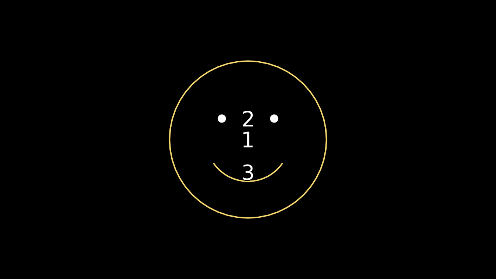

### Constructors and generators

Every shape has a constructor function and an R6 class generator.
[`Circle()`](https://adamrsophie.github.io/manimR/reference/geometry.md)
is a function that calls `CircleClass$new()`: use the function to make
mobjects, and the generator to subclass or to reach class methods.

``` r

c1 <- Circle(radius = 1)
c2 <- CircleClass$new(radius = 1)
class(c1)
#> [1] "Circle"          "Arc"             "TipableVMobject" "VMobject"       
#> [5] "Mobject"         "R6"
inherits(c1, "Arc")
#> [1] TRUE
CircleClass$classname
#> [1] "Circle"
```

The generators follow the pattern `FooClass`. For the classes in this
vignette they are:

- Base classes: `MobjectClass`, `VMobjectClass`, `GroupClass`,
  `VGroupClass`, `VDictClass`, `VectorizedPointClass` and
  `TipableVMobjectClass` (anything that can carry arrow tips).
- Arcs and circles: `ArcClass`, `ArcBetweenPointsClass`, `CircleClass`,
  `DotClass`, `EllipseClass`, `AnnularSectorClass`, `AnnulusClass`.
- Lines and arrows: `LineClass`, `DashedLineClass`, `ArrowClass`,
  `VectorClass`, `AngleClass`, and `ArrowTipClass` with the tip classes
  shown [below](#arrows-and-tips).
- Polygons and rectangles: `PolygramClass`, `PolygonClass`,
  `RegularPolygramClass`, `RegularPolygonClass`, `TriangleClass`,
  `RectangleClass`, `SquareClass`, `RoundedRectangleClass`,
  `SurroundingRectangleClass`, `BackgroundRectangleClass`,
  `ScreenRectangleClass`.
- Everything else: `BooleanOpsClass` with `UnionClass`,
  `IntersectionClass`, `DifferenceClass` and `ExclusionClass`;
  `BraceClass` and `BraceLabelClass`; `LabelClass`, `LabeledLineClass`,
  `LabeledArrowClass` and `LabeledPolygramClass`;
  `CurvesAsSubmobjectsClass` and `ManimBannerClass`.

A few constructors, such as
[`Sector()`](https://adamrsophie.github.io/manimR/reference/geometry.md),
[`Star()`](https://adamrsophie.github.io/manimR/reference/geometry.md),
[`DoubleArrow()`](https://adamrsophie.github.io/manimR/reference/geometry.md),
[`CurvedArrow()`](https://adamrsophie.github.io/manimR/reference/geometry.md),
[`CubicBezier()`](https://adamrsophie.github.io/manimR/reference/geometry.md),
[`Cutout()`](https://adamrsophie.github.io/manimR/reference/geometry.md)
and
[`DashedVMobject()`](https://adamrsophie.github.io/manimR/reference/DashedVMobject.md),
have no generator of their own: they build an object of a parent class
and add their name to its class vector, so
[`inherits()`](https://rdrr.io/r/base/class.html) still recognizes them.

``` r

class(Star())
#> [1] "Star"     "Polygon"  "Polygram" "VMobject" "Mobject"  "R6"
inherits(Sector(), "Sector")
#> [1] TRUE
```

Upstream’s class methods live on the generators, for example
`CircleClass$from_three_points()` (also available as
[`circle_from_three_points()`](https://adamrsophie.github.io/manimR/reference/geometry.md)):

``` r

CircleClass$from_three_points(LEFT, UP, RIGHT)$radius
#> [1] 1
```

[`set_default()`](https://adamrsophie.github.io/manimR/reference/set_default.md)
changes a constructor’s defaults until you reset them, which keeps a
long scene consistent:

``` r

set_default(Circle, color = BLUE, fill_opacity = 0.5)
Circle()$get_color()
#> [1] "#58C4DD"
Circle()$get_fill_opacity()
#> [1] 0.5
set_default(Circle) # restore the original defaults
Circle()$get_color()
#> [1] "#FC6255"
```

### Methods change the mobject and return it

Methods that change a mobject change it in place and return it
invisibly, so calls chain with `$`. Because R6 objects are references,
assigning a mobject to a new name does not copy it; use `$copy()` for an
independent copy (see [Copying and saving
state](#copying-and-saving-state)).

``` r

sq <- Square()$shift(LEFT)$scale(2)$rotate(PI / 8)
alias <- sq
alias$shift(UP)
sq$get_center()   # moved too: same object
#> [1] -1  1  0
```

## Positioning

### The frame and its coordinates

The visible frame is `config$frame_width` by `config$frame_height` units
(14.2 by 8 by default) with the origin at its center. Positions are
length 3 vectors `c(x, y, z)`; the direction constants `UP`, `DOWN`,
`LEFT`, `RIGHT` (and the corners `UL`, `UR`, `DL`, `DR`) are unit steps,
so `2 * LEFT + UP` is the point `(-2, 1, 0)`.

``` r

c(config$frame_width, config$frame_height)
#> [1] 14.22222  8.00000
c(manim_frame$left_side[1], manim_frame$right_side[1], manim_frame$top[2], manim_frame$bottom[2])
#> [1] -7.111111  7.111111  4.000000 -4.000000
```

### Units

Lengths are in scene units. The unit helpers convert other measures:
`Pixels` (at the current resolution), `Percent(X_AXIS)` or
`Percent(Y_AXIS)` (of the frame width or height), `Degrees` (to radians)
and `Munits` (one scene unit). Multiply a number by a unit.

``` r

50 * Pixels
#> [1] 0.3703704
25 * Percent(X_AXIS)
#> [1] 3.555556
50 * Percent(Y_AXIS)
#> [1] 4
90 * Degrees
#> [1] 1.570796
3 * Munits
#> [1] 3
Square()$shift(25 * Percent(X_AXIS) * RIGHT)$get_center()
#> [1] 3.555556 0.000000 0.000000
```

### Moving mobjects

- `shift(...)` moves by a vector (several vectors are added).
- `move_to(point_or_mobject, aligned_edge)` puts the center (or the
  given edge) at a point or at another mobject’s position.
- `next_to(mobject_or_point, direction, buff, aligned_edge)` places a
  mobject beside another, `buff` units away.
- `align_to(mobject_or_point, direction)` lines up one edge with another
  mobject’s edge, without moving along the other axis.
- `to_edge(edge, buff)` and `to_corner(corner, buff)` move to the
  frame’s edges and corners.

``` r

box <- Square(side_length = 1.6, color = WHITE)
pic <- VGroup(
  box,
  Circle(radius = 0.4, color = BLUE)$next_to(box, RIGHT),
  Circle(radius = 0.4, color = GREEN)$next_to(box, UP, buff = 0.1),
  Rectangle(width = 1.2, height = 0.5, color = YELLOW)$next_to(box, LEFT, aligned_edge = UP),
  Triangle(color = RED)$scale(0.4)$next_to(box, DOWN, buff = 0.6),
  Star(color = PURPLE, fill_opacity = 1)$scale(0.5)$to_corner(UL),
  Text("to_edge(RIGHT)", font_size = 30)$to_edge(RIGHT),
  Dot(color = ORANGE)$move_to(3 * LEFT + 2 * DOWN),
  Square(side_length = 0.6, color = ORANGE)$move_to(3 * LEFT + 2 * DOWN, aligned_edge = DL)
)
plot(pic)
```

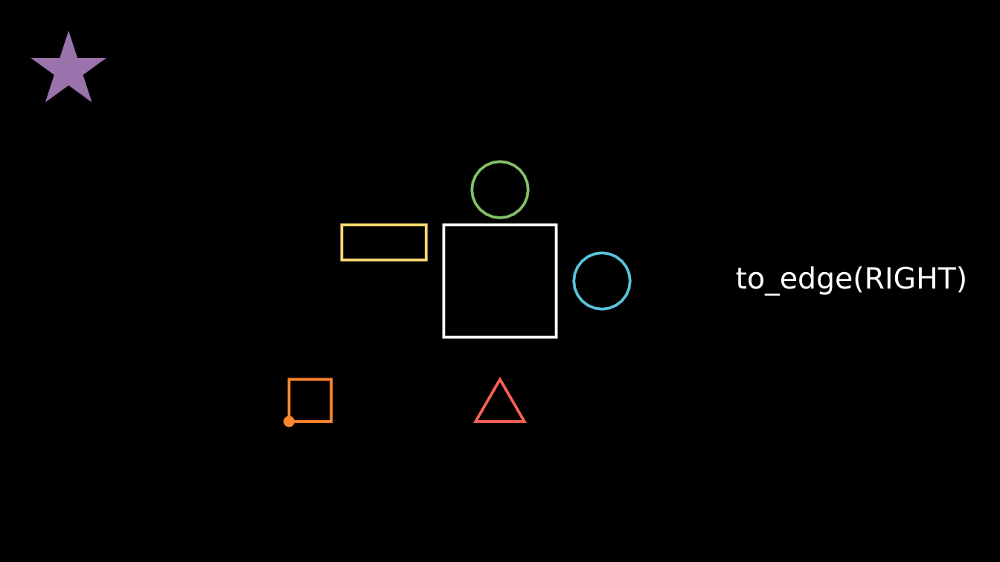

The orange square was moved with `aligned_edge = DL`, so its lower left
corner, not its center, sits on the orange dot.

`align_to()` lines up edges. Below, the bottom row is a copy of the top
row whose members were each aligned to the group’s top edge:

``` r

row <- VGroup(Square(1), Circle(radius = 0.8, color = BLUE), Rectangle(width = 1, height = 2.2, color = GREEN),
              Triangle(color = YELLOW))$arrange(RIGHT, buff = 0.5)$shift(1.6 * UP)
aligned <- row$copy()$shift(3.2 * DOWN)
for (m in aligned$submobjects) m$align_to(aligned, UP)
plot(VGroup(row, aligned, DashedLine(c(-4, aligned$get_top()[2], 0), c(4, aligned$get_top()[2], 0), color = GREY_B)))
```

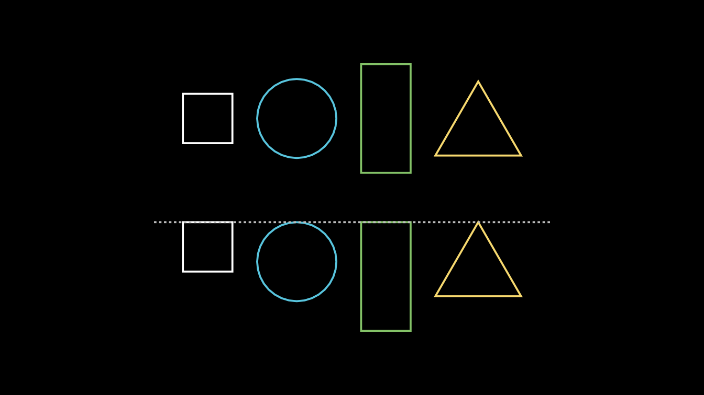

The frame stops you from losing things: buffers keep a margin from the
edge. The standard values are `SMALL_BUFF` (0.1), `MED_SMALL_BUFF`
(0.25), `MED_LARGE_BUFF` (0.5) and `LARGE_BUFF` (1); `next_to()` and
`arrange()` default to `DEFAULT_MOBJECT_TO_MOBJECT_BUFFER` (0.25) and
`to_edge()` to `DEFAULT_MOBJECT_TO_EDGE_BUFFER` (0.5).

### Arranging groups

`arrange(direction, buff, center)` lines up the members of a group, each
next to the previous one; extra arguments such as `aligned_edge` go to
`next_to()`. `arrange_in_grid()` builds a table: give `rows` or `cols`,
`buff` (one number, or one for columns and one for rows), alignments,
and `flow_order` (`"rd"` fills rows first, `"dr"` columns first).

``` r

numbered <- function(n) VGroup(lapply(seq_len(n), function(i) {
  VGroup(Square(side_length = 0.5 + 0.12 * (i %% 3), color = BLUE), Text(as.character(i), font_size = 30))
}))
a <- numbered(5)$arrange(DOWN, aligned_edge = LEFT, buff = 0.1)
b <- numbered(6)$arrange_in_grid(rows = 2, buff = c(0.3, 0.3))
d <- numbered(6)$arrange_in_grid(rows = 2, flow_order = "dr", buff = c(0.3, 0.3))
plot(VGroup(a, b, d)$arrange(RIGHT, buff = 1))
```

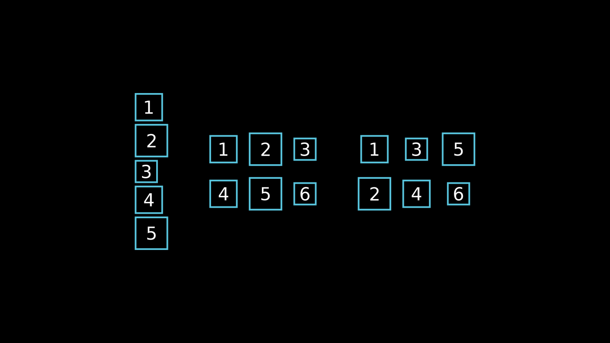

### Reading positions and sizes

``` r

sq <- Square(side_length = 2)$shift(RIGHT)
sq$get_center()
#> [1] 1 0 0
sq$get_corner(UR)
#> [1] 2 1 0
c(sq$get_top()[2], sq$get_bottom()[2], sq$get_left()[1], sq$get_right()[1])
#> [1]  1 -1  0  2
sq$get_critical_point(DL)
#> [1]  0 -1  0
sq$get_x()
#> [1] 1
c(sq$width, sq$height)
#> [1] 2 2
sq$width <- 4      # width, height and depth can be set; the shape scales evenly
sq$height
#> [1] 4
sq$set_x(0)$get_center()
#> [1] 0 0 0
Line(LEFT, RIGHT)$get_length()
#> [1] 2
Circle()$get_arc_length()
#> [1] 6.281205
zapsmall(Circle()$point_from_proportion(0.25))
#> [1] 0 1 0
```

`match_width()`, `match_height()`, `match_x()` and `match_y()` copy a
size or coordinate from another mobject; `surround()` and
[`replace()`](https://rdrr.io/r/base/replace.html) fit one mobject over
another.

## Transforming

[`scale()`](https://rdrr.io/r/base/scale.html), `rotate()`, `flip()` and
`stretch()` work about the center by default. Give `about_point` (any
point) or `about_edge` (a direction) to keep another point fixed. In the
pictures, the gray outline is the original.

``` r

ghost <- function(m) m$copy()$set_stroke(GREY_B, width = 2)$set_fill(opacity = 0)
flag <- function() Polygon(c(0, -1, 0), c(0, 1, 0), c(1.2, 0.6, 0), c(0.3, 0.3, 0), c(0.3, -1, 0),
                           color = YELLOW, fill_opacity = 0.6)
s1 <- Square(color = BLUE, fill_opacity = 0.5)
s2 <- Square(color = BLUE, fill_opacity = 0.5)
s3 <- Square(color = GREEN, fill_opacity = 0.5)
s4 <- Square(color = GREEN, fill_opacity = 0.5)
f1 <- flag()
c1 <- Circle(color = RED, fill_opacity = 0.5)
panels <- VGroup(
  VGroup(ghost(s1), s1$scale(1.4)),
  VGroup(ghost(s2), s2$scale(1.4, about_edge = DL)),
  VGroup(ghost(s3), s3$rotate(PI / 6)),
  VGroup(ghost(s4), s4$rotate(PI / 6, about_point = s4$get_corner(DL))),
  VGroup(ghost(f1), f1$flip(UP)),
  VGroup(ghost(c1), c1$stretch(1.6, 1))
)$arrange(RIGHT, buff = 0.9)
panels$width <- 13
plot(panels)
```

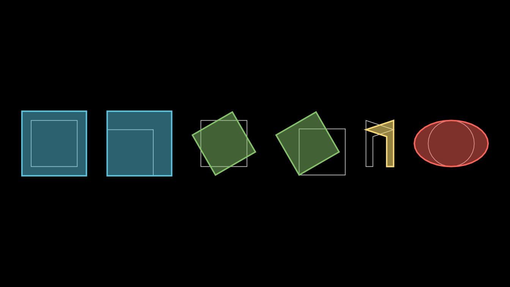

From left to right: `scale(1.4)`, `scale(1.4, about_edge = DL)`,
`rotate(PI / 6)`, `rotate(PI / 6, about_point = <corner>)`, `flip(UP)`
(a mirror image across the vertical axis) and `stretch(1.6, 1)`. The
dimension argument of `stretch()` counts from 1, so 1 is x and 2 is y.

`rotate(angle, axis)` turns counterclockwise about `axis` (`OUT` by
default). Rotations about other axes tilt the mobject out of the plane,
which matters in 3D scenes.

### Functions and matrices

`apply_function(func)` sends every point through a function of a point,
and `apply_matrix(matrix)` multiplies every point by a 2 x 2 or 3 x 3
matrix (about the origin unless `about_point` is given).
`apply_complex_function()` takes a function of a complex number. Extra
curves (`insert_n_curves()`) keep a bent shape smooth.

``` r

wave <- function(p) p + c(0, 0.3 * sin(2 * p[1]), 0)
grid_lines <- function() {
  g <- VGroup(c(lapply(seq(-1.5, 1.5, by = 0.5), function(k) Line(c(-1.5, k, 0), c(1.5, k, 0), color = BLUE)),
                lapply(seq(-1.5, 1.5, by = 0.5), function(k) Line(c(k, -1.5, 0), c(k, 1.5, 0), color = YELLOW))))
  for (l in g$submobjects) l$insert_n_curves(16)
  g
}
shear <- matrix(c(1, 0, 0.5, 1), 2) # (x, y) goes to (x + 0.5 y, y)
bent <- VGroup(grid_lines(), grid_lines()$apply_function(wave), grid_lines()$apply_matrix(shear),
               grid_lines()$apply_complex_function(function(z) z^2 / 3))$arrange(RIGHT, buff = 0.7)
bent$width <- 13
plot(bent)
```

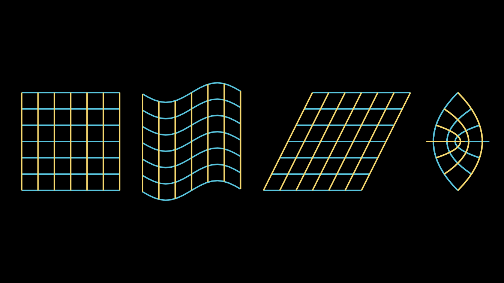

Matrices are easier to understand in motion.
[`ApplyMatrix()`](https://adamrsophie.github.io/manimR/reference/transform.md)
animates the same multiplication:

``` r

ShearGrid <- R6::R6Class("ShearGrid", inherit = Scene,
  public = list(construct = function() {
    grid <- VGroup(c(lapply(-3:3, function(k) Line(c(-3, k, 0), c(3, k, 0), color = BLUE_D)),
                     lapply(-3:3, function(k) Line(c(k, -3, 0), c(k, 3, 0), color = BLUE_D))))
    sq <- Square(side_length = 1, color = YELLOW, fill_opacity = 0.6)$move_to(c(0.5, 0.5, 0))
    self$add(grid, sq)
    self$play(ApplyMatrix(matrix(c(1, 0, 1, 1), 2), VGroup(grid, sq)), run_time = 2)
  })
)
```

## Styling

### Fill, stroke and opacity

A VMobject has a fill (color and opacity) and a stroke (color, width and
opacity). `set_color()` sets both colors, `set_fill()` and
`set_stroke()` one each, and `set_opacity()` both opacities. Stroke
widths are in hundredths of a unit (the default `DEFAULT_STROKE_WIDTH`
is 4). Every setter applies to the whole family unless `family = FALSE`.

``` r

styled <- VGroup(
  Square()$set_color(BLUE),
  Square()$set_fill(BLUE, opacity = 0.7),
  Square()$set_fill(BLUE, opacity = 0.7)$set_stroke(YELLOW, width = 12),
  Square(fill_opacity = 1, color = RED)$set_opacity(0.3),
  Square(stroke_width = 0, fill_opacity = 1, color = GREEN)
)$arrange(RIGHT, buff = 0.5)
plot(styled)
```

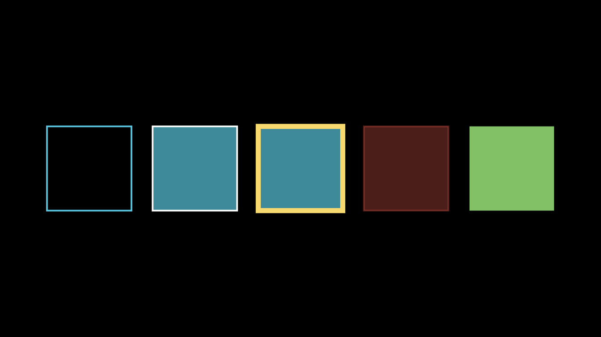

Constructors take the same settings as arguments: `color`, `fill_color`,
`fill_opacity`, `stroke_color`, `stroke_width` and `stroke_opacity`.
`set_style()` sets several at once, `get_style()` reads them, and
`match_style()` copies another mobject’s style.

``` r

fancy <- Square()$set_style(fill_color = RED, fill_opacity = 0.5, stroke_color = BLUE, stroke_width = 8)
str(fancy$get_style(simple = TRUE))
#> List of 5
#>  $ stroke_opacity: num 1
#>  $ stroke_width  : num 8
#>  $ fill_color    : chr "#FC6255"
#>  $ fill_opacity  : num 0.5
#>  $ stroke_color  : chr "#58C4DD"
Circle()$match_style(fancy)$get_stroke_width()
#> [1] 8
fancy$get_fill_color()
#> [1] "#FC6255"
fancy$get_fill_opacity()
#> [1] 0.5
```

A *background stroke* is drawn behind the fill. It outlines text and
labels so they stay readable on busy backgrounds:

``` r

outlined <- Text("outline", font_size = 72, color = YELLOW)$set_stroke(BLACK, width = 10, background = TRUE)
plot(VGroup(Rectangle(width = 6, height = 1.6, color = BLUE, fill_opacity = 1), outlined))
```

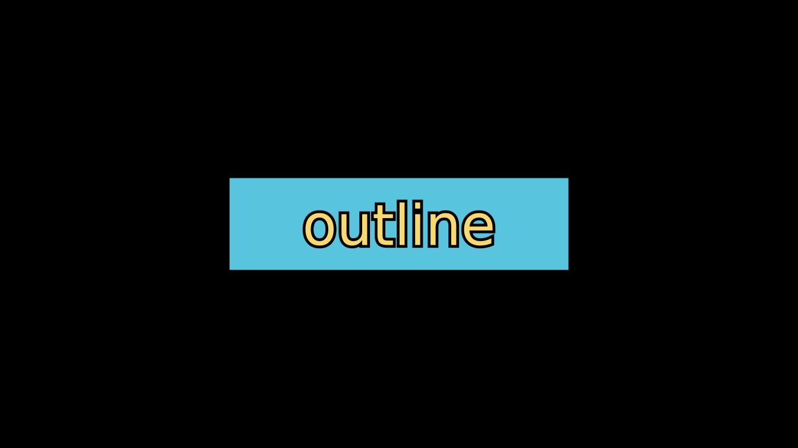

### Gradients and sheen

Several colors make a gradient; `set_sheen()` lightens toward one side.
The [colors
vignette](https://adamrsophie.github.io/manimR/articles/colors-images.html#coloring-mobjects)
has the details.

``` r

plot(VGroup(
  Circle(fill_opacity = 1)$set_color(c(BLUE, GREEN)),
  Star(fill_opacity = 1)$set_color(c(YELLOW, RED)),
  Square(fill_opacity = 1, color = PURPLE)$set_sheen(0.7, UR),
  VGroup(lapply(1:9, function(i) Dot(radius = 0.2)))$arrange(RIGHT)$set_color_by_gradient(BLUE, YELLOW)
)$arrange(RIGHT, buff = 0.6))
```

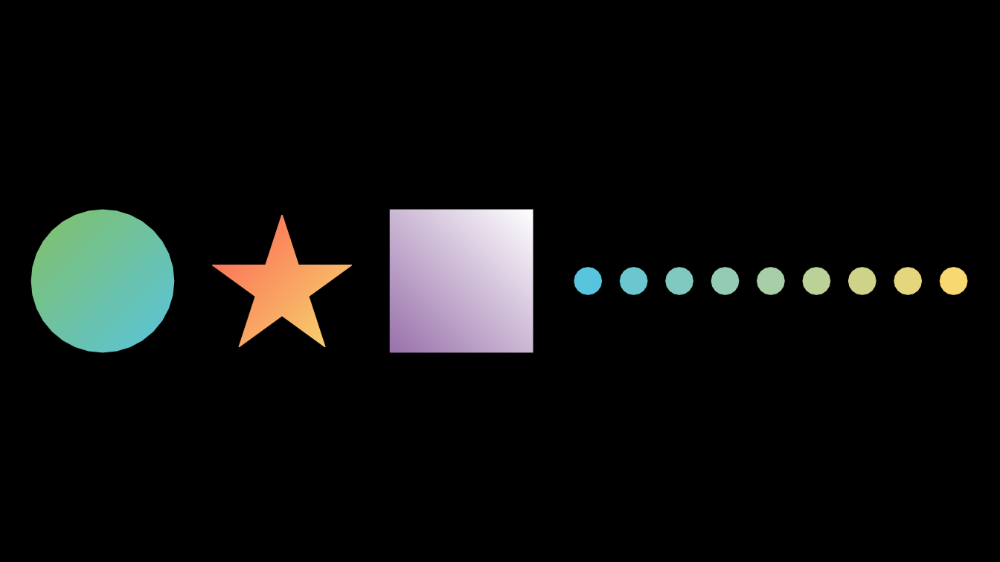

### Drawing order with z_index

Mobjects are drawn in the order they were added, so later ones cover
earlier ones. A higher `z_index` brings a mobject to the front
regardless:

``` r

make_stack <- function() VGroup(
  Square(color = RED, fill_opacity = 1),
  Square(color = GREEN, fill_opacity = 1)$shift(0.6 * (RIGHT + DOWN)),
  Square(color = BLUE, fill_opacity = 1)$shift(1.2 * (RIGHT + DOWN))
)
default_order <- make_stack()
raised <- make_stack()
raised[1]$set_z_index(2)
raised[2]$set_z_index(1)
plot(VGroup(default_order, raised)$arrange(RIGHT, buff = 1.5))
```

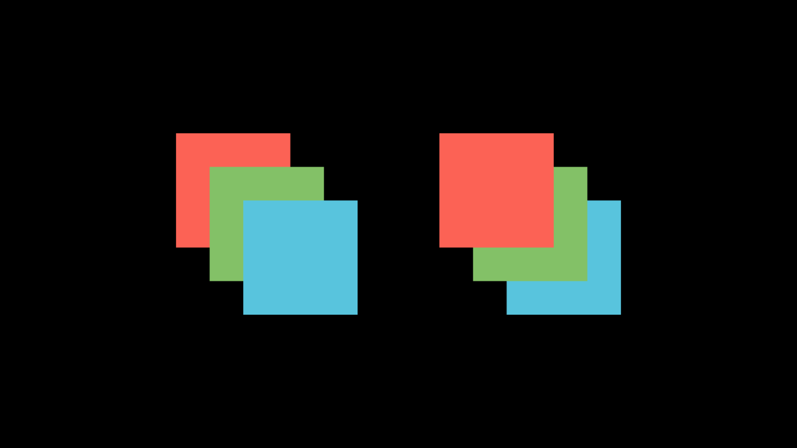

Constructors also accept `z_index =` directly.

## Copying and saving state

- `copy()` returns an independent deep copy, submobjects included.
- `become(other)` makes a mobject take another’s points and style while
  keeping its identity, so animations and updaters that refer to it
  still work.
- `save_state()` stores a snapshot and `restore()` goes back to it.
- `generate_target()` makes a copy in `$target` to modify; the
  [`MoveToTarget()`](https://adamrsophie.github.io/manimR/reference/transform.md)
  animation then morphs the mobject into it.

``` r

original <- Square(color = BLUE)
twin <- original$copy()$shift(RIGHT)
original$get_center()       # unchanged
#> [1] 0 0 0

morph <- Square()
id <- morph$mob_id
morph$become(Circle(color = RED))
morph$get_color()
#> [1] "#FC6255"
morph$mob_id == id          # still the same object
#> [1] TRUE

s <- Square()
s$save_state()
s$shift(3 * RIGHT)$scale(0.5)
s$restore()$get_center()
#> [1] 0 0 0

invisible(s$generate_target())
s$target$shift(UP)$set_color(YELLOW)
c(s$get_center()[2], s$target$get_center()[2])
#> [1] 0 1
```

The animated version shows why these are useful: the target is prepared
first and the change happens in one smooth move, and
[`Restore()`](https://adamrsophie.github.io/manimR/reference/transform.md)
animates back to the saved state.

``` r

StateAndTarget <- R6::R6Class("StateAndTarget", inherit = Scene,
  public = list(construct = function() {
    sq <- Square(color = BLUE, fill_opacity = 0.6)$shift(3 * LEFT)
    sq$save_state()
    invisible(sq$generate_target())
    sq$target$shift(6 * RIGHT)$scale(0.5)$rotate(PI / 4)$set_color(YELLOW)
    ghost <- DashedVMobject(sq$target$copy()$set_fill(opacity = 0), num_dashes = 24)
    self$add(ghost)
    self$play(MoveToTarget(sq), run_time = 1.5)
    self$play(sq$animate$shift(2 * UP), run_time = 0.8)
    self$play(Restore(sq), run_time = 1.2)
    self$add(Text("restored", font_size = 32)$next_to(sq, DOWN))
    self$wait(0.3)
  })
)
```

## Groups and indexing

### VGroup and Group

[`VGroup()`](https://adamrsophie.github.io/manimR/reference/VGroupClass.md)
groups VMobjects so they move and style together;
[`Group()`](https://adamrsophie.github.io/manimR/reference/GroupClass.md)
groups any mobjects, such as an image with shapes. Both accept mobjects
or lists of mobjects, so `VGroup(lapply(...))` builds a group from a
loop. `add()` and [`remove()`](https://rdrr.io/r/base/rm.html) change
the members afterwards.

``` r

g <- VGroup(Circle(), Square(), Triangle())
length(g)
#> [1] 3
g$add(Star())
length(g)
#> [1] 4
g$remove(g[1])
length(g)
#> [1] 3
dots <- VGroup(lapply(1:5, function(i) Dot()))$arrange(RIGHT)
length(dots)
#> [1] 5
img <- ImageMobject(matrix(seq(0, 255, length.out = 64), 8, 8))
class(Group(img, Circle()))[1]
#> [1] "Group"
```

### Indexing

`g[i]` returns the i-th submobject, counting from 1. A vector of indices
returns a group of those submobjects; negative indices drop members, as
for R vectors. `g[[i]]` also returns one submobject. `length(g)` counts
the submobjects, and `g$submobjects` is the plain list, convenient for
loops.

``` r

g <- VGroup(Circle(), Square(), Triangle(), Star())
class(g[2])[1]
#> [1] "Square"
class(g[2:3])[1]
#> [1] "VGroup"
length(g[-1])
#> [1] 3
class(g[[4]])[1]
#> [1] "Star"
for (m in g$submobjects) m$set_fill(opacity = 0.5)
```

Indexing makes it easy to style parts of a group:

``` r

row <- VGroup(lapply(1:8, function(i) Square(side_length = 0.9)))$arrange(RIGHT, buff = 0.15)
row[c(2, 4, 6, 8)]$set_fill(BLUE, opacity = 1)
row[1]$set_color(YELLOW)
row[[8]]$scale(0.6)
plot(row)
```

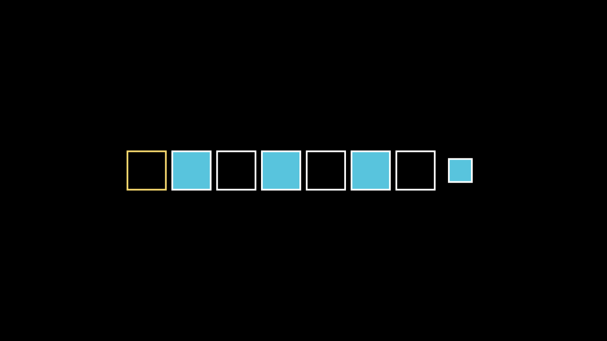

### VDict

[`VDict()`](https://adamrsophie.github.io/manimR/reference/VDictClass.md)
is a VGroup whose members have names. Index it with a key (or a vector
of keys for a group), assign with `vd[key] <- mobject`, and use the
methods [`get()`](https://rdrr.io/r/base/get.html),
`add_key_value_pair()`, `remove_key()` and `get_all_submobjects()`. With
`[[`, a character key returns a field or method when there is one of
that name, otherwise the entry.

``` r

vd <- VDict(list(square = Square(color = BLUE), circle = Circle()))
class(vd["square"])[1]
#> [1] "Square"
vd["triangle"] <- Triangle(color = GREEN)
length(vd)
#> [1] 3
vd$get("circle")$get_color()
#> [1] "#FC6255"
vd$remove_key("circle")
length(vd)
#> [1] 2
class(vd[c("square", "triangle")])[1]
#> [1] "VGroup"
plot(vd$arrange(RIGHT, buff = 1))
```

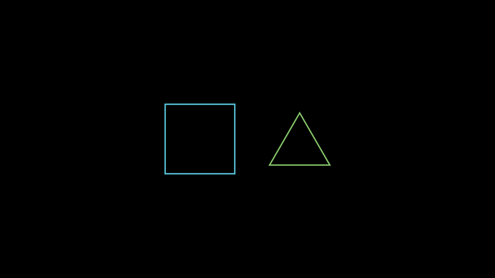

## The geometry library

This section shows every shape. A small helper lays out a catalog with a
caption under each shape.

``` r

catalog <- function(items, cols = 4, font_size = 30, buff = c(0.7, 0.5)) {
  cells <- VGroup(lapply(names(items), function(nm) {
    VGroup(items[[nm]], Text(nm, font_size = font_size)$next_to(items[[nm]], DOWN, buff = 0.2))
  }))
  cells$arrange_in_grid(cols = cols, buff = buff)
  cells$scale(min(1, 13.4 / cells$width, 7.6 / cells$height))
}
```

### Arcs, circles and dots

``` r

plot(catalog(list(
  "Arc" = Arc(radius = 1, start_angle = PI / 6, angle = 4 * PI / 3, color = BLUE),
  "ArcBetweenPoints" = ArcBetweenPoints(LEFT, RIGHT, angle = PI / 2, color = GREEN),
  "Circle" = Circle(radius = 1),
  "Ellipse" = Ellipse(width = 2.4, height = 1.2, color = YELLOW),
  "Dot" = Dot(radius = 0.2, color = WHITE),
  "AnnotationDot" = AnnotationDot()$scale(2.5),
  "LabeledDot" = LabeledDot(Text("A", font_size = 40, color = BLACK), color = YELLOW),
  "CubicBezier" = CubicBezier(c(-1, -0.5, 0), c(-0.5, 1.5, 0), c(0.5, -1.5, 0), c(1, 0.5, 0), color = PINK)
)))
```

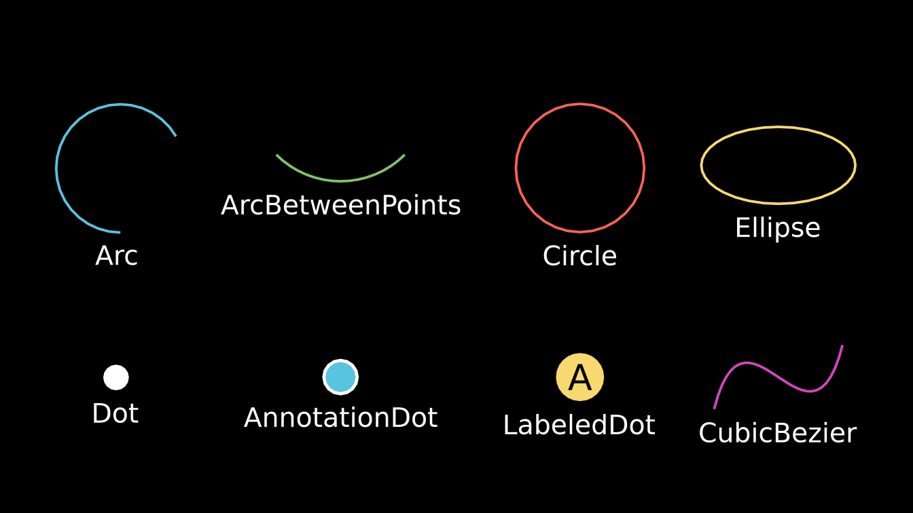

- `Arc(radius, start_angle, angle, arc_center)` sweeps `angle` radians
  counterclockwise from `start_angle`.
  `ArcBetweenPoints(start, end, angle)` bends between two points.
- `Circle(radius)` is a full arc; `Ellipse(width, height)` a stretched
  circle.
  [`circle_from_three_points()`](https://adamrsophie.github.io/manimR/reference/geometry.md)
  and `CircleClass$from_three_points()` find the circle through three
  points, and `$point_at_angle()` gives the point at an angle on a
  circle.
- `Dot(point, radius)` is a small filled circle;
  [`AnnotationDot()`](https://adamrsophie.github.io/manimR/reference/geometry.md)
  has a colored fill and a white stroke; `LabeledDot(label)` is a dot
  with a label inside (a string is typeset with
  [`MathTex()`](https://adamrsophie.github.io/manimR/reference/tex.md),
  so pass a
  [`Text()`](https://adamrsophie.github.io/manimR/reference/TextClass.md)
  mobject when LaTeX is not available).
- `CubicBezier(start_anchor, start_handle, end_handle, end_anchor)` is a
  single Bezier curve.

``` r

through <- circle_from_three_points(LEFT, UP, c(1.5, 0.5, 0), color = TEAL)
pts <- VGroup(Dot(LEFT), Dot(UP), Dot(c(1.5, 0.5, 0)))
on_circle <- Dot(through$point_at_angle(-PI / 2), color = RED)
plot(VGroup(through, pts, on_circle))
```

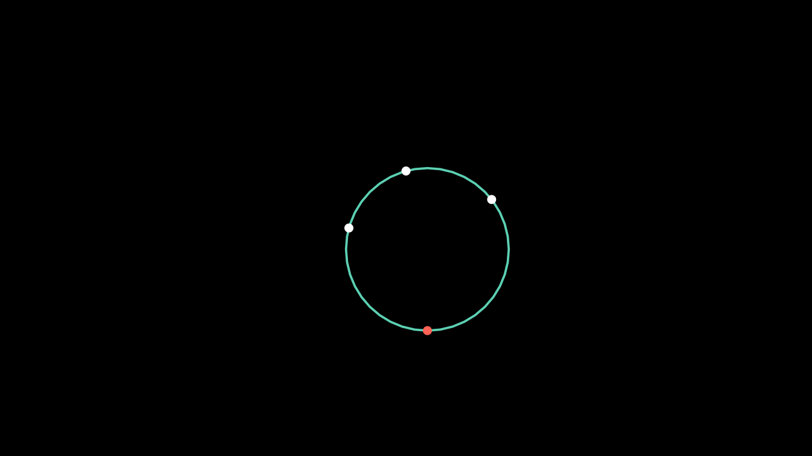

### Sectors, rings and arc polygons

``` r

p3 <- list(c(-1, -0.6, 0), c(1, -0.6, 0), c(0, 1.1, 0))
arc_poly <- ArcPolygon(p3[[1]], p3[[2]], p3[[3]], arc_config = list(angle = PI / 3, color = ORANGE),
                       fill_color = ORANGE, fill_opacity = 0.3, stroke_width = 0)
a <- c(-1, -0.6, 0)
b <- c(1, -0.6, 0)
cc <- c(0, sqrt(3) - 0.6, 0)
reuleaux <- ArcPolygonFromArcs(
  ArcBetweenPoints(a, b, radius = 2, stroke_width = 0),
  ArcBetweenPoints(b, cc, radius = 2, stroke_width = 0),
  ArcBetweenPoints(cc, a, radius = 2, stroke_color = RED),
  color = PURPLE, fill_opacity = 1
)
plot(catalog(list(
  "Sector" = Sector(radius = 1.2, angle = PI / 3, color = BLUE),
  "AnnularSector" = AnnularSector(inner_radius = 0.6, outer_radius = 1.2, angle = 2 * PI / 3, color = GREEN),
  "Annulus" = Annulus(inner_radius = 0.6, outer_radius = 1.1, color = RED),
  "ArcPolygon" = arc_poly,
  "ArcPolygonFromArcs" = reuleaux
), cols = 5))
```

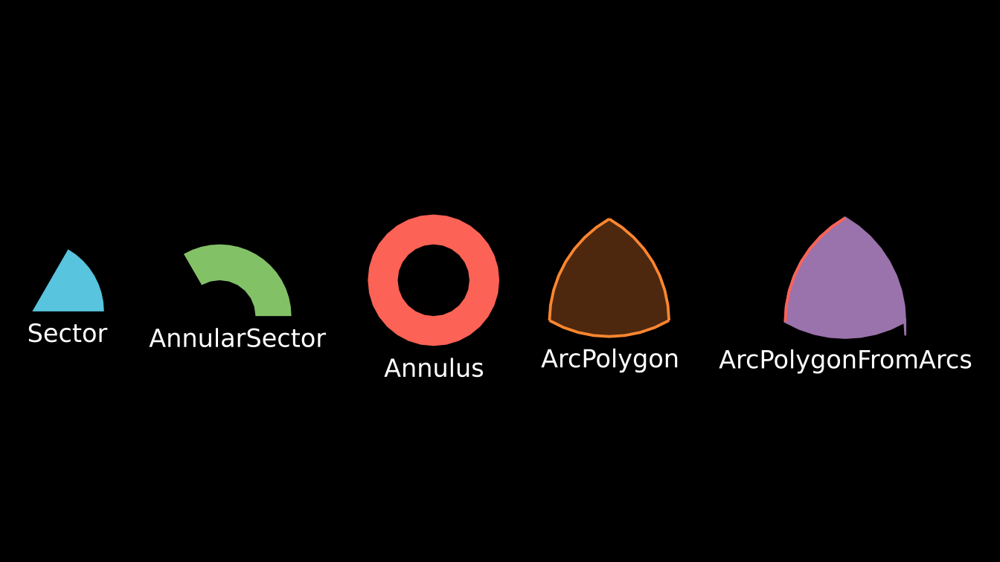

[`Sector()`](https://adamrsophie.github.io/manimR/reference/geometry.md),
[`AnnularSector()`](https://adamrsophie.github.io/manimR/reference/geometry.md)
and
[`Annulus()`](https://adamrsophie.github.io/manimR/reference/geometry.md)
are filled by default.
[`ArcPolygon()`](https://adamrsophie.github.io/manimR/reference/geometry.md)
joins its vertices with arcs (one `angle` or `radius` for all, or a list
of settings in `arc_config`);
[`ArcPolygonFromArcs()`](https://adamrsophie.github.io/manimR/reference/geometry.md)
joins given arcs with straight segments where they do not meet. Both
keep their arcs as submobjects (`$arcs`), which are drawn with their own
style; here the arcs carry the orange outline of the first shape, and
only one arc of the Reuleaux triangle has a visible (red) stroke.

### Lines

``` r

curve <- Circle(radius = 0.9, color = GREY_B)
plot(catalog(list(
  "Line" = Line(c(-1, -0.5, 0), c(1, 0.5, 0), color = BLUE),
  "Line(path_arc = )" = Line(LEFT, RIGHT, path_arc = PI / 2, color = GREEN),
  "DashedLine" = DashedLine(LEFT, RIGHT, color = YELLOW, dash_length = 0.15),
  "TangentLine" = VGroup(curve, TangentLine(curve, alpha = 0.125, length = 2.2, color = RED)),
  "Elbow" = Elbow(width = 0.8, angle = PI / 4, color = PINK)
), cols = 5))
```

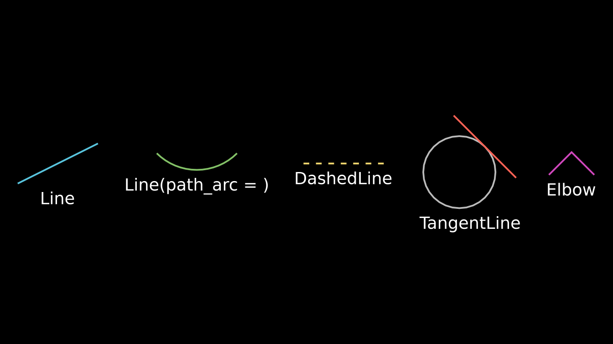

`Line(start, end, buff, path_arc)` accepts points or mobjects for
`start` and `end` (then it starts at their edges), and `buff` shortens
it at both ends. Lines have helpers for their geometry:

``` r

ln <- Line(ORIGIN, c(3, 4, 0))
c(ln$get_length(), ln$get_angle() / DEGREES, ln$get_slope())
#> [1]  5.000000 53.130102  1.333333
ln$get_vector()
#> [1] 3 4 0
ln$get_unit_vector()
#> [1] 0.6 0.8 0.0
ln$put_start_and_end_on(LEFT, RIGHT)$get_length()
#> [1] 2
ln$set_length(5)$get_length()
#> [1] 5
Line(Circle()$shift(2 * LEFT), Circle()$shift(2 * RIGHT))$get_start() # starts at the edge
#> [1] -1  0  0
```

`TangentLine(vmob, alpha, length)` touches a curve at proportion `alpha`
of its length, and `Elbow(width, angle)` is the small corner mark used
for right angles.

### Arrows and tips

``` r

plot(catalog(list(
  "Arrow" = Arrow(LEFT, RIGHT, color = BLUE),
  "DoubleArrow" = DoubleArrow(LEFT, RIGHT, color = GREEN),
  "Vector" = Vector(c(1.2, 0.8, 0), color = YELLOW),
  "CurvedArrow" = CurvedArrow(LEFT, RIGHT, color = RED),
  "CurvedDoubleArrow" = CurvedDoubleArrow(LEFT, RIGHT, color = PINK),
  "Line + add_tip()" = Line(LEFT, RIGHT, color = TEAL)$add_tip()
), cols = 3))
```

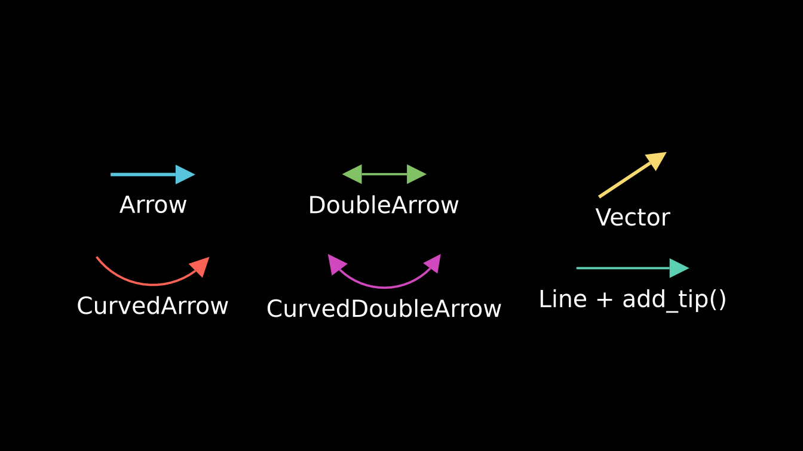

`Arrow(start, end, buff)` stops `buff` short of its end points (0.25 by
default) and keeps its tip in proportion when it is short.
`Vector(direction)` starts at the origin. Any line or arc can get a tip
with `add_tip()`, at the start with `add_tip(at_start = TRUE)`;
`get_tip()`, `get_tips()`, `has_tip()` and `pop_tips()` manage them.

The tip shape is a class generator passed as `tip_shape` (or
`tip_shape_start` and `tip_shape_end` for double arrows). The base class
of all tips is `ArrowTipClass`, and the class of anything that can carry
tips is `TipableVMobjectClass`.

``` r

tips <- c("ArrowTriangleTipClass", "ArrowTriangleFilledTipClass", "ArrowCircleTipClass",
          "ArrowCircleFilledTipClass", "ArrowSquareTipClass", "ArrowSquareFilledTipClass", "StealthTipClass")
tip_rows <- VGroup(lapply(seq_along(tips), function(i) {
  y <- 3.4 - 0.85 * i
  arrow <- Arrow(c(0.5, y, 0), c(3.5, y, 0), tip_shape = get(tips[i]), color = YELLOW)
  VGroup(Text(tips[i], font_size = 30)$next_to(arrow, LEFT, buff = 0.4), arrow)
}))
plot(tip_rows$center())
```

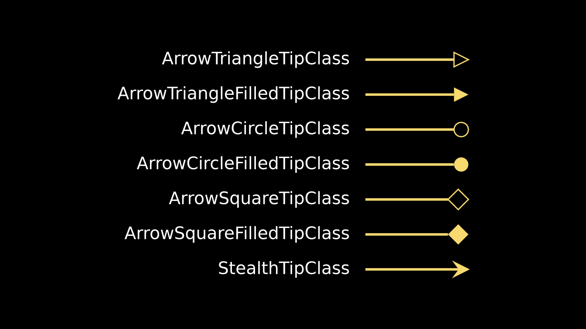

``` r

arrow <- Arrow(LEFT, RIGHT)
arrow$has_tip()
#> [1] TRUE
zapsmall(arrow$get_tip()$tip_angle)
#> [1] -3.766828e-16
arrow$get_tip()$length
#> [1] 0.35
```

### Angles

`Angle(line1, line2)` marks the angle between two lines that meet.
Choose which of the four angles with `quadrant`, take the reflex angle
with `other_angle = TRUE`, or mark it with a dot or a right angle elbow.
[`RightAngle()`](https://adamrsophie.github.io/manimR/reference/geometry.md)
is the elbow version; `angle_from_three_points(A, B, C)` (or
`AngleClass$from_three_points()`) builds the angle at `B`, and
`get_value()` reads it.

``` r

make_lines <- function() VGroup(Line(ORIGIN, 1.6 * RIGHT), Line(ORIGIN, rotate_vector(1.6 * RIGHT, PI / 3)))
l1 <- make_lines()
l2 <- make_lines()
l3 <- VGroup(Line(1.2 * LEFT, 1.2 * RIGHT), Line(rotate_vector(1.2 * LEFT, PI / 3), rotate_vector(1.2 * RIGHT, PI / 3)))
l4 <- make_lines()
l5 <- VGroup(Line(ORIGIN, 1.6 * RIGHT), Line(ORIGIN, 1.6 * UP))
plot(catalog(list(
  "Angle" = VGroup(l1, Angle(l1[1], l1[2], color = YELLOW)),
  "other_angle = TRUE" = VGroup(l2, Angle(l2[1], l2[2], other_angle = TRUE, radius = 0.4, color = GREEN)),
  "quadrant = c(-1, -1)" = VGroup(l3, Angle(l3[1], l3[2], quadrant = c(-1, -1), color = RED)),
  "dot = TRUE" = VGroup(l4, Angle(l4[1], l4[2], dot = TRUE, color = BLUE)),
  "RightAngle" = VGroup(l5, RightAngle(l5[1], l5[2], length = 0.4, color = PINK))
), cols = 5))
```

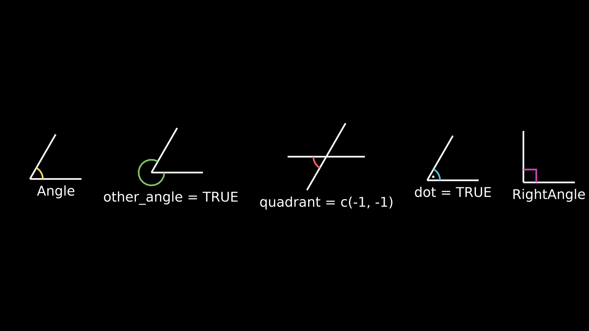

``` r

angle_from_three_points(RIGHT, ORIGIN, UP)$get_value(degrees = TRUE)
#> [1] 90
Angle(l1[1], l1[2])$get_value()
#> [1] 1.047198
```

`TangentialArc(line1, line2, radius, corner)` is an arc of the given
radius tangent to both lines, the rounded corner between them:

``` r

h <- Line(c(-4, -2, 0), c(4, -2, 0), color = GREY_B)
v <- Line(c(0, -3.5, 0), c(0, 3, 0), color = GREY_B)
plot(VGroup(h, v,
            TangentialArc(h, v, radius = 1.5, color = YELLOW, stroke_width = 6),
            TangentialArc(h, v, radius = 1, corner = c(-1, 1), color = RED, stroke_width = 6)))
```

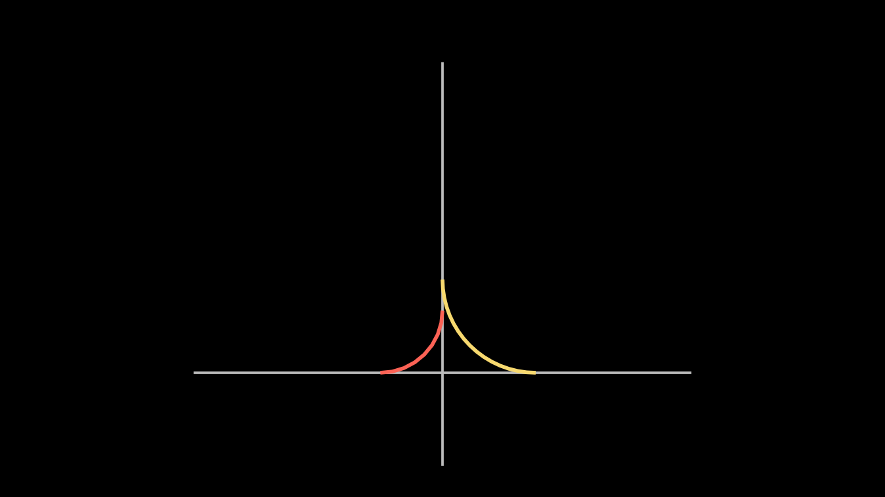

### Polygons

``` r

plot(catalog(list(
  "Polygon" = Polygon(c(-1, -0.8, 0), c(1, -0.8, 0), c(1.2, 0.5, 0), c(0, 1, 0), c(-1.2, 0.3, 0), color = BLUE),
  "Triangle" = Triangle(color = GREEN),
  "Square" = Square(side_length = 1.6, color = YELLOW),
  "Rectangle" = Rectangle(width = 2.2, height = 1.2, color = RED),
  "RegularPolygon(6)" = RegularPolygon(6, color = TEAL),
  "RegularPolygram(7, 3)" = RegularPolygram(7, density = 3, color = PURPLE),
  "Star(5)" = Star(5, color = GOLD),
  "RoundedRectangle" = RoundedRectangle(corner_radius = 0.3, width = 2.2, height = 1.3, color = PINK)
)))
```

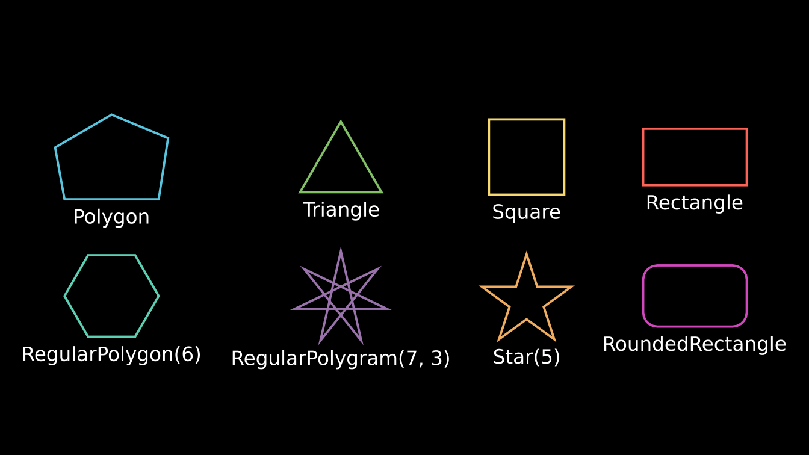

- `Polygon(...)` takes its vertices as separate points or as one matrix.
  `Polygram(...)` takes vertex groups (one matrix each) and draws each
  as a closed path, so it can have several pieces.
- `RegularPolygon(n)` and `RegularPolygram(num_vertices, density)` (a
  star polygon that connects every `density`th vertex);
  [`Triangle()`](https://adamrsophie.github.io/manimR/reference/geometry.md)
  is `RegularPolygon(3)`.
- `Star(n, outer_radius, inner_radius, density)` is a star outline.
- `Rectangle(width, height, grid_xstep, grid_ystep)` can draw a grid
  inside; `Square(side_length)`; `RoundedRectangle(corner_radius)`.

`get_vertices()` returns the corners, and `round_corners(radius)` rounds
them:

``` r

hexagon <- RegularPolygon(6)
nrow(hexagon$get_vertices())
#> [1] 6
two_parts <- Polygram(rbind(c(-1, 0, 0), c(0, 1, 0), c(1, 0, 0)),
                      rbind(c(-1, -0.4, 0), c(1, -0.4, 0), c(0, -1.4, 0)), color = ORANGE)
plot(catalog(list(
  "Polygram (2 groups)" = two_parts,
  "round_corners(0.3)" = Triangle(color = BLUE)$scale(1.2)$round_corners(radius = 0.3),
  "Rectangle with grid" = Rectangle(width = 2.4, height = 1.6, grid_xstep = 0.4, grid_ystep = 0.4, color = GREEN),
  "Star(7, density = 3)" = Star(7, outer_radius = 1, density = 3, color = YELLOW)
)))
```

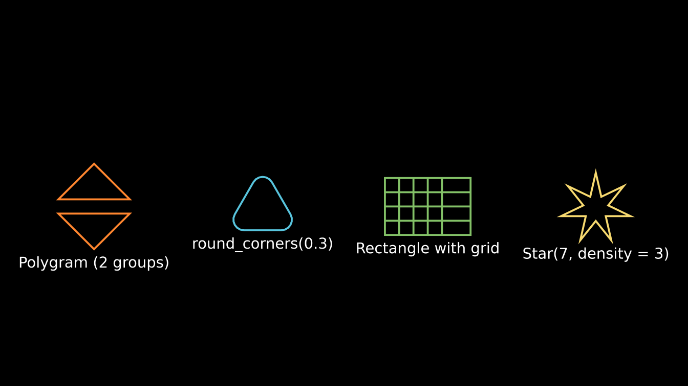

### Cutouts and convex hulls

`Cutout(main_shape, ...)` punches the other shapes out of the main one,
so the holes show what is behind. `ConvexHull(...)` is the smallest
convex polygon around a set of points.

``` r

stripes <- VGroup(lapply(1:6, function(i) {
  Rectangle(width = 3, height = 0.5, stroke_width = 0, fill_opacity = 1, fill_color = c(RED, YELLOW)[i %% 2 + 1])
}))$arrange(DOWN, buff = 0)
holes <- Cutout(Square(side_length = 3), Circle(radius = 0.5)$shift(0.6 * UL),
                Triangle()$scale(0.6)$shift(0.6 * DR), fill_opacity = 1, color = BLUE, stroke_width = 0)
set.seed(4)
cloud <- cbind(runif(20, -1.5, 1.5), runif(20, -1.2, 1.2), 0)
hull <- ConvexHull(cloud, color = YELLOW)
cloud_dots <- VGroup(lapply(seq_len(nrow(cloud)), function(i) Dot(cloud[i, ], radius = 0.05)))
plot(VGroup(VGroup(stripes, holes),
            VGroup(hull, cloud_dots))$arrange(RIGHT, buff = 1.5))
```

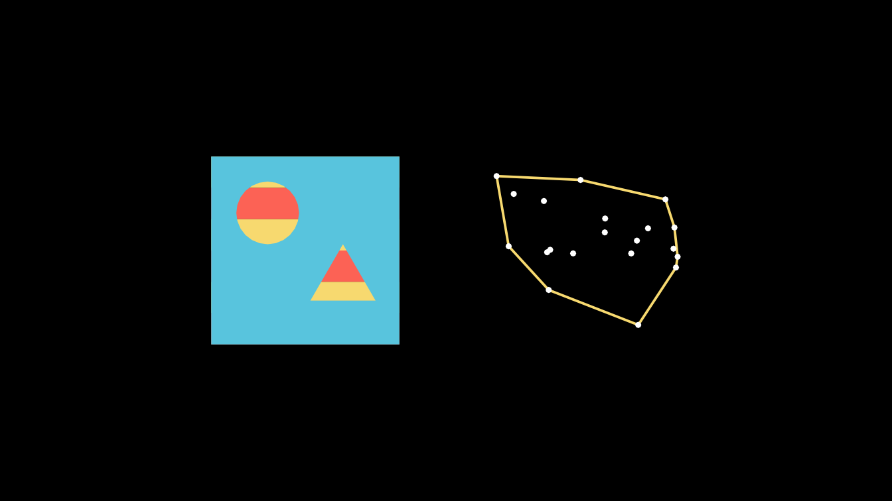

### Annotation shapes

[`SurroundingRectangle()`](https://adamrsophie.github.io/manimR/reference/geometry.md)
frames a mobject (with optional rounded corners),
[`BackgroundRectangle()`](https://adamrsophie.github.io/manimR/reference/geometry.md)
puts a translucent rectangle behind it,
[`Underline()`](https://adamrsophie.github.io/manimR/reference/geometry.md)
draws a line under it and
[`Cross()`](https://adamrsophie.github.io/manimR/reference/geometry.md)
crosses it out (or makes a plain X without a mobject).

``` r

framed <- Text("frame", font_size = 44)
backed <- Text("back", font_size = 44)
underlined <- Text("under", font_size = 44)
crossed <- Text("wrong", font_size = 44)
plot(catalog(list(
  "SurroundingRectangle" = VGroup(framed, SurroundingRectangle(framed, corner_radius = 0.1)),
  "BackgroundRectangle" = VGroup(Square(side_length = 1, color = BLUE, fill_opacity = 1)$shift(0.4 * UP),
                                 BackgroundRectangle(backed, fill_opacity = 0.8), backed),
  "Underline" = VGroup(underlined, Underline(underlined, color = YELLOW)),
  "Cross" = VGroup(crossed, Cross(crossed))
), cols = 4, font_size = 26))
```

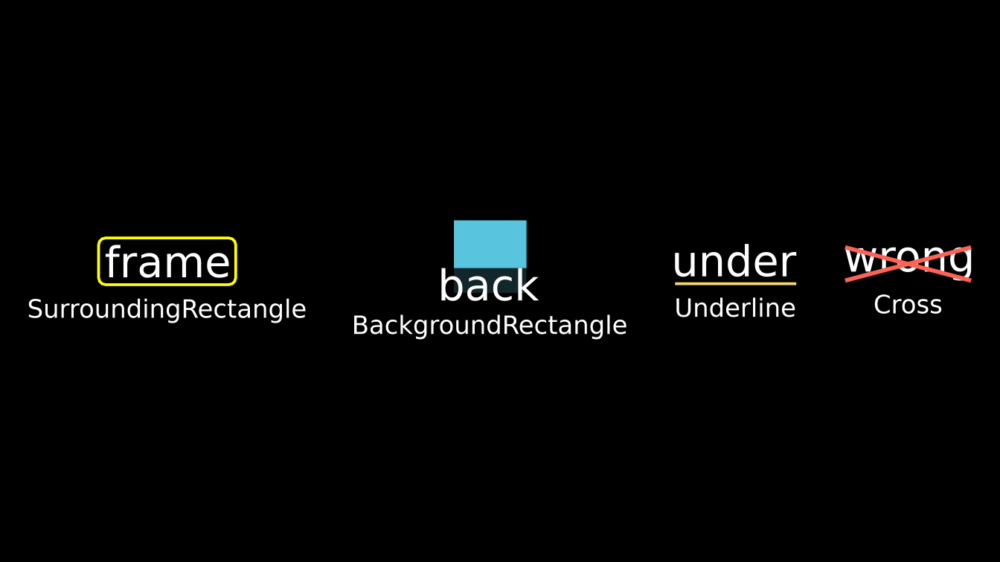

### Boolean operations

[`Union()`](https://adamrsophie.github.io/manimR/reference/boolean_ops.md),
[`Intersection()`](https://adamrsophie.github.io/manimR/reference/boolean_ops.md),
[`Difference()`](https://adamrsophie.github.io/manimR/reference/boolean_ops.md)
and
[`Exclusion()`](https://adamrsophie.github.io/manimR/reference/boolean_ops.md)
combine shapes the way a drawing program does. They need the suggested
‘polyclip’ package. The result is a new VMobject made of straight
segments (curves are sampled finely), and it takes the usual style
arguments.

``` r

sq <- Square(color = RED, fill_opacity = 0.5)$move_to(0.4 * LEFT)
ci <- Circle(color = BLUE, fill_opacity = 0.5)$move_to(0.4 * RIGHT + 0.4 * UP)
plot(catalog(list(
  "inputs" = VGroup(sq$copy(), ci$copy()),
  "Union" = Union(sq, ci, color = GREEN, fill_opacity = 1),
  "Intersection" = Intersection(sq, ci, color = YELLOW, fill_opacity = 1),
  "Difference" = Difference(sq, ci, color = PINK, fill_opacity = 1),
  "Exclusion" = Exclusion(sq, ci, color = TEAL, fill_opacity = 1)
), cols = 5))
```

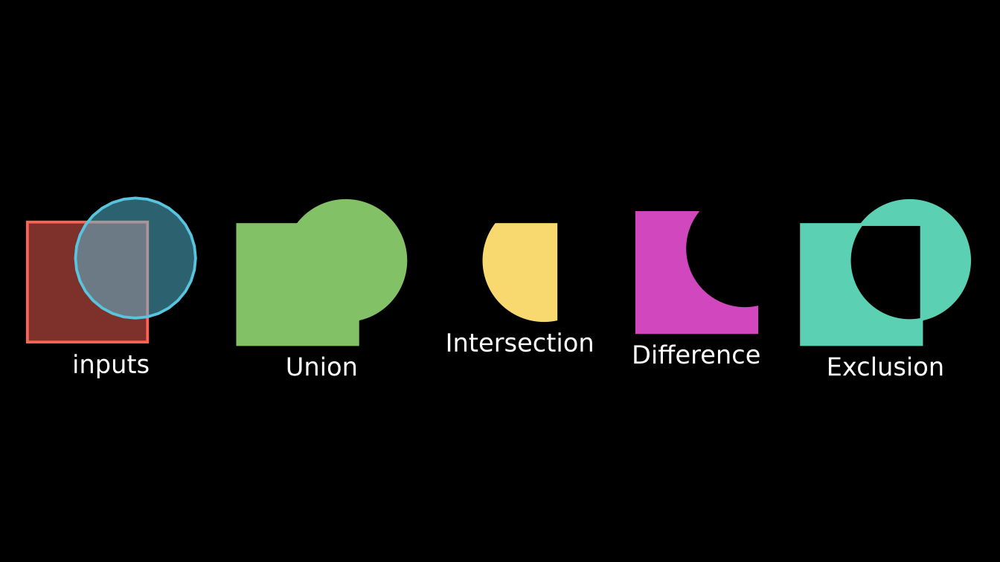

[`Union()`](https://adamrsophie.github.io/manimR/reference/boolean_ops.md)
and
[`Intersection()`](https://adamrsophie.github.io/manimR/reference/boolean_ops.md)
take two or more shapes; `Difference(subject, clip)` removes `clip` from
`subject`, and
[`Exclusion()`](https://adamrsophie.github.io/manimR/reference/boolean_ops.md)
keeps what exactly one of the two covers.

### Braces

`Brace(mobject, direction)` draws a curly brace along one side of a
mobject. `put_at_tip()` places another mobject at its tip, and
`get_text()` / `get_tex()` make a label there.
[`BraceLabel()`](https://adamrsophie.github.io/manimR/reference/BraceClass.md)
makes the brace and label in one go (the label constructor is
[`MathTex()`](https://adamrsophie.github.io/manimR/reference/tex.md) by
default;
[`BraceText()`](https://adamrsophie.github.io/manimR/reference/BraceClass.md)
uses
[`Text()`](https://adamrsophie.github.io/manimR/reference/TextClass.md)).
[`BraceBetweenPoints()`](https://adamrsophie.github.io/manimR/reference/BraceClass.md)
spans two points, and
[`ArcBrace()`](https://adamrsophie.github.io/manimR/reference/BraceClass.md)
follows an arc.

``` r

rect <- Rectangle(width = 3, height = 1.5, color = BLUE)
b_down <- Brace(rect, DOWN)
b_left <- Brace(rect, LEFT, color = YELLOW)
width_label <- Text("width", font_size = 30)
b_down$put_at_tip(width_label)
with_braces <- VGroup(rect, b_down, b_left, width_label)
p1 <- c(-1.5, -1, 0)
p2 <- c(1, 1, 0)
between <- VGroup(Dot(p1), Dot(p2), BraceBetweenPoints(p1, p2, color = GREEN))
arc <- Arc(radius = 1.5, start_angle = PI / 6, angle = 2 * PI / 3, color = RED)
side_sq <- Square(side_length = 1.6, color = TEAL)
plot(catalog(list(
  "Brace + put_at_tip()" = with_braces,
  "BraceText" = VGroup(side_sq, BraceText(side_sq, "side", font_size = 30)),
  "BraceBetweenPoints" = between,
  "ArcBrace" = VGroup(arc, ArcBrace(arc))
), cols = 4, font_size = 26))
```

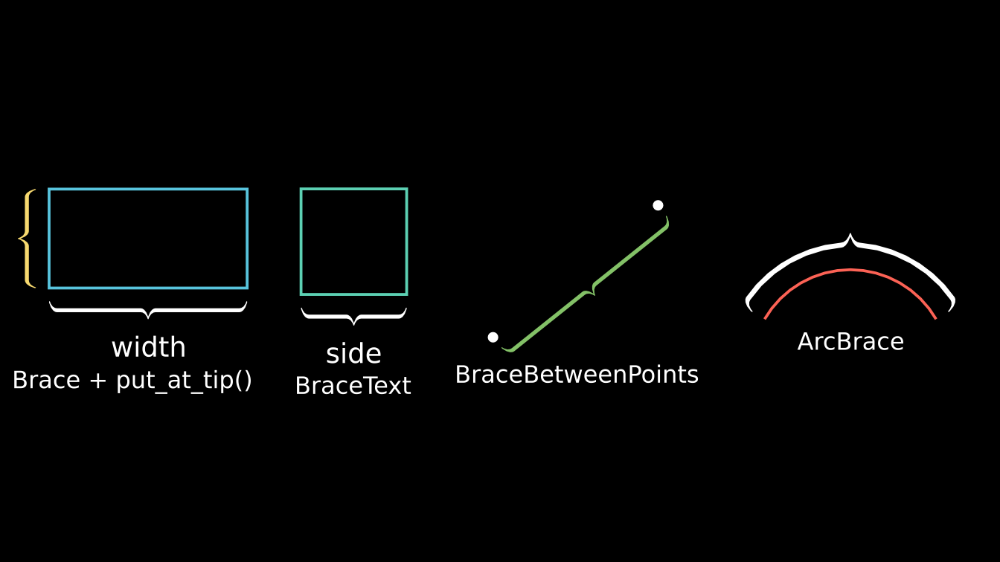

``` r

plot(BraceLabel(Line(2 * LEFT, 2 * RIGHT), "x^2 + y^2", brace_direction = UP))
```

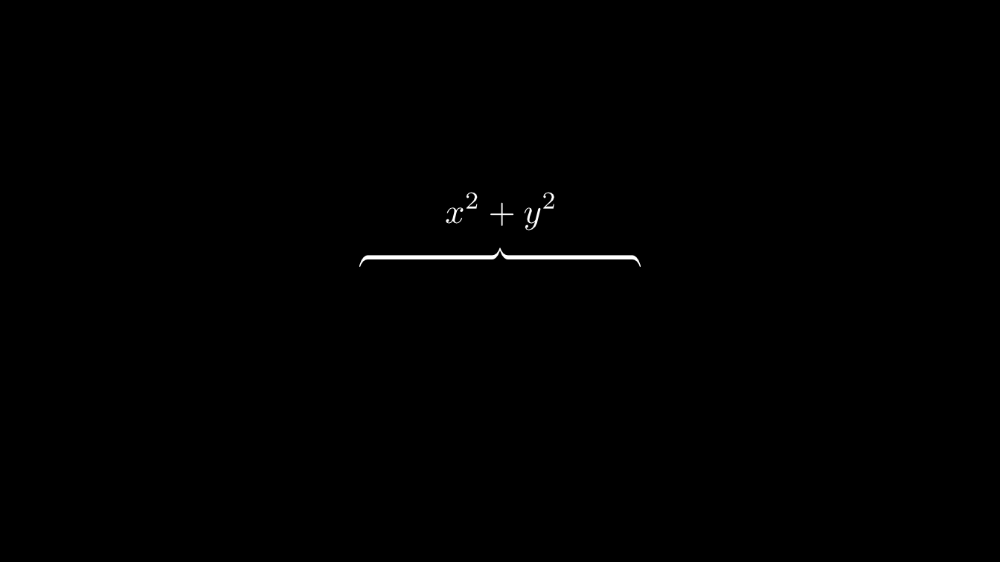

### Labeled geometry

[`Label()`](https://adamrsophie.github.io/manimR/reference/LabelClass.md)
is a label on a background box with a frame.
[`LabeledLine()`](https://adamrsophie.github.io/manimR/reference/LabelClass.md)
and
[`LabeledArrow()`](https://adamrsophie.github.io/manimR/reference/LabelClass.md)
put such a label at `label_position` (a proportion of the length), and
[`LabeledPolygram()`](https://adamrsophie.github.io/manimR/reference/LabelClass.md)
puts it at the polygon’s pole of inaccessibility, the interior point
farthest from the edges (see
[`polylabel()`](https://adamrsophie.github.io/manimR/reference/polylabel.md)
in [Math and utility
functions](https://adamrsophie.github.io/manimR/articles/utilities.md)).
A string label is typeset with
[`MathTex()`](https://adamrsophie.github.io/manimR/reference/tex.md); a
[`Text()`](https://adamrsophie.github.io/manimR/reference/TextClass.md)
mobject works without LaTeX. `label_config`, `box_config` and
`frame_config` style the parts.

Fills use the nonzero winding rule, as in SVG and upstream: a ring
inside another is a hole when its vertices run the opposite way, which
is why the inner ring of the polygram below is listed clockwise.

``` r

ring <- list(rbind(c(-2, -1.2, 0), c(2, -1.2, 0), c(2, 1.2, 0), c(-2, 1.2, 0)),     # counterclockwise
             rbind(c(-1.6, -0.8, 0), c(-1.6, 0.8, 0), c(-0.2, 0.8, 0), c(-0.2, -0.8, 0))) # clockwise: a hole
plot(catalog(list(
  "Label" = Label(Text("Label", font_size = 36), box_config = list(color = BLUE, fill_opacity = 0.8)),
  "LabeledLine" = LabeledLine(Text("0.8", font_size = 28), label_position = 0.8,
                              start = c(-1.5, -0.7, 0), end = c(1.5, 0.7, 0), color = YELLOW),
  "LabeledArrow" = LabeledArrow(Text("force", font_size = 28), start = c(-1.5, 0, 0), end = c(1.5, 0, 0),
                                color = GREEN),
  "LabeledPolygram" = LabeledPolygram(ring[[1]], ring[[2]], label = Text("pole", font_size = 28),
                                      color = RED, fill_opacity = 0.3)
), cols = 4, font_size = 26))
```

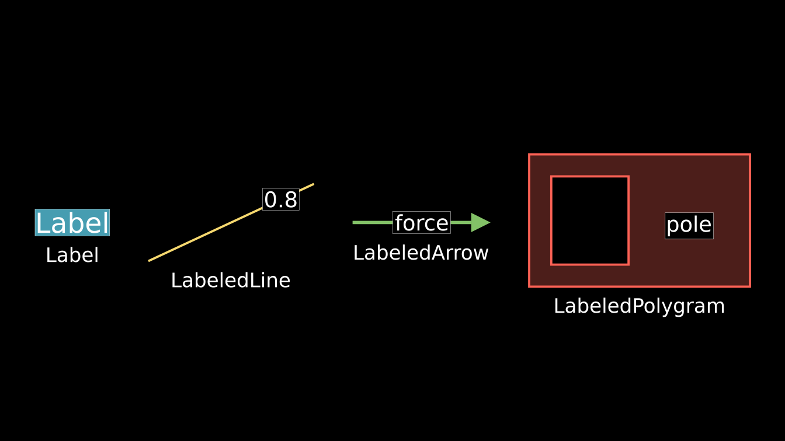

### Dashed paths, pieces and screen shapes

- `DashedVMobject(vmobject, num_dashes, dashed_ratio)` is a dashed copy
  of any VMobject.
- `CurvesAsSubmobjects(vmobject)` splits a path into one submobject per
  Bezier curve, so each piece can be colored on its own.
- `ScreenRectangle(aspect_ratio, height)` has the shape of the screen
  (16:9 by default), and
  [`FullScreenRectangle()`](https://adamrsophie.github.io/manimR/reference/ScreenRectangleClass.md)
  covers the whole frame.
- `VectorizedPoint(location)` is an invisible point, useful as an anchor
  for animations and layouts.

``` r

pieces <- CurvesAsSubmobjects(Circle(radius = 1)$set_stroke(width = 10))
pieces$set_color_by_gradient(BLUE, YELLOW, RED)
anchor <- VectorizedPoint(c(1, 1, 0))
c(length(pieces), anchor$width)
#> [1] 8.00 0.01
plot(VGroup(
  FullScreenRectangle(color = GREY_D, stroke_width = 8),
  catalog(list(
    "DashedVMobject" = DashedVMobject(Star(color = YELLOW)$scale(1.2), num_dashes = 30),
    "CurvesAsSubmobjects" = pieces,
    "ScreenRectangle" = ScreenRectangle(height = 1.6, color = GREEN)
  ), cols = 3)$scale(0.9)
))
```

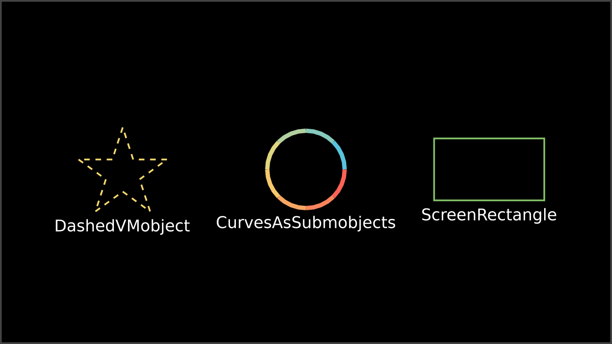

### The manim banner

[`ManimBanner()`](https://adamrsophie.github.io/manimR/reference/ManimBannerClass.md)
draws manim’s logo; `create()` and `expand()` return its two animations.

``` r

Banner <- R6::R6Class("Banner", inherit = Scene,
  public = list(construct = function() {
    banner <- ManimBanner()$scale(0.8)
    self$play(banner$create())
    self$play(banner$expand())
    self$wait(0.5)
  })
)
```

## Building a VMobject from points

Any path can be drawn by setting the points of a
[`VMobject()`](https://adamrsophie.github.io/manimR/reference/VMobjectClass.md)
yourself.

- `set_points_as_corners(points)` joins the points with straight
  segments.
- `set_points_smoothly(points)` passes a smooth spline through them.
- `start_new_path(point)` starts a (new) piece at a point;
  `add_line_to()`,
  `add_cubic_bezier_curve_to(handle1, handle2, anchor)`,
  `add_quadratic_bezier_curve_to(handle, anchor)` and
  `add_smooth_curve_to(point)` continue it; `close_path()` closes it.
- `make_smooth()` and `make_jagged()` change all corners at once, and
  `set_points()` or `append_points()` take raw Bezier control points.

``` r

zigzag <- rbind(c(-1.5, -1, 0), c(-0.75, 1, 0), c(0, -1, 0), c(0.75, 1, 0), c(1.5, -1, 0))
corners <- VMobject(color = BLUE)$set_points_as_corners(zigzag)
smooth <- VMobject(color = GREEN)$set_points_smoothly(zigzag)

drawn <- VMobject(color = YELLOW, fill_opacity = 0.3)
drawn$start_new_path(c(-1.5, -1, 0))
drawn$add_line_to(c(-1.5, 0.5, 0))
drawn$add_cubic_bezier_curve_to(c(-1, 1.5, 0), c(0, 1.5, 0), c(0.5, 0.5, 0))
drawn$add_quadratic_bezier_curve_to(c(1.5, 0.5, 0), c(1.5, -1, 0))
drawn$close_path()

two_pieces <- VMobject(color = RED)
two_pieces$start_new_path(c(-1.5, 0.5, 0))
two_pieces$add_smooth_curve_to(c(0, 1.2, 0))
two_pieces$add_smooth_curve_to(c(1.5, 0.5, 0))
two_pieces$start_new_path(c(-1.5, -0.8, 0))
two_pieces$add_line_to(c(1.5, -0.8, 0))

plot(catalog(list(
  "set_points_as_corners" = corners,
  "set_points_smoothly" = smooth,
  "lines and curves" = drawn,
  "start_new_path" = two_pieces
)))
```

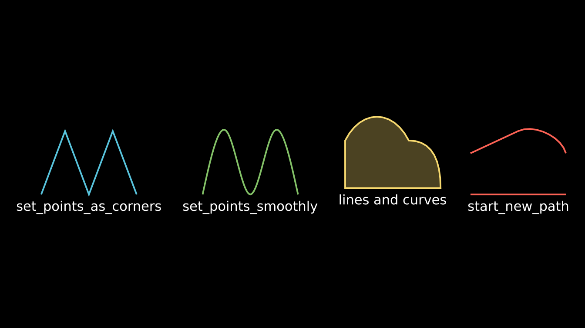

``` r

drawn$get_num_curves()
#> [1] 4
drawn$is_closed()
#> [1] TRUE
length(two_pieces$get_subpaths())
#> [1] 2
```

A path can be animated like any built in shape.
[`Create()`](https://adamrsophie.github.io/manimR/reference/creation.md)
draws it along its points:

``` r

DrawSpiral <- R6::R6Class("DrawSpiral", inherit = Scene,
  public = list(construct = function() {
    t <- seq(0, 4 * PI, length.out = 120)
    spiral <- VMobject(color = YELLOW, stroke_width = 6)
    spiral$set_points_smoothly(cbind(0.25 * t * cos(t), 0.25 * t * sin(t), 0))
    spiral$set_color(c(BLUE, YELLOW))
    self$play(Create(spiral), run_time = 2)
  })
)
```

## Making your own Mobject class

For a reusable shape, subclass a mobject class with R6. The usual
pattern is a class generator plus a constructor function, exactly as
manimR’s own shapes are built. Set your fields before calling
`super$initialize()`, because the parent initializer calls
`generate_points()`.

Here is a VMobject whose points are generated from parameters, a rose
curve:

``` r

RoseClass <- R6::R6Class("Rose", inherit = VMobjectClass,
  public = list(
    petals = 5,
    radius = 1.5,
    initialize = function(petals = 5, radius = 1.5, ...) {
      self$petals <- petals
      self$radius <- radius
      super$initialize(...)
    },
    generate_points = function() {
      t <- seq(0, TAU, length.out = 40 * self$petals)
      r <- self$radius * cos(self$petals * t)
      self$set_points_smoothly(cbind(r * cos(t), r * sin(t), 0))
    }
  )
)
Rose <- function(...) RoseClass$new(...)

rose <- Rose(petals = 5, color = PINK, fill_opacity = 0.4)
class(rose)
#> [1] "Rose"     "VMobject" "Mobject"  "R6"
```

And a group subclass that assembles other mobjects, a labeled pie chart.
Its methods are available like any other, and it scales, moves and
animates as one mobject:

``` r

PieChartClass <- R6::R6Class("PieChart", inherit = VGroupClass,
  public = list(
    values = NULL,
    initialize = function(values, colors = NULL, radius = 1.5, ...) {
      super$initialize(...)
      self$values <- values
      colors <- colors %||% color_gradient(c(BLUE, GREEN, YELLOW, RED), length(values))
      angles <- TAU * values / sum(values)
      starts <- cumsum(c(0, angles))[seq_along(values)]
      for (i in seq_along(values)) {
        self$add(Sector(radius = radius, start_angle = starts[i], angle = angles[i],
                        color = colors[i], fill_opacity = 1, stroke_width = 2, stroke_color = BLACK))
      }
    },
    share = function(i) self$values[i] / sum(self$values)
  )
)
PieChart <- function(...) PieChartClass$new(...)

pie <- PieChart(c(3, 2, 4, 1))
length(pie)
#> [1] 4
pie$share(3)
#> [1] 0.4
plot(VGroup(rose, pie)$arrange(RIGHT, buff = 1.5))
```

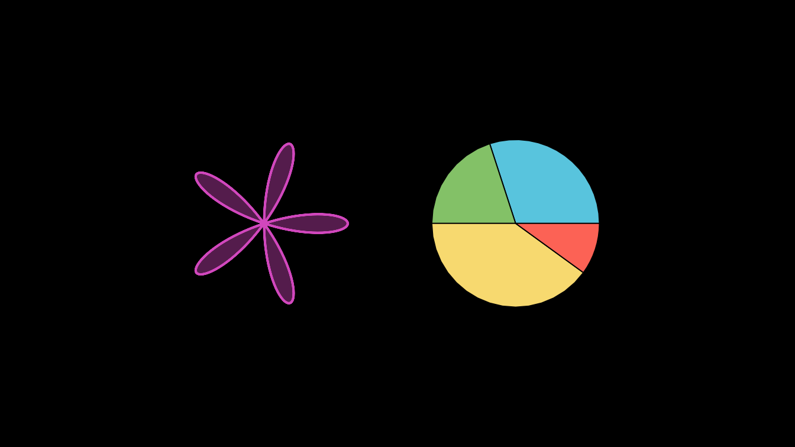

Subclasses take part in everything shown in this vignette: positioning,
styling, copying, grouping and every animation.
