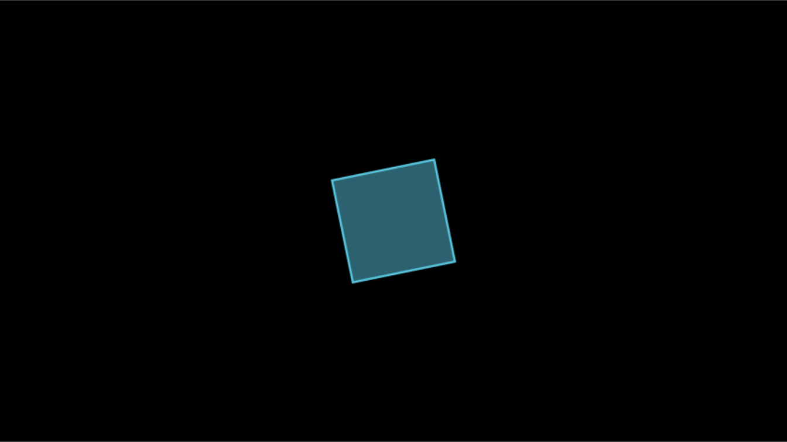

# Rendering, configuration and output

This vignette covers everything about turning a scene into files: the
[`render()`](https://adamrsophie.github.io/manimR/reference/render.md)
function and its arguments, qualities and formats, where output goes,
the configuration system and `manim.cfg` files, the video encoder, the
life of a scene during a render, sections, sound, subcaptions, the
partial movie cache, rendering scripts and the command line, previews,
logging, and the classes that do the work. Output follows Manim
Community 0.22.1, so what you know about `manim render` carries over.

Every example writes into a temporary directory, so you can run them
without cluttering your working directory. In your own work you would
usually leave `media_dir` at its default, `"media"`, inside the project.

## How a render works

`render(MyScene)` goes through these steps, as `manim render` does:

1.  It applies the settings you passed (quality, format and so on) for
    the duration of the render, and creates the scene. The scene creates
    its camera, which reads the resolution, frame rate and background
    color.
2.  The scene’s `Manager` calls `setup()`, then `construct()`, then
    `tear_down()`.
3.  Each `self$play()` or `self$wait()` is one *animation call*. The
    renderer (`CairoRenderer`) computes every frame of it with the
    camera, and the file writer (`SceneFileWriter`) streams the frames
    to `ffmpeg`, which encodes one video segment, a *partial movie
    file*, per call.
4.  When `construct()` returns, the partial movie files are joined into
    the final video, and sounds, section videos and subtitles are added.

The examples use this small scene:

``` r

Demo <- R6::R6Class("Demo", inherit = Scene,
  public = list(construct = function() {
    square <- Square(color = BLUE)$set_fill(BLUE, 0.5)
    self$play(Create(square), run_time = 0.5)
    self$play(square$animate$rotate(PI / 4), run_time = 0.5)
    self$play(square$animate$scale(0.5)$set_fill(YELLOW, 0.8), run_time = 0.5)
  })
)
```

## `render()` and its arguments

``` r

media <- file.path(tempdir(), "media")
out <- render(Demo, quality = "l", media_dir = media)
class(out)
#> [1] "manim_output"
basename(out)
#> [1] "Demo.mp4"
list.files(media, recursive = TRUE)
#> [1] "videos/manimR/480p15/Demo.mp4"                                                                                     
#> [2] "videos/manimR/480p15/partial_movie_files/Demo/0c99f975820087471864ecd26c0ea2f716becfff7049025536797ac10fe36ef7.mp4"
#> [3] "videos/manimR/480p15/partial_movie_files/Demo/dc67732229c1e26a6337dcd486a46fc092418890c4776e1d80806bdbec929952.mp4"
#> [4] "videos/manimR/480p15/partial_movie_files/Demo/f86e4215df5b5fd6bf2c1f1d5162d5abd9a673963c0cc6ca72e3606c792654a5.mp4"
#> [5] "videos/manimR/480p15/partial_movie_files/Demo/partial_movie_file_list.txt"
```

[`render()`](https://adamrsophie.github.io/manimR/reference/render.md)
returns the path of the output file invisibly, with class
`manim_output`, which prints the path. Besides the movie, the render
left one partial movie file per animation call, named by a hash (see
[The partial movie cache](#the-partial-movie-cache)), and the list of
those files that `ffmpeg` joined. The arguments of
[`render()`](https://adamrsophie.github.io/manimR/reference/render.md)
are:

| Argument | Meaning |
|----|----|
| `scene` | A `Scene` subclass, a scene object, or a function of `self` used as `construct()` |
| `quality` | A quality flag (`"l"`, `"m"`, `"h"`, `"p"`, `"k"`) or preset name (`"low_quality"`) |
| `format` | `"auto"`, `"mp4"`, `"mov"`, `"webm"`, `"gif"`, `"png"`, `"png-sequence"` or `"none"` |
| `output_file` | The name of the output file, instead of the scene name |
| `save_last_frame` | `TRUE` is a shorthand for `format = "png"` |
| `preview` | Open the result when done (see [Previews](#previews)) |
| `transparent` | Render with a transparent background |
| `module_name` | Folder name under `media/videos/` and `media/images/`; by default the script name, or `manimR` |
| `scene_name` | Name of the output file; by default the class name |
| `...` | Any other setting of [`manim_config()`](https://adamrsophie.github.io/manimR/reference/manim_config.md) for this render only |

Settings passed to
[`render()`](https://adamrsophie.github.io/manimR/reference/render.md)
apply only to that render: afterwards the configuration is what it was
before.

When `scene` is an existing scene object rather than a class, its camera
already exists, so settings that change the camera (quality, resolution,
frame rate, background) have no effect, and
[`render()`](https://adamrsophie.github.io/manimR/reference/render.md)
warns about it. Pass the class, or change the configuration before
creating the object.

In an R Markdown or Quarto document, a
[`render()`](https://adamrsophie.github.io/manimR/reference/render.md)
result printed at the end of a chunk is shown in the page: a video
player for videos, an image for GIF and PNG files. [RStudio, knitr,
Quarto and
Shiny](https://adamrsophie.github.io/manimR/articles/rstudio-knitr-shiny.md)
has more.

## Quality

A quality is a preset of resolution and frame rate. `QUALITIES` holds
upstream’s presets, and `DEFAULT_QUALITY` names the default:

``` r

do.call(rbind, lapply(QUALITIES, as.data.frame))
#>                    flag pixel_height pixel_width frame_rate
#> fourk_quality         k         2160        3840         60
#> production_quality    p         1440        2560         60
#> high_quality          h         1080        1920         60
#> medium_quality        m          720        1280         30
#> low_quality           l          480         854         15
#> example_quality    <NA>          480         854         30
DEFAULT_QUALITY
#> [1] "high_quality"
```

Use either the flag or the name: `quality = "l"` and
`quality = "low_quality"` are the same. `example_quality`, used for
upstream’s documentation, has no flag. The output folder is named after
the resolution and frame rate, such as `480p15` or `1080p60`.

For any other size, set `pixel_width` and `pixel_height` (or both at
once with `frame_size`) and `frame_rate`:

``` r

render(Demo, frame_size = c(1080, 1080), frame_rate = 24)  # a square video
```

As upstream, the frame keeps its width of about 14.2 units at every
resolution, and the camera adapts the frame height to the aspect ratio:
a square video shows a frame 14.2 units tall.

## Output formats

`format` chooses what a render writes:

| `format` | Output |
|----|----|
| `"auto"` (default) | MP4, or MOV when `transparent = TRUE`; a scene without any animation saves its last frame as a PNG instead |
| `"mp4"` | H.264 video |
| `"mov"` | QuickTime video; with `transparent = TRUE`, lossless with an alpha channel |
| `"webm"` | VP9 video, with an alpha channel when transparent |
| `"gif"` | Animated GIF |
| `"png"` | Only the last frame, as one PNG file; `save_last_frame = TRUE` means the same |
| `"png-sequence"` | Every frame as a numbered PNG file (`"png_sequence"` is accepted too) |
| `"none"` | Nothing is written: the scene runs, which tests it quickly |

``` r

fmt_dir <- file.path(tempdir(), "formats")
gif <- render(Demo, quality = "l", format = "gif", media_dir = fmt_dir)
frames <- render(Demo, quality = "l", format = "png-sequence", media_dir = fmt_dir)
nothing <- render(Demo, quality = "l", format = "none", media_dir = fmt_dir)
basename(gif)
#> [1] "Demo_manimR_v0.1.0.gif"
basename(frames)
#> [1] "Demo"
head(list.files(frames))
#> [1] "0000.png" "0001.png" "0002.png" "0003.png" "0004.png" "0005.png"
length(list.files(frames))
#> [1] 24
is.null(nothing)
#> [1] TRUE
```

As in Python manim, the default names of GIFs and last frame images
carry the version that made them. An image sequence goes to a folder
named after the scene in the images folder; `zero_pad` (default 4) is
the number of digits in its file names.

`dry_run = TRUE` also renders without writing any file, whatever the
format. A WebM render logs a warning that it can be slower than the
other formats, as upstream does.

### Transparency

`transparent = TRUE` renders the background as transparent pixels (it
sets `background_opacity` to 0). MP4 cannot store transparency, so
asking for a transparent MP4 is an error; with the default `"auto"`
format a transparent render writes a MOV (lossless QuickTime animation
with an alpha channel). WebM and PNG output keep transparency too.

``` r

mov <- render(Demo, quality = "l", transparent = TRUE, media_dir = fmt_dir)
basename(mov)
#> [1] "Demo.mov"
str(get_video_metadata(mov)[c("codec_name", "pix_fmt")])
#> List of 2
#>  $ codec_name: chr "qtrle"
#>  $ pix_fmt   : chr "argb"
```

### The last frame

`format = "png"` skips the video entirely. Animations are computed but
not drawn, so this is much faster than a full render and the quickest
way to check the end state of a long scene. The image goes to
`media/images/<module>/`. Printed in an R Markdown chunk, as here, the
result appears in the page:

``` r

last <- render(Demo, quality = "l", format = "png", media_dir = file.path(tempdir(), "stills"))
last
```


### One frame at any time

[`scene_frame()`](https://adamrsophie.github.io/manimR/reference/scene_frame.md)
renders the frame shown at any moment of a scene, without writing a
file: plays that end earlier step through their frames without drawing
them, so updaters reach the state a video has, and the play running at
that time is drawn at its frame for that moment.
[`plot()`](https://rdrr.io/r/graphics/plot.default.html) shows the
frame.

``` r

plot(scene_frame(Demo, t = 0.75))
```



That is halfway through the rotation, the second animation. `t = Inf`,
the default, gives the last frame.

## Output file names

Without `output_file`, a video is written to
`<media_dir>/videos/<module_name>/<quality>/<scene_name>.<format>` and
an image to `<media_dir>/images/<module_name>/`. `module_name` is the
name of the script file the scene came from (see [Rendering script
files](#rendering-script-files)), or `manimR` for scenes rendered from
the console; `scene_name` is the class name.

`output_file` names the file instead, as `-o` does for `manim`. A
relative name is placed in the video folder (or the images folder for a
PNG), and an absolute path is used as it is. The format’s extension is
added unless the name already ends with it:

``` r

names_dir <- file.path(tempdir(), "names")
opening <- render(Demo, quality = "l", media_dir = names_dir, module_name = "chapter1", scene_name = "Opening")
poster <- render(Demo, quality = "l", media_dir = names_dir, output_file = "poster")
clip <- render(Demo, quality = "l", media_dir = names_dir, output_file = "clip.mp4", transparent = TRUE)
elsewhere <- render(Demo, quality = "l", media_dir = names_dir, output_file = file.path(tempdir(), "elsewhere.mp4"))
files <- list.files(names_dir, recursive = TRUE)
files[!grepl("partial_movie_files", files)]
#> [1] "videos/chapter1/480p15/Opening.mp4" "videos/manimR/480p15/clip.mp4.mov" 
#> [3] "videos/manimR/480p15/poster.mp4"
basename(elsewhere)
#> [1] "elsewhere.mp4"
```

`clip.mp4` became `clip.mp4.mov`: the transparent render is a MOV, and
the name did not end with `.mov`. The partial movie files always stay in
the media folder, wherever the movie goes.

## The media directory

All output lives under `media_dir`. By default it is a folder `media` in
the R session’s temporary directory, so that rendering writes nothing to
the working directory; set `manim_config(media_dir = "media")` to keep
the output next to your scripts, as Python manim does.
[`manim_cli()`](https://adamrsophie.github.io/manimR/reference/manim_cli.md),
like upstream’s command line, uses `media` in the working directory.
With every feature in use, a media folder looks like this:

    media/
      videos/<module>/<quality>/          the movies, such as Demo.mp4
        partial_movie_files/<scene>/      one cached segment per animation call
        sections/                         section videos and their JSON index
      images/<module>/                    last frames and image sequences
      Tex/                                LaTeX files and their SVG output
      texts/                              text rendering files
      logs/                               log files, with log_to_file = TRUE

Each folder comes from a directory setting that may refer to the others
with the placeholders `{media_dir}`, `{module_name}`, `{quality}` and
`{scene_name}`, as in upstream’s configuration file.
[`get_dir()`](https://adamrsophie.github.io/manimR/reference/get_dir.md)
fills them in:

``` r

str(manim_config()[c("video_dir", "images_dir", "sections_dir", "partial_movie_dir",
                     "tex_dir", "text_dir", "log_dir")])
#> List of 7
#>  $ video_dir        : chr "{media_dir}/videos/{module_name}/{quality}"
#>  $ images_dir       : chr "{media_dir}/images/{module_name}"
#>  $ sections_dir     : chr "{video_dir}/sections"
#>  $ partial_movie_dir: chr "{video_dir}/partial_movie_files/{scene_name}"
#>  $ tex_dir          : chr "{media_dir}/Tex"
#>  $ text_dir         : chr "{media_dir}/texts"
#>  $ log_dir          : chr "{media_dir}/logs"
with_manim_config(list(media_dir = "media", quality = "m"),
                  get_dir("video_dir", module_name = "scenes"))
#> [1] "media/videos/scenes/720p30"
```

Change a template to move that kind of output, for example to keep every
quality of a scene in one folder:

``` r

render(Demo, quality = "l", video_dir = "{media_dir}/renders/{module_name}")
```

## Configuration

All settings live in one configuration, which you can read and change in
several ways:

- [`manim_config()`](https://adamrsophie.github.io/manimR/reference/manim_config.md)
  returns every setting as a list; with named arguments it changes them
  and invisibly returns the previous values. An unknown name is an
  error.
- `with_manim_config(settings, code)` runs `code` with some settings
  changed and restores them afterwards.
- `tempconfig(settings, code)` does the same with upstream’s name and
  behavior: names that are not settings are ignored.
- `config` gives upstream’s `config.name` syntax: `config$frame_height`,
  `config$background_color <- WHITE`, `config[["pixel_width"]]`.
- `manim_frame` is upstream’s read only `frame` object, with the frame
  sizes, edges and direction constants.
- [`digest_config_file()`](https://adamrsophie.github.io/manimR/reference/digest_config_file.md)
  reads settings from a `manim.cfg` file (see below).

``` r

old <- manim_config(frame_rate = 24)
config$frame_rate
#> [1] 24
manim_config(frame_rate = old$frame_rate)
with_manim_config(list(pixel_width = 1280, pixel_height = 720), config$pixel_width)
#> [1] 1280
tempconfig(list(background_color = WHITE), config$background_color)
#> [1] "#FFFFFF"
config$aspect_ratio
#> [1] 1.777778
manim_frame
#> <manimR frame> 14.22222 x 8 units, 1920 x 1080 pixels
manim_frame$top
#> [1] 0 4 0
```

`config$quality <- "medium_quality"` sets the resolution and frame rate
in one step. Values derived from others (`frame_x_radius`,
`frame_y_radius`, `aspect_ratio`, `top`, `bottom`, `left_side`,
`right_side`) are computed when read.

### The settings

[`manim_config()`](https://adamrsophie.github.io/manimR/reference/manim_config.md)
knows every setting of upstream’s configuration, plus a few of its own:

``` r

names(manim_config())
#>  [1] "quality"                       "pixel_width"                  
#>  [3] "pixel_height"                  "frame_rate"                   
#>  [5] "frame_height"                  "background_color"             
#>  [7] "background_opacity"            "format"                       
#>  [9] "save_sections"                 "zero_pad"                     
#> [11] "preview"                       "live_preview"                 
#> [13] "show_in_file_browser"          "preview_command"              
#> [15] "dry_run"                       "write_all"                    
#> [17] "scene_names"                   "input_file"                   
#> [19] "output_file"                   "media_dir"                    
#> [21] "log_dir"                       "log_to_file"                  
#> [23] "assets_dir"                    "video_dir"                    
#> [25] "sections_dir"                  "images_dir"                   
#> [27] "tex_dir"                       "text_dir"                     
#> [29] "partial_movie_dir"             "disable_caching"              
#> [31] "disable_caching_warning"       "max_files_cached"             
#> [33] "flush_cache"                   "video_codec"                  
#> [35] "pixel_format"                  "video_encoder_options"        
#> [37] "max_inflight_encoders"         "encoder_queue_size"           
#> [39] "verbosity"                     "progress_bar"                 
#> [41] "media_loglevel"                "media_embed"                  
#> [43] "media_width"                   "notify_outdated_version"      
#> [45] "from_animation_number"         "upto_animation_number"        
#> [47] "renderer"                      "enable_gui"                   
#> [49] "gui_location"                  "fullscreen"                   
#> [51] "window_position"               "window_size"                  
#> [53] "window_monitor"                "use_projection_fill_shaders"  
#> [55] "use_projection_stroke_shaders" "enable_wireframe"             
#> [57] "no_latex_cleanup"              "tex_template"                 
#> [59] "tex_template_file"             "plugins"                      
#> [61] "seed"                          "frame_width"                  
#> [63] "ffmpeg"                        "typst"                        
#> [65] "module_name"                   "curve_tolerance"              
#> [67] "frame_x_radius"                "frame_y_radius"               
#> [69] "transparent"                   "save_last_frame"
```

[`?manim_config`](https://adamrsophie.github.io/manimR/reference/manim_config.md)
describes them all. The ones you will use most:

| Setting | Default | Meaning |
|----|----|----|
| `quality` | `"h"` | A flag or preset name; sets `pixel_width`, `pixel_height` and `frame_rate` |
| `pixel_width`, `pixel_height`, `frame_size` | 1920, 1080 | Resolution in pixels |
| `frame_rate` | 60 | Frames per second |
| `frame_width`, `frame_height` | 14.2, 8 | Size of the visible frame in scene units |
| `background_color`, `background_opacity` | `"#000000"`, 1 | Background |
| `format`, `transparent` | `"auto"`, `FALSE` | Output format and transparency |
| `media_dir` | `"media"` | Root of all output |
| `output_file` | none | Name of the output file |
| `save_sections` | `FALSE` | Also write one video per section |
| `from_animation_number`, `upto_animation_number` | 0, -1 | Render only some animation calls (-1: to the end) |
| `disable_caching`, `flush_cache`, `max_files_cached` | `FALSE`, `FALSE`, 100 | The partial movie cache |
| `video_codec`, `pixel_format`, `video_encoder_options` | `"auto"`, `"auto"`, none | The encoder of the video segments |
| `preview`, `preview_command`, `show_in_file_browser` | `FALSE`, none, `FALSE` | What happens after a render |
| `verbosity`, `progress_bar`, `log_to_file` | `"INFO"`, `TRUE`, `FALSE` | Logging |
| `dry_run`, `zero_pad` | `FALSE`, 4 | No output; digits in image sequence names |
| `seed` | none | Random seed of every scene |
| `tex_template` | none | Default [`TexTemplate()`](https://adamrsophie.github.io/manimR/reference/TexTemplateClass.md) for [`Tex()`](https://adamrsophie.github.io/manimR/reference/tex.md) and [`MathTex()`](https://adamrsophie.github.io/manimR/reference/tex.md) |
| `ffmpeg`, `typst` | `"ffmpeg"`, `"typst"` | Paths to the external programs (manimR only) |

`write_to_movie`, a setting of older manim versions, no longer exists:
use `format = "png"` for the last frame only, or `format = "none"` for
no output.

### `manim.cfg` files

A project can keep its settings in a `manim.cfg` file, written in the
format Python manim uses. As `import manim` does, manimR reads the user
wide file (`~/.config/manim/manim.cfg`) and the `manim.cfg` of the
working directory when it loads;
[`config_file_paths()`](https://adamrsophie.github.io/manimR/reference/digest_config_file.md)
gives both locations.
[`manim_cli()`](https://adamrsophie.github.io/manimR/reference/manim_cli.md)
reads the working directory’s file too, and
[`digest_config_file()`](https://adamrsophie.github.io/manimR/reference/digest_config_file.md)
reads any such file from R:

``` r

cfg_file <- file.path(tempdir(), "manim.cfg")
writeLines(c(
  "[CLI]",
  "frame_rate = 24",
  "background_color = #1E1E1E",
  "save_sections = True"
), cfg_file)
with_manim_config(list(), {
  digest_config_file(cfg_file)
  str(manim_config()[c("frame_rate", "background_color", "save_sections")])
})
#> List of 3
#>  $ frame_rate      : num 24
#>  $ background_color: chr "#1E1E1E"
#>  $ save_sections   : logi TRUE
```

The settings go in the `[CLI]` section; the `[video_encoder]` and
`[video_encoder.options]` sections set the encoder (see [The
encoder](#the-encoder)). Here the change is wrapped in
`with_manim_config(list(), ...)` so that it is undone afterwards; at the
top of a script you would call
[`digest_config_file()`](https://adamrsophie.github.io/manimR/reference/digest_config_file.md)
alone. The command line’s `cfg write` writes the current settings to a
`manim.cfg`.

### Frame size, background and frame rate

The frame is about 14.2 units wide and, at 16:9, 8 units tall, whatever
the resolution. To zoom out, set a larger `frame_width`, and the camera
adapts the height: `frame_width = 2 * 14.22` shows twice as much in each
direction. The background color can be set for a render with
`render(MyScene, background_color = WHITE)`, for all later renders with
`manim_config(background_color = WHITE)`, or inside a scene through its
camera:

``` r

WhiteBackground <- R6::R6Class("WhiteBackground", inherit = Scene,
  public = list(construct = function() {
    self$camera$background_color <- WHITE
    circle <- Circle(color = BLACK)
    label <- Text("on white", color = BLACK, font_size = 36)$next_to(circle, DOWN)
    self$play(Create(circle), FadeIn(label), run_time = 1)
    self$wait(0.5)
  })
)
```

`frame_rate` sets the frames per second; animation timings stay in
seconds. A `run_time` shorter than one frame is lengthened to one frame,
with a warning.

## The encoder

Each video segment is encoded with settings chosen from the format, as
upstream does:

| Output | Codec | Pixel format | Options |
|----|----|----|----|
| MP4, MOV and GIF | `libx264` | `yuv420p` | `crf = "23"` |
| WebM | `libvpx-vp9` | `yuv420p`, or `yuva420p` when transparent | `crf = "23"` |
| MOV and GIF, transparent | `qtrle` | `argb` | none |

`video_codec` and `pixel_format` replace the codec and pixel format, and
`video_encoder_options` adds or replaces ffmpeg options, given as a
named list of strings. A lower `crf` means higher quality and larger
files:

``` r

small <- render(Demo, quality = "l", media_dir = fmt_dir, output_file = "small",
                video_encoder_options = list(crf = "40"))
large <- render(Demo, quality = "l", media_dir = fmt_dir, output_file = "large",
                video_encoder_options = list(crf = "10"))
file.size(small) < file.size(large)
#> [1] TRUE
```

The encoder settings are part of the identity of a cached segment, so
changing them renders the segments again.

## The life of a scene

A scene has three methods that rendering calls in order: `setup()`, for
preparation shared by several scenes (for example in a base class);
`construct()`, which plays the animations; and `tear_down()`, for
cleanup after the last animation. All three default to doing nothing.

``` r

TitledScene <- R6::R6Class("TitledScene", inherit = Scene,
  public = list(
    setup = function() {
      set_default(Text, color = YELLOW)
      self$add(Text("A titled scene", font_size = 36)$to_edge(UP))
    },
    tear_down = function() {
      set_default(Text)
    }
  )
)
Lifecycle <- R6::R6Class("Lifecycle", inherit = TitledScene,
  public = list(construct = function() {
    dots <- VGroup(lapply(1:5, function(i) Dot()))$arrange(RIGHT, buff = 0.6)
    self$play(LaggedStart(lapply(dots$submobjects, FadeIn), lag_ratio = 0.3), run_time = 1)
    self$play(dots$animate$set_color(BLUE), run_time = 0.5)
  })
)
```

`Lifecycle` inherits the title from `TitledScene`’s `setup()`, and the
[`set_default()`](https://adamrsophie.github.io/manimR/reference/set_default.md)
change made there is undone by `tear_down()`. With
[`manim_scene()`](https://adamrsophie.github.io/manimR/reference/manim_scene.md),
pass the setup function as `setup =`. The `seed` setting, or
`random_seed` when creating a scene object, makes random choices
repeatable.

## Sections

`self$next_section()` splits a scene into sections. The first section is
created automatically, and a section without any animation is dropped.
With `save_sections = TRUE`, each section is also written to its own
video in the `sections/` folder, with a JSON index describing them;
presentation tools use this to step through a talk one section at a
time.

``` r

Talk <- R6::R6Class("Talk", inherit = Scene,
  public = list(construct = function() {
    square <- Square()
    self$play(Create(square), run_time = 0.5)
    self$next_section("grow it")
    self$play(square$animate$scale(1.5), run_time = 0.5)
    self$next_section("draft, not shown", skip_animations = TRUE)
    self$play(square$animate$set_fill(RED, 1), run_time = 0.5)
    self$next_section("turn it", DefaultSectionType$NORMAL)
    self$play(Rotate(square, PI / 4), run_time = 0.5)
  })
)
```

``` r

sec_dir <- file.path(tempdir(), "sections-demo")
talk <- render(Talk, quality = "l", media_dir = sec_dir, save_sections = TRUE)
list.files(file.path(dirname(talk), "sections"))
#> [1] "Talk_0000_autocreated.mp4" "Talk_0001_grow-it.mp4"    
#> [3] "Talk_0003_turn-it.mp4"     "Talk.json"
cat(readLines(file.path(dirname(talk), "sections", "Talk.json")), sep = "\n")
#> [
#>     {
#>         "name": "autocreated",
#>         "type": "default.normal",
#>         "video": "Talk_0000_autocreated.mp4",
#>         "width": 854,
#>         "height": 480,
#>         "nb_frames": "8",
#>         "duration": "0.533008",
#>         "avg_frame_rate": "15/1",
#>         "codec_name": "h264",
#>         "pix_fmt": "yuv420p"
#>     },
#>     {
#>         "name": "grow it",
#>         "type": "default.normal",
#>         "video": "Talk_0001_grow-it.mp4",
#>         "width": 854,
#>         "height": 480,
#>         "nb_frames": "8",
#>         "duration": "0.533333",
#>         "avg_frame_rate": "15/1",
#>         "codec_name": "h264",
#>         "pix_fmt": "yuv420p"
#>     },
#>     {
#>         "name": "turn it",
#>         "type": "default.normal",
#>         "video": "Talk_0003_turn-it.mp4",
#>         "width": 854,
#>         "height": 480,
#>         "nb_frames": "8",
#>         "duration": "0.533333",
#>         "avg_frame_rate": "15/1",
#>         "codec_name": "h264",
#>         "pix_fmt": "yuv420p"
#>     }
#> ]
```

Things to know:

- The first section, created automatically, is called `autocreated`.
- `name` is any string; the file name uses a cleaned up version, and the
  JSON keeps the original. Files are numbered from `0000` in the order
  the sections were created, so the skipped section above leaves a gap.
- `section_type` is recorded in the JSON for tools that read it.
  `DefaultSectionType$NORMAL` (`"default.normal"`) is the default, and
  any string is allowed.
- `skip_animations = TRUE` skips rendering the animations of that
  section: they still run, so later sections start from the right state,
  but no frames are drawn and the section has no video. Use it to jump
  past finished parts while you work on a later one.
- Sections need a video format; `save_sections` with `format = "png"` is
  an error.

The sections of a render are `Section` objects, which you can inspect on
a scene object after rendering (see [Inside a
render](#inside-a-render)).
[`Section()`](https://adamrsophie.github.io/manimR/reference/Section.md)
creates one directly:

``` r

s <- Section(DefaultSectionType$NORMAL, NULL, "intro", FALSE)
s
#> <Section 'intro' stored in 'None'>
s$is_empty()
#> [1] TRUE
```

## Sound

`self$add_sound(file)` adds a sound file to the scene at the current
time, shifted by `time_offset` seconds. `gain` changes its volume in
decibels, and `gain_to_background` lowers every sound added before it by
that many decibels while it plays. Sound files are found relative to the
working directory or the `assets_dir` setting. Here a short tone, made
with ffmpeg, plays twice:

``` r

tone <- file.path(tempdir(), "tone.wav")
invisible(capture(c("ffmpeg", "-y", "-loglevel", "error", "-f", "lavfi",
                    "-i", "sine=frequency=440:duration=0.4", tone)))
```

``` r

Beeps <- R6::R6Class("Beeps", inherit = Scene,
  public = list(construct = function() {
    dot <- Dot()
    self$add_sound(tone)
    self$play(FadeIn(dot), run_time = 0.5)
    self$add_sound(tone, gain = -6)
    self$play(dot$animate$shift(RIGHT), run_time = 0.5)
  })
)
beeps <- render(Beeps, quality = "l", media_dir = sec_dir)
info <- capture(c("ffmpeg", "-hide_banner", "-i", beeps))$err
regmatches(info, gregexpr("(Video|Audio): [a-z0-9]+", info))[[1]]
#> [1] "Video: h264" "Audio: aac"
```

The movie has a video and an audio stream.
[`capture()`](https://adamrsophie.github.io/manimR/reference/command_helpers.md)
runs a command and returns its output, error stream and exit status;
here `ffmpeg -i` describes the streams of the movie.

## Subcaptions

Subcaptions are subtitles. `self$add_subcaption(text, duration, offset)`
adds one starting at the current time plus `offset`, and
`self$play(..., subcaption = text)` adds one that lasts as long as the
animation. They are written next to the movie as an `.srt` file, which
video players show as subtitles.

``` r

Captioned <- R6::R6Class("Captioned", inherit = Scene,
  public = list(construct = function() {
    circle <- Circle()
    self$play(Create(circle), run_time = 1, subcaption = "Draw a circle")
    self$add_subcaption("Now it shrinks", duration = 0.5)
    self$play(circle$animate$scale(0.5), run_time = 0.5)
  })
)
captioned <- render(Captioned, quality = "l", media_dir = sec_dir)
cat(readLines(sub("\\.mp4$", ".srt", captioned)), sep = "\n")
#> 1
#> 00:00:00,000 --> 00:00:01,000
#> Draw a circle
#> 
#> 2
#> 00:00:01,000 --> 00:00:01,500
#> Now it shrinks
```

`subcaption_duration` and `subcaption_offset` in `play()` adjust the
timing of the caption that `subcaption` creates.

## The partial movie cache

Each animation call is written to its own partial movie file, named by a
hash of the camera, the encoder settings, the animations and the
mobjects in the scene, including the values that updaters read from
their environments. When you render again, a call whose hash already has
a file is not drawn again, so changing the end of a long scene only
renders the changed part. The `Demo` render at the start of this
vignette left three segments; rendering it again encodes nothing:

``` r

segments <- list.files(file.path(dirname(out), "partial_movie_files", "Demo"),
                       pattern = "\\.mp4$", full.names = TRUE)
length(segments)
#> [1] 3
before <- file.mtime(segments)
again <- render(Demo, quality = "l", media_dir = media)
identical(before, file.mtime(segments))
#> [1] TRUE
```

At the `INFO` verbosity the second render logs
`Animation 0 : Using cached data (hash : ...)` for each reused call.

Three settings control the cache:

- `disable_caching = TRUE` renders every animation call again, and names
  the partial files by their number (`uncached_00000.mp4`) instead of a
  hash.
- `flush_cache = TRUE` deletes the scene’s cached files before
  rendering.
- `max_files_cached` (default 100) is the most files kept per scene; the
  least recently used are deleted first, and -1 keeps them all.

``` r

render(Demo, quality = "l", disable_caching = TRUE)
render(Demo, quality = "l", flush_cache = TRUE)
manim_config(max_files_cached = 500)
```

From a terminal, the `cache clear` subcommand of
[`manim_cli()`](https://adamrsophie.github.io/manimR/reference/manim_cli.md)
deletes the cached files of named scenes (see [The command
line](#the-command-line)).

## Rendering only some animations

`from_animation_number` and `upto_animation_number` render a range of
animation calls. They count from 0, as upstream does, so `1` is the
second call, and `upto_animation_number = -1` (the default) means to the
end. Calls before the range run without being drawn, so the scene state
is right when the range starts; the render stops after the last call in
range.

``` r

middle <- render(Demo, quality = "l", from_animation_number = 1, upto_animation_number = 1,
                 media_dir = media, output_file = "middle")
get_video_metadata(middle)$nb_frames
#> [1] "8"
```

That is the 8 frames of the second animation (half a second at 15 frames
per second).

## Rendering script files

Larger projects keep their scenes in R scripts, as Python manim keeps
them in `.py` files.
[`find_scenes()`](https://adamrsophie.github.io/manimR/reference/find_scenes.md)
sources a script in a new environment and returns the scene classes it
defines, in order;
[`render_file()`](https://adamrsophie.github.io/manimR/reference/render_file.md)
renders some or all of them, with the script’s name as the module name.
Calls of
[`render()`](https://adamrsophie.github.io/manimR/reference/render.md)
and
[`render_file()`](https://adamrsophie.github.io/manimR/reference/render_file.md)
inside the script are skipped while it is sourced, so a script that
renders its own scenes when run is not rendered twice.

``` r

script <- file.path(tempdir(), "shapes.R")
writeLines(c(
  'Intro <- R6::R6Class("Intro", inherit = Scene, public = list(construct = function() {',
  '  self$play(Create(Circle()), run_time = 0.5)',
  '}))',
  'Outro <- manim_scene(function(self) {',
  '  self$play(FadeIn(Square()), run_time = 0.5)',
  '}, name = "Outro")',
  'render(Intro)'
), script)
names(find_scenes(script))
#> [1] "Intro" "Outro"
```

``` r

script_dir <- file.path(tempdir(), "scripts")
outs <- render_file(script, quality = "l", media_dir = script_dir)
#> Rendering Intro ...
#> Rendering Outro ...
basename(outs)
#> [1] "Intro.mp4" "Outro.mp4"
list.files(script_dir, recursive = TRUE, pattern = "^(Intro|Outro)\\.mp4$")
#> [1] "videos/shapes/480p15/Intro.mp4" "videos/shapes/480p15/Outro.mp4"
```

`render_file(script, "Outro")` renders one scene.
`find_scenes(envir = )` searches an environment instead of a file.

## The command line

[`manim_cli()`](https://adamrsophie.github.io/manimR/reference/manim_cli.md)
is the R counterpart of the `manim` command. Run it from a terminal with
`Rscript`:

``` sh
Rscript -e 'manimR::manim_cli()' shapes.R Intro -pql
Rscript -e 'manimR::manim_cli()' render shapes.R -a -qh --format gif
Rscript -e 'manimR::manim_cli()' shapes.R Outro -s -o outro
Rscript -e 'manimR::manim_cli()' shapes.R Intro --frame_rate=24 -c project.cfg
```

With no scene name, a script with one scene renders it and a script with
several asks which ones to render. The most used options follow
`manim render`:

| Option | Meaning |
|----|----|
| `-ql`, `-qm`, `-qh`, `-qp`, `-qk`, `-q NAME` | Quality |
| `-p`, `--preview` | Open the result |
| `-s`, `--save_last_frame` | Save only the last frame |
| `-t`, `--transparent` | Transparent background |
| `-a`, `--write_all` | Render every scene in the file |
| `-o NAME`, `--output_file NAME` | Output file name |
| `--format FMT` | Output format |
| `-n N` or `-n N,M` | Render animation calls N to M (from 0) |
| `-r W,H`, `--resolution W,H` | Resolution in pixels |
| `--fps FPS`, `--frame_rate FPS` | Frame rate |
| `--save_sections` | Also write one video per section |
| `--disable_caching`, `--flush_cache` | Control the partial movie cache |
| `--media_dir DIR`, `--log_dir DIR`, `--log_to_file` | Where output and logs go |
| `--video-codec`, `--pixel-format`, `--encoder-option KEY=VALUE` | The encoder |
| `--dry_run`, `-0 N`, `--zero_pad N` | No output; digits of image sequence names |
| `-v LEVEL`, `--verbosity LEVEL`, `--progress_bar none` | Logging |
| `-c FILE`, `--config_file FILE` | Read settings from FILE instead of `./manim.cfg` |

[`?manim_cli`](https://adamrsophie.github.io/manimR/reference/manim_cli.md)
lists every option. Short flags can be clustered, as in `-pql`, options
can be written `--name=value`, and `render` may come first, as in
`manim render`. The command line wins over `manim.cfg`.

The other subcommands of `manim` work too:

| Command | What it does |
|----|----|
| `checkhealth` | Reports the programs manimR uses, as [`manim_check()`](https://adamrsophie.github.io/manimR/reference/manim_check.md) |
| `cfg show`, `cfg write`, `cfg export --dir DIR` | Print the settings, or write them to a `manim.cfg` |
| `init project NAME` | Create a project folder with `main.R` and a `manim.cfg` |
| `init scene NAME [FILE]` | Add a scene template to `FILE` (`main.R` by default) |
| `plugins -l` | List installed plugins |
| `cache clear FILE SCENE ...` | Delete the cached segments of the scenes (with `-q` and `--media-dir`) |
| `--version` | Print the version |

Inside R, pass the arguments as a character vector:

``` r

manim_cli("--version")
#> manimR v0.1.0
```

``` r

cli_log <- capture.output(
  cli_out <- manim_cli(c(script, "Outro", "-ql", "--format", "gif", "--media_dir", script_dir))
)
#> Rendering Outro ...
basename(cli_out)
#> [1] "Outro_manimR_v0.1.0.gif"
```

[`manim_cli()`](https://adamrsophie.github.io/manimR/reference/manim_cli.md)
prints `File ready at <path>` for each file it writes; here that output
is captured to keep the paths of this temporary directory out of the
page.

## Previews

`render(..., preview = TRUE)` (or `-p`) opens the result when the render
is done: in the RStudio Viewer pane when available, otherwise with the
system viewer. `preview_output(path)` does the same for any rendered
file, and opens an image sequence folder in the file browser.
`preview_command` names another program to open results with, and
`show_in_file_browser = TRUE` shows the file in the system file browser.

``` r

render(Demo, quality = "l", preview = TRUE)
preview_output(out)
manim_config(preview_command = "vlc")
```

## Logging

manimR reports through `logger`, modeled on upstream’s logger:
`logger$debug()`, `logger$info()`, `logger$warning()`, `logger$error()`
and `logger$critical()` print a message when its level is at least the
`verbosity` setting (`"DEBUG"`, `"INFO"`, `"WARNING"`, `"ERROR"` or
`"CRITICAL"`). Messages go through
[`message()`](https://rdrr.io/r/base/message.html), so
[`suppressMessages()`](https://rdrr.io/r/base/message.html) silences
them. Format arguments work as in
[`sprintf()`](https://rdrr.io/r/base/sprintf.html).

``` r

logger$info("not shown at the WARNING level")
logger$warning("rendered %d scenes", 3L)
#> WARNING rendered 3 scenes
logger$getEffectiveLevel()
#> [1] 30
console$print("console$print() writes to standard output")
#> console$print() writes to standard output
```

`logger$setLevel("INFO")` is the same as
`manim_config(verbosity = "INFO")`. The default verbosity, `"INFO"`,
reports each file written and each cached segment reused; this vignette
uses `"WARNING"` to keep the output short. `error_console$print()`
writes to standard error, and `cli_ctx_settings` holds upstream’s
command line help settings.

In interactive sessions and on the command line, a progress bar shows
the frames of each animation as they are drawn; `progress_bar = FALSE`
turns it off. With `log_to_file = TRUE`, each render also writes its log
messages, as JSON lines, to `<log_dir>/<module>_<scene>.log`. Here the
messages are kept out of the page with
[`suppressMessages()`](https://rdrr.io/r/base/message.html), and the log
file has them:

``` r

log_dir <- file.path(tempdir(), "log-demo")
logged <- suppressMessages(
  render(Demo, quality = "l", media_dir = log_dir, log_to_file = TRUE, verbosity = "INFO")
)
list.files(file.path(log_dir, "logs"))
#> [1] "manimR_Demo.log"
log_lines <- readLines(file.path(log_dir, "logs", "manimR_Demo.log"))
cat(grep("Rendered", log_lines, value = TRUE), sep = "\n")
#> {"levelname": "INFO", "module": "manimR", "message": "Rendered Demo\nPlayed 3 animations"}
```

## Inside a render

Three classes do the work, as upstream:

- `Manager` runs one render: it calls `setup()`, `construct()` and
  `tear_down()`, carries out `play()`, `next_section()`, `add_sound()`
  and `add_subcaption()`, and finishes the output. A scene creates its
  manager when it is first rendered, in `scene$manager`.
- `CairoRenderer` draws the frames with the scene’s camera and keeps the
  time and the number of animation calls. It is `scene$renderer`.
- `SceneFileWriter` streams the frames to `ffmpeg`, and handles the
  partial movie files, sections, sounds, subcaptions and the last frame
  image. It is `scene$renderer$file_writer`.

Rendering a scene object, instead of a class, lets you look at them
afterwards. The camera reads the configuration when the object is
created, so create it with the settings you want:

``` r

invisible(with_manim_config(list(quality = "l", media_dir = media), {
  scene <- Talk$new()
  render(scene)
}))
class(scene$renderer)[1]
#> [1] "CairoRenderer"
scene$renderer$num_plays
#> [1] 4
scene$renderer$time
#> [1] 2.1
scene$renderer$file_writer$sections
#> [[1]]
#> <Section 'autocreated' stored in 'None'>
#> 
#> [[2]]
#> <Section 'grow it' stored in 'None'>
#> 
#> [[3]]
#> <Section 'draft, not shown' stored in 'None'>
#> 
#> [[4]]
#> <Section 'turn it' stored in 'None'>
scene$manager$output_spec$format
#> [1] "mp4"
```

To change how frames are produced, pass your own renderer when creating
the scene. This one counts the frames it writes (caching is turned off,
since frames of cached animation calls are not drawn at all):

``` r

CountingRenderer <- R6::R6Class("CountingRenderer", inherit = CairoRendererClass,
  public = list(
    frames = 0,
    add_frame = function(frame, num_frames = 1) {
      self$frames <- self$frames + num_frames
      super$add_frame(frame, num_frames)
    }
  )
)
invisible(with_manim_config(list(quality = "l", media_dir = media, disable_caching = TRUE), {
  counted <- Demo$new(renderer = CountingRenderer$new())
  render(counted)
}))
counted$renderer$frames
#> [1] 24
```

[`CairoRenderer()`](https://adamrsophie.github.io/manimR/reference/CairoRenderer.md)
and
[`SceneFileWriter()`](https://adamrsophie.github.io/manimR/reference/CairoRenderer.md)
construct these objects directly, and `Manager(scene)` attaches a
manager to a scene by hand; a scene accepts only one:

``` r

blank <- Scene$new()
manager <- Manager(blank)
identical(blank$manager, manager)
#> [1] TRUE
```

## Video metadata

[`get_video_metadata()`](https://adamrsophie.github.io/manimR/reference/command_helpers.md)
reads the first video stream of a file with `ffprobe` (or `ffmpeg`): its
size, number of frames, duration, frame rate, codec and pixel format. As
upstream, the frame count and duration are strings.

``` r

str(get_video_metadata(mov))
#> List of 7
#>  $ width         : int 854
#>  $ height        : int 480
#>  $ nb_frames     : chr "24"
#>  $ duration      : chr "1.600000"
#>  $ avg_frame_rate: chr "15/1"
#>  $ codec_name    : chr "qtrle"
#>  $ pix_fmt       : chr "argb"
```

## See also

[RStudio, knitr, Quarto and
Shiny](https://adamrsophie.github.io/manimR/articles/rstudio-knitr-shiny.md)
shows how to render from RStudio addins and inside R Markdown and Quarto
documents, which is how the scenes in these vignettes are rendered.
[Getting
started](https://adamrsophie.github.io/manimR/articles/manimR.md)
introduces scenes and
[`render()`](https://adamrsophie.github.io/manimR/reference/render.md).
