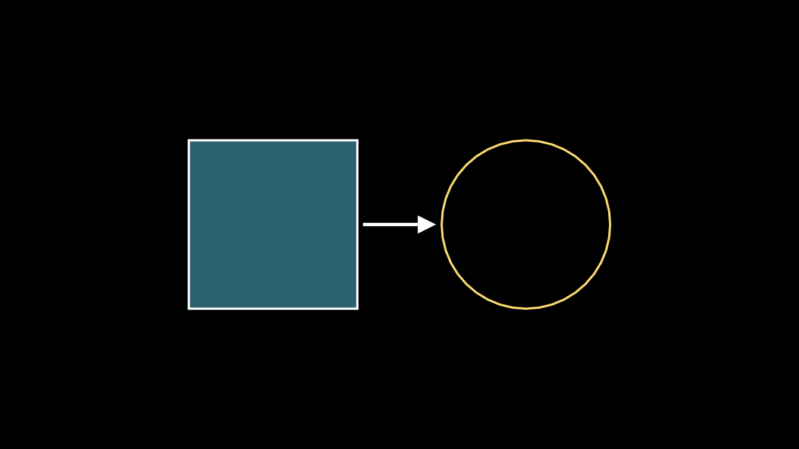
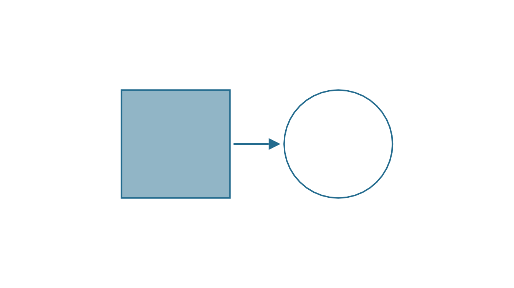
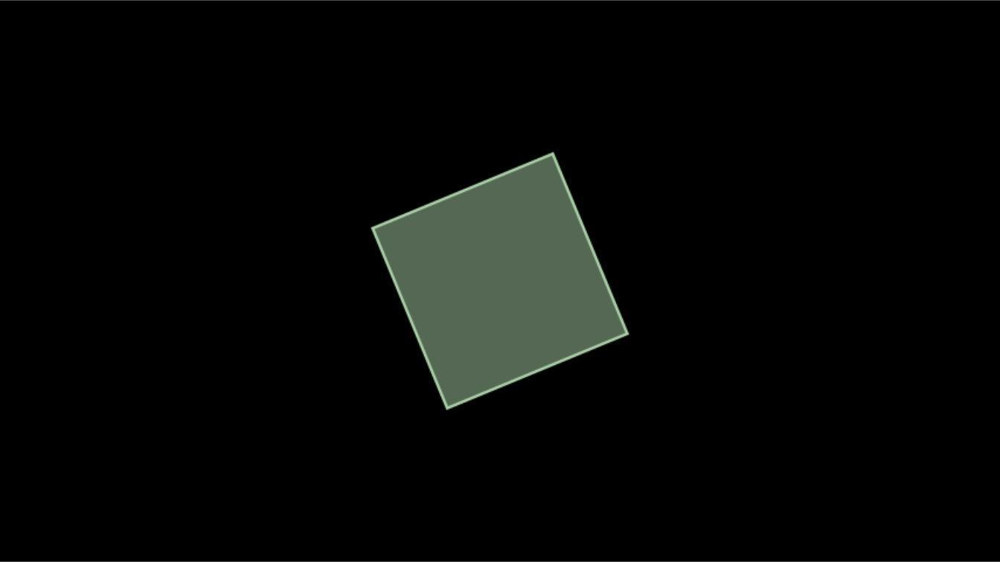
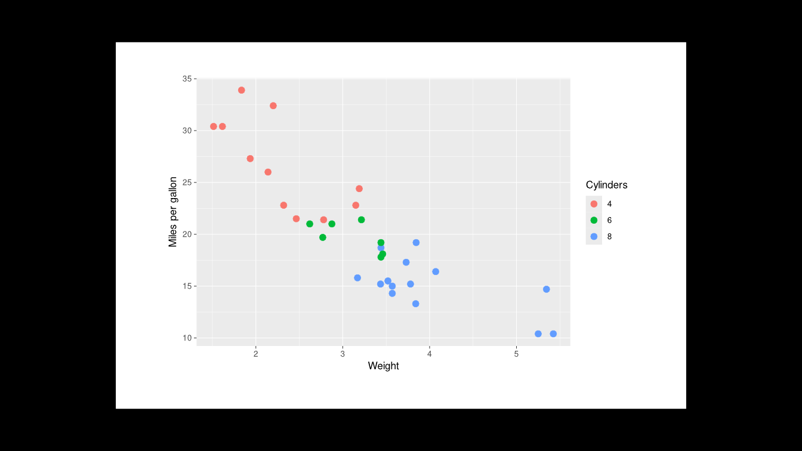

# RStudio, knitr, Quarto and Shiny

Python manim is driven from a terminal: you write a file, run
`manim -pql scene.py MyScene`, and a video player pops up. manimR keeps
that workflow (see
[Rendering](https://adamrsophie.github.io/manimR/articles/rendering.md)),
but R users usually work inside an IDE, a notebook or a web app. This
vignette shows every place where manimR plugs into that world:

- the RStudio **Plots pane** and **Viewer**
  ([`plot()`](https://rdrr.io/r/graphics/plot.default.html),
  [`scene_frame()`](https://adamrsophie.github.io/manimR/reference/scene_frame.md)
  and
  [`preview_output()`](https://adamrsophie.github.io/manimR/reference/preview_output.md));
- the **RStudio addins** that render the scene under the cursor;
- the **`manim` knitr engine** for R Markdown and Quarto documents;
- the **interactive Shiny window** that lets you orbit, pan and poke a
  live scene;
- embedding rendered videos in **Shiny apps**
  ([`manimOutput()`](https://adamrsophie.github.io/manimR/reference/manimOutput.md)
  and
  [`renderManim()`](https://adamrsophie.github.io/manimR/reference/manimOutput.md))
  and HTML pages;
- turning **other R graphics** (ggplot2, grid, base graphics) into
  mobjects with
  [`as_mobject()`](https://adamrsophie.github.io/manimR/reference/as_mobject.md);
- plain **scripts** run with `Rscript`, including the
  [`manim_cli()`](https://adamrsophie.github.io/manimR/reference/manim_cli.md)
  command line, and **tests** with
  [`expect_snapshot_frame()`](https://adamrsophie.github.io/manimR/reference/scene_frame.md).

## The Plots pane: `plot()`

Every mobject has a
[`plot()`](https://rdrr.io/r/graphics/plot.default.html) method
([`plot.Mobject()`](https://adamrsophie.github.io/manimR/reference/plot.Mobject.md)).
It draws one frame, framed exactly like a scene (8 units high, 14.2
units wide, black background), on the current graphics device. In
RStudio that is the Plots pane, so you can build a picture step by step
at the console, exactly as you would with base graphics:

``` r

square <- Square(side_length = 3)$set_fill(BLUE, opacity = 0.5)
circle <- Circle(radius = 1.5, color = YELLOW)$next_to(square, RIGHT, buff = 1.5)
arrow <- Arrow(square$get_right(), circle$get_left(), buff = 0.1)
shapes <- VGroup(square, arrow, circle)$move_to(ORIGIN)
plot(shapes)
```



[`plot()`](https://rdrr.io/r/graphics/plot.default.html) takes a
`background_color`, which helps when you want a picture for a light
themed document:

``` r

plot(shapes$copy()$set_color(DARK_BLUE), background_color = WHITE)
```



Because [`plot()`](https://rdrr.io/r/graphics/plot.default.html) uses an
ordinary R graphics device, it also works in
[`png()`](https://rdrr.io/r/grDevices/png.html),
[`pdf()`](https://rdrr.io/r/grDevices/pdf.html),
[`svg()`](https://rdrr.io/r/grDevices/cairo.html), `knitr` figure chunks
and Shiny’s
[`renderPlot()`](https://rdrr.io/pkg/shiny/man/renderPlot.html). It
draws with the plain 2D camera, so it ignores 3D camera angles: for a 3D
picture, plot a frame of a `ThreeDScene` with
[`scene_frame()`](https://adamrsophie.github.io/manimR/reference/scene_frame.md)
(next section; see also [Cameras and 3D
scenes](https://adamrsophie.github.io/manimR/articles/cameras-and-3d.md)).

## One frame of a scene: `scene_frame()`

While you work on the timing of a scene you often want to see one moment
of it without rendering a whole video. `scene_frame(scene, t)` renders
only the frame shown at `t` seconds: plays that end before `t` step
through their frames without drawing them, so updaters reach the state
the video has, the play running at `t` is drawn at its frame for that
moment, and `t = Inf` (the default) gives the last frame.
[`plot()`](https://rdrr.io/r/graphics/plot.default.html) shows the frame
in the Plots pane. The scene can be a scene class or a `construct`
function, and the frame is drawn by the scene’s own camera, so 3D scenes
look as they do in the video:

``` r

grow <- function(self) {
  square <- Square(side_length = 3, color = BLUE)$set_fill(BLUE, opacity = 0.5)
  self$play(Create(square), run_time = 2)
  self$play(square$animate$rotate(PI / 4)$set_color(YELLOW), run_time = 2)
}
plot(scene_frame(grow, t = 1))     # halfway through Create()
```


``` r

plot(scene_frame(grow, t = 3))     # halfway through the rotation
```



## The Viewer: `render()` and `preview_output()`

[`render()`](https://adamrsophie.github.io/manimR/reference/render.md)
writes a video and returns its path. With `preview = TRUE` it also shows
the result: in RStudio the video plays in the Viewer pane; outside
RStudio it opens with your system’s default player.

``` r

SquareToCircle <- R6::R6Class("SquareToCircle", inherit = Scene,
  public = list(construct = function() {
    square <- Square()$rotate(PI / 4)
    circle <- Circle()$set_fill(PINK, opacity = 0.5)
    self$play(Create(square))
    self$play(Transform(square, circle))
    self$wait(0.5)
  })
)
out <- render(SquareToCircle, quality = "l", preview = TRUE)
```

[`preview_output()`](https://adamrsophie.github.io/manimR/reference/preview_output.md)
is the function that `preview = TRUE` calls. Use it to show any rendered
file again, a video, a GIF or a PNG:

``` r

preview_output(out)
preview_output("media/images/manimR/SquareToCircle.png")
```

The Viewer page is a small HTML file in a temporary folder with the
video set to loop, so you can leave it playing while you edit.

## RStudio addins

manimR registers six addins (see
[`?rstudio_addins`](https://adamrsophie.github.io/manimR/reference/rstudio_addins.md)).
They appear in the **Addins** menu of the RStudio toolbar under the
heading *MANIMR*:

| Addin name | Function | What it does |
|----|----|----|
| Render scene at cursor | [`addin_render_scene()`](https://adamrsophie.github.io/manimR/reference/rstudio_addins.md) | Renders the scene whose definition contains the cursor (or the nearest one above it) and plays it in the Viewer. |
| Render scene in background | [`addin_render_background()`](https://adamrsophie.github.io/manimR/reference/rstudio_addins.md) | Renders the scene at the cursor as an RStudio background job, so the console stays free while it works. The Background Jobs pane shows its log and can stop it, and the result opens in the Viewer when it is done. |
| Render all scenes in file | [`addin_render_all()`](https://adamrsophie.github.io/manimR/reference/rstudio_addins.md) | Renders every `Scene` subclass defined in the active file and shows the last one. |
| Preview last frame | [`addin_last_frame()`](https://adamrsophie.github.io/manimR/reference/rstudio_addins.md) | Renders only the final frame of the scene at the cursor, as a PNG. This is the fastest way to check a layout. |
| Insert scene template | [`addin_insert_template()`](https://adamrsophie.github.io/manimR/reference/rstudio_addins.md) | Inserts a ready to run scene skeleton at the cursor. |
| Render with options | [`manim_gadget()`](https://adamrsophie.github.io/manimR/reference/rstudio_addins.md) | Opens a dialog where you pick the scene, quality, output format, a transparent background and “last frame only”, then renders. |

All six work on the **active source document**. A saved file is saved
again before rendering, so you never render stale code; an untitled
document is written to a temporary file first. The scenes are found with
[`find_scenes()`](https://adamrsophie.github.io/manimR/reference/find_scenes.md),
which looks for every R6 class that inherits from `Scene` (including
`MovingCameraScene`, `ThreeDScene` and your own scene base classes).
Output goes to `media/videos/<file name>/<quality>/` in the media folder
(in the session’s temporary directory unless `media_dir` is set),
exactly as
[`render_file()`](https://adamrsophie.github.io/manimR/reference/render_file.md)
writes it.

The template inserted by
[`addin_insert_template()`](https://adamrsophie.github.io/manimR/reference/rstudio_addins.md)
is the classic first scene:

``` r

MyScene <- R6::R6Class("MyScene", inherit = Scene,
  public = list(
    construct = function() {
      circle <- Circle()$set_fill(PINK, opacity = 0.5)
      square <- Square()$rotate(PI / 4)
      self$play(Create(square))
      self$play(Transform(square, circle))
      self$wait()
    }
  )
)
```

The quick addins render at low quality (480p, 15 frames per second) so
that they return fast. Choose another default with an option, for
example in your `~/.Rprofile`:

``` r

options(manimR.addin_quality = "m")   # "l", "m", "h", "p" or "k"
```

The gadget always asks, and offers the formats `"auto"`, `"mp4"`,
`"gif"`, `"webm"`, `"mov"` and `"png-sequence"` (one PNG per frame);
*Last frame only* writes a PNG, and a transparent background turns
`"mp4"` into `"mov"`, which can store transparency.

### Binding a keyboard shortcut

Addins become really useful with a shortcut, so that rendering the scene
you are editing is a single key press:

1.  Open **Tools \> Modify Keyboard Shortcuts…** (or **Addins \> Browse
    Addins… \> Keyboard Shortcuts…**).
2.  Type `manimR` or the addin name, for example
    `Render scene at cursor`, in the filter box. Addins are listed with
    the scope *Addin*.
3.  Click the **Shortcut** cell of the row and press the key combination
    you want, for example Ctrl+Alt+M (on macOS Cmd+Option+M).
4.  Click **Apply**.

A good set is one key for *Preview last frame* (layout work) and another
for *Render scene at cursor* (timing work); *Render scene in background*
suits long renders at high quality.

### Finding and rendering scenes from code

The addins are thin wrappers around two functions you can call yourself.
[`find_scenes()`](https://adamrsophie.github.io/manimR/reference/find_scenes.md)
lists the scenes defined in a file (or in an environment):

``` r

script <- tempfile(fileext = ".R")
writeLines(c(
  'Pulse <- R6::R6Class("Pulse", inherit = Scene, public = list(construct = function() {',
  '  dot <- Dot(radius = 0.3, color = RED)',
  '  self$play(GrowFromCenter(dot), run_time = 1)',
  '  self$play(Indicate(dot), run_time = 1)',
  '}))',
  'Spin <- R6::R6Class("Spin", inherit = Scene, public = list(construct = function() {',
  '  self$play(Rotate(Square(), angle = PI / 2), run_time = 1)',
  '}))'
), script)
names(find_scenes(script))
#> [1] "Pulse" "Spin"
```

[`render_file()`](https://adamrsophie.github.io/manimR/reference/render_file.md)
sources the file and renders the scenes you name (all of them when you
name none). Every argument after the scene names goes to
[`render()`](https://adamrsophie.github.io/manimR/reference/render.md).
Here `format = "png"` writes only the last frame, into a temporary media
folder:

``` r

out <- render_file(script, "Pulse", quality = "l", format = "png", media_dir = tempdir())
#> Rendering Pulse ...
basename(out)
#> [1] "Pulse_manimR_v0.1.0.png"
```

## The `manim` knitr engine

Loading manimR registers a knitr engine called `manim` (the function
[`knitr_manim_engine()`](https://adamrsophie.github.io/manimR/reference/knitr_manim_engine.md);
if you ever need to register it by hand, call
`knitr::knit_engines$set(manim = manimR::knitr_manim_engine)`). A chunk
that uses it contains ordinary R code that defines a scene class. When
the document is knitted the engine

1.  evaluates the code, in the same environment as the document’s `r`
    chunks, so objects and helper functions defined earlier are visible;
2.  picks the scene to render: the one named by the chunk option
    `scene`, or otherwise the last scene class assigned in this chunk (a
    chunk that defines no scene renders nothing, so you can also use the
    engine for plain helper code);
3.  renders it into the document’s figure folder as
    `<chunk label>-<Scene name>.<extension>`;
4.  embeds the result: a looping, muted, autoplaying `<video>` element
    for `mp4`, `webm` and `mov` in HTML output, and an ordinary image
    otherwise.

The code of the chunk is shown, and highlighted, as R code.

Here is a raw chunk as you would type it in an `.Rmd` file:

```` markdown
```{manim square-to-circle, quality = "m", out.width = "80%"}
SquareToCircle <- R6::R6Class("SquareToCircle", inherit = Scene,
  public = list(construct = function() {
    square <- Square()$rotate(PI / 4)
    circle <- Circle()$set_fill(PINK, opacity = 0.5)
    self$play(Create(square))
    self$play(Transform(square, circle))
    self$wait(0.5)
  })
)
```
````

and this is what knitting it produces:

``` r

SquareToCircle <- R6::R6Class("SquareToCircle", inherit = Scene,
  public = list(construct = function() {
    square <- Square()$rotate(PI / 4)
    circle <- Circle()$set_fill(PINK, opacity = 0.5)
    self$play(Create(square))
    self$play(Transform(square, circle))
    self$wait(0.5)
  })
)
```

### Chunk options

| Option | Default | Meaning |
|----|----|----|
| `scene` | last scene defined in the chunk | Name of the scene class to render. |
| `quality` | `"l"` | `"l"` (480p15), `"m"` (720p30), `"h"` (1080p60), `"p"` (1440p60) or `"k"` (2160p60). |
| `format` | `"auto"` for HTML, `"png"` for LaTeX, `"gif"` for other outputs | `"auto"` (an MP4 video, or the last frame as a PNG when the scene has no animations), `"mp4"`, `"webm"`, `"mov"`, `"gif"`, or `"png"` for the last frame only. |
| `save_last_frame` | `FALSE` | `TRUE` is short for `format = "png"`. |
| `out.width` | `"100%"` | Display width of the video or image. |

The usual knitr options keep working: `echo = FALSE` hides the code,
`eval = FALSE` shows the code without rendering, and `label` names the
output file. Set defaults for every chunk with
`knitr::opts_chunk$set()`, for example
`knitr::opts_chunk$set(quality = "m", format = "gif")`.

When one chunk defines several scenes, `scene` picks the one to show.
Here two scenes are defined, the second one is rendered, and it is shown
at 60% of the page width:

``` markdown
```{manim two-scenes, scene = "Grow", out.width = "60%"}
```

``` r

Shrink <- R6::R6Class("Shrink", inherit = Scene,
  public = list(construct = function() {
    self$play(ShrinkToCenter(Square()), run_time = 1)
  })
)
Grow <- R6::R6Class("Grow", inherit = Scene,
  public = list(construct = function() {
    star <- Star(color = YELLOW)$scale(2)$set_fill(YELLOW, opacity = 0.6)
    self$play(GrowFromCenter(star), run_time = 1)
    self$play(Rotate(star, angle = PI / 5), run_time = 1)
  })
)
```

With `format = "auto"` a scene that only adds mobjects, without
animations, is already shown as a picture. `save_last_frame = TRUE`
gives a still image even when the scene animates. Either way it is the
right choice for a figure that does not need motion but does need a
scene, for example a 3D view:

``` markdown
```{manim cube-still, save_last_frame = TRUE, out.width = "50%"}
```

``` r

CubeStill <- R6::R6Class("CubeStill", inherit = ThreeDScene,
  public = list(construct = function() {
    self$set_camera_orientation(phi = 65 * DEGREES, theta = -40 * DEGREES)
    self$add(Cube(side_length = 2.5, fill_color = TEAL))
  })
)
```


Objects defined in ordinary `r` chunks are available to the scenes. A
helper that builds a mobject can live in an `r` chunk and be reused by
several scenes:

``` r

labeled_dot <- function(text, color) {
  VGroup(Dot(radius = 0.4, color = color), Text(text, font_size = 48)$shift(0.9 * DOWN))
}
```

``` r

UseHelper <- R6::R6Class("UseHelper", inherit = Scene,
  public = list(construct = function() {
    a <- labeled_dot("A", RED)$shift(3 * LEFT)
    b <- labeled_dot("B", BLUE)$shift(3 * RIGHT)
    self$play(FadeIn(a), FadeIn(b), run_time = 1)
    self$play(a$animate$shift(2 * RIGHT), b$animate$shift(2 * LEFT), run_time = 1)
  })
)
```

### `render()` in ordinary `r` chunks

The engine is not the only way to put a scene in a document. The value
of
[`render()`](https://adamrsophie.github.io/manimR/reference/render.md)
printed in an ordinary `r` chunk is embedded too (manimR gives it a
`knit_print()` method): a video player for MP4, WebM and MOV files in
HTML output, an image for GIF and PNG files, and a note with the path in
other output formats. The file is copied next to the chunk’s figures,
and `out.width` sets its width. This suits scenes built by code, for
example a `construct` function made in a loop or read from a file:

``` r

spiral <- function(self) {
  curve <- ParametricFunction(function(t) c(t / 4 * cos(t), t / 4 * sin(t), 0),
                              t_range = c(0, 4 * PI), color = TEAL)
  self$play(Create(curve), run_time = 2)
}
spiral_out <- render(spiral, quality = "l", scene_name = "Spiral",
                     format = if (in_pkgdown) "auto" else "png")
spiral_out
```

[`render()`](https://adamrsophie.github.io/manimR/reference/render.md)
returns its path invisibly, so print the value, as on the last line
above. Unlike the engine,
[`render()`](https://adamrsophie.github.io/manimR/reference/render.md)
does not read the chunk options, so pass `quality` and `format` yourself
(this vignette asks for a PNG outside the website, like its `manim`
chunks).

### How these vignettes use the engine

Every manimR vignette starts with the same setup chunk:

``` r

knitr::opts_chunk$set(collapse = TRUE, comment = "#>", fig.width = 7, fig.height = 3.94, out.width = "100%")
library(manimR)
manim_config(verbosity = "WARNING", progress_bar = FALSE)
in_pkgdown <- identical(Sys.getenv("IN_PKGDOWN"), "true")
knitr::opts_chunk$set(format = if (in_pkgdown) "auto" else "png", quality = "l")
manim_config(media_dir = file.path(tempdir(), "manimR-media"))
has_latex <- nzchar(Sys.which("latex")) && nzchar(Sys.which("dvisvgm"))
has_typst <- nzchar(Sys.which("typst"))
```

- [`library(manimR)`](https://adamrsophie.github.io/manimR/) registers
  the engine.
- `manim_config(verbosity = "WARNING", progress_bar = FALSE)` keeps the
  render log and progress bars out of the document.
- pkgdown sets the environment variable `IN_PKGDOWN` while it builds the
  website, so the website gets real videos (`"auto"` picks MP4).
  Everywhere else (the installed vignettes, `R CMD check`) the default
  `format` is `"png"`, which embeds the last frame: the HTML stays small
  and self contained, and the build is faster.
- `has_latex` and `has_typst` are used as `eval = has_latex` and
  `eval = has_typst` on chunks that typeset with
  [`MathTex()`](https://adamrsophie.github.io/manimR/reference/tex.md)
  or
  [`Typst()`](https://adamrsophie.github.io/manimR/reference/typst.md),
  so the vignettes still build on machines without those tools.
- `media_dir` points at a temporary folder, so
  [`render()`](https://adamrsophie.github.io/manimR/reference/render.md)
  calls in `r` chunks and the LaTeX cache of
  [`MathTex()`](https://adamrsophie.github.io/manimR/reference/tex.md)
  do not write a `media/` folder next to the document. (The `manim`
  engine always renders into a temporary folder and copies only the
  result into the figure folder.)

`fig.width = 7` with `fig.height = 3.94` gives the 16:9 aspect ratio of
a manim frame, so
[`plot()`](https://rdrr.io/r/graphics/plot.default.html) pictures and
rendered scenes line up on the page.

## Quarto

Quarto runs R code through knitr, so the same engine works in `.qmd`
files. Ask for the knitr engine in the YAML header and load manimR in a
setup chunk before the first `manim` chunk. Chunk options can be written
in the header or as Quarto’s `#|` comments:

```` markdown
---
title: "Animations in Quarto"
format: html
engine: knitr
---

```{r}
#| include: false
library(manimR)
manim_config(verbosity = "WARNING", progress_bar = FALSE)
```

```{manim}
#| label: square-to-circle
#| quality: "m"
#| out.width: "80%"
SquareToCircle <- R6::R6Class("SquareToCircle", inherit = Scene,
  public = list(construct = function() {
    square <- Square()$rotate(PI / 4)
    self$play(Create(square))
    self$play(Transform(square, Circle()))
  })
)
```
````

The video is written next to the document in the figure folder
(`<document>_files/figure-html/`), and the page refers to it, so publish
that folder with the HTML file. With `embed-resources: true` the videos
are embedded into the HTML file as base64 data, which keeps everything
in one file but makes it large. For small self contained pages, or for
PDF output, set `format = "png"` (or `save_last_frame = TRUE`) for the
`manim` chunks; for PDF output the engine already defaults to `"png"`.
`format = "gif"` is a middle ground that moves and is shown as an image.

## Interactive scenes in a Shiny window

Python manim’s OpenGL renderer has an interactive mode in which you can
look around a scene while it runs. manimR shows the live scene in a
Shiny gadget instead: in the RStudio Viewer pane, or in your browser
outside RStudio. Open it with `interactive_embed()`;
[`embed()`](https://rdrr.io/r/stats/embed.html) and `interact()` are the
same function under upstream’s other names (see
[`?interactive_scene`](https://adamrsophie.github.io/manimR/reference/interactive_scene.md)).

``` r

sc <- ThreeDScene$new()
sc$set_camera_orientation(phi = 70 * DEGREES, theta = -45 * DEGREES)
cube <- Cube(fill_color = TEAL)
cube$add_updater(function(m, dt) m$rotate(0.5 * dt, axis = OUT))
sc$add(ThreeDAxes(), cube)
sc$set_key_function("s", function() sc$add(Sphere(radius = 0.5)$shift(2 * UP)))
sc$interactive_embed(fps = 10)
```

In the window:

- time based updaters (such as the spinning cube above) keep running,
  `fps` times per second;
- dragging with the left mouse button orbits a 3D camera (it changes
  `theta` and `phi`); dragging with the right button, or moving the
  mouse with Shift held, pans the view;
- the mouse wheel zooms;
- r restores the starting view and q (or the *Close* button) closes the
  window;
- any other key runs the function registered with
  `scene$set_key_function(key, func)`; above, s adds a sphere;
- the code box runs R code with `self` set to the scene, then redraws,
  much like upstream’s embedded IPython shell. Try
  `self$camera$set_zoom(2)` or `self$add(Text("hello"))`.

The window needs an interactive R session with the shiny and miniUI
packages installed, and it refuses to open while a video is being
written. `scene$check_interactive_embed_is_valid()` returns `TRUE` when
a window can be opened. When the window closes, `interactive_embed()`
returns the scene, so you can keep working with the changes you made.

The Shiny app itself is built by the internal function
`manimR:::interactive_app(scene, fps)`, which returns a
[`shiny::shinyApp()`](https://rdrr.io/pkg/shiny/man/shinyApp.html)
object; it is not exported, so treat it as subject to change.

### Event handlers

The window forwards mouse and keyboard events to methods of the scene,
which you can also call yourself, for example to script a camera move or
to test a key binding. These are the same handlers upstream’s OpenGL
window calls: `on_key_press()`, `on_key_release()`, `on_mouse_press()`,
`on_mouse_motion()`, `on_mouse_drag()` and `on_mouse_scroll()`.

``` r

sc <- ThreeDScene$new()
sc$set_camera_orientation(phi = 60 * DEGREES, theta = -45 * DEGREES)
sc$remember_camera_state()   # the view that "r" restores
angles <- function(s) round(c(phi = s$camera$get_phi(), theta = s$camera$get_theta()) / DEGREES)

# A left button drag of (0.5, 0.25) radians orbits the camera.
sc$on_mouse_drag(point = ORIGIN, d_point = c(0.5, 0.25, 0), buttons = 1)
angles(sc)
#>   phi theta 
#>    74   -74

# Scrolling zooms.
sc$on_mouse_scroll(point = ORIGIN, offset = c(0, 0.2, 0))
round(sc$camera$get_zoom(), 2)
#> [1] 1.66

# "r" goes back to the remembered view.
sc$on_key_press("r")
angles(sc)
#>   phi theta 
#>    60   -45

# Other keys run the functions registered with set_key_function().
sc$set_key_function("c", function() sc$add(Cube()))
sc$on_key_press("c")
length(sc$mobjects)
#> [1] 1
```

For a 2D `Scene` (or a `MovingCameraScene`), a right button drag pans:

``` r

sc2 <- Scene$new()
sc2$on_mouse_drag(point = ORIGIN, d_point = c(1, 0.5, 0), buttons = 4)
sc2$camera$frame_center
#> [1] -1.0 -0.5  0.0
```

## Rendered videos in Shiny apps

manimR has a Shiny output pair,
[`manimOutput()`](https://adamrsophie.github.io/manimR/reference/manimOutput.md)
and
[`renderManim()`](https://adamrsophie.github.io/manimR/reference/manimOutput.md),
that works like
[`plotOutput()`](https://rdrr.io/pkg/shiny/man/plotOutput.html) and
[`renderPlot()`](https://rdrr.io/pkg/shiny/man/renderPlot.html). The
expression in
[`renderManim()`](https://adamrsophie.github.io/manimR/reference/manimOutput.md)
returns a scene class, a `construct` function (anything
[`render()`](https://adamrsophie.github.io/manimR/reference/render.md)
takes) or the path of a file you rendered yourself, and the output shows
the video, or the image for PNG and GIF files. The expression is
reactive, so a scene built from inputs renders again when they change.
The arguments after the expression go to
[`render()`](https://adamrsophie.github.io/manimR/reference/render.md):
`quality = "l"` is the default, and `format = "gif"` or `format = "png"`
give images. Renders go to a temporary media folder and reuse its cache
of partial movies, so a setting you have seen before comes back quickly.

``` r

library(shiny)
library(manimR)

ui <- fluidPage(
  titlePanel("manimR in Shiny"),
  sidebarLayout(
    sidebarPanel(
      sliderInput("n", "Number of sides", min = 3, max = 12, value = 5),
      selectInput("color", "Color", c("BLUE", "RED", "GREEN", "YELLOW"))
    ),
    mainPanel(manimOutput("scene", width = "100%"))
  )
)

server <- function(input, output, session) {
  output$scene <- renderManim({
    n <- input$n
    color <- get(input$color, envir = asNamespace("manimR"))
    function(self) {
      shape <- RegularPolygon(n = n)$scale(2)$set_fill(color, opacity = 0.5)
      self$play(Create(shape))
      self$play(Rotate(shape, angle = PI))
    }
  }, quality = "l")
}

shinyApp(ui, server)
```

Three other patterns help when you need more control.

**Still pictures** need no file at all:
[`plot()`](https://rdrr.io/r/graphics/plot.default.html) draws on
Shiny’s plot device.

``` r

library(shiny)
library(manimR)

ui <- fluidPage(
  sliderInput("n", "Number of sides", min = 3, max = 12, value = 5),
  plotOutput("shape", height = "400px")
)
server <- function(input, output, session) {
  output$shape <- renderPlot({
    plot(RegularPolygon(n = input$n)$scale(2)$set_fill(BLUE, opacity = 0.5))
  })
}
shinyApp(ui, server)
```

**A time slider** is
[`scene_frame()`](https://adamrsophie.github.io/manimR/reference/scene_frame.md)
in [`renderPlot()`](https://rdrr.io/pkg/shiny/man/renderPlot.html): each
change of the slider renders a single frame, which is much faster than a
video.

``` r

ui <- fluidPage(
  sliderInput("t", "Time (seconds)", min = 0, max = 4, value = 0, step = 0.1),
  plotOutput("frame", height = "400px")
)
server <- function(input, output, session) {
  output$frame <- renderPlot(plot(scene_frame(grow, t = input$t)))
}
shinyApp(ui, server)
```

(`grow` is the `construct` function from the section on
[`scene_frame()`](https://adamrsophie.github.io/manimR/reference/scene_frame.md).)

**Videos by hand**: render into a folder that Shiny serves with
[`addResourcePath()`](https://rdrr.io/pkg/shiny/man/resourcePaths.html),
then show the file with a `<video>` tag. This version renders only when
a button is pressed.
[`manim_scene()`](https://adamrsophie.github.io/manimR/reference/manim_scene.md)
turns a function into a scene class with a name of your choice. Each
render gets a new file name, so the browser does not show a cached old
video.

``` r

library(shiny)
library(manimR)

video_dir <- file.path(tempdir(), "manim-videos")
dir.create(video_dir, showWarnings = FALSE)
addResourcePath("videos", video_dir)

ui <- fluidPage(
  titlePanel("manimR in Shiny"),
  sidebarLayout(
    sidebarPanel(
      sliderInput("n", "Number of sides", min = 3, max = 12, value = 5),
      selectInput("color", "Color", c("BLUE", "RED", "GREEN", "YELLOW")),
      actionButton("go", "Render")
    ),
    mainPanel(uiOutput("video"))
  )
)

server <- function(input, output, session) {
  output$video <- renderUI({
    req(input$go)
    n <- isolate(input$n)
    color <- get(isolate(input$color), envir = asNamespace("manimR"))
    scene <- manim_scene(function(self) {
      shape <- RegularPolygon(n = n)$scale(2)$set_fill(color, opacity = 0.5)
      self$play(Create(shape))
      self$play(Rotate(shape, angle = PI))
    }, name = "PolygonScene")
    file <- file.path(video_dir, sprintf("polygon-%d.mp4", input$go))
    withProgress(message = "Rendering", {
      render(scene, quality = "l", output_file = file, media_dir = tempdir())
    })
    tags$video(src = file.path("videos", basename(file)), type = "video/mp4",
               controls = NA, autoplay = NA, loop = NA, muted = NA, width = "100%")
  })
}

shinyApp(ui, server)
```

**The last frame as an image** sits in between: render with
`format = "png"` and return the PNG from
[`renderImage()`](https://rdrr.io/pkg/shiny/man/renderImage.html):

``` r

output$frame <- renderImage({
  png <- render(scene, quality = "m", format = "png", media_dir = tempdir())
  list(src = unclass(png), contentType = "image/png", width = "100%")
}, deleteFile = FALSE)
```

Rendering takes a few seconds even at low quality, so for scenes that do
not depend on the inputs render once (at startup, or ahead of time into
the app’s `www/` folder) and only serve the files.

## Rendered videos in R Markdown HTML pages

Inside an R Markdown document the `manim` engine is the simplest way:
the video is rendered while knitting. To show a video you rendered
earlier, put a `<video>` element in the page. In an `r` chunk an
htmltools tag is printed as HTML:

``` r

htmltools::tags$video(src = "media/videos/scenes/720p30/SquareToCircle.mp4", type = "video/mp4",
                      controls = NA, autoplay = NA, loop = NA, muted = NA, width = "100%")
```

or write the HTML directly in the text of the document:

``` html
<video src="media/videos/scenes/720p30/SquareToCircle.mp4" controls autoplay loop muted width="100%"></video>
```

GIFs and PNGs are images, so
[`knitr::include_graphics()`](https://rdrr.io/pkg/knitr/man/include_graphics.html)
handles them, and they are embedded in self contained HTML files:

``` r

knitr::include_graphics("media/videos/scenes/480p15/SquareToCircle.gif")
```

When the output is self contained (the default of `html_document` and
`html_vignette`), pandoc embeds the video into the HTML file as base64
data, so the page works on its own but grows by the size of every video.
With `self_contained = FALSE` the page links to the file instead, so
keep the video next to the HTML file when you share the page.

## Other R graphics: `as_mobject()`

[`as_mobject()`](https://adamrsophie.github.io/manimR/reference/as_mobject.md)
brings plots made with other R graphics into a scene. It draws the plot
into an SVG file with R’s
[`svg()`](https://rdrr.io/r/grDevices/cairo.html) device and imports it
with
[`SVGMobject()`](https://adamrsophie.github.io/manimR/reference/SVGMobjectClass.md),
so every line, point, rectangle and letter becomes a submobject that can
be colored, moved and animated. It takes

- a ggplot2 plot, a grid grob or gtable, or a recorded plot
  ([`recordPlot()`](https://rdrr.io/r/grDevices/recordplot.html)), drawn
  as they are;
- a function that draws with base graphics, such as
  `function() hist(x)`.

`width` and `height` set the size of the drawing in inches, `bg` its
background (transparent by default, so only the plot’s own elements are
imported), and `height_units` the height of the mobject in scene units
(6 by default). A white background suits a ggplot with its default
theme:

``` r

p <- ggplot2::ggplot(mtcars, ggplot2::aes(wt, mpg, color = factor(cyl))) +
  ggplot2::geom_point(size = 3) +
  ggplot2::labs(x = "Weight", y = "Miles per gallon", color = "Cylinders")
chart <- as_mobject(p, width = 7, height = 4.5, bg = "white", height_units = 6.5)
plot(chart)
```



Base graphics drawn in white on the transparent background look at home
on manim’s black frame, and
[`Create()`](https://adamrsophie.github.io/manimR/reference/creation.md)
draws them stroke by stroke:

``` r

Histogram <- R6::R6Class("Histogram", inherit = Scene,
  public = list(construct = function() {
    hist_mob <- as_mobject(function() {
      par(fg = "white", col.axis = "white", col.lab = "white", col.main = "white")
      hist(faithful$eruptions, breaks = 20, col = "steelblue", border = "white",
           main = "Old Faithful eruptions", xlab = "Minutes")
    }, height_units = 6.5)
    self$play(Create(hist_mob), run_time = 2)
  })
)
```

## Scripts, `Rscript` and `manim_cli()`

For batch work, keep scenes in an ordinary R script. A script can render
its own scenes at the end:

``` r

# scenes.R
library(manimR)

SquareToCircle <- R6::R6Class("SquareToCircle", inherit = Scene,
  public = list(construct = function() {
    self$play(Create(Square()))
    self$play(Transform(self$mobjects[[1]], Circle()))
  })
)

if (sys.nframe() == 0L) {   # only when run as a script, not when sourced
  render(SquareToCircle, quality = "h")
}
```

and is run from a terminal with

``` bash
Rscript scenes.R
```

[`render_file()`](https://adamrsophie.github.io/manimR/reference/render_file.md)
and the RStudio addins source such a script, and the
[`sys.nframe()`](https://rdrr.io/r/base/sys.parent.html) test keeps the
render call at the bottom from running then.

[`manim_cli()`](https://adamrsophie.github.io/manimR/reference/manim_cli.md)
mirrors the `manim` command of Python manim, so existing habits and
shell scripts carry over. It reads its arguments from the command line:

``` bash
Rscript -e 'manimR::manim_cli()' scenes.R SquareToCircle -pql
Rscript -e 'manimR::manim_cli()' render scenes.R -a -qh --format=gif
Rscript -e 'manimR::manim_cli()' scenes.R SquareToCircle -s -r 1920,1080
```

`FILE` is an R script followed by scene names. Without scene names a
script with one scene renders it, and a script with several asks which
to render. As in manim, `render` may come first and options can be
written `--name=value`.

| Flag | Meaning |
|----|----|
| `-ql`, `-qm`, `-qh`, `-qp`, `-qk` | Quality: 480p15, 720p30, 1080p60, 1440p60, 2160p60. `-q NAME` also accepts preset names such as `low_quality`. |
| `-p` | Preview the result when done. |
| `-s` | Save only the last frame, as a PNG (`--format png`). |
| `-t` | Transparent background (MOV output). |
| `-a` | Render every scene in the file. |
| `--format FMT` | `auto`, `mp4`, `mov`, `webm`, `gif`, `png`, `png-sequence` or `none`. |
| `-o FILE` | Output file. |
| `-c FILE` | Read settings from a `.cfg` file. |
| `--media_dir DIR` | Where the `media` folder goes. |
| `-n N` or `-n N,M` | Render only animation N, or animations N through M, counted from 0. |
| `-r W,H` | Resolution in pixels. |
| `--fps FPS` | Frame rate. |
| `--save_sections` | Also write one video per section. |
| `--disable_caching` | Render every animation again instead of reusing cached partial movies. |
| `--flush_cache` | Delete the cached partial movie files first. |

Short flags can be combined as in manim: `-pql` is `-p -ql`. The other
options of `manim render` (`--seed`, `--dry_run`, `-v`, `--video-codec`
and more) are accepted too;
[`?manim_cli`](https://adamrsophie.github.io/manimR/reference/manim_cli.md)
lists them all. Called with no arguments (or with `-h`),
[`manim_cli()`](https://adamrsophie.github.io/manimR/reference/manim_cli.md)
prints its usage line.

Settings can live in a `manim.cfg` file, upstream’s format: a `[CLI]`
section with lines such as `quality = low_quality` or
`background_color = WHITE`. As `import manim` does, manimR reads the
`manim.cfg` of the working directory (and the user wide
`~/.config/manim/manim.cfg`) when it loads;
[`manim_cli()`](https://adamrsophie.github.io/manimR/reference/manim_cli.md)
reads the working directory’s file too, `-c` names another one, and
options on the command line win over both.
[`digest_config_file()`](https://adamrsophie.github.io/manimR/reference/digest_config_file.md)
applies such a file in an R session.

The other subcommands of `manim` work as well:

``` bash
Rscript -e 'manimR::manim_cli()' --version
Rscript -e 'manimR::manim_cli()' checkhealth          # are FFmpeg, LaTeX and friends installed?
Rscript -e 'manimR::manim_cli()' cfg show             # print the settings
Rscript -e 'manimR::manim_cli()' cfg write            # write them to ./manim.cfg
Rscript -e 'manimR::manim_cli()' cfg export --dir DIR
Rscript -e 'manimR::manim_cli()' init project MyVideo # a folder with main.R and manim.cfg
Rscript -e 'manimR::manim_cli()' init scene Intro main.R
Rscript -e 'manimR::manim_cli()' plugins -l
Rscript -e 'manimR::manim_cli()' cache clear scenes.R SquareToCircle -q l
```

[`manim_cli()`](https://adamrsophie.github.io/manimR/reference/manim_cli.md)
also takes the arguments as a character vector, which is handy for
testing a command line from R. Here the last frame of the `Spin` scene
from the script written earlier is rendered into a temporary media
folder:

``` r

out <- manim_cli(c(script, "Spin", "-ql", "-s", paste0("--media_dir=", tempdir())))
#> Rendering Spin ...
```

``` r

basename(out)
#> [1] "Spin_manimR_v0.1.0.png"
```

``` r

manim_cli("--version")
#> manimR v0.1.0
```

On a server without a display, everything above works unchanged: manimR
draws with the ragg graphics device and writes videos with FFmpeg, so no
window system is needed.

## Testing scenes: `expect_snapshot_frame()`

A package that builds animations on manimR can test them like plots.
`expect_snapshot_frame(scene, t, name)` is a testthat expectation: it
renders the frame at time `t` with
[`scene_frame()`](https://adamrsophie.github.io/manimR/reference/scene_frame.md),
saves it as a PNG snapshot (see
[`testthat::expect_snapshot_file()`](https://testthat.r-lib.org/reference/expect_snapshot_file.html)),
and fails when a later run draws a different picture. Inspect and accept
changes with
[`testthat::snapshot_review()`](https://testthat.r-lib.org/reference/snapshot_accept.html)
as for any snapshot.

``` r

# tests/testthat/test-scenes.R
test_that("the title card stays the same", {
  expect_snapshot_frame(TitleCard, t = 1.5, name = "title-card")
  expect_snapshot_frame(TitleCard, name = "title-card-end")   # the last frame
})
```
