# Text, math and tables

manimR can typeset text in three ways, and the higher level mobjects for
code, numbers, matrices and tables build on them:

| Mobjects | Typeset with | Needs |
|:---|:---|:---|
| [`Text()`](https://adamrsophie.github.io/manimR/reference/TextClass.md), [`MarkupText()`](https://adamrsophie.github.io/manimR/reference/MarkupText.md), [`Paragraph()`](https://adamrsophie.github.io/manimR/reference/Paragraph.md), [`Code()`](https://adamrsophie.github.io/manimR/reference/CodeClass.md), [`Table()`](https://adamrsophie.github.io/manimR/reference/TableClass.md) | system fonts | nothing extra |
| [`Tex()`](https://adamrsophie.github.io/manimR/reference/tex.md), [`MathTex()`](https://adamrsophie.github.io/manimR/reference/tex.md), [`BulletedList()`](https://adamrsophie.github.io/manimR/reference/BulletedList.md), [`Title()`](https://adamrsophie.github.io/manimR/reference/BulletedList.md), [`DecimalNumber()`](https://adamrsophie.github.io/manimR/reference/DecimalNumberClass.md), [`Integer()`](https://adamrsophie.github.io/manimR/reference/DecimalNumberClass.md), [`Variable()`](https://adamrsophie.github.io/manimR/reference/DecimalNumberClass.md), [`Matrix()`](https://adamrsophie.github.io/manimR/reference/MatrixClass.md) and friends, [`MathTable()`](https://adamrsophie.github.io/manimR/reference/TableClass.md), [`IntegerTable()`](https://adamrsophie.github.io/manimR/reference/TableClass.md), [`DecimalTable()`](https://adamrsophie.github.io/manimR/reference/TableClass.md) | LaTeX | `latex` and `dvisvgm` |
| [`Typst()`](https://adamrsophie.github.io/manimR/reference/typst.md), [`MathTypst()`](https://adamrsophie.github.io/manimR/reference/typst.md) | Typst | the `typst` compiler |

Every typeset result is a vectorized mobject, so it can be moved,
colored and animated like any shape. The examples draw single frames
with [`plot()`](https://rdrr.io/r/graphics/plot.default.html) and
animate with scenes; chunks that need LaTeX or Typst only run when the
tools are installed. LaTeX output and Typst output are cached in
`media_dir` (see
[`?manim_config`](https://adamrsophie.github.io/manimR/reference/manim_config.md)),
so a formula is compiled only once.

## Text

### Fonts, sizes and styles

[`Text()`](https://adamrsophie.github.io/manimR/reference/TextClass.md)
draws a string with a system font. The main arguments are `font_size`
(48 by default), `color`, `font` (a family name; `"sans"`, `"serif"` and
`"mono"` work everywhere), `weight` and `slant`.

``` r

lines <- VGroup(
  Text("The default font at size 48"),
  Text("serif at size 36", font = "serif", font_size = 36),
  Text("mono and bold", font = "mono", weight = BOLD),
  Text("sans, italic and yellow", font = "sans", slant = ITALIC, color = YELLOW)
)
plot(lines$arrange(DOWN, buff = 0.4))
```

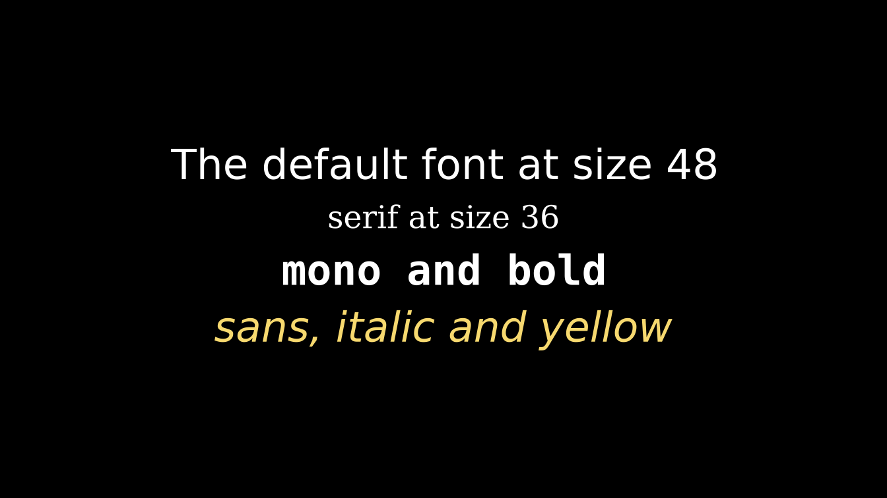

Weights and slants are strings, available as constants with the same
names as in upstream manim: `NORMAL`, `ITALIC` and `OBLIQUE` for
`slant`, and `THIN`, `ULTRALIGHT`, `LIGHT`, `SEMILIGHT`, `BOOK`,
`NORMAL`, `MEDIUM`, `SEMIBOLD`, `BOLD`, `ULTRABOLD`, `HEAVY` and
`ULTRAHEAVY` for `weight` (see
[`?font_constants`](https://adamrsophie.github.io/manimR/reference/font_constants.md)).
A font that lacks a weight uses the closest one it has.

``` r

c(NORMAL, ITALIC, OBLIQUE)
#> [1] "NORMAL"  "ITALIC"  "OBLIQUE"
weights <- c(THIN, ULTRALIGHT, LIGHT, SEMILIGHT, BOOK, NORMAL, MEDIUM, SEMIBOLD, BOLD, ULTRABOLD, HEAVY, ULTRAHEAVY)
samples <- VGroup(lapply(weights, function(w) Text(w, weight = w, font_size = 40)))
plot(samples$arrange_in_grid(rows = 4, cols = 3, buff = c(0.8, 0.4)))
```

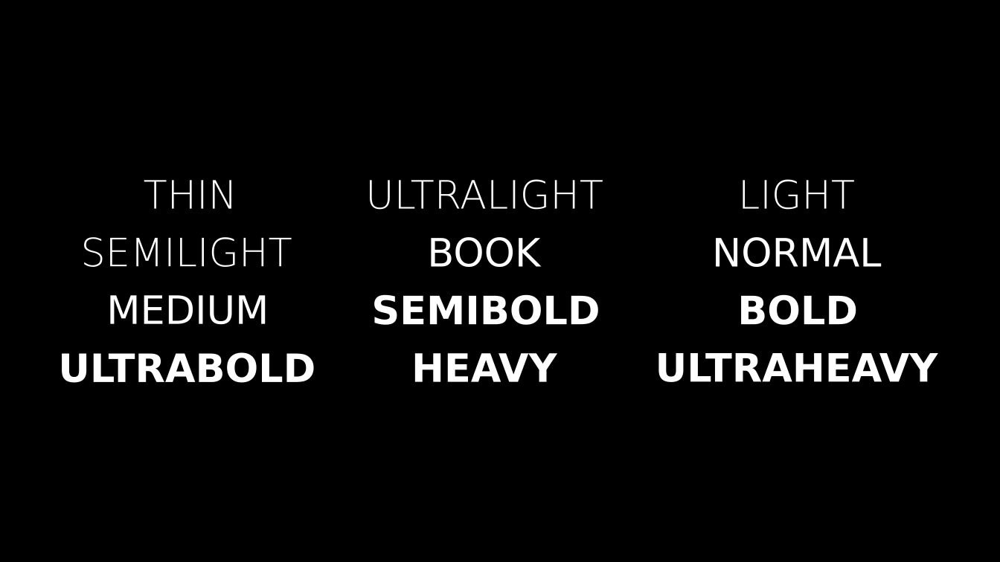

`TextClass$font_list()` lists the font families installed on your
system:

``` r

head(TextClass$font_list())
#> [1] "Bitstream Charter"    "C059"                 "Courier"             
#> [4] "D050000L"             "DejaVu Math TeX Gyre" "DejaVu Sans"
```

A font file that is not installed can be used after
[`register_font()`](https://adamrsophie.github.io/manimR/reference/register_font.md),
which makes the file available under its family name and returns that
name. It looks for the file as given, then in `assets/fonts/` and
`fonts/` below the working directory.

``` r

family <- register_font("fonts/MyFont-Regular.ttf")
Text("Hello", font = family)
```

Any font file works, including one that is already installed, as in this
runnable example (the family name depends on your system):

``` r

font_file <- systemfonts::match_fonts("serif")$path
family <- register_font(font_file)
plot(Text(paste("Registered font:", family), font = family))
```

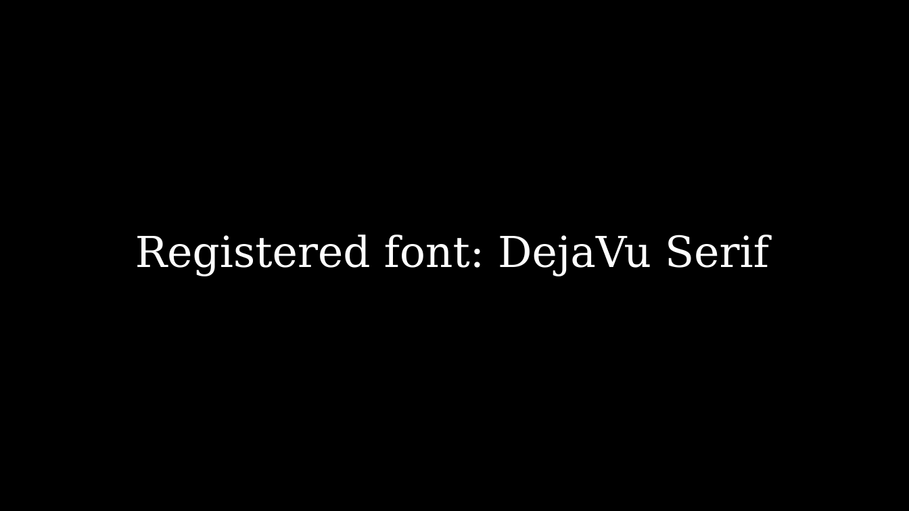

Upstream manim’s
[`register_font()`](https://adamrsophie.github.io/manimR/reference/register_font.md)
is a context manager that forgets the font when its `with` block ends;
in manimR the font stays registered for the rest of the R session.

### Glyphs are submobjects

Each visible character is a submobject (spaces have none), so `text[i]`
is the i-th glyph and `text[a:b]` a group of glyphs.
`get_part_by_text()` returns the glyphs of the first occurrence of a
substring. The `font_size` field reads or changes the size of an
existing text.

``` r

greeting <- Text("Hello world")
length(greeting$submobjects)
#> [1] 10
greeting[1]$set_color(RED)
greeting$get_part_by_text("world")$set_color(YELLOW)
greeting$font_size <- 96
greeting$font_size
#> [1] 96
plot(greeting)
```

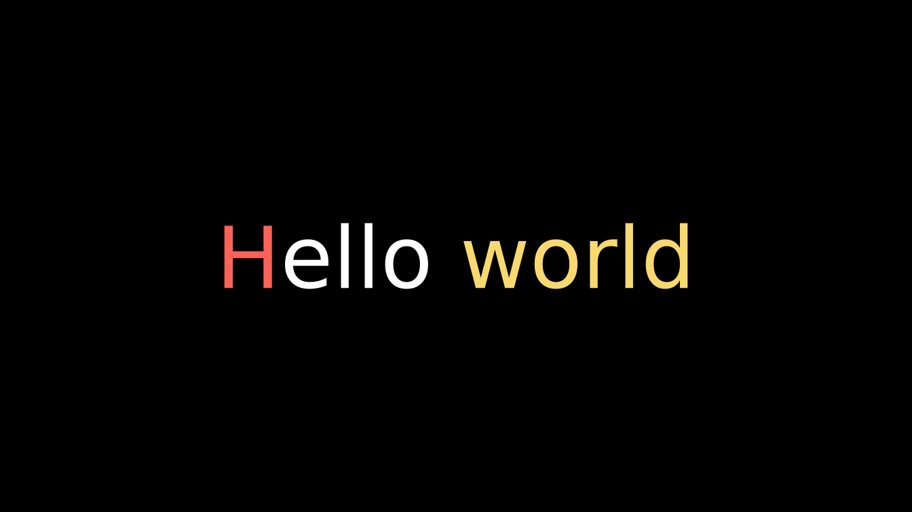

### Coloring and styling parts

Five arguments style parts of a text. Each takes a named list whose
names are substrings (every occurrence is styled) or slices such as
`"[2:5]"`:

- `t2c`: colors.
- `t2f`: fonts.
- `t2s`: slants.
- `t2w`: weights.
- `t2g`: gradients, given as vectors of colors.

Slices follow upstream manim and Python: they count from 0 and exclude
the end, so `"[2:5]"` is the third to fifth characters. This differs
from R indexing such as `text[1]`, which counts from 1. `gradient`
colors the whole text with a gradient.

``` r

parts <- VGroup(
  Text("Hello world, hello R", t2c = list(world = YELLOW, R = BLUE), t2w = list(Hello = BOLD),
       t2s = list(world = ITALIC), t2f = list(R = "mono")),
  Text("0123456789", t2c = list("[2:5]" = RED)),
  Text("a gradient on one word", t2g = list(gradient = c(TEAL, PURPLE))),
  Text("Rainbow text", gradient = c(RED, YELLOW, GREEN, BLUE))
)
plot(parts$arrange(DOWN, buff = 0.4))
```

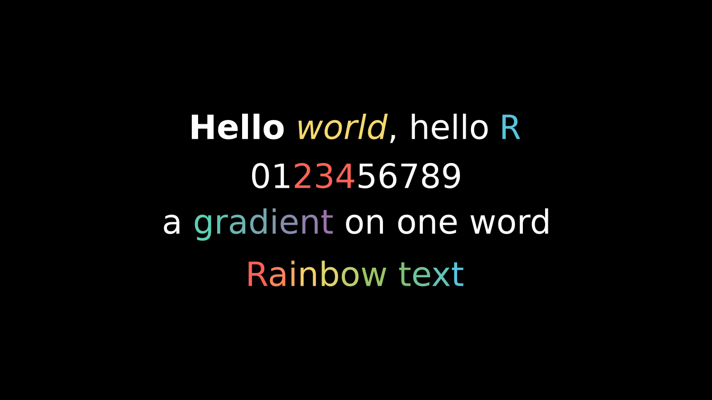

### Lines, spacing and ligatures

A newline starts a new line. `line_spacing` sets the space between lines
as a fraction of the font size (0.3 by default, as upstream), and
`tab_width` the number of spaces per tab.

``` r

plot(VGroup(
  Text("line_spacing\nat its default"),
  Text("line_spacing\n= 1", line_spacing = 1, color = YELLOW)
)$arrange(RIGHT, buff = 1.5))
```

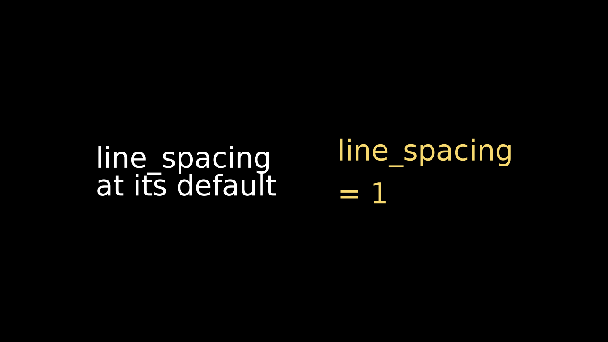

By default
[`Text()`](https://adamrsophie.github.io/manimR/reference/TextClass.md)
turns off ligatures (single glyphs that some fonts use for letter pairs
such as “fi”), so that every character is its own submobject.
`disable_ligatures = FALSE` keeps them, which can change the number of
glyphs:

``` r

length(Text("office affine", font = "serif")$submobjects)
#> [1] 10
length(Text("office affine", font = "serif", disable_ligatures = FALSE)$submobjects)
#> [1] 10
```

### `MarkupText()`

[`MarkupText()`](https://adamrsophie.github.io/manimR/reference/MarkupText.md)
reads Pango style markup, which styles parts of a text inline. The
supported tags are `<b>`, `<i>`, `<u>`, `<s>` (strike), `<tt>`
(monospace), `<big>`, `<small>`, `<sup>`, `<sub>`, manim’s
`<color col="...">` and `<gradient from="..." to="...">`, and `<span>`
with the attributes `foreground` (or `color`, `fgcolor`), `font` (or
`font_family`), `weight`, `style`, `size`, `fgalpha`, `underline` and
`strikethrough`. Escape `<`, `>` and `&` as `&lt;`, `&gt;` and `&amp;`.

``` r

markup <- VGroup(
  MarkupText("<b>bold</b>, <i>italic</i>, <u>underlined</u> and <s>struck</s>"),
  MarkupText("H<sub>2</sub>O and x<sup>2</sup> in <tt>monospace</tt>"),
  MarkupText("<span foreground='#58C4DD'>blue</span>, <span fgalpha='50%'>faded</span>, <big>big</big> and <small>small</small>"),
  MarkupText("<gradient from='YELLOW' to='RED'>a gradient</gradient> and <span weight='bold' style='italic'>both</span>")
)
plot(markup$arrange(DOWN, buff = 0.35)$scale_to_fit_width(12))
```

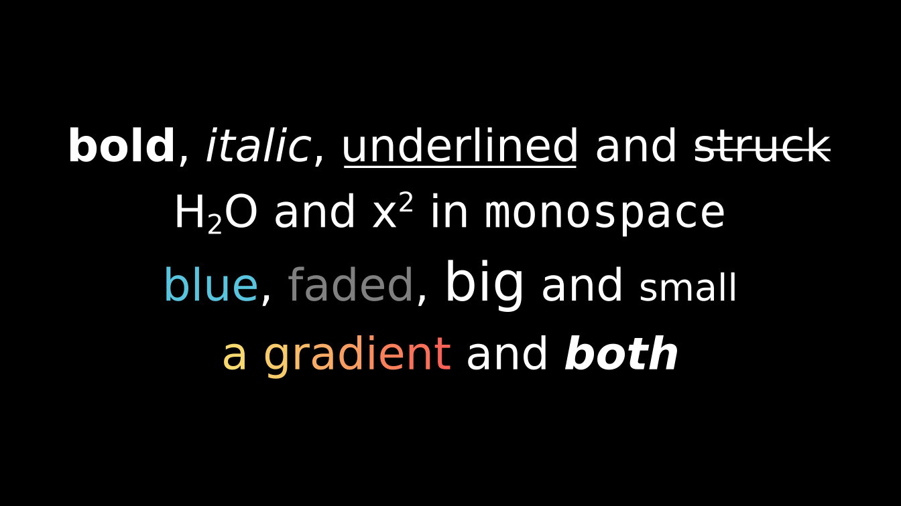

### `Paragraph()`

[`Paragraph()`](https://adamrsophie.github.io/manimR/reference/Paragraph.md)
takes one string per line and returns a `VGroup` with one group of
glyphs per line, aligned with `alignment = "left"`, `"center"` or
`"right"`. Other arguments go to
[`Text()`](https://adamrsophie.github.io/manimR/reference/TextClass.md).

``` r

para <- Paragraph("A paragraph keeps", "each line as its own group,", "aligned to one side.",
                  alignment = "left", font_size = 40, line_spacing = 0.6)
para[2]$set_color(YELLOW)
plot(para)
```

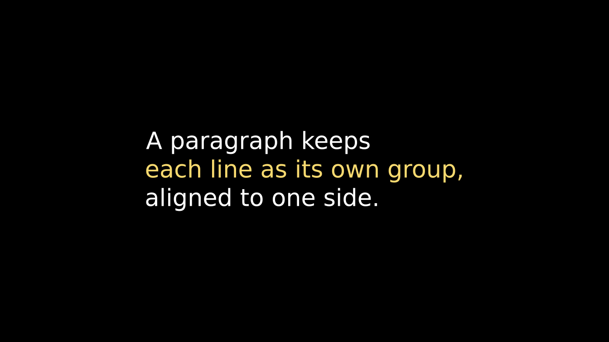

### Animating text

Text works with every animation.
[`Write()`](https://adamrsophie.github.io/manimR/reference/creation.md)
draws the glyphs one after another; the
[Animations](https://adamrsophie.github.io/manimR/articles/animations.md)
vignette also covers
[`AddTextLetterByLetter()`](https://adamrsophie.github.io/manimR/reference/creation.md),
[`AddTextWordByWord()`](https://adamrsophie.github.io/manimR/reference/creation.md)
and
[`TypeWithCursor()`](https://adamrsophie.github.io/manimR/reference/creation.md).

``` r

TextAnimation <- R6::R6Class("TextAnimation", inherit = Scene,
  public = list(construct = function() {
    title <- Text("Text in motion", font_size = 72)
    self$play(Write(title))
    self$play(title$get_part_by_text("motion")$animate$set_color(YELLOW))
    self$play(title$animate$scale(0.6)$to_edge(UP))
    body <- Paragraph("Each glyph is a submobject,", "so parts can move on their own.",
                      alignment = "center", font_size = 36)
    self$play(FadeIn(body, shift = UP, lag_ratio = 0.02))
    self$wait(0.5)
  })
)
```

## LaTeX: `Tex()` and `MathTex()`

[`Tex()`](https://adamrsophie.github.io/manimR/reference/tex.md)
typesets LaTeX in text mode and
[`MathTex()`](https://adamrsophie.github.io/manimR/reference/tex.md) in
math mode (inside an `align*` environment). Both need a LaTeX
installation with `dvisvgm`. In R strings a backslash is written twice,
`"\\frac{1}{2}"`; raw strings such as `r"(\frac{1}{2})"` avoid the
doubling.

``` r

plot(VGroup(
  Tex("Hello \\LaTeX, with \\textbf{bold} and \\emph{emphasis}"),
  MathTex(r"(e^{i\pi} + 1 = 0)"),
  MathTex(r"(\int_0^1 x^2 \, dx = \frac{1}{3})", color = YELLOW, font_size = 60)
)$arrange(DOWN, buff = 0.5))
```

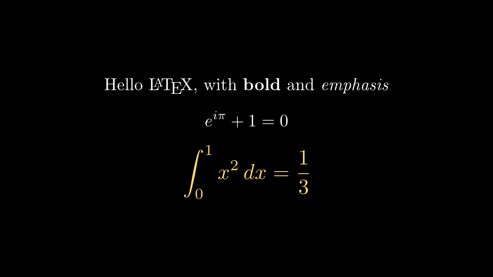

### Parts of a formula

Every string passed to
[`MathTex()`](https://adamrsophie.github.io/manimR/reference/tex.md) (or
[`Tex()`](https://adamrsophie.github.io/manimR/reference/tex.md))
becomes one submobject, so `eq[3]` below is the `b^2` part. Double
braces split a single string in the same way:
`MathTex("{{a^2}} + {{b^2}}")` has the parts `a^2`, `+` and `b^2`.
Methods that look parts up by their LaTeX string are:

- `set_color_by_tex(tex, color)` and `set_opacity_by_tex(tex, opacity)`.
- `get_part_by_tex(tex)`, the first part with that string, and
  `get_parts_by_tex(tex)`, a group of all of them.
- `index_of_part_by_tex(tex)`, its position among the submobjects.

``` r

eq <- MathTex("a^2", "+", "b^2", "=", "c^2")
eq$font_size <- 96
length(eq$submobjects)
#> [1] 5
eq[3]$set_color(BLUE)
eq$set_color_by_tex("c^2", YELLOW)
eq$get_part_by_tex("+")$set_color(RED)
eq$index_of_part_by_tex("=")
#> [1] 4
plot(eq)
```

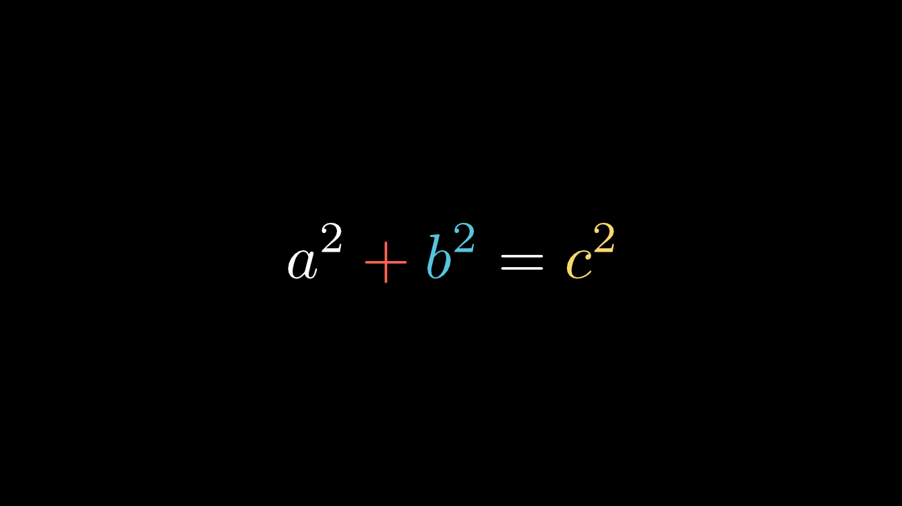

`substrings_to_isolate` splits out every occurrence of the given
substrings, so they can be colored even inside a single string, and
`tex_to_color_map` isolates and colors substrings in one step.
`arg_separator` is the text inserted between the strings (a space for
[`MathTex()`](https://adamrsophie.github.io/manimR/reference/tex.md),
nothing for
[`Tex()`](https://adamrsophie.github.io/manimR/reference/tex.md)), and
`tex_environment` the LaTeX environment (`"align*"` for
[`MathTex()`](https://adamrsophie.github.io/manimR/reference/tex.md),
`"center"` for
[`Tex()`](https://adamrsophie.github.io/manimR/reference/tex.md)).
[`SingleStringMathTex()`](https://adamrsophie.github.io/manimR/reference/tex.md)
typesets one string without any splitting.

``` r

plot(VGroup(
  MathTex("(x + 1)^2 = x^2 + 2x + 1", substrings_to_isolate = "x")$set_color_by_tex("x", BLUE),
  MathTex(r"(\alpha + \beta = \gamma)", tex_to_color_map = list("\\alpha" = RED, "\\beta" = GREEN)),
  SingleStringMathTex(r"(\sum_{n=1}^\infty \frac{1}{n^2} = \frac{\pi^2}{6})")
)$arrange(DOWN, buff = 0.5)$scale(1.3))
```

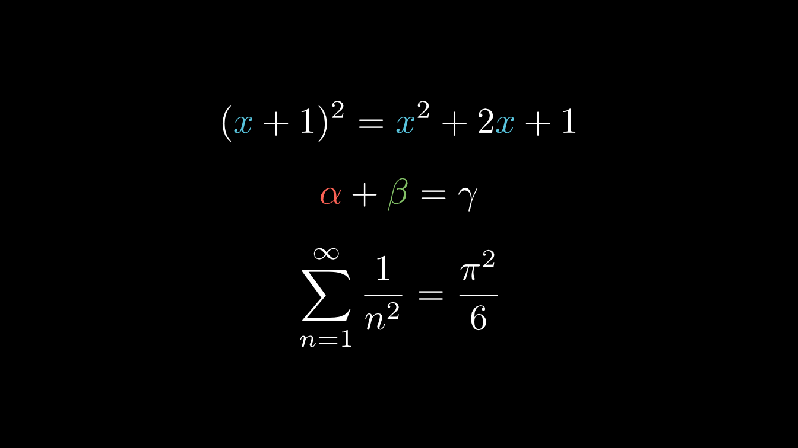

### Lists and titles

[`BulletedList()`](https://adamrsophie.github.io/manimR/reference/BulletedList.md)
typesets one bulleted item per string; `fade_all_but(i)` dims every item
except one.
[`Title()`](https://adamrsophie.github.io/manimR/reference/BulletedList.md)
places a title at the top of the frame with an underline
(`include_underline`, `match_underline_width_to_text`).

``` r

title <- Title("Bulleted lists")
items <- BulletedList("Strings become items", "Each item is a part", "Fade the rest to focus")
items$fade_all_but(2)
plot(VGroup(title, items$scale(1.4)))
```

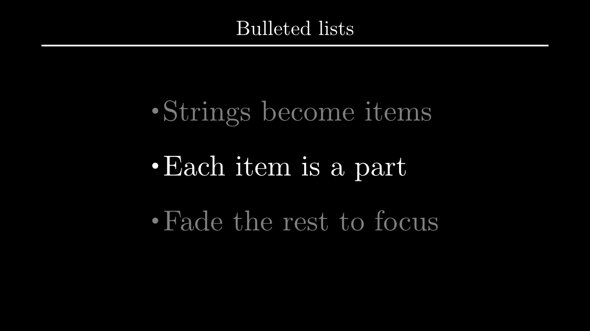

### Templates

The LaTeX document around each expression comes from a
[`TexTemplate()`](https://adamrsophie.github.io/manimR/reference/TexTemplateClass.md).
Add packages with `add_to_preamble()` and commands after
`\begin{document}` with `add_to_document()`; `tex_compiler` and
`output_format` choose the compiler (`"latex"` with `".dvi"`,
`"xelatex"` with `".xdv"`, or `"lualatex"` with `".pdf"`). Pass a
template as `tex_template` to one mobject, or make it the default for
everything with `manim_config(tex_template = ...)`.
`TexTemplateClass$from_file()` reads a whole template from a `.tex`
file.

``` r

script <- TexTemplate()
script$add_to_preamble("\\usepackage{mathrsfs}")
plot(MathTex(r"(\mathscr{L}\{f\}(s) = \int_0^\infty f(t) e^{-st} \, dt)", tex_template = script, font_size = 80))
```

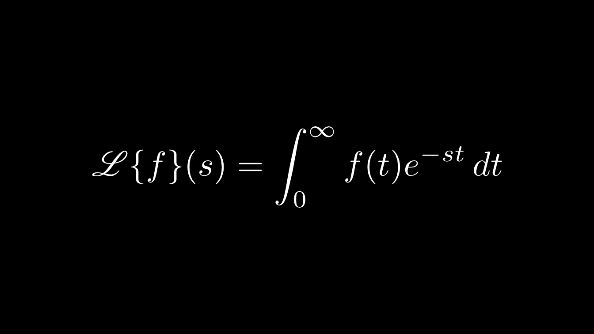

[`TexTemplateLibrary()`](https://adamrsophie.github.io/manimR/reference/TexTemplateLibrary.md)
returns ready made templates (`default`, `threeb1b`, `ctex` and
`simple`), and
[`TexFontTemplates()`](https://adamrsophie.github.io/manimR/reference/TexTemplateLibrary.md)
returns about fifty templates that switch the font of text and math.
Upstream manim stores these in class attributes, as in
`TexTemplateLibrary.ctex`; in R they are functions that return a fresh
list each time, written `TexTemplateLibrary()$ctex`, so changing one
template cannot affect another.

``` r

names(TexTemplateLibrary())
#> [1] "default"  "threeb1b" "ctex"     "simple"
length(TexFontTemplates())
#> [1] 52
TexFontTemplates()$french_cursive$description
#> [1] "French Cursive (Euler Greek)"
```

Most font templates need extra LaTeX packages (the one below uses
`frcursive` and `mathastext`, both part of TeX Live).

``` r

cursive <- TexFontTemplates()$french_cursive
plot(Tex("Handwritten $x^2 + y^2 = 1$", tex_template = cursive, font_size = 72))
```

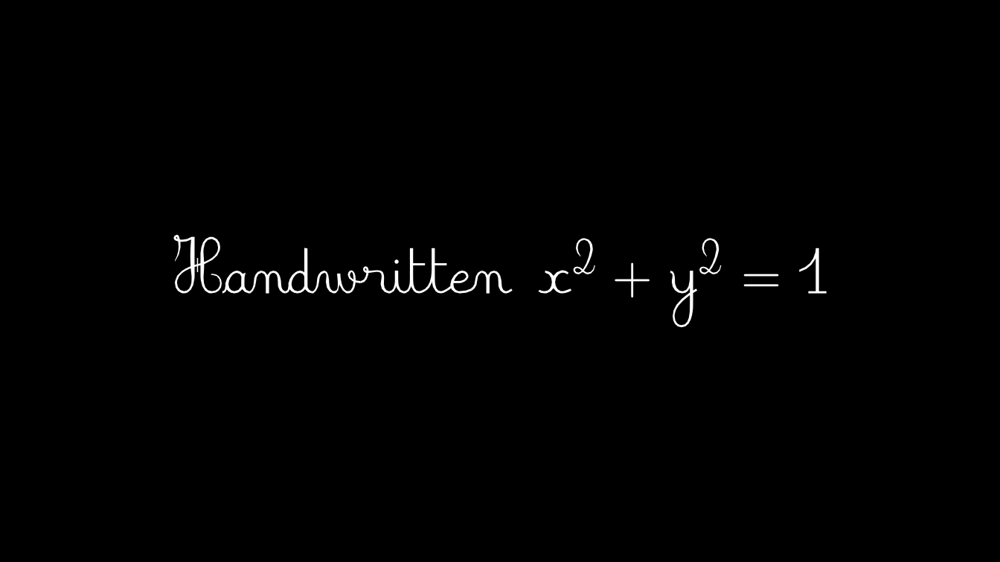

[`tex_to_svg_file()`](https://adamrsophie.github.io/manimR/reference/tex_to_svg_file.md)
is the function underneath: it compiles an expression and returns the
path of the SVG file, which
[`SVGMobject()`](https://adamrsophie.github.io/manimR/reference/SVGMobjectClass.md)
can load. The file draws in black, so give the imported shapes a
`fill_color`.

``` r

svg <- tex_to_svg_file(r"(\sqrt{2})", environment = "align*")
basename(svg)
#> [1] "24fb166be7fce66f.svg"
plot(SVGMobject(svg, fill_color = WHITE, height = 2))
```

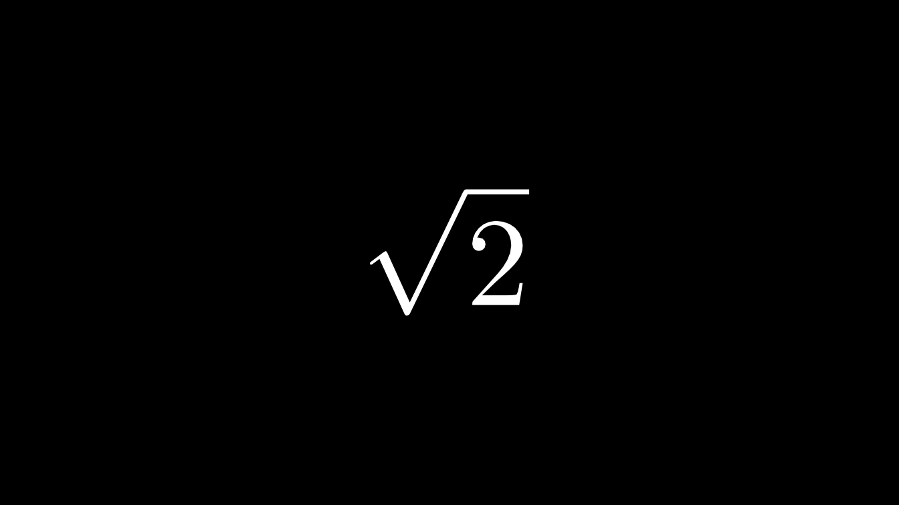

## Typst: `Typst()` and `MathTypst()`

[Typst](https://typst.app) is a modern typesetting system with a single
small compiler.
[`Typst()`](https://adamrsophie.github.io/manimR/reference/typst.md)
takes Typst markup and
[`MathTypst()`](https://adamrsophie.github.io/manimR/reference/typst.md)
a math expression without the `$` signs. Install the `typst` command
line compiler, or point manimR to it with
`manim_config(typst = "/path/to/typst")`.

``` r

plot(VGroup(
  Typst("*Hello* from _Typst!_", font_size = 72),
  MathTypst("integral_0^1 x^2 dif x = 1/3", color = YELLOW, font_size = 60)
)$arrange(DOWN, buff = 0.6))
```

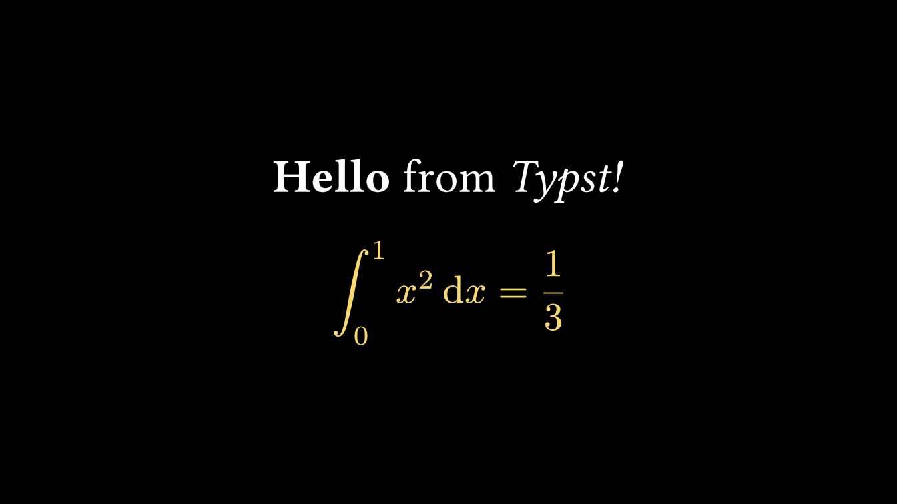

Parts are selected with `select()`. In
[`MathTypst()`](https://adamrsophie.github.io/manimR/reference/typst.md),
`{{ content : label }}` names a part and `{{ content }}` numbers it, so
`select("lhs")` and `select(1)` below return groups of glyphs. Unlike
upstream manim, numeric keys count from 1. In general Typst markup,
parts are marked with ordinary Typst labels, `#box[body] <label>`.
`typst_preamble` adds Typst code (such as `#set` rules) before the body.

``` r

eq <- MathTypst("{{ a^2 + b^2 : lhs }} = {{ c^2 }}", font_size = 96)
eq$select("lhs")$set_color(BLUE)
eq$select(1)$set_color(YELLOW)
fancy <- Typst("#box[Labeled] <word> text in italics", typst_preamble = "#set text(style: \"italic\")")
fancy$select("word")$set_color(ORANGE)
plot(VGroup(eq, fancy)$arrange(DOWN, buff = 0.6))
```

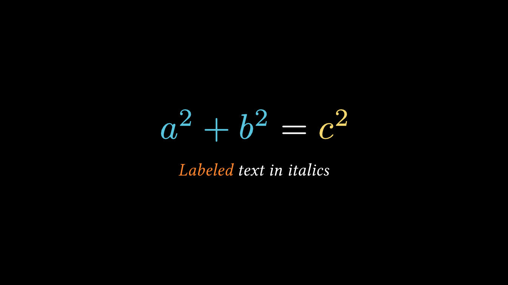

[`typst_to_svg_file()`](https://adamrsophie.github.io/manimR/reference/typst_to_svg_file.md)
compiles Typst code to an SVG file and returns its path, like
[`tex_to_svg_file()`](https://adamrsophie.github.io/manimR/reference/tex_to_svg_file.md)
does for LaTeX.

``` r

basename(typst_to_svg_file("$sum_(k=1)^n k = n(n+1)/2$"))
#> [1] "d39970d512f28aca.svg"
```

## Code listings

[`Code()`](https://adamrsophie.github.io/manimR/reference/CodeClass.md)
shows highlighted source code, from a string (`code_string`) or a file
(`code_file`, with the language guessed from the extension). R and
Python are highlighted; other languages are shown in one color, with a
warning. The listing is made of
[`Text()`](https://adamrsophie.github.io/manimR/reference/TextClass.md)
lines in a monospaced font, so no LaTeX is needed.

- `formatter_style`: one of the built in styles
  (`CodeClass$get_styles_list()`), or a named list of colors like the
  entries of `CodeClass$get_pygments_style("monokai")`.
- `add_line_numbers` and `line_numbers_from`: line numbers.
- `background`: `"rectangle"` or `"window"` (with three buttons), styled
  through `background_config`.
- `paragraph_config`: arguments for the
  [`Text()`](https://adamrsophie.github.io/manimR/reference/TextClass.md)
  lines, such as `font_size`.

``` r

CodeClass$get_styles_list()
#>  [1] "abap"               "algol"              "algol_nu"          
#>  [4] "arduino"            "autumn"             "bw"                
#>  [7] "borland"            "coffee"             "colorful"          
#> [10] "default"            "dracula"            "emacs"             
#> [13] "friendly_grayscale" "friendly"           "fruity"            
#> [16] "github-dark"        "gruvbox-dark"       "gruvbox-light"     
#> [19] "igor"               "inkpot"             "lightbulb"         
#> [22] "lilypond"           "lovelace"           "manni"             
#> [25] "material"           "monokai"            "murphy"            
#> [28] "native"             "nord-darker"        "nord"              
#> [31] "one-dark"           "paraiso-dark"       "paraiso-light"     
#> [34] "pastie"             "perldoc"            "rainbow_dash"      
#> [37] "rrt"                "sas"                "solarized-dark"    
#> [40] "solarized-light"    "staroffice"         "stata-dark"        
#> [43] "stata-light"        "tango"              "trac"              
#> [46] "vim"                "vs"                 "xcode"             
#> [49] "zenburn"
```

``` r

source_code <- "square <- function(x) {\n  # multiply x by itself\n  x * x\n}\nsquare(4)"
listing <- Code(code_string = source_code, language = "r", formatter_style = "monokai",
                background = "window", paragraph_config = list(font_size = 28))
plot(listing$scale_to_fit_width(10))
```

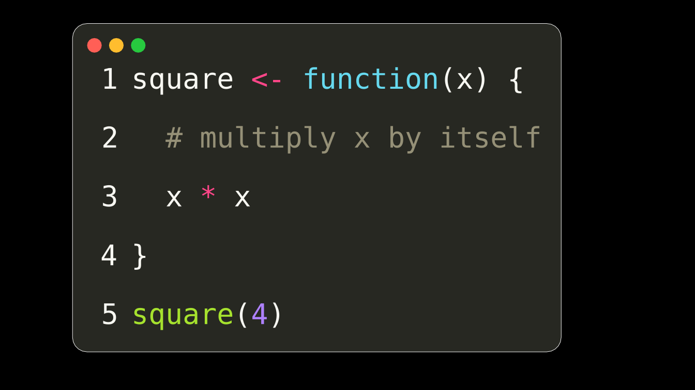

The parts are fields: `code_lines` (a `VGroup` with one
[`Text()`](https://adamrsophie.github.io/manimR/reference/TextClass.md)
per line), `line_numbers` and `background`. That makes it easy to point
at a line:

``` r

CodeHighlight <- R6::R6Class("CodeHighlight", inherit = Scene,
  public = list(construct = function() {
    file <- tempfile(fileext = ".py")
    writeLines(c("def square(x):", "    return x * x", "", "print(square(4))"), file)
    listing <- Code(code_file = file, formatter_style = "emacs", line_numbers_from = 10,
                    paragraph_config = list(font_size = 30))
    self$play(FadeIn(listing))
    box <- SurroundingRectangle(listing$code_lines[2], color = YELLOW, buff = 0.08)
    self$play(Create(box))
    self$play(Transform(box, SurroundingRectangle(listing$code_lines[4], color = YELLOW, buff = 0.08)))
    self$wait(0.5)
  })
)
```

## Numbers

[`DecimalNumber()`](https://adamrsophie.github.io/manimR/reference/DecimalNumberClass.md)
shows a number that can change later with `set_value()`; `get_value()`
reads it and `increment_value()` adds to it.
[`Integer()`](https://adamrsophie.github.io/manimR/reference/DecimalNumberClass.md)
is the same with no decimal places. The formatting arguments are:

- `num_decimal_places`: digits after the decimal point.
- `include_sign`: always show the sign.
- `group_with_commas`: thousands separators (on by default).
- `unit`: LaTeX appended after the number, raised when it starts with
  `^`.
- `show_ellipsis`: append an ellipsis.
- `edge_to_fix`: the edge that stays in place when the value changes.
- `mob_class`: the constructor used for each character, `MathTex` by
  default.

``` r

numbers <- VGroup(
  DecimalNumber(1234567.891, num_decimal_places = 3),
  DecimalNumber(-3.2, include_sign = TRUE, unit = "^\\circ"),
  DecimalNumber(42.5, unit = "\\%"),
  DecimalNumber(3.14159, num_decimal_places = 4, show_ellipsis = TRUE),
  Integer(-17),
  DecimalNumber(1 + 2i)
)
plot(numbers$arrange(DOWN, buff = 0.25)$scale(1.5))
```

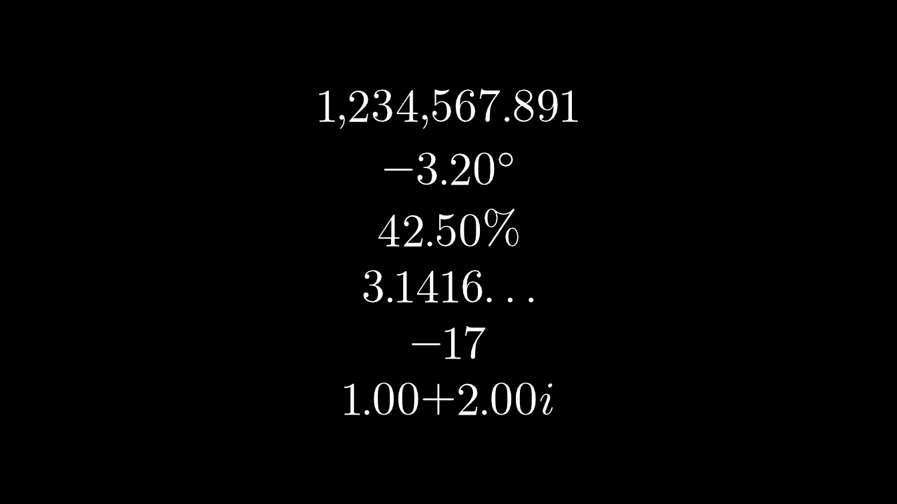

``` r

count <- Integer(7)
count$increment_value(3)
count$get_value()
#> [1] 10
```

With `mob_class = Text` the digits come from system fonts, so the number
works without LaTeX:

``` r

price <- DecimalNumber(19.99, mob_class = Text, font_size = 96, color = GREEN)
price$set_value(24.5)
price$get_value()
#> [1] 24.5
plot(price)
```

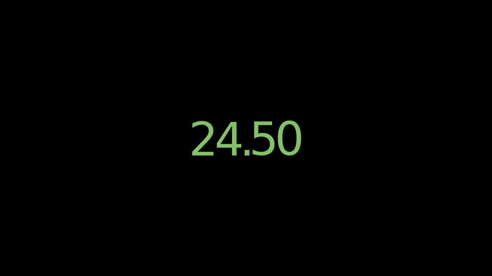

[`Variable()`](https://adamrsophie.github.io/manimR/reference/DecimalNumberClass.md)
combines a label, an equals sign and a number driven by a value tracker.
Numbers that follow changing values, and
[`Variable()`](https://adamrsophie.github.io/manimR/reference/DecimalNumberClass.md),
are covered in [Updaters and value
trackers](https://adamrsophie.github.io/manimR/articles/updaters.md);
the counting animations
[`ChangeDecimalToValue()`](https://adamrsophie.github.io/manimR/reference/number_animations.md)
and
[`ChangingDecimal()`](https://adamrsophie.github.io/manimR/reference/number_animations.md)
in
[Animations](https://adamrsophie.github.io/manimR/articles/animations.md).

## Matrices

[`Matrix()`](https://adamrsophie.github.io/manimR/reference/MatrixClass.md)
lays out entries in a grid between brackets. It accepts an R matrix, a
data frame, or a list of rows. Entries go through `element_to_mobject`
([`MathTex()`](https://adamrsophie.github.io/manimR/reference/tex.md) by
default, so strings may contain LaTeX), and the brackets are LaTeX
delimiters, so matrices need LaTeX.

- `left_bracket` and `right_bracket`: `"["` and `"]"` by default; `"("`,
  `"\\{"` or `"|"` also work.
- `v_buff` and `h_buff`: the spacing of rows and columns.
- `element_alignment_corner`: which corner of each entry is aligned to
  the grid.
- [`DecimalMatrix()`](https://adamrsophie.github.io/manimR/reference/MatrixClass.md),
  [`IntegerMatrix()`](https://adamrsophie.github.io/manimR/reference/MatrixClass.md)
  and
  [`MobjectMatrix()`](https://adamrsophie.github.io/manimR/reference/MatrixClass.md)
  use
  [`DecimalNumber()`](https://adamrsophie.github.io/manimR/reference/DecimalNumberClass.md),
  [`Integer()`](https://adamrsophie.github.io/manimR/reference/DecimalNumberClass.md)
  or arbitrary mobjects as entries.

``` r

plain <- Matrix(list(list(2, "\\pi"), list(-1, "\\sqrt{2}")))
decimal <- DecimalMatrix(rbind(c(3.14159, 2.71828), c(1.41421, 1.73205)),
                         element_to_mobject_config = list(num_decimal_places = 2))
integer <- IntegerMatrix(rbind(c(1, 2), c(3, 4)), left_bracket = "(", right_bracket = ")")
shapes <- MobjectMatrix(list(list(Circle(radius = 0.3), Square(side_length = 0.6)),
                             list(Triangle()$scale(0.35), Star(outer_radius = 0.35))))
plot(VGroup(plain, decimal, integer, shapes)$arrange(RIGHT, buff = 0.6)$scale_to_fit_width(13))
```

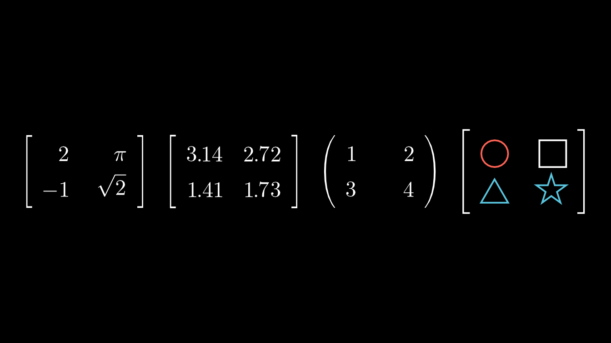

The accessors are `get_rows()`, `get_columns()` and `get_entries()` (all
groups, indexed from 1) and `get_brackets()`; `set_row_colors()` and
`set_column_colors()` color whole rows or columns, and
`add_background_to_entries()` puts a dark rectangle behind every entry.

``` r

m <- Matrix(rbind(c(1, 2, 3), c(4, 5, 6), c(7, 8, 9)))
m$set_column_colors(RED, GREEN, BLUE)
m$get_rows()[2]$set_color(YELLOW)
m$get_entries()[9]$set_color(WHITE)
box <- SurroundingRectangle(m$get_columns()[1])
plot(VGroup(m, box)$scale(1.8))
```

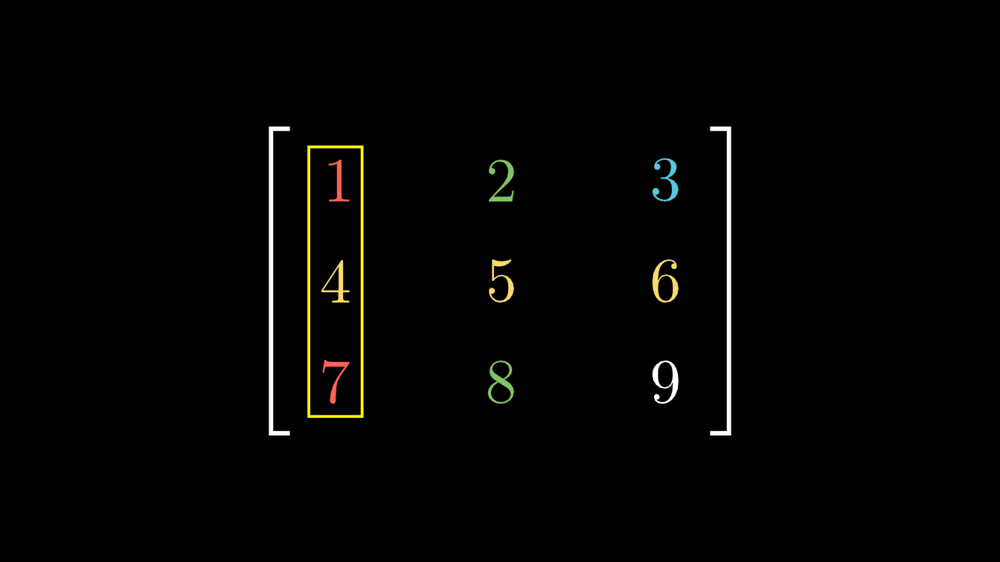

[`matrix_to_tex_string()`](https://adamrsophie.github.io/manimR/reference/matrix_to_tex_string.md)
writes an R matrix as a LaTeX array, and
[`matrix_to_mobject()`](https://adamrsophie.github.io/manimR/reference/matrix_to_tex_string.md)
typesets it in one piece (without the separate entries of
[`Matrix()`](https://adamrsophie.github.io/manimR/reference/MatrixClass.md)).
[`get_det_text()`](https://adamrsophie.github.io/manimR/reference/get_det_text.md)
builds the “det( ) = value” decoration around a matrix; add the matrix
itself separately.

``` r

matrix_to_tex_string(matrix(1:4, 2))
#> [1] "\\left[ \\begin{array}{cc}1 & 3 \\\\ 2 & 4\\end{array} \\right]"
```

``` r

a <- Matrix(rbind(c(2, 0), c(-1, 1)))
det <- get_det_text(a, determinant = 2, initial_scale_factor = 1)
plot(VGroup(VGroup(a, det)$shift(LEFT * 3), matrix_to_mobject(rbind(c(1, 0), c(0, 1)))$shift(RIGHT * 3))$scale(1.6))
```

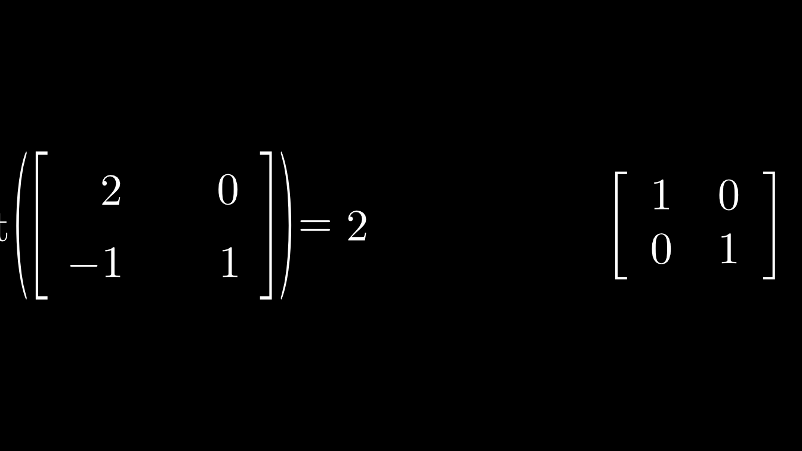

Matrices animate like any group. Here a column is highlighted and its
entries move.

``` r

MatrixAnimation <- R6::R6Class("MatrixAnimation", inherit = Scene,
  public = list(construct = function() {
    m <- IntegerMatrix(rbind(c(1, 2), c(3, 4)), h_buff = 1.5)$scale(1.5)
    self$play(Write(m))
    column <- m$get_columns()[2]
    box <- SurroundingRectangle(column, color = YELLOW)
    self$play(Create(box))
    self$play(column$animate$set_color(YELLOW))
    self$play(Swap(m$get_entries()[2], m$get_entries()[4]))
    self$wait(0.5)
  })
)
```

## Tables

[`Table()`](https://adamrsophie.github.io/manimR/reference/TableClass.md)
arranges entries in a grid with lines between the cells. It accepts an R
matrix, a data frame or a list of rows; the entries go through
[`Paragraph()`](https://adamrsophie.github.io/manimR/reference/Paragraph.md),
so plain strings need no LaTeX.

- `row_labels`, `col_labels` and `top_left_entry`: lists of mobjects
  labeling the rows and columns, and the corner between them.
- `include_outer_lines` (off by default) and `include_inner_lines`.
- `v_buff` and `h_buff`: spacing; `line_config`: arguments for the
  lines, such as `stroke_width` or `color`.
- `element_to_mobject` and `element_to_mobject_config`: how entries are
  built, and `arrange_in_grid_config` for the layout.

Positions in a table are `c(row, column)`, counted from 1 with labels
included, so with row and column labels `c(2, 2)` is the first entry.
`add_highlighted_cell(pos, color)` puts a colored background behind a
cell; `get_highlighted_cell()` returns that background without adding
it, and `get_cell()` the cell’s outline as a polygon.

``` r

df <- data.frame(model = c("linear", "quadratic"), rmse = c("2.31", "1.07"), r2 = c("0.81", "0.96"))
tab <- Table(df,
  col_labels = list(Text("model"), Text("RMSE"), Text("R squared")),
  include_outer_lines = TRUE,
  line_config = list(stroke_width = 2, color = GREY_B)
)
tab$add_highlighted_cell(c(3, 2), color = GREEN)
tab$get_col_labels()$set_color(YELLOW)
outline <- tab$get_cell(c(3, 3), color = RED, stroke_width = 6)
glow <- tab$get_highlighted_cell(c(2, 1), color = PURPLE)
plot(VGroup(glow, tab, outline)$scale(1.1))
```

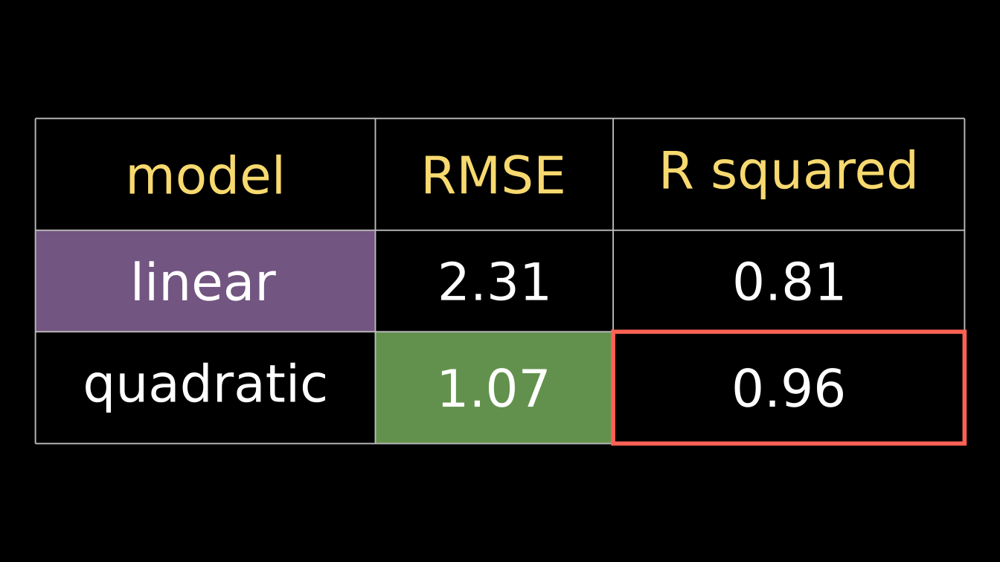

The accessors return groups indexed from 1: `get_rows()`,
`get_columns()`, `get_entries()` (all entries, or the one at `pos`),
`get_entries_without_labels()` (the same, with positions that skip the
labels), `get_row_labels()`, `get_col_labels()`, `get_labels()`,
`get_horizontal_lines()` and `get_vertical_lines()`. `set_row_colors()`
and `set_column_colors()` color whole rows or columns, and
`add_background_to_entries()` puts a rectangle behind each entry.

``` r

grid <- Table(list(c("a", "b", "c"), c("d", "e", "f")),
              row_labels = list(Text("row 1"), Text("row 2")))
length(grid$get_entries()$submobjects)
#> [1] 8
length(grid$get_entries_without_labels()$submobjects)
#> [1] 6
length(grid$get_horizontal_lines()$submobjects)
#> [1] 1
grid$set_column_colors(WHITE, BLUE, GREEN, ORANGE)
grid$get_entries_without_labels(c(2, 3))$set_color(RED)
plot(grid$scale(1.4))
```

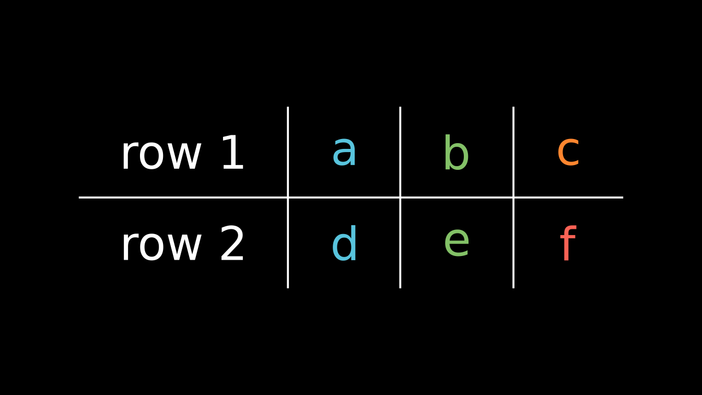

[`MobjectTable()`](https://adamrsophie.github.io/manimR/reference/TableClass.md)
takes mobjects as entries.
[`MathTable()`](https://adamrsophie.github.io/manimR/reference/TableClass.md),
[`IntegerTable()`](https://adamrsophie.github.io/manimR/reference/TableClass.md)
and
[`DecimalTable()`](https://adamrsophie.github.io/manimR/reference/TableClass.md)
typeset entries with
[`MathTex()`](https://adamrsophie.github.io/manimR/reference/tex.md),
[`Integer()`](https://adamrsophie.github.io/manimR/reference/DecimalNumberClass.md)
and
[`DecimalNumber()`](https://adamrsophie.github.io/manimR/reference/DecimalNumberClass.md),
so they need LaTeX.

``` r

shapes <- MobjectTable(list(
  list(Circle(radius = 0.4, color = BLUE), Square(side_length = 0.8, color = GREEN)),
  list(Triangle(color = RED)$scale(0.45), Star(outer_radius = 0.45, color = YELLOW))
))
plot(shapes$scale(1.5))
```

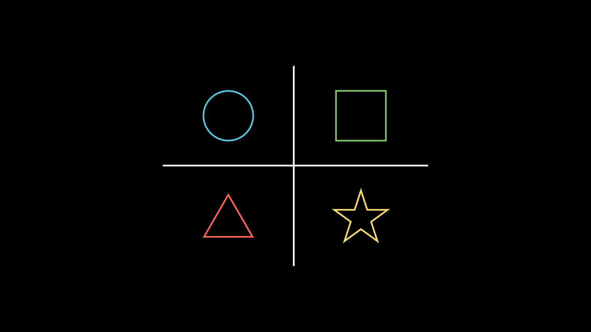

``` r

addition <- MathTable(list(list("+", 0, 1), list(0, 0, 1), list(1, 1, 2)), include_outer_lines = TRUE)
counts <- IntegerTable(rbind(c(12, 7), c(3, 25)), col_labels = list(Text("yes"), Text("no")),
                       row_labels = list(Text("A"), Text("B")))
rates <- DecimalTable(rbind(c(0.125, 0.5), c(0.875, 1)),
                      element_to_mobject_config = list(num_decimal_places = 3))
rates$set_row_colors(GREEN, ORANGE)
plot(VGroup(addition, counts, rates)$arrange(RIGHT, buff = 0.7)$scale_to_fit_width(13))
```

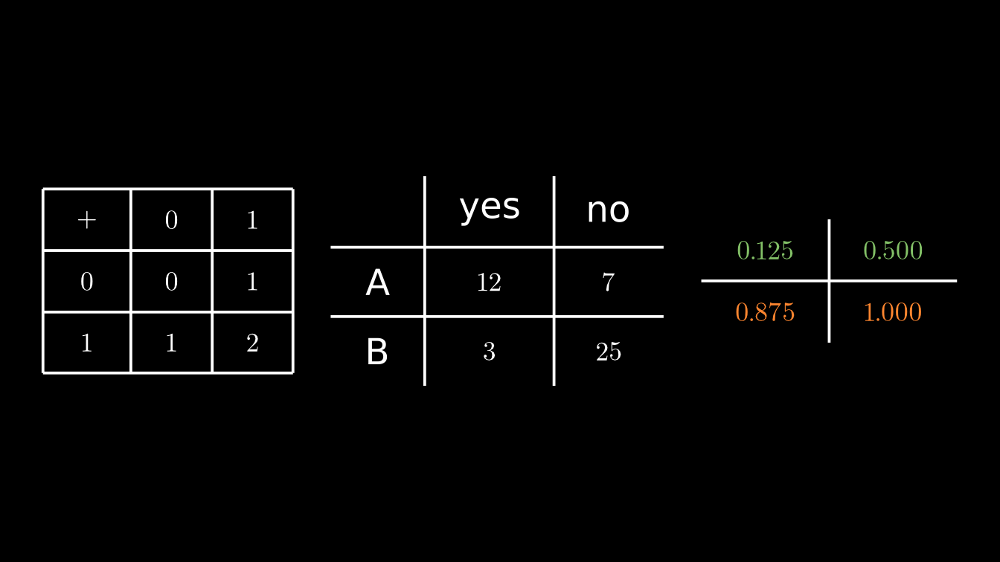

`tab$create()` returns an animation that draws the lines, then the
entries and labels, then the highlighted cells. Its arguments choose the
animations used for each part (`line_animation`, `element_animation`,
`label_animation`, `entry_animation`) and their `lag_ratio`.

``` r

TableCreate <- R6::R6Class("TableCreate", inherit = Scene,
  public = list(construct = function() {
    tab <- Table(list(c("1", "2", "3"), c("4", "5", "6")),
                 col_labels = list(Text("x"), Text("y"), Text("z")),
                 include_outer_lines = TRUE)
    tab$add_highlighted_cell(c(2, 2), color = TEAL)
    self$play(tab$create(), run_time = 2)
    self$play(Circumscribe(tab$get_rows()[3]))
    self$wait(0.5)
  })
)
```

## Equations in motion

Because a
[`MathTex()`](https://adamrsophie.github.io/manimR/reference/tex.md) has
one submobject per part, equations can be written, recolored and
rearranged step by step.
[`Write()`](https://adamrsophie.github.io/manimR/reference/creation.md)
draws an equation, and
[`TransformMatchingTex()`](https://adamrsophie.github.io/manimR/reference/transform_matching.md)
moves each part to the part with the same LaTeX string in the next
equation, fading the rest. The
[Animations](https://adamrsophie.github.io/manimR/articles/animations.md)
vignette describes its options.

``` r

SolveEquation <- R6::R6Class("SolveEquation", inherit = Scene,
  public = list(construct = function() {
    step1 <- MathTex("2", "x", "+", "3", "=", "11")$scale(2)
    step2 <- MathTex("2", "x", "=", "11", "-", "3")$scale(2)
    step3 <- MathTex("2", "x", "=", "8")$scale(2)
    step4 <- MathTex("x", "=", "4")$scale(2)
    self$play(Write(step1))
    self$play(step1$animate$set_color_by_tex("x", YELLOW))
    for (step in list(step2, step3, step4)) step$set_color_by_tex("x", YELLOW)
    self$play(TransformMatchingTex(step1, step2, path_arc = PI / 2))
    self$play(TransformMatchingTex(step2, step3))
    self$play(TransformMatchingTex(step3, step4))
    self$play(Circumscribe(step4))
    self$wait(0.5)
  })
)
```

Parts can also be animated on their own, for example to highlight a term
before rewriting it:

``` r

HighlightTerms <- R6::R6Class("HighlightTerms", inherit = Scene,
  public = list(construct = function() {
    eq <- MathTex("(a + b)^2", "=", "a^2", "+", "2ab", "+", "b^2", font_size = 80)
    self$add(eq)
    self$play(Indicate(eq[5]))
    self$play(eq[3]$animate$set_color(BLUE), eq[7]$animate$set_color(GREEN))
    brace <- Brace(eq[5], DOWN)
    note <- Text("the cross term", font_size = 32)$next_to(brace, DOWN)
    self$play(GrowFromCenter(brace), FadeIn(note, shift = UP))
    self$wait(0.5)
  })
)
```
