# Math and utility functions

Behind every mobject and animation sits a toolbox of plain R functions:
vector algebra, Bezier curve helpers, interpolation, rate functions,
path functions, list helpers and file helpers. They are exported so you
can use them in your own scenes. This vignette walks through all of
them, printing their results and drawing pictures where geometry helps.

Everything here works on ordinary R values. A point or a vector is a
numeric vector of length 3, `c(x, y, z)`, and a set of points is an
`n x 3` matrix with one point per row. Results that are tiny floating
point noise (such as `6.1e-17` instead of `0`) are rounded with
[`zapsmall()`](https://rdrr.io/r/base/zapsmall.html) in the examples so
they read well.

## Constants

### Directions

The direction constants are unit vectors. Add and scale them to build
points: `2 * RIGHT + UP` is the point `(2, 1, 0)`.

``` r

rbind(ORIGIN, UP, DOWN, LEFT, RIGHT, IN, OUT)
#>        [,1] [,2] [,3]
#> ORIGIN    0    0    0
#> UP        0    1    0
#> DOWN      0   -1    0
#> LEFT     -1    0    0
#> RIGHT     1    0    0
#> IN        0    0   -1
#> OUT       0    0    1
rbind(UL, UR, DL, DR)
#>    [,1] [,2] [,3]
#> UL   -1    1    0
#> UR    1    1    0
#> DL   -1   -1    0
#> DR    1   -1    0
rbind(X_AXIS, Y_AXIS, Z_AXIS)
#>        [,1] [,2] [,3]
#> X_AXIS    1    0    0
#> Y_AXIS    0    1    0
#> Z_AXIS    0    0    1
2 * RIGHT + UP
#> [1] 2 1 0
```

`UL`, `UR`, `DL` and `DR` are the diagonal corners (`UL = UP + LEFT`),
so they are not unit vectors. `IN` and `OUT` point into and out of the
screen; `OUT` is the default rotation axis everywhere.

``` r

dirs <- list(RIGHT = RIGHT, UR = UR, UP = UP, UL = UL, LEFT = LEFT, DL = DL, DOWN = DOWN, DR = DR)
cols <- color_gradient(c(BLUE, GREEN, YELLOW, RED), length(dirs))
pic <- VGroup()
for (i in seq_along(dirs)) {
  d <- dirs[[i]]
  pic$add(Arrow(ORIGIN, 2 * d, buff = 0, color = cols[i]))
  pic$add(Text(names(dirs)[i], font_size = 26, color = cols[i])$move_to(2.6 * d))
}
plot(pic)
```

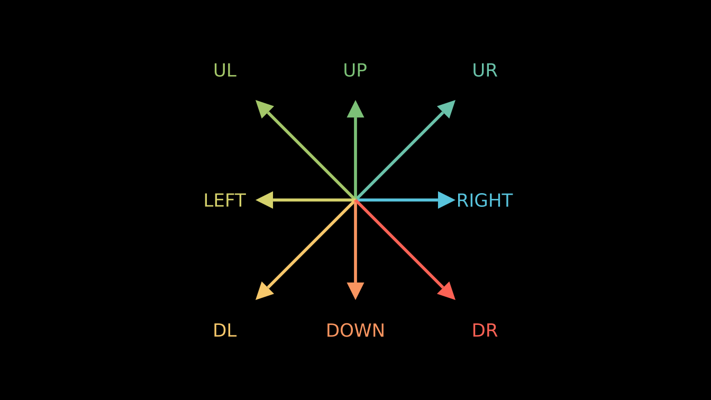

### Angles

`PI` and `TAU` (which is `2 * PI`, one full turn) are the usual circle
constants. Angles are in radians; multiply by `DEGREES` to write them in
degrees.

``` r

c(PI = PI, TAU = TAU, DEGREES = DEGREES)
#>         PI        TAU    DEGREES 
#> 3.14159265 6.28318531 0.01745329
90 * DEGREES
#> [1] 1.570796
```

### Buffers and defaults

Buffers are the standard gaps used by `next_to()`, `to_edge()`,
`arrange()` and friends. The `DEFAULT_` constants are the defaults of
strokes, fonts, dots, dashes, arrow tips, waits and point clouds.

``` r

c(SMALL_BUFF = SMALL_BUFF, MED_SMALL_BUFF = MED_SMALL_BUFF,
  MED_LARGE_BUFF = MED_LARGE_BUFF, LARGE_BUFF = LARGE_BUFF,
  DEFAULT_MOBJECT_TO_EDGE_BUFFER = DEFAULT_MOBJECT_TO_EDGE_BUFFER,
  DEFAULT_MOBJECT_TO_MOBJECT_BUFFER = DEFAULT_MOBJECT_TO_MOBJECT_BUFFER)
#>                        SMALL_BUFF                    MED_SMALL_BUFF 
#>                              0.10                              0.25 
#>                    MED_LARGE_BUFF                        LARGE_BUFF 
#>                              0.50                              1.00 
#>    DEFAULT_MOBJECT_TO_EDGE_BUFFER DEFAULT_MOBJECT_TO_MOBJECT_BUFFER 
#>                              0.50                              0.25
c(DEFAULT_STROKE_WIDTH = DEFAULT_STROKE_WIDTH, DEFAULT_FONT_SIZE = DEFAULT_FONT_SIZE,
  DEFAULT_DOT_RADIUS = DEFAULT_DOT_RADIUS, DEFAULT_SMALL_DOT_RADIUS = DEFAULT_SMALL_DOT_RADIUS,
  DEFAULT_DASH_LENGTH = DEFAULT_DASH_LENGTH, DEFAULT_ARROW_TIP_LENGTH = DEFAULT_ARROW_TIP_LENGTH,
  DEFAULT_WAIT_TIME = DEFAULT_WAIT_TIME,
  DEFAULT_POINTWISE_FUNCTION_RUN_TIME = DEFAULT_POINTWISE_FUNCTION_RUN_TIME,
  SCALE_FACTOR_PER_FONT_POINT = SCALE_FACTOR_PER_FONT_POINT,
  DEFAULT_POINT_DENSITY_1D = DEFAULT_POINT_DENSITY_1D,
  DEFAULT_POINT_DENSITY_2D = DEFAULT_POINT_DENSITY_2D)
#>                DEFAULT_STROKE_WIDTH                   DEFAULT_FONT_SIZE 
#>                         4.000000000                        48.000000000 
#>                  DEFAULT_DOT_RADIUS            DEFAULT_SMALL_DOT_RADIUS 
#>                         0.080000000                         0.040000000 
#>                 DEFAULT_DASH_LENGTH            DEFAULT_ARROW_TIP_LENGTH 
#>                         0.050000000                         0.350000000 
#>                   DEFAULT_WAIT_TIME DEFAULT_POINTWISE_FUNCTION_RUN_TIME 
#>                         1.000000000                         3.000000000 
#>         SCALE_FACTOR_PER_FONT_POINT            DEFAULT_POINT_DENSITY_1D 
#>                         0.001041667                        10.000000000 
#>            DEFAULT_POINT_DENSITY_2D 
#>                        25.000000000
```

The units `Pixels`,
[`Percent()`](https://adamrsophie.github.io/manimR/reference/units.md),
`Degrees` and `Munits` convert other measures into scene units; they are
described in [Mobjects and
geometry](https://adamrsophie.github.io/manimR/articles/mobjects.md).

### Font, joint and cap constants

The font constants are the strings that
[`Text()`](https://adamrsophie.github.io/manimR/reference/TextClass.md)
accepts for `slant` and `weight`, so `Text("Hi", weight = BOLD)` reads
like upstream code.

``` r

c(NORMAL, ITALIC, OBLIQUE)
#> [1] "NORMAL"  "ITALIC"  "OBLIQUE"
c(THIN, ULTRALIGHT, LIGHT, SEMILIGHT, BOOK, NORMAL, MEDIUM, SEMIBOLD, BOLD, ULTRABOLD, HEAVY, ULTRAHEAVY)
#>  [1] "THIN"       "ULTRALIGHT" "LIGHT"      "SEMILIGHT"  "BOOK"      
#>  [6] "NORMAL"     "MEDIUM"     "SEMIBOLD"   "BOLD"       "ULTRABOLD" 
#> [11] "HEAVY"      "ULTRAHEAVY"
str(LineJointType)
#> List of 4
#>  $ AUTO : chr "auto"
#>  $ ROUND: chr "round"
#>  $ BEVEL: chr "bevel"
#>  $ MITER: chr "miter"
str(CapStyleType)
#> List of 4
#>  $ AUTO  : chr "auto"
#>  $ ROUND : chr "round"
#>  $ BUTT  : chr "butt"
#>  $ SQUARE: chr "square"
```

`LineJointType` and `CapStyleType` name the values of a VMobject’s
`joint_type` and `cap_style`: how the corners of a thick stroke are
joined and how the open ends are capped.

``` r

zigzag <- rbind(c(-1, -0.6, 0), c(-0.3, 0.6, 0), c(0.3, -0.6, 0), c(1, 0.6, 0))
joints <- VGroup()
for (j in c("round", "bevel", "miter")) {
  line <- VMobject(stroke_width = 30, color = BLUE, joint_type = LineJointType[[toupper(j)]])
  line$set_points_as_corners(zigzag)
  joints$add(VGroup(line, Text(paste("joint:", j), font_size = 24)$next_to(line, DOWN)))
}
caps <- VGroup()
for (cp in c("butt", "round", "square")) {
  line <- Line(LEFT, RIGHT, stroke_width = 40, color = ORANGE, cap_style = CapStyleType[[toupper(cp)]])
  caps$add(VGroup(line, Text(paste("cap:", cp), font_size = 24)$next_to(line, DOWN)))
}
plot(VGroup(joints$arrange(RIGHT, buff = 1), caps$arrange(RIGHT, buff = 1.2))$arrange(DOWN, buff = 0.8))
```

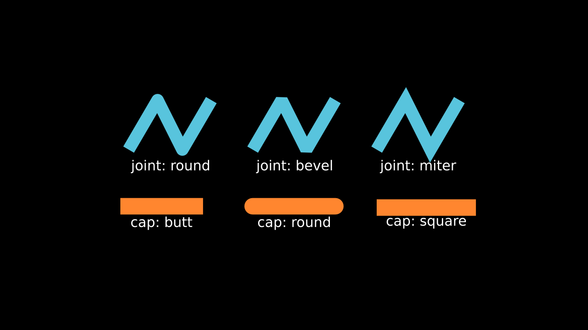

### Interface constants

A few constants come from upstream’s command line interface and
interactive scenes: the messages printed when a scene is missing, the
key codes of Shift and Ctrl, the default window position, and the
renderer names the `renderer` setting accepts.

``` r

cat(SCENE_NOT_FOUND_MESSAGE, NO_SCENE_MESSAGE, INVALID_NUMBER_MESSAGE, sep = "\n")
#> 
#>    {} is not in the script
#> 
#> 
#>    There are no scenes inside that module
#> 
#> Invalid scene numbers have been specified. Aborting.
cat(CHOOSE_NUMBER_MESSAGE)
#> 
#> Choose number corresponding to desired scene/arguments.
#> (Use comma separated list for multiple entries or use "*" to select all scenes.)
#> Choice(s):
EPILOG
#> [1] "Made with <3 by Manim Community developers."
str(CONTEXT_SETTINGS)
#> List of 3
#>  $ align_option_groups: logi TRUE
#>  $ align_sections     : logi TRUE
#>  $ show_constraints   : logi TRUE
c(SHIFT_VALUE = SHIFT_VALUE, CTRL_VALUE = CTRL_VALUE, START_X = START_X, START_Y = START_Y)
#> SHIFT_VALUE  CTRL_VALUE     START_X     START_Y 
#>       65505       65507          30          20
unlist(RendererType)
#>    CAIRO   OPENGL 
#>  "cairo" "opengl"
```

### Upstream style module access

Python code often writes `rate_functions.ease_in_sine` or
`color.BLUE_C`. The lists `rate_functions` and `color` give the same
access, which helps when porting a scene line by line. Everything inside
them is also exported directly.

``` r

rate_functions$smooth(0.25)
#> [1] 0.07010372
identical(rate_functions$smooth, smooth_rate)
#> [1] TRUE
color$BLUE_C
#> [1] "#58C4DD"
color$X11$BEIGE
#> [1] "#F5F5DC"
```

## Vectors and space operations

### Lengths, products and centers

``` r

v <- c(3, 4, 0)
get_norm(v)
#> [1] 5
normalize(v)
#> [1] 0.6 0.8 0.0
normalize(ORIGIN, fall_back = RIGHT) # a zero vector has no direction
#> [1] 1 0 0
cross(RIGHT, UP)
#> [1] 0 0 1
cross2d(RIGHT, UP)                   # the z component of the cross product
#> [1] 1
get_unit_normal(RIGHT, UR)
#> [1] 0 0 1
midpoint(LEFT, UP)
#> [1] -0.5  0.5  0.0
center_of_mass(rbind(LEFT, RIGHT, 3 * UP))
#> [1] 0 1 0
```

[`cross2d()`](https://adamrsophie.github.io/manimR/reference/space_ops.md)
also works row by row on matrices, which is handy when many segments are
tested at once:

``` r

cross2d(rbind(RIGHT, UP, UR), rbind(UP, RIGHT, UR))
#> RIGHT    UP    UR 
#>     1    -1     0
```

### Angles and rotations

[`angle_of_vector()`](https://adamrsophie.github.io/manimR/reference/space_ops.md)
gives the angle of a vector in the plane, measured counterclockwise from
`RIGHT`;
[`angle_between_vectors()`](https://adamrsophie.github.io/manimR/reference/space_ops.md)
gives the unsigned angle between two vectors in space.

``` r

angle_of_vector(UP) / DEGREES
#> [1] 90
angle_of_vector(DL) / DEGREES
#> [1] -135
angle_between_vectors(RIGHT, UR) / DEGREES
#> [1] 45
```

`rotation_matrix(angle, axis)` returns the 3 x 3 matrix of a rotation
about `axis` (by the right hand rule),
[`rotation_about_z()`](https://adamrsophie.github.io/manimR/reference/space_ops.md)
is the special case of the z axis, and
[`rotate_vector()`](https://adamrsophie.github.io/manimR/reference/space_ops.md)
applies such a rotation to a vector.
[`z_to_vector()`](https://adamrsophie.github.io/manimR/reference/space_ops.md)
returns the rotation that takes the z axis to a given direction, which
is how 3D mobjects are oriented.

``` r

zapsmall(rotation_matrix(PI / 2, OUT))
#>      [,1] [,2] [,3]
#> [1,]    0   -1    0
#> [2,]    1    0    0
#> [3,]    0    0    1
zapsmall(rotation_about_z(PI / 2))
#>      [,1] [,2] [,3]
#> [1,]    0   -1    0
#> [2,]    1    0    0
#> [3,]    0    0    1
zapsmall(rotate_vector(RIGHT, PI / 2))
#> [1] 0 1 0
zapsmall(rotate_vector(RIGHT, PI / 2, axis = UP)) # around the y axis
#> [1]  0  0 -1
zapsmall(z_to_vector(RIGHT))
#>      [,1] [,2] [,3]
#> [1,]    0    0    1
#> [2,]    0    1    0
#> [3,]   -1    0    0
zapsmall(z_to_vector(RIGHT) %*% OUT)
#>      [,1]
#> [1,]    1
#> [2,]    0
#> [3,]    0
```

`compass_directions(n)` spreads `n` unit vectors evenly around the
circle, and `regular_vertices(n)` returns the vertices of a regular
polygon with the angle it started from.

``` r

zapsmall(compass_directions(4))
#>      [,1] [,2] [,3]
#> [1,]    1    0    0
#> [2,]    0    1    0
#> [3,]   -1    0    0
#> [4,]    0   -1    0
rv <- regular_vertices(5, radius = 2)
zapsmall(rv$vertices)
#>           [,1]      [,2] [,3]
#> [1,]  0.000000  2.000000    0
#> [2,] -1.902113  0.618034    0
#> [3,] -1.175571 -1.618034    0
#> [4,]  1.175571 -1.618034    0
#> [5,]  1.902113  0.618034    0
rv$start_angle / DEGREES
#> [1] 90
```

A picture puts these together: a fan of vectors made with
[`rotate_vector()`](https://adamrsophie.github.io/manimR/reference/space_ops.md),
a pentagon from
[`regular_vertices()`](https://adamrsophie.github.io/manimR/reference/space_ops.md)
and the eight
[`compass_directions()`](https://adamrsophie.github.io/manimR/reference/space_ops.md).

``` r

v <- c(2, 0.6, 0)
fan <- VGroup(lapply(0:5, function(k) {
  Arrow(ORIGIN, rotate_vector(v, k * TAU / 12), buff = 0, color = interpolate_color(BLUE, YELLOW, k / 5))
}))
pent <- regular_vertices(5, radius = 1.6)$vertices
pentagon <- VGroup(Polygon(pent, color = GREEN), # a matrix of vertices works too
                   VGroup(lapply(1:5, function(i) Dot(pent[i, ], color = YELLOW))))
comp <- compass_directions(8, start_vect = RIGHT)
compass <- VGroup(lapply(1:8, function(i) Arrow(ORIGIN, 1.5 * comp[i, ], buff = 0, color = RED)))
plot(VGroup(fan, pentagon, compass)$arrange(RIGHT, buff = 1))
```

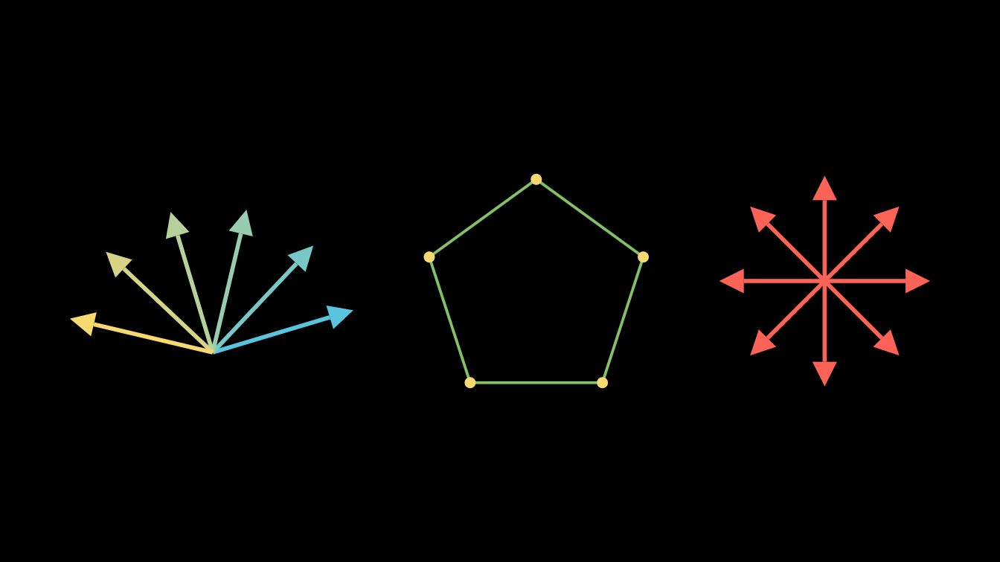

### Complex numbers

The plane doubles as the complex plane:
[`complex_to_R3()`](https://adamrsophie.github.io/manimR/reference/space_ops.md)
turns `x + yi` into `c(x, y, 0)` and
[`R3_to_complex()`](https://adamrsophie.github.io/manimR/reference/space_ops.md)
goes back.
[`complex_func_to_R3_func()`](https://adamrsophie.github.io/manimR/reference/space_ops.md)
wraps a function of a complex number into a function of a point, which
is what `apply_function()` expects.

``` r

complex_to_R3(1 + 2i)
#> [1] 1 2 0
R3_to_complex(c(3, -1, 0))
#> [1] 3-1i
square_it <- complex_func_to_R3_func(function(z) z^2)
square_it(c(1, 1, 0)) # (1 + i)^2 = 2i
#> [1] 0 2 0
```

Here a grid of lines is bent by `z^2 / 2`. Each line gets extra curves
first (`insert_n_curves()`) so the bent copy stays smooth.

``` r

make_grid <- function() {
  g <- VGroup()
  for (k in seq(-1.5, 1.5, by = 0.5)) {
    g$add(Line(c(-1.5, k, 0), c(1.5, k, 0), color = BLUE, stroke_width = 2))
    g$add(Line(c(k, -1.5, 0), c(k, 1.5, 0), color = YELLOW, stroke_width = 2))
  }
  for (line in g$submobjects) line$insert_n_curves(20)
  g
}
half_square <- complex_func_to_R3_func(function(z) z^2 / 2)
before <- make_grid()
after <- make_grid()$apply_function(half_square)
plot(VGroup(before, after)$arrange(RIGHT, buff = 1.5))
```

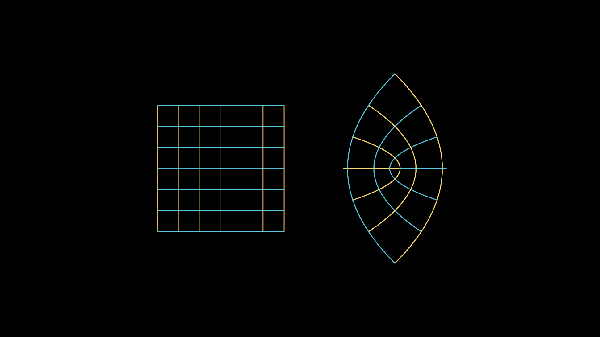

### Intersections and bisectors

[`line_intersection()`](https://adamrsophie.github.io/manimR/reference/space_ops.md)
intersects two lines in the plane, each given by two points.
[`find_intersection()`](https://adamrsophie.github.io/manimR/reference/space_ops.md)
takes a point and a direction for each line instead, and handles many
pairs at once when given matrices.
[`perpendicular_bisector()`](https://adamrsophie.github.io/manimR/reference/space_ops.md)
returns the two end points of the perpendicular bisector of a segment.

``` r

l1 <- rbind(c(-3, -1, 0), c(1, 2, 0))
l2 <- rbind(c(-3, 2, 0), c(0, -1.5, 0))
p <- line_intersection(l1, l2)
p
#> [1] -1.434783  0.173913  0.000000
find_intersection(c(0, 0, 0), c(1, 1, 0), c(2, 0, 0), c(-1, 1, 0))
#> [1] 1 1 0
find_intersection(rbind(ORIGIN, ORIGIN), rbind(RIGHT, UR),
                  rbind(c(2, 1, 0), c(0, 3, 0)), rbind(DOWN, RIGHT)) # one pair per row
#>      [,1] [,2] [,3]
#> [1,]    2    0    0
#> [2,]    3    3    0
seg <- rbind(c(1.5, -1, 0), c(4, 1, 0))
pb <- perpendicular_bisector(seg)
pb
#>      [,1] [,2] [,3]
#> [1,] 0.75  2.5    0
#> [2,] 4.75 -2.5    0
```

``` r

plot(VGroup(
  Line(l1[1, ], l1[2, ], color = BLUE),
  Line(l2[1, ], l2[2, ], color = GREEN),
  Dot(p, color = YELLOW, radius = 0.12),
  Line(seg[1, ], seg[2, ], color = RED),
  Dot(seg[1, ], color = RED), Dot(seg[2, ], color = RED),
  DashedLine(pb[1, ], pb[2, ], color = WHITE),
  Dot(midpoint(seg[1, ], seg[2, ]), color = WHITE)
))
```

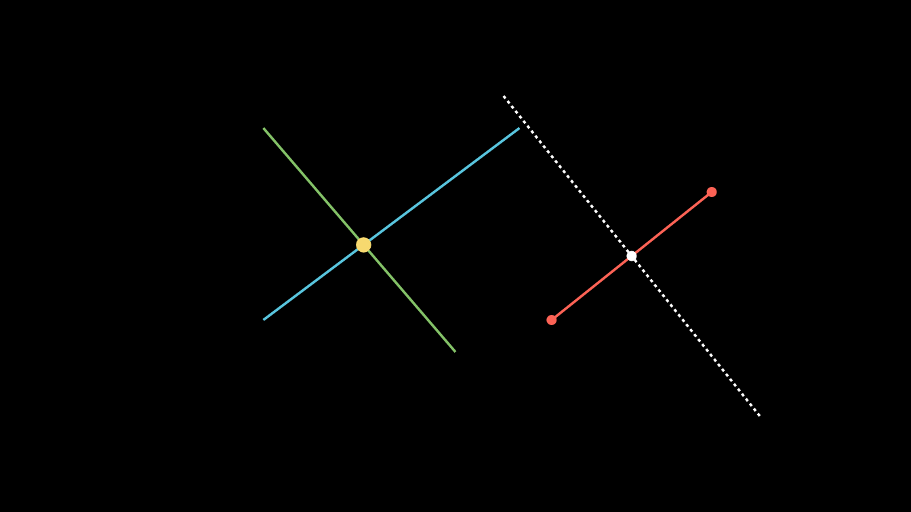

### Polygons: area, orientation and winding

[`shoelace()`](https://adamrsophie.github.io/manimR/reference/space_ops.md)
computes the signed area of a polygon (positive when its vertices run
clockwise) and
[`shoelace_direction()`](https://adamrsophie.github.io/manimR/reference/space_ops.md)
turns the sign into `"CW"` or `"CCW"`.
[`get_winding_number()`](https://adamrsophie.github.io/manimR/reference/space_ops.md)
counts how many times a closed path winds counterclockwise around the
origin.

``` r

unit_square <- rbind(c(0, 0), c(1, 0), c(1, 1), c(0, 1))
shoelace(unit_square)
#> [1] -1
shoelace_direction(unit_square)
#> [1] "CCW"
shoelace_direction(unit_square[4:1, ])
#> [1] "CW"
get_winding_number(Circle()$points)
#> [1] 1
get_winding_number(Circle()$shift(3 * RIGHT)$points) # origin outside
#> [1] 7.067899e-17
```

### Spherical coordinates

[`cartesian_to_spherical()`](https://adamrsophie.github.io/manimR/reference/space_ops.md)
returns `c(r, theta, phi)`: the distance from the origin, the angle
around the z axis, and the angle down from the z axis.
[`spherical_to_cartesian()`](https://adamrsophie.github.io/manimR/reference/space_ops.md)
goes back.

``` r

s <- cartesian_to_spherical(c(1, 1, 1))
s
#> [1] 1.7320508 0.7853982 0.9553166
spherical_to_cartesian(s)
#> [1] 1 1 1
zapsmall(spherical_to_cartesian(c(2, 0, PI / 2)))
#> [1] 2 0 0
```

### Banded matrices

[`thick_diagonal()`](https://adamrsophie.github.io/manimR/reference/space_ops.md)
returns a 0/1 matrix with a band of ones around the diagonal.

``` r

thick_diagonal(5, thickness = 2)
#>      [,1] [,2] [,3] [,4] [,5]
#> [1,]    1    1    0    0    0
#> [2,]    1    1    1    0    0
#> [3,]    0    1    1    1    0
#> [4,]    0    0    1    1    1
#> [5,]    0    0    0    1    1
```

## Quaternions

Quaternions are numeric vectors `c(w, x, y, z)`. They describe 3D
rotations (upstream’s OpenGL camera stores its orientation as one).
[`quaternion_from_angle_axis()`](https://adamrsophie.github.io/manimR/reference/quaternion_mult.md)
builds the rotation quaternion,
[`quaternion_mult()`](https://adamrsophie.github.io/manimR/reference/quaternion_mult.md)
multiplies any number of quaternions from left to right,
[`quaternion_conjugate()`](https://adamrsophie.github.io/manimR/reference/quaternion_mult.md)
negates the vector part, and
[`angle_axis_from_quaternion()`](https://adamrsophie.github.io/manimR/reference/quaternion_mult.md)
recovers the angle and axis. Rotating a vector `v` by `q` is the product
`q * v * conj(q)`, with `v` as a quaternion whose real part is zero:

``` r

q <- quaternion_from_angle_axis(PI / 2, OUT)
q
#> [1] 0.7071068 0.0000000 0.0000000 0.7071068
zapsmall(quaternion_mult(q, c(0, RIGHT), quaternion_conjugate(q))) # RIGHT turns to UP
#> [1] 0 0 1 0
quaternion_mult() # the identity
#> [1] 1 0 0 0
str(angle_axis_from_quaternion(q))
#> List of 2
#>  $ angle: num 1.57
#>  $ axis : num [1:3] 0 0 1
```

## Interpolation and simple functions

`interpolate(start, end, alpha)` blends linearly and works on numbers,
points and whole matrices of points.
[`inverse_interpolate()`](https://adamrsophie.github.io/manimR/reference/interpolate.md)
answers the reverse question,
[`match_interpolate()`](https://adamrsophie.github.io/manimR/reference/interpolate.md)
maps a value from one range to another, and
[`mid()`](https://adamrsophie.github.io/manimR/reference/interpolate.md)
is the midpoint.

``` r

interpolate(0, 10, 0.3)
#> [1] 3
interpolate(LEFT, UP, 0.5)
#> [1] -0.5  0.5  0.0
inverse_interpolate(0, 10, 3)
#> [1] 0.3
match_interpolate(0, 100, 0, 10, 3) # 3 on [0, 10] is 30 on [0, 100]
#> [1] 30
mid(2, 4)
#> [1] 3
```

[`integer_interpolate()`](https://adamrsophie.github.io/manimR/reference/interpolate.md)
splits a progress value into an index and the fraction left over;
[`DrawBorderThenFill()`](https://adamrsophie.github.io/manimR/reference/creation.md),
for example, uses it to split its progress into an outline stage and a
fill stage. The index is 0 based, as upstream’s: add 1 before using it
to index an R vector.

``` r

str(integer_interpolate(0, 10, 0.46))
#> List of 2
#>  $ index  : int 4
#>  $ residue: num 0.6
str(integer_interpolate(0, 10, 1))
#> List of 2
#>  $ index  : int 9
#>  $ residue: num 1
```

[`sigmoid()`](https://adamrsophie.github.io/manimR/reference/sigmoid.md)
is the logistic function,
[`binary_search()`](https://adamrsophie.github.io/manimR/reference/sigmoid.md)
inverts a monotone function numerically (returning `NULL` when the
target is out of reach), and
[`clip_value()`](https://adamrsophie.github.io/manimR/reference/clip_value.md)
clamps a number to a range. It is called
[`clip_value()`](https://adamrsophie.github.io/manimR/reference/clip_value.md)
because an exported [`clip()`](https://rdrr.io/r/graphics/clip.html)
would mask [`graphics::clip()`](https://rdrr.io/r/graphics/clip.html);
upstream’s [`choose()`](https://rdrr.io/r/base/Special.html) is simply
[`base::choose()`](https://rdrr.io/r/base/Special.html).

``` r

sigmoid(c(-4, 0, 4))
#> [1] 0.01798621 0.50000000 0.98201379
binary_search(function(x) x^2 + 3 * x + 1, target = 11, lower_bound = 0, upper_bound = 5)
#> [1] 2.000046
binary_search(function(x) x^2 + 3 * x + 1, target = 71, lower_bound = 0, upper_bound = 5)
#> NULL
clip_value(5, 0, 3)
#> [1] 3
clip_value(-1, 0, 3)
#> [1] 0
choose(5, 2)
#> [1] 10
```

## Bezier curves

Every VMobject is a chain of cubic Bezier curves, stored four control
points per curve (anchor, handle, handle, anchor). The helpers below
work on such control points, given as a matrix with one point per row.

### Evaluating a curve

`bezier(points)` returns a function of `t` in `[0, 1]`; give it a vector
of `t` values to get a matrix of points.

``` r

cubic <- rbind(c(-3, -1, 0), c(-2, 2, 0), c(1, -2, 0), c(3, 1, 0))
curve <- bezier(cubic)
curve(0.5)
#> [1] -0.375  0.000  0.000
curve(c(0, 0.25, 1))
#>           [,1]     [,2] [,3]
#> [1,] -3.000000 -1.00000    0
#> [2,] -1.921875  0.15625    0
#> [3,]  3.000000  1.00000    0
```

### Cutting curves into pieces

`partial_bezier_points(points, a, b)` returns the control points of the
part of the curve between `t = a` and `t = b`.
[`split_bezier()`](https://adamrsophie.github.io/manimR/reference/partial_bezier_points.md)
cuts at one `t` and stacks both halves;
[`subdivide_bezier()`](https://adamrsophie.github.io/manimR/reference/partial_bezier_points.md)
cuts into `n` equal parameter pieces;
[`bezier_remap()`](https://adamrsophie.github.io/manimR/reference/partial_bezier_points.md)
subdivides a path of several curves until it has a requested number of
curves, which is how two paths are made compatible before a `Transform`.

``` r

partial_bezier_points(cubic, 0.25, 0.75)
#>           [,1]     [,2] [,3]
#> [1,] -1.921875  0.15625    0
#> [2,] -1.015625  0.34375    0
#> [3,]  0.203125 -0.34375    0
#> [4,]  1.359375 -0.15625    0
nrow(split_bezier(cubic, 0.5))
#> [1] 8
nrow(subdivide_bezier(cubic, 3))
#> [1] 12
nrow(bezier_remap(Square()$points, 7)) / 4 # a square's 4 curves become 7
#> [1] 7
```

The picture shows the control polygon (dashed), the whole curve (blue),
the part from `t = 0.25` to `t = 0.75` (yellow) and the points where
[`subdivide_bezier()`](https://adamrsophie.github.io/manimR/reference/partial_bezier_points.md)
cuts it in three (red).

``` r

whole <- VMobject(color = BLUE, stroke_width = 4)
whole$set_points(cubic)
middle <- VMobject(color = YELLOW, stroke_width = 10)
middle$set_points(partial_bezier_points(cubic, 0.25, 0.75))
pieces <- subdivide_bezier(cubic, 3)
cuts <- VGroup(lapply(c(4, 8), function(i) Dot(pieces[i, ], color = RED, radius = 0.1)))
control <- VGroup(
  DashedLine(cubic[1, ], cubic[2, ], color = GREY_B), DashedLine(cubic[2, ], cubic[3, ], color = GREY_B),
  DashedLine(cubic[3, ], cubic[4, ], color = GREY_B),
  VGroup(lapply(1:4, function(i) Dot(cubic[i, ], color = WHITE)))
)
plot(VGroup(control, whole, middle, cuts))
```

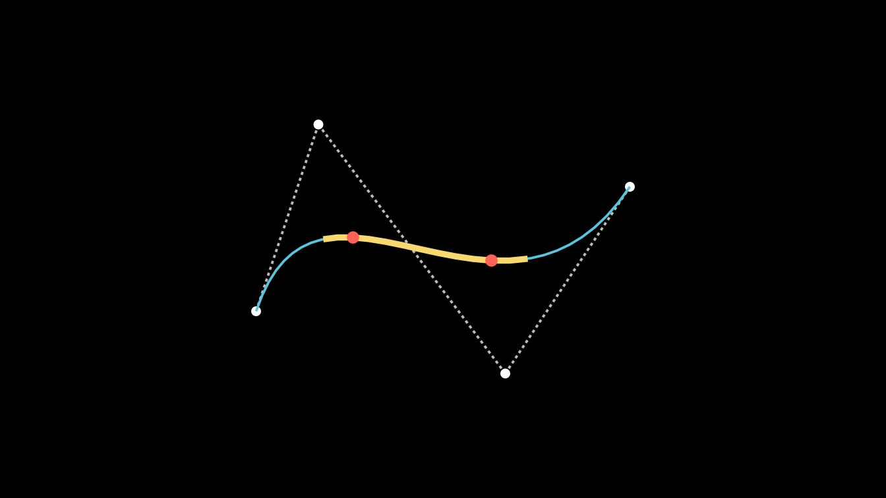

### Finding a point on a curve

[`proportions_along_bezier_curve_for_point()`](https://adamrsophie.github.io/manimR/reference/proportions_along_bezier_curve_for_point.md)
solves for the parameters at which the curve passes through a point, and
[`point_lies_on_bezier()`](https://adamrsophie.github.io/manimR/reference/proportions_along_bezier_curve_for_point.md)
says whether there is any.

``` r

p <- curve(0.3)
proportions_along_bezier_curve_for_point(p, cubic)
#> [1] 0.3
point_lies_on_bezier(p, cubic)
#> [1] TRUE
point_lies_on_bezier(c(0, 0, 0), cubic)
#> [1] FALSE
```

### Smooth splines

[`get_smooth_cubic_bezier_handle_points()`](https://adamrsophie.github.io/manimR/reference/get_smooth_cubic_bezier_handle_points.md)
computes handles that join a list of anchors into a smooth spline (this
is what `set_points_smoothly()` and `make_smooth()` use). It returns the
first and second handle of each curve.

``` r

anchors <- rbind(c(-4, -1, 0), c(-2, 1.5, 0), c(0, -1, 0), c(2, 1, 0), c(4, -1.5, 0))
h <- get_smooth_cubic_bezier_handle_points(anchors)
h
#> $h1
#>            [,1]       [,2] [,3]
#> [1,] -3.3333333  0.4136905    0
#> [2,] -1.3333333  1.1726190    0
#> [3,]  0.6666667 -1.1041667    0
#> [4,]  2.6666667  1.2440476    0
#> 
#> $h2
#>            [,1]       [,2] [,3]
#> [1,] -2.6666667  1.8273810    0
#> [2,] -0.6666667 -0.8958333    0
#> [3,]  1.3333333  0.7559524    0
#> [4,]  3.3333333 -0.1279762    0
```

Interleaving anchors and handles gives the points of a VMobject:

``` r

n <- nrow(anchors) - 1
pts <- do.call(rbind, lapply(seq_len(n), function(i) {
  rbind(anchors[i, ], h$h1[i, ], h$h2[i, ], anchors[i + 1, ])
}))
spline <- VMobject(color = YELLOW, stroke_width = 6)
spline$set_points(pts)
handles <- VGroup(lapply(seq_len(n), function(i) {
  VGroup(Line(anchors[i, ], h$h1[i, ], color = GREY_B, stroke_width = 2),
         Line(h$h2[i, ], anchors[i + 1, ], color = GREY_B, stroke_width = 2),
         Dot(h$h1[i, ], color = GREY_B, radius = 0.05), Dot(h$h2[i, ], color = GREY_B, radius = 0.05))
}))
plot(VGroup(handles, spline, VGroup(lapply(1:5, function(i) Dot(anchors[i, ], color = RED)))))
```

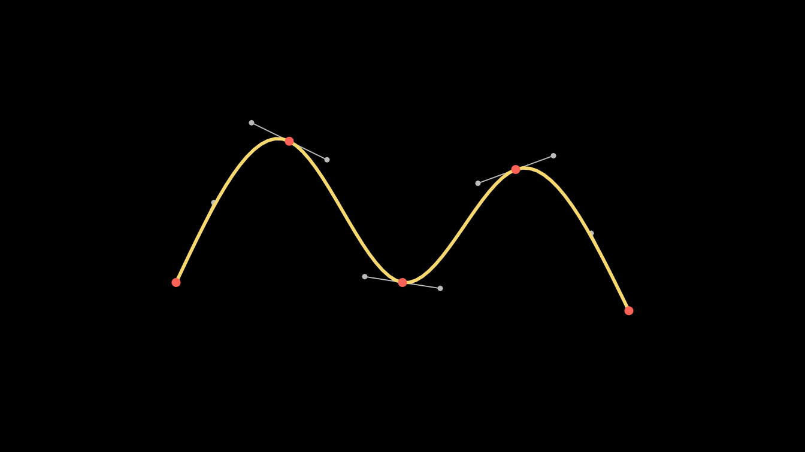

[`is_closed()`](https://adamrsophie.github.io/manimR/reference/is_closed.md)
tells whether a spline ends where it starts, which decides whether the
smoothing also wraps around the start point. It reproduces upstream’s
test exactly, including a quirk: the tolerance uses the signed first
coordinate, so a spline starting at a negative coordinate never counts
as closed.

``` r

is_closed(rbind(c(0, 0, 0), c(1, 2, 0), c(0, 0, 0)))
#> [1] TRUE
is_closed(rbind(c(1, 1, 0), c(1, 2, 0), c(1.5, 1, 0)))
#> [1] FALSE
is_closed(rbind(c(-1, 0, 0), c(1, 2, 0), c(-1, 0, 0))) # the quirk
#> [1] TRUE
```

## Triangulation and the pole of inaccessibility

### Ear clipping

`earclip_triangulation(verts, ring_ends)` cuts a polygon, possibly with
holes, into triangles. `verts` lists the vertices of every ring one
after the other, and `ring_ends` gives the cumulative vertex count at
the end of each ring. The result holds row indices of `verts`, three per
triangle.

``` r

outer <- rbind(c(-3, -2, 0), c(3, -2, 0), c(3, 2, 0), c(-3, 2, 0))
hole <- rbind(c(-1, -1, 0), c(-1, 1, 0), c(1, 1, 0), c(1, -1, 0))
verts <- rbind(outer, hole)
tri <- matrix(earclip_triangulation(verts, ring_ends = c(4, 8)), ncol = 3, byrow = TRUE)
tri
#>      [,1] [,2] [,3]
#> [1,]    4    1    5
#> [2,]    8    5    1
#> [3,]    4    5    6
#> [4,]    8    1    2
#> [5,]    3    4    6
#> [6,]    7    8    2
#> [7,]    3    6    7
#> [8,]    7    2    3
```

``` r

tri_cols <- color_gradient(c(BLUE, TEAL, GREEN, YELLOW), nrow(tri))
triangles <- VGroup(lapply(seq_len(nrow(tri)), function(k) {
  Polygon(verts[tri[k, ], ], color = WHITE, stroke_width = 2, fill_color = tri_cols[k], fill_opacity = 0.8)
}))
plot(triangles)
```

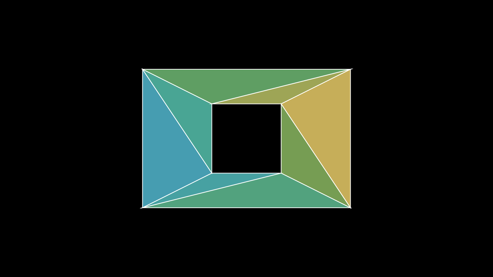

### Polylabel

[`polylabel()`](https://adamrsophie.github.io/manimR/reference/polylabel.md)
finds the point inside a polygon that is farthest from its edges, the
pole of inaccessibility, which is the best spot for a label. It returns
the point `c` and its distance `d` to the nearest edge.
[`LabeledPolygram()`](https://adamrsophie.github.io/manimR/reference/LabelClass.md)
uses it to place its label.

``` r

L_shape <- rbind(c(-3, -2), c(3, -2), c(3, -0.5), c(-1, -0.5), c(-1, 2), c(-3, 2), c(-3, -2))
pole <- polylabel(list(L_shape))
pole
#> $c
#> [1] -1.953125 -0.953125
#> 
#> $d
#> [1] 1.046875
#> 
#> $h
#> [1] 0.015625
```

``` r

shape <- Polygon(cbind(L_shape[-7, ], 0), color = BLUE, fill_opacity = 0.3)
center <- c(pole$c, 0)
plot(VGroup(shape, Circle(radius = pole$d, color = YELLOW)$move_to(center), Dot(center, color = YELLOW)))
```

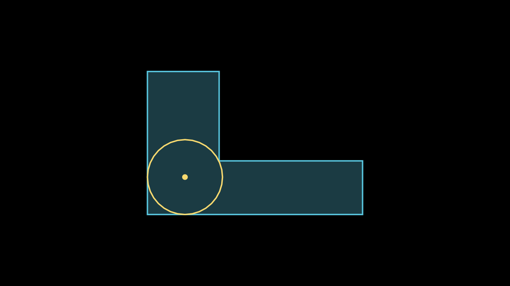

## Rate functions

A rate function maps the progress of an animation, a number `t` from 0
to 1, to how far along the animation should be. The default for most
animations is
[`smooth_rate()`](https://adamrsophie.github.io/manimR/reference/rate_funcs.md)
(upstream’s `smooth`, renamed so it does not mask
[`stats::smooth()`](https://rdrr.io/r/stats/smooth.html)). Pass any rate
function as `rate_func`:

``` r

self$play(sq$animate$shift(RIGHT), rate_func = there_and_back)
self$play(Create(circle, rate_func = ease_out_bounce))
self$play(dot$animate(rate_func = linear)$shift(UP))
```

Rate functions take a single number. To evaluate one on many values, use
[`vapply()`](https://rdrr.io/r/base/lapply.html) (or
[`sapply()`](https://rdrr.io/r/base/lapply.html)):

``` r

t <- c(0, 0.25, 0.5, 0.75, 1)
vapply(t, smooth_rate, numeric(1))
#> [1] 0.00000000 0.07010372 0.50000000 0.92989628 1.00000000
vapply(t, there_and_back, numeric(1))
#> [1] 0.0 0.5 1.0 0.5 0.0
round(vapply(t, ease_out_back, numeric(1)), 3)
#> [1] 0.000 0.817 1.088 1.064 1.000
```

### Every rate function

The grid below plots all of them. The dotted lines mark 0 and 1; curves
that leave that band overshoot (the `back` and `elastic` families) or
pull back first (`running_start`).

``` r

rf <- rate_functions[setdiff(names(rate_functions),
                             c("unit_interval", "zero", "not_quite_there", "squish_rate_func"))]
names(rf)[names(rf) == "smooth"] <- "smooth_rate"
rf[["not_quite_there()"]] <- not_quite_there()
rf[["squish_rate_func(smooth_rate)"]] <- squish_rate_func(smooth_rate)
t <- seq(0, 1, length.out = 201)
op <- par(mfrow = c(8, 6), mar = c(1.2, 1.4, 1.6, 0.4), mgp = c(2, 0.35, 0), tcl = -0.2,
          cex.main = 0.68, cex.axis = 0.6, font.main = 1)
for (nm in names(rf)) {
  y <- vapply(t, rf[[nm]], numeric(1))
  plot(t, y, type = "l", lwd = 2, col = "#236B8E", main = nm, xlab = "", ylab = "",
       ylim = range(0, 1, y))
  abline(h = c(0, 1), col = "grey70", lty = 3)
}
par(op)
```

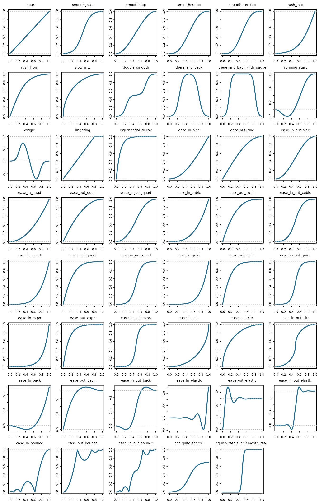

For reference, the families are:

- Basic: `linear`, `smooth_rate`, `smoothstep`, `smootherstep`,
  `smoothererstep`, `double_smooth`, `rush_into`, `rush_from`,
  `slow_into`, `lingering`, `exponential_decay`.
- Back and forth: `there_and_back`, `there_and_back_with_pause`,
  `wiggle`, `running_start`.
- Factories that build a rate function from another one:
  `not_quite_there(func, proportion)` stops at `proportion` of the way
  and `squish_rate_func(func, a, b)` runs `func` only between `a` and
  `b`.
- Easing curves, each in three versions: `ease_in_` starts slowly,
  `ease_out_` ends slowly and `ease_in_out_` does both.

| curve   | ease in           | ease out           | ease in and out       |
|:--------|:------------------|:-------------------|:----------------------|
| sine    | `ease_in_sine`    | `ease_out_sine`    | `ease_in_out_sine`    |
| quad    | `ease_in_quad`    | `ease_out_quad`    | `ease_in_out_quad`    |
| cubic   | `ease_in_cubic`   | `ease_out_cubic`   | `ease_in_out_cubic`   |
| quart   | `ease_in_quart`   | `ease_out_quart`   | `ease_in_out_quart`   |
| quint   | `ease_in_quint`   | `ease_out_quint`   | `ease_in_out_quint`   |
| expo    | `ease_in_expo`    | `ease_out_expo`    | `ease_in_out_expo`    |
| circ    | `ease_in_circ`    | `ease_out_circ`    | `ease_in_out_circ`    |
| back    | `ease_in_back`    | `ease_out_back`    | `ease_in_out_back`    |
| elastic | `ease_in_elastic` | `ease_out_elastic` | `ease_in_out_elastic` |
| bounce  | `ease_in_bounce`  | `ease_out_bounce`  | `ease_in_out_bounce`  |

### Shape parameters

Some rate functions take an extra argument after `t`: `inflection` for
[`smooth_rate()`](https://adamrsophie.github.io/manimR/reference/rate_funcs.md),
[`rush_into()`](https://adamrsophie.github.io/manimR/reference/rate_funcs.md),
[`rush_from()`](https://adamrsophie.github.io/manimR/reference/rate_funcs.md)
and
[`there_and_back()`](https://adamrsophie.github.io/manimR/reference/rate_funcs.md);
`pause_ratio` for
[`there_and_back_with_pause()`](https://adamrsophie.github.io/manimR/reference/rate_funcs.md);
`pull_factor` for
[`running_start()`](https://adamrsophie.github.io/manimR/reference/rate_funcs.md);
`wiggles` for
[`wiggle()`](https://adamrsophie.github.io/manimR/reference/rate_funcs.md);
and `half_life` for
[`exponential_decay()`](https://adamrsophie.github.io/manimR/reference/rate_funcs.md).
Fix them with a small wrapper:

``` r

smooth_rate(0.3)
#> [1] 0.1140365
smooth_rate(0.3, inflection = 4)
#> [1] 0.2505568
gentle <- function(t) smooth_rate(t, inflection = 4)
wiggle(0.3, wiggles = 4)
#> [1] -0.4315481
```

### Writing your own

Any R function of one number works as a rate function. It should usually
return 0 at `t = 0` and 1 at `t = 1`, so the animation starts and ends
where expected.
[`unit_interval()`](https://adamrsophie.github.io/manimR/reference/unit_interval.md)
clamps a function to 0 before the start and 1 after the end, and
[`zero()`](https://adamrsophie.github.io/manimR/reference/unit_interval.md)
makes it 0 outside `[0, 1]`; these are upstream’s decorators.

``` r

three_steps <- function(t) (floor(3 * t) + smooth_rate((3 * t) %% 1)) / 3
power_rate <- function(p) function(t) t^p # a factory, like not_quite_there()
cubed <- power_rate(3)
clamped <- unit_interval(function(t) t^2)
c(three_steps(0.5), cubed(0.5), clamped(1.5), zero(function(t) t^2)(1.5))
#> [1] 0.500 0.125 1.000 0.000
```

Plotted a little beyond `[0, 1]`, only the clamped version stays at 0
and 1 outside the unit interval. Animations only ever evaluate `t`
inside it, so clamping matters when you call a rate function yourself.

``` r

op <- par(mfrow = c(1, 3), mar = c(2, 2, 2, 0.5), mgp = c(2, 0.4, 0), tcl = -0.2, cex.main = 0.9)
fs <- list(three_steps = three_steps, `power_rate(3)` = cubed, `unit_interval(t^2)` = clamped)
for (nm in names(fs)) {
  x <- seq(-0.2, 1.2, length.out = 281)
  plot(x, vapply(x, fs[[nm]], numeric(1)), type = "l", lwd = 2, col = "#236B8E", main = nm, xlab = "", ylab = "")
  abline(v = c(0, 1), col = "grey70", lty = 3)
}
```

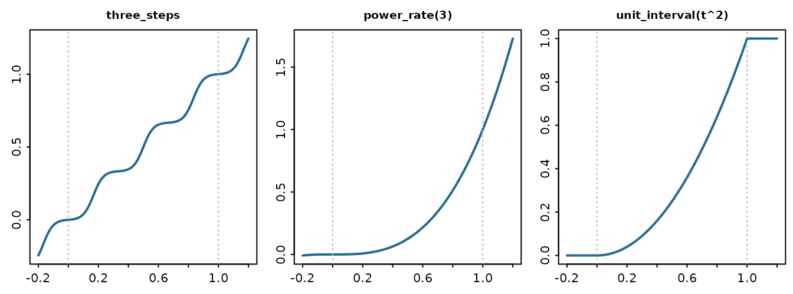

``` r

par(op)
```

The race below moves five dots the same distance in the same time with
different rate functions. `there_and_back` returns to its start, so its
dot ends where it began.

``` r

RateRace <- R6::R6Class("RateRace", inherit = Scene,
  public = list(construct = function() {
    funcs <- list(linear = linear, smooth_rate = smooth_rate, there_and_back = there_and_back,
                  ease_out_bounce = ease_out_bounce, three_steps = three_steps)
    cols <- c(BLUE, GREEN, YELLOW, ORANGE, RED)
    dots <- list()
    for (i in seq_along(funcs)) {
      y <- 2.4 - (i - 1) * 1.2
      label <- Text(names(funcs)[i], font_size = 26, color = cols[i])$move_to(c(-4.6, y, 0))
      track <- Line(c(-2.5, y, 0), c(5.5, y, 0), color = GREY_D, stroke_width = 2)
      dots[[i]] <- Dot(c(-2.5, y, 0), radius = 0.15, color = cols[i])
      self$add(label, track, dots[[i]])
    }
    self$play(lapply(seq_along(funcs), function(i) {
      dots[[i]]$animate(rate_func = funcs[[i]])$shift(8 * RIGHT)
    }), run_time = 2)
    self$wait(0.3)
  })
)
```

## Path functions

During a `Transform`, every point travels from where it is to where it
is going. A path function decides the route: it takes the start points,
the end points and the progress `alpha`, and returns the points at that
moment. Each `*_path()` constructor returns such a function.

``` r

straight_path()
#> function (start, end, alpha) 
#> (1 - alpha) * start + alpha * end
#> <bytecode: 0x581db24ce150>
#> <environment: namespace:manimR>
start <- rbind(LEFT)
end <- rbind(RIGHT)
zapsmall(straight_path()(start, end, 0.5))
#>      [,1] [,2] [,3]
#> LEFT    0    0    0
zapsmall(path_along_arc(PI)(start, end, 0.5))
#>      [,1] [,2] [,3]
#> LEFT    0   -1    0
zapsmall(clockwise_path()(start, end, 0.5))
#>      [,1] [,2] [,3]
#> LEFT    0    1    0
zapsmall(counterclockwise_path()(start, end, 0.5))
#>      [,1] [,2] [,3]
#> LEFT    0   -1    0
zapsmall(spiral_path(PI)(start, end, 0.5))
#>      [,1] [,2] [,3]
#> LEFT   -1   -1    0
zapsmall(path_along_circles(PI, circles_centers = ORIGIN)(start, end, 0.5))
#>      [,1] [,2] [,3]
#> LEFT    0   -1    0
```

- [`straight_path()`](https://adamrsophie.github.io/manimR/reference/paths.md)
  moves in a straight line (the default).
- `path_along_arc(arc_angle, axis)` swings along a circular arc of
  `arc_angle` radians; positive angles turn counterclockwise.
  [`clockwise_path()`](https://adamrsophie.github.io/manimR/reference/paths.md)
  and
  [`counterclockwise_path()`](https://adamrsophie.github.io/manimR/reference/paths.md)
  are half turns.
- `path_along_circles(arc_angle, circles_centers, axis)` turns every
  point about a center you choose while it also slides toward its
  target. When the target is not exactly the start turned about that
  center, the shape deforms on the way: in the scene below, the dot
  shrinks to a point halfway, because each of its points meets the
  opposite one.
- `spiral_path(angle, axis)` moves toward the target while rotating, so
  points spiral in.

Pass a path function to an animation as `path_func`.
[`Transform()`](https://adamrsophie.github.io/manimR/reference/transform.md)
also takes `path_arc`, a shortcut for
[`path_along_arc()`](https://adamrsophie.github.io/manimR/reference/paths.md)
(and `path_arc_axis`, `path_arc_centers`);
[`ClockwiseTransform()`](https://adamrsophie.github.io/manimR/reference/transform.md)
and
[`CounterclockwiseTransform()`](https://adamrsophie.github.io/manimR/reference/transform.md)
use half turns.

Because a path function is an ordinary R function, you can sample it to
draw the route a point will take. The scene below does that for six
choices, drawing each route in gray, then runs the six transforms at
once.

``` r

route <- function(path, a, b) {
  pts <- t(vapply(seq(0, 1, length.out = 60), function(al) as.numeric(path(rbind(a), rbind(b), al)), numeric(3)))
  VMobject(color = GREY_C, stroke_width = 3)$set_points_as_corners(pts)
}
PathCompare <- R6::R6Class("PathCompare", inherit = Scene,
  public = list(construct = function() {
    panels <- list(
      list(label = "straight_path()", center = c(-4.6, 1.2, 0), args = list(path_func = straight_path())),
      list(label = "clockwise_path()", center = c(0, 1.2, 0), args = list(path_func = clockwise_path())),
      list(label = "counterclockwise_path()", center = c(4.6, 1.2, 0),
           args = list(path_func = counterclockwise_path())),
      list(label = "path_arc = PI / 2", center = c(-4.6, -2.3, 0), args = list(path_arc = PI / 2)),
      list(label = "spiral_path(PI)", center = c(0, -2.3, 0), args = list(path_func = spiral_path(PI))),
      list(label = "path_along_circles()", center = c(4.6, -2.3, 0),
           args = list(path_func = path_along_circles(PI, c(4.6, -1.8, 0))))
    )
    cols <- c(BLUE, GREEN, YELLOW, ORANGE, RED, PURPLE)
    anims <- list()
    for (i in seq_along(panels)) {
      pnl <- panels[[i]]
      a <- pnl$center + LEFT
      b <- pnl$center + RIGHT
      path <- pnl$args$path_func %||% path_along_arc(pnl$args$path_arc)
      dot <- Dot(a, color = cols[i], radius = 0.12)
      title <- Text(pnl$label, font_size = 22)$move_to(pnl$center + c(0, if (i <= 3) 1.6 else 1, 0))
      self$add(title, route(path, a, b), Circle(radius = 0.12, color = GREY_B)$move_to(b), dot)
      anims[[i]] <- do.call(Transform, c(list(dot, dot$copy()$move_to(b)), pnl$args))
    }
    self$play(anims, run_time = 2)
    self$wait(0.3)
  })
)
```

## List and dictionary helpers

These are ports of `manim.utils.iterables` and `manim.utils.config_ops`.
They work on R vectors and lists; atomic input gives atomic output.

``` r

adjacent_pairs(1:4)            # cyclic: the last pair wraps around
#> [[1]]
#> [1] 1 2
#> 
#> [[2]]
#> [1] 2 3
#> 
#> [[3]]
#> [1] 3 4
#> 
#> [[4]]
#> [1] 4 1
adjacent_n_tuples(1:5, 3)[1:2]
#> [[1]]
#> [1] 1 2 3
#> 
#> [[2]]
#> [1] 2 3 4
concatenate_lists(1:2, 3:4, 5)
#> [1] 1 2 3 4 5
list_difference_update(1:5, c(2, 4))
#> [1] 1 3 5
list_update(c(1, 2, 3, 4), c(2, 5)) # 2 moves to the end
#> [1] 1 3 4 2 5
remove_list_redundancies(c(1, 2, 1, 3, 2, 4)) # keeps the last copy
#> [1] 1 3 2 4
str(remove_nones(list(1, NULL, 0, "", "a", FALSE)))
#> List of 2
#>  $ : num 1
#>  $ : chr "a"
stretch_array_to_length(1:3, 7)
#> [1] 1 1 1 2 2 3 3
str(make_even(1:3, 4:8))
#> List of 2
#>  $ : int [1:5] 1 1 2 2 3
#>  $ : int [1:5] 4 5 6 7 8
str(make_even_by_cycling(1:2, 1:5))
#> List of 2
#>  $ : int [1:5] 1 2 1 2 1
#>  $ : int [1:5] 1 2 3 4 5
```

[`listify()`](https://adamrsophie.github.io/manimR/reference/list_helpers.md)
and
[`tuplify()`](https://adamrsophie.github.io/manimR/reference/list_helpers.md)
turn a value into a list (R has no tuples, so both return lists); given
a mobject they return its submobjects.
[`all_elements_are_instances()`](https://adamrsophie.github.io/manimR/reference/list_helpers.md)
checks classes, accepting a class name or an R6 generator.

``` r

str(listify("a"))
#> List of 1
#>  $ : chr "a"
str(tuplify(1:2))
#> List of 2
#>  $ : int 1
#>  $ : int 2
length(listify(VGroup(Circle(), Square())))
#> [1] 2
all_elements_are_instances(list(Circle(), Square()), "VMobject")
#> [1] TRUE
all_elements_are_instances(list(Circle(), Square()), CircleClass)
#> [1] FALSE
```

The dictionary helpers merge nested named lists.
[`update_dict_recursively()`](https://adamrsophie.github.io/manimR/reference/dict_helpers.md)
updates an environment in place (as upstream updates a dict) but returns
a new list when given a list, so assign the result.
[`DictAsObject()`](https://adamrsophie.github.io/manimR/reference/dict_helpers.md)
turns a named list into an environment you can read with `$`.

``` r

defaults <- list(color = "white", stroke = list(width = 4, opacity = 1))
str(merge_dicts_recursively(defaults, list(stroke = list(width = 8))))
#> List of 2
#>  $ color : chr "white"
#>  $ stroke:List of 2
#>   ..$ width  : num 8
#>   ..$ opacity: num 1
settings <- update_dict_recursively(defaults, list(color = "red"))
settings$color
#> [1] "red"
obj <- DictAsObject(list(x = 1, y = "two"))
obj$y
#> [1] "two"
```

## File and path helpers

Ports of `manim.utils.file_ops`, and the image and sound lookups. These
examples only touch the session’s temporary directory.

``` r

add_extension_if_not_present("scene", ".png")
#> [1] "scene.png"
add_extension_if_not_present("scene.png", ".png")
#> [1] "scene.png"
work <- guarantee_existence(file.path(tempdir(), "manimR-utilities"))
dir.exists(work)
#> [1] TRUE
fresh <- guarantee_empty_existence(file.path(work, "frames")) # deletes, then recreates
length(list.files(fresh))
#> [1] 0
```

[`seek_full_path_from_defaults()`](https://adamrsophie.github.io/manimR/reference/path_helpers.md)
finds a file by name in a directory, trying each extension in turn.
[`get_full_raster_image_path()`](https://adamrsophie.github.io/manimR/reference/path_helpers.md)
and
[`get_full_sound_file_path()`](https://adamrsophie.github.io/manimR/reference/path_helpers.md)
do the same for images (`.jpg`, `.jpeg`, `.png`, `.gif`, `.ico`) and
sounds (`.wav`, `.mp3`) in the `assets_dir` setting;
`color_using_background_image()`, for example, looks up an image given
by name this way.

``` r

png::writePNG(array(0.5, c(4, 4, 3)), file.path(work, "logo.png"))
basename(seek_full_path_from_defaults("logo", work, c(".jpg", ".png")))
#> [1] "logo.png"
with_manim_config(list(assets_dir = work), basename(get_full_raster_image_path("logo")))
#> [1] "logo.png"
writeLines("", file.path(work, "click.wav")) # a stand in for a real sound file
basename(get_full_sound_file_path("click", assets_dir = work))
#> [1] "click.wav"
```

[`modify_atime()`](https://adamrsophie.github.io/manimR/reference/path_helpers.md)
sets a file’s access time to now (the renderer does this when it reuses
a cached partial movie),
[`ensure_executable()`](https://adamrsophie.github.io/manimR/reference/path_helpers.md)
says whether a program can be run, and
[`open_file()`](https://adamrsophie.github.io/manimR/reference/path_helpers.md)
opens a file with the system viewer:

``` r

modify_atime(file.path(work, "logo.png"))
unname(ensure_executable("ffmpeg"))
#> [1] TRUE
ensure_executable("surely-not-a-program")
#> [1] FALSE
```

``` r

open_file("media/videos/scene/480p15/MyScene.mp4")
open_file("media/videos", in_browser = TRUE) # show the folder instead
```

## Command helpers

[`capture()`](https://adamrsophie.github.io/manimR/reference/command_helpers.md)
runs a program (the first element of a character vector, then its
arguments) and returns its output, error output and exit code.
[`get_dir_layout()`](https://adamrsophie.github.io/manimR/reference/command_helpers.md)
lists every file below a directory.

``` r

res <- capture(c(file.path(R.home("bin"), "Rscript"), "-e", "cat(6 * 7)"))
str(res)
#> List of 3
#>  $ out       : chr "42"
#>  $ err       : chr ""
#>  $ returncode: int 0
get_dir_layout(work)
#> [1] "click.wav" "logo.png"
```

[`get_video_metadata()`](https://adamrsophie.github.io/manimR/reference/command_helpers.md)
reads the size, frame count, duration, frame rate and codec of a video
with ffprobe. Here
[`capture()`](https://adamrsophie.github.io/manimR/reference/command_helpers.md)
asks ffmpeg for a one second test video first:

``` r

video <- file.path(work, "test.mp4")
out <- capture(c("ffmpeg", "-y", "-v", "error", "-f", "lavfi",
                 "-i", "testsrc=duration=1:size=320x240:rate=15", "-pix_fmt", "yuv420p", video))
out$returncode
#> [1] 0
str(get_video_metadata(video))
#> List of 7
#>  $ width         : int 320
#>  $ height        : int 240
#>  $ nb_frames     : chr "15"
#>  $ duration      : chr "1.000000"
#>  $ avg_frame_rate: chr "15/1"
#>  $ codec_name    : chr "h264"
#>  $ pix_fmt       : chr "yuv420p"
```

## Checking mobject methods

[`assert_is_mobject_method()`](https://adamrsophie.github.io/manimR/reference/assert_is_mobject_method.md)
checks that a function is a method of a mobject, such as `sq$shift`. Use
it in your own functions that take a method as an argument, to fail
early with a clear message.

``` r

sq <- Square()
invisible(assert_is_mobject_method(sq$shift)) # fine
tryCatch(assert_is_mobject_method(mean), error = conditionMessage)
#> [1] "Expected a method of a mobject, such as sq$shift"
```

## Plugins

Upstream finds plugins through Python entry points. A manimR plugin is
an ordinary installed R package whose `DESCRIPTION` contains the line

    Config/manimR/plugin: true

[`list_plugins()`](https://adamrsophie.github.io/manimR/reference/get_plugins.md)
prints the plugins found and
[`get_plugins()`](https://adamrsophie.github.io/manimR/reference/get_plugins.md)
loads them and returns their namespaces, named by package, so a scene
can call `get_plugins()$myplugin$MyMobject()`.

``` r

list_plugins()
#> Plugins:
names(get_plugins())
#> character(0)
```

With no plugin installed both are empty. A plugin package simply exports
mobjects, animations or scenes built on manimR’s classes, for example an
`R6::R6Class(inherit = manimR::VMobjectClass)` generator and a
constructor function.
